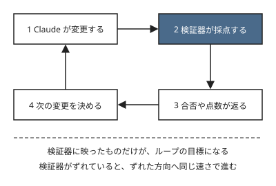

!!! abstract "要点"
    - **何が分かるか**：Claude は渡された検証器（テスト・採点・ベンチマーク）が定める問題を解き、置かれたループを何でも速める。
    - **いつ引くか**：スコアやテストを目標に、Claude に試行を繰り返させるとき。テストに書いた条件だけが満たされ、書かなかった意図が抜けていたとき。長く改善を回しても、方向を誤らせたくないとき。
    - **前提**：<!-- link:begin verification-ladder -->[検証の階段](../verify/verification-ladder.md)<!-- link:end -->

<!-- textlint-disable -->
別名：評価器が問題を定義する・評価を握る・最初の成果物は検証器
<!-- textlint-enable -->

検証器が問題を定義するとは、Claude にとっての「問題」が、渡された検証器の返す合否や点数で決まることを言う。検証器が正しければ、ループは正しい方向へ速く進む。検証器が誤っていれば、誤りも同じ速さで増える。だから、最初に用意するものは、解法ではなく検証器である。

## ループは何でも速める {#loops-amplify}

Claude に「テストが全部通るまで直して」「スコアを上げて」と頼むと、Claude は合否や点数を手がかりに、変更を重ねる。ここで検証器とは、出力を機械的に判定する仕組み全般を指す。テスト、採点コード、ベンチマーク、ローカルのテスタ、交差検証（CV）がこれに当たる。ループが速く回るほど、検証器が定めた問題への到達も速くなる。

速くなるのは、人が意図した問題ではなく、検証器に書かれた問題である。たとえば次のようにずれる。

- 開発：テストが戻り値の型しか調べていなければ、Claude は型だけ合う実装で全部を通す。空入力の扱いのような、書かなかった意図は、検証器に映らないので目標にならない。
- コンテスト：手元の採点コードの計算式が公式の採点とずれていれば、Claude は手元のスコアを上げ続ける。上がるほど公式の結果から離れることがある。
- データ分析：検証用の分割が本番のデータの分布と違えば、交差検証の点は上がっても、本番では通用しない。形式ごとの検証器の作り方は <!-- link:begin evaluators-by-format#evaluator-first -->[形式別の評価器（テスタ・ベンチマーカー・CV・flag・対戦場） › どの形式でも、最初の成果物は評価器](../contest/evaluators-by-format.md#evaluator-first)<!-- link:end --> にある。

!!! example "Before/After：同じ修正の依頼"
    - **Before**：「`parse_date` のテストが全部通るまで直して」。
    - **After**：「`parse_date` を直して。先に、空文字列・存在しない日付・タイムゾーン付きの入力の 3 つについて、期待を書いたテストを足す。足したテストが今は落ちることを確かめてから直す。既存のテストと足したテストは書き換えない」。
    - **足したもの**：完了の定義を、人が先に書いた。Before は、テストの範囲の外を何も守らない。After は、握りたい意図をテストにして、検証器へ入れる。

加速の効き方は、検証器が良い場合にも出る。Claude 以外のモデル（Gemini 2.5 Pro）を使った ALE-Bench で要素を 1 つずつ足して効果を比べた実験（アブレーション。arXiv、2025 年）では、素のエージェントのレーティングは 1167 だった。知識を注入すると 1264、局所評価で候補を選ぶ探索を加えると 1879（上位 6.8%）になった。知識を足す（見せる）より、評価ループを回す（確かめる）ほうが効いた（根拠：強・類推）。Claude の傾向としては読まない。検証器の質が上がると、加速の幅も大きくなるという一例である。

## 検証器に映ったものだけが目標になる {#why}

Claude は、検証器が返した結果を見て次の変更を選ぶ。検証器に映らないものは、目標として渡されていないのと同じである。人の頭の中にある「欲しかったもの」は、検証器に書かない限り、ループには届かない。

誤りが増える経路は 2 つある。

- 検証器そのものが誤っている：Anthropic が並列の Claude 群で C コンパイラを作った報告は、エージェントは与えられた問題を解くので、検証器はほぼ完璧でなければならないと結論している（根拠：中、報告の時点の版の事例）。エージェント評価の解説にも、同じ向きの例がある。Opus 4.5 の CORE-Bench は最初 42% だったが、厳しすぎる採点、あいまいな課題の仕様、厳密には再現できない課題を直し、制約の少ない足場（scaffold）に替えると 95% になった。直した項目ごとの寄与は記事に書かれていない（根拠：中）。採点側の不具合が、成績の数字を大きく動かすことがある。
- 検証器は誤っていないが狭い：書いた条件は正しく測るものの、測っていない条件は多い。Claude が不正をしなくても、測っていない部分は良くなるか悪くなるかが決まらない。正直に最適化しても外れる仕組みは <!-- link:begin selection-pressure#why -->[選択圧：良かった版を選び続ける罠 › なぜ正直でも外れるか](selection-pressure.md#why)<!-- link:end --> で扱う。

採点の抜け道を突く reward hacking は、この問題の一部である。抜け道がなくても、検証器が狭ければ同じずれは起きる。抜け道を突かれる側の話は <!-- link:begin reward-hacking -->[採点器を騙す（reward hacking）](../basics/reward-hacking.md)<!-- link:end --> にある。

## 最初の成果物は検証器 {#verifier-first}

ループを回す前に、最初に用意する成果物は検証器である。ここでは、このページが扱う原理と原因を、検証器に結び付ける。

- 原理「確かめる」：完了を、Claude の自己申告ではなく、検証器の結果で決める。検証器がなければ、Claude の「できた」は、確かめていない申告にとどまる。これは Claude 側の原因「確かめていない」に当たる。完了の確かめ方の段は <!-- link:begin verification-ladder#four-steps -->[検証の階段 › 四つの段](../verify/verification-ladder.md#four-steps)<!-- link:end --> にある。
- 原理「握る」：何を良しとするか、つまり検証器の定義は、人が持つ。Claude に作らせてもよいが、採否は人が決める。握るものの分け方は <!-- link:begin what-not-to-delegate#what-humans-hold -->[任せないもの（評価・採否・撤退・中核の理解） › どの段階でも人が握るもの](../delegate/what-not-to-delegate.md#what-humans-hold)<!-- link:end --> にある。
- 人の側の落とし穴「預けすぎる」：検証器が通ると、人は中身を見なくなりやすい（推論）。AI の助言への過度な依存は、検証が安くなるほど減るという実験結果がある（Vasconcelos ら、2023 年。人が AI の助言をどれだけ受け入れるかの実験で、Claude の結果ではない。根拠：中・類推）。検証のコストが依存の度合いを決めるので、安く確かめられる検証器を先に作る意味がある。

検証器を使い始める前に、次の 3 点を点検する。詳しい点検は検証器の三条件のページにある。

1. 検証器が正しいか：<!-- link:begin verifier-three-conditions#correct -->[検証器の三条件（正しい・書き換えられない・本番を代表する） › 正しい](verifier-three-conditions.md#correct)<!-- link:end -->
2. 作業する側が書き換えられないか：<!-- link:begin verifier-three-conditions#tamper-proof -->[検証器の三条件（正しい・書き換えられない・本番を代表する） › 書き換えられない](verifier-three-conditions.md#tamper-proof)<!-- link:end -->
3. 手元の勝ちが本番の勝ちを意味するか：<!-- link:begin verifier-three-conditions#representative -->[検証器の三条件（正しい・書き換えられない・本番を代表する） › 本番を代表する](verifier-three-conditions.md#representative)<!-- link:end -->

検証器を Claude に作らせるときは、作った環境を既知の答えで確かめてから判定に使う。作り方は <!-- link:begin build-test-harness#what-to-build -->[検証環境・テスト基盤を作らせる › 何を作らせるか](../recipes/build-test-harness.md#what-to-build)<!-- link:end -->、確かめ方は <!-- link:begin build-test-harness#check-the-harness -->[検証環境・テスト基盤を作らせる › 作った環境を確かめる](../recipes/build-test-harness.md#check-the-harness)<!-- link:end --> にある。テストを書き換えて通す行為を防ぐ層は <!-- link:begin protect-tests#layers -->[テストを守る（改ざんを防ぐ） › 守りの層](../verify/protect-tests.md#layers)<!-- link:end --> にある。

任せる幅を広げるほど、確かめる仕組みを先に強める。長く回す、並列で回す、席を外して回す、のどれも同じである。比例則は <!-- link:begin four-principles#proportional-rule -->[四つの原理と比例則（見せる・確かめる・縛る・握る） › 比例則](../start/four-principles.md#proportional-rule)<!-- link:end -->、任せる幅に合わせた段の選び方は <!-- link:begin verification-ladder#choose-step -->[検証の階段 › 任せる幅に合わせて段を選ぶ](../verify/verification-ladder.md#choose-step)<!-- link:end --> にある。

!!! example "判断例：週末に Claude へスコア改善を回させる"
    - **状況**：手元に採点コードがあり、Claude に週末の間スコアを上げ続けさせたい。採点コードが公式の採点と一致するかは、まだ確かめていない。
    - **迷う候補**：すぐ回して、結果を見てから確かめる。回す前に、採点コードを確かめる。
    - **選んだもの**：回す前に、手計算できる小さなケースと、公式が出した採点の例で、採点コードを確かめる。
    - **理由**：すぐ回す案も、途中で気付けば損は小さい。ただ、席を外す間は気付く人がいないので、ずれた採点コードの上で長く進むと、戻す手間が大きい。確かめる費用は、回す時間より小さい。

## よくある誤解 {#misconceptions}

- 「正直に最適化するなら、検証器の穴は問題にならない」：問題になる。Claude が不正をしなくても、検証器が測っていないことは最適化されない。たくさん試して良かった版を選ぶだけでも、評価の穴に合わせ込む。防ぎ方は <!-- link:begin selection-pressure#defenses -->[選択圧：良かった版を選び続ける罠 › 防ぎ方](selection-pressure.md#defenses)<!-- link:end --> にある。
- 「ループを長く回すほど良くなる」：検証器が決まっていない戦略そのものを回し続ける開いたループは、手元の評価への過適合を進めうる。<!-- link:begin open-ended-loop-trap#longer-is-not-better -->[AI に改善を回させ続ける罠（開いたループ） › 長く回せば良くなるとは限らない](../delegate/open-ended-loop-trap.md#longer-is-not-better)<!-- link:end --> で扱う。
- 「評価のループがあれば、AI はどの形式の大会でも人の最上位に並ぶ」：言い過ぎである。人の最上位に並んだ記録はあるが、Anthropic 自身の 2025 年の報告では、Claude は全体の上位 25% に入ることが多い一方、最も難しい課題では最上位の人のチームに及ばなかった（根拠：中）。大会で使える範囲は、大会の規則で決まる。
- 「検証器の合格は、人が見なくてよい印である」：検証器は、測ったことだけを保証する。測っていないことは、人が握る。手元の評価は良いのに本番で通用しないときの切り分けは <!-- link:begin misses-broken-evaluation#diagnosis -->[手元の評価は良いのに本番で通用しない › 原因を安く確かめる順](../symptoms/misses-broken-evaluation.md#diagnosis)<!-- link:end --> にある。

## 評価と実験の地図 {#map}

このページは、評価と実験の分野の総論である。困りごとから、行き先を引く。

- 検証器そのものを点検したい：<!-- link:begin verifier-three-conditions -->[検証器の三条件（正しい・書き換えられない・本番を代表する）](verifier-three-conditions.md)<!-- link:end -->
- 検証器の環境を Claude に作らせたい：<!-- link:begin build-test-harness -->[検証環境・テスト基盤を作らせる](../recipes/build-test-harness.md)<!-- link:end -->
- 形式ごとに、検証器が何に当たるかを知りたい：<!-- link:begin evaluators-by-format -->[形式別の評価器（テスタ・ベンチマーカー・CV・flag・対戦場）](../contest/evaluators-by-format.md)<!-- link:end -->
- 良かった版を選び続ける罠を避けたい：<!-- link:begin selection-pressure -->[選択圧：良かった版を選び続ける罠](selection-pressure.md)<!-- link:end -->
- CLAUDE.md・プロンプト・スキルの変更が効いたかを測りたい：<!-- link:begin measure-changes -->[変更が効いたかを測る（小さな eval）](measure-changes.md)<!-- link:end -->
- テストの書き換えや採点の抜け道を防ぎたい：<!-- link:begin protect-tests -->[テストを守る（改ざんを防ぐ）](../verify/protect-tests.md)<!-- link:end -->、<!-- link:begin reward-hacking -->[採点器を騙す（reward hacking）](../basics/reward-hacking.md)<!-- link:end -->
- 手元の評価は良いのに本番で通用しない：<!-- link:begin misses-broken-evaluation -->[手元の評価は良いのに本番で通用しない](../symptoms/misses-broken-evaluation.md)<!-- link:end -->
- 完了の条件を決めて、続けさせたい：<!-- link:begin goal-until-done -->[/goal（完了するまで続けさせる）](../delegate/goal-until-done.md)<!-- link:end -->
- 戦略そのものを回し続けさせたくなった：<!-- link:begin open-ended-loop-trap -->[AI に改善を回させ続ける罠（開いたループ）](../delegate/open-ended-loop-trap.md)<!-- link:end -->
- 任せる範囲と、人が握る範囲を分けたい：<!-- link:begin what-not-to-delegate -->[任せないもの（評価・採否・撤退・中核の理解）](../delegate/what-not-to-delegate.md)<!-- link:end -->
- 4 つの原理と比例則の全体を見たい：<!-- link:begin four-principles -->[四つの原理と比例則（見せる・確かめる・縛る・握る）](../start/four-principles.md)<!-- link:end -->

<!-- gen:begin references -->
<!-- textlint-disable -->

## 参考 {#references}

- [Building a C compiler with a team of parallel Claudes](https://www.anthropic.com/research/building-c-compiler)：Anthropic・英語・確認日 2026-11-04
- [Demystifying evals for AI agents](https://www.anthropic.com/research/demystifying-evals-for-ai-agents)：Anthropic・英語・確認日 2026-11-04
- [ALE-Bench: A Benchmark for Long-Horizon Objective-Driven Algorithm Engineering](https://arxiv.org/abs/2506.09050)：arXiv（Imajuku, Yuki ほか）・英語・確認日 2026-11-04
- [Claude is competitive with humans in (some) cyber competitions](https://www.anthropic.com/research/cyber-competitions)：Anthropic・英語・確認日 2026-11-04
- [Explanations Can Reduce Overreliance on AI Systems During Decision-Making](https://cicl.stanford.edu/papers/vasconcelos2023explanations.pdf)：Stanford CICL・英語・確認日 2026-11-04

<!-- textlint-enable -->
<!-- gen:end references -->

<!-- gen:begin page-links -->
<!-- textlint-disable -->

**前提**

- [検証の階段](../verify/verification-ladder.md)

**次に読む**

- [検証器の三条件（正しい・書き換えられない・本番を代表する）](verifier-three-conditions.md)
- [評価指標そのものを確かめる](check-the-metric.md)
- [選択圧：良かった版を選び続ける罠](selection-pressure.md)
- [手元の評価は良いのに本番で通用しない](../symptoms/misses-broken-evaluation.md)
- そのタスクは AI に向いているか（五つの軸）（準備中）

**関連**

- [変更が効いたかを測る（小さな eval）](measure-changes.md)
- [採点器を騙す（reward hacking）](../basics/reward-hacking.md)
- [四つの原理と比例則（見せる・確かめる・縛る・握る）](../start/four-principles.md)
- [テストを守る（改ざんを防ぐ）](../verify/protect-tests.md)
- [任せないもの（評価・採否・撤退・中核の理解）](../delegate/what-not-to-delegate.md)
- [検証環境・テスト基盤を作らせる](../recipes/build-test-harness.md)
- [形式別の評価器（テスタ・ベンチマーカー・CV・flag・対戦場）](../contest/evaluators-by-format.md)
- [AI に改善を回させ続ける罠（開いたループ）](../delegate/open-ended-loop-trap.md)
- [/goal（完了するまで続けさせる）](../delegate/goal-until-done.md)

<!-- textlint-enable -->
<!-- gen:end page-links -->
