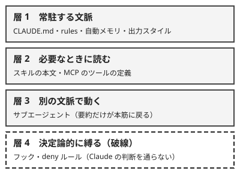

!!! abstract "要点"
    - **何ができるか**：常に効かせる規則は CLAUDE.md、場面ごとの手順はスキル、別の文脈に隔てる作業はサブエージェント、例外を許さない規則はフックに置き分けられる。外部サービスの接続は MCP、全体を束ねて配るのはプラグインである。
    - **いつ引くか**：似た仕組みが多すぎて、どれを使えばよいか分からないとき。指示や手順の置き場所ごとの違いを、一覧で比べたいとき。
    - **前提**：<!-- link:begin request-vs-lock -->[お願いと鍵（決定論的か、非決定論的か）](../basics/request-vs-lock.md)<!-- link:end -->、<!-- link:begin attention-budget -->[コンテキストウィンドウと注意の予算](../basics/attention-budget.md)<!-- link:end -->、<!-- link:begin what-survives-compaction -->[圧縮（compaction）で何が残り、何が消えるか](../basics/what-survives-compaction.md)<!-- link:end -->

<!-- textlint-disable -->
別名：Extend Claude Code・拡張の比較表・CLAUDE.md・skills・hooks の使い分け
<!-- textlint-enable -->

拡張機能の全体図と使い分け早見表は、Claude Code に指示・手順・接続を足す仕組みを、同じ属性で並べて比べるための表である。仕組みごとに、いつ読み込まれ、どれだけ文脈を使い、圧縮の後に残り、どこまで守らせられるかが違う。この違いを見ずに置くと、文脈が散らかる。例外を許さない規則を、縛れないまま放置することにもなる。

## 拡張の 4 つの層 {#layers}

Claude Code の拡張は、効き方で 4 つの層に分けて見ると整理しやすい。ここでの分け方は公式の文書の整理を、この辞典が要約したものである。

- **常駐する文脈**：セッションの始まりから文脈に入る指示である。いつも効く代わりに、毎回の費用になる。
- **必要なときに読む**：名前や説明だけが先に入り、本文は使うときに読まれる。使わない間は小さい。
- **別の文脈で動く**：別室で作業し、要約だけを本筋に返す。本筋の文脈を汚さない。
- **決定論的に縛る**：Claude が読んで判断する層の外で、決まったきっかけに毎回必ず動く。

上の 3 つの層の指示は、どれも Claude が読んで従うお願いである。サブエージェントに道具の制限を付けるときだけは、制限の部分が機械で効く。例外を許さない規則を確実に守らせられるのは、最後の層である。お願いと鍵の考え方は<!-- link:begin request-vs-lock#sorting -->[お願いと鍵（決定論的か、非決定論的か） › お願いと鍵の分け方](../basics/request-vs-lock.md#sorting)<!-- link:end -->にある。常駐を小さく保つ理由は、溢れを避けるためよりも、焦点を保つためと費用のためである。理由は<!-- link:begin always-on-costs#why-small -->[常駐するもののコスト（CLAUDE.md・MCP・スキル） › なぜ常駐を小さく保つのか](../context/always-on-costs.md#why-small)<!-- link:end -->を見る。指示が文脈のどこに入るかは<!-- link:begin where-instructions-sit#positions -->[システムプロンプト・ユーザーメッセージ・CLAUDE.md の位置 › 指示が入る場所](../basics/where-instructions-sit.md#positions)<!-- link:end -->にある。

プラグインはこの 4 つの層とは別の種類で、スキル・サブエージェント・フック・MCP サーバーなどを束ねて配る単位である。時期とコストは、束ねた中身で決まる。

## 比較の表 {#table}

CLAUDE.md・rules・自動メモリ・スキル・サブエージェント・出力スタイル・フック・MCP・プラグイン・code intelligence プラグインを、属性ごとに並べた表である。表は Claude Code の機能が対象である。アプリのコネクタや API の MCP connector は、同じ名前でも別の機能なので載せない。選ぶときは、強制力・読み込みの時期・コンテキストのコスト・圧縮で残るかの 4 列を見る。

<!-- gen:begin compare 強制力 読み込みの時期 コンテキストのコスト 圧縮で残るか -->
<!-- textlint-disable -->

| 機能 | 強制力 | 読み込みの時期 | コンテキストのコスト | 圧縮で残るか |
| --- | --- | --- | --- | --- |
| [CLAUDE.md](what-to-put-in-claude-md.md) | お願い | セッション開始 | 常駐 | 残る |
| [rules（.claude/rules/）](path-scoped-rules.md) | お願い | セッション開始か、一致するファイルを扱うとき | 常駐か、一致するファイルのときだけ | 条件による |
| [自動メモリ（auto memory）](using-auto-memory.md) | お願い | セッション開始 | 常駐 | 残る |
| [スキル（skills）](writing-skills.md) | お願い | セッション開始と使うとき | 使うまで小さい | 残る |
| [サブエージェント（subagents）](writing-subagents.md) | — | 起動したとき | 分離 | 未確認 |
| [出力スタイル（output styles）](../cli/output-style-modes.md) | お願い | セッション開始と切り替えたとき | 常駐 | 残る |
| [フック（hooks）](../enforce/hooks-basics.md) | 鍵 | イベントが起きたとき | ゼロ（出力を返さない限り） | 残る |
| [MCP](connecting-mcp.md) | なし | セッション開始 | 使うまで小さい | 未確認 |
| [プラグイン（plugins）](plugins-and-marketplaces.md) | なし | セッション開始と使うとき | 使うまで小さい | 未確認 |
| [code intelligence プラグイン（LSP）](code-intelligence-plugins.md) | なし | 編集の後と調べるとき | 小さい | 未確認 |

<!-- textlint-enable -->
<!-- gen:end compare 強制力 読み込みの時期 コンテキストのコスト 圧縮で残るか -->

表の値だけでは分からない点を補う。まず、空欄の読み方である。表で「未確認」や「—」とあるセルは、公式の文書に該当する行がないか、1 つの値で言い切れないものである。強制力が「なし」の MCP は、接続の仕組みであって、指示を守らせる仕組みではないという意味である。MCP の圧縮の後の扱いは、公式の圧縮の表に行がない。サブエージェントの強制力は、定義の指示（お願い）と道具の制限（`tools` や `disallowedTools`）が混ざるので、1 語にしていない。プラグインの時期とコストは、中身で決まる。rules の「条件による」は、`paths` の有無で答えが違うという意味である。詳しくは<!-- link:begin what-survives-compaction#reloaded -->[圧縮（compaction）で何が残り、何が消えるか › 入れ直されるもの](../basics/what-survives-compaction.md#reloaded)<!-- link:end -->と<!-- link:begin what-survives-compaction#reread-on-demand -->[圧縮（compaction）で何が残り、何が消えるか › 必要になったら読み直されるもの](../basics/what-survives-compaction.md#reread-on-demand)<!-- link:end -->にある。

次に、「残る」の意味である。残るといっても、残り方は仕組みごとに違う。根の CLAUDE.md はディスクから入れ直される。サブフォルダの CLAUDE.md は、要約に消えて必要になったときに読み直される。フックは会話の外で動くので圧縮の後も働くが、フックが前に足した文脈は要約に溶ける。圧縮の後に残したい規則は、この違いを見て置き場所を決める。一覧は<!-- link:begin what-survives-compaction#kept -->[圧縮（compaction）で何が残り、何が消えるか › そのまま効くもの](../basics/what-survives-compaction.md#kept)<!-- link:end -->と<!-- link:begin what-survives-compaction#dissolved -->[圧縮（compaction）で何が残り、何が消えるか › 要約に溶けて消えるもの](../basics/what-survives-compaction.md#dissolved)<!-- link:end -->を見る。

最後に、表に出ない重なり方の違いである。同じ種類のものが複数の階層にあるとき、次のように扱われる。

- **CLAUDE.md**：加算される。すべての階層の分が同時に効く。
- **スキルとサブエージェント**：同じ名前なら、優先度の高い置き場所のほうが勝つ。
- **MCP サーバー**：同じ名前なら、範囲の狭い設定のほうが勝つ。
- **フック**：マージされる。該当するものがすべて発火する。

この重なり方は公式の Extend Claude Code の説明による。優先度の順は公式の文書を見る。

## 移す先の選び方 {#how-to-choose}

指示や手順をどこに置くかは、次の 8 つの問いを上から順に当てはめて決める。最初に当てはまった問いの置き場所が、第一の候補になる。

1. **例外を許さないか**：許さないなら、フックか deny ルールに移す。CLAUDE.md には、止めている理由と、例外が要るときの相談の基準だけを書く。フックの使いどころは<!-- link:begin hooks-basics#when -->[フックの考え方とイベント › 使いどころ](../enforce/hooks-basics.md#when)<!-- link:end -->、スキルとの選び方は<!-- link:begin hook-vs-skill -->[フックとスキルの違い](hook-vs-skill.md)<!-- link:end -->、用途ごとの鍵の手段は<!-- link:begin request-lock-table#table -->[お願いと鍵の対応表 › 用途ごとの対応表](../enforce/request-lock-table.md#table)<!-- link:end -->を見る。
2. **外部サービスの操作や情報が要るか**：MCP でつなぐ。ただし成熟した CLI があれば、CLI とスキルで済むことが多い。選び方は<!-- link:begin mcp-or-cli -->[MCP か CLI か](mcp-or-cli.md)<!-- link:end -->を見る。
3. **大量に読む脇道や、出力が会話を埋める作業か**：サブエージェントに任せる。要約だけが本筋に戻る。スキルとの違いは<!-- link:begin skill-vs-subagent -->[スキルとサブエージェントの違い](skill-vs-subagent.md)<!-- link:end -->を見る。
4. **応答の口調や形を変えたいか**：出力スタイルに置く。何を知るべきかは CLAUDE.md、どう答えるかは出力スタイルである。分担は<!-- link:begin output-style-modes#vs-claude-md -->[出力スタイルで応答の仕方を切り替える › CLAUDE.md・スキルとの分担](../cli/output-style-modes.md#vs-claude-md)<!-- link:end -->を見る。
5. **ときどき使う手順か**：スキルに置く。説明だけが先に入り、本文は使うときに読まれる。
6. **一部のフォルダやファイルにだけ要る規約か**：`paths` を付けた rules に置く。
7. **毎回の作業に要る事実か**：根の CLAUDE.md に置く。長くするほど文脈を使うので、残す行は絞る。
8. **複数のリポジトリやチームに同じ設定を配りたいか**：プラグインに束ねる。入れたものは、使わないときも説明が常駐する。入れる前の確認は<!-- link:begin plugins-and-marketplaces#before-install -->[プラグインとマーケットプレイス › 入れる前の確認](plugins-and-marketplaces.md#before-install)<!-- link:end -->を見る。

4〜7 の中での細かい選び分けは<!-- link:begin claude-md-vs-rules-skills-styles#how-to-choose -->[CLAUDE.md・rules・スキル・出力スタイルの違い › 指示の置き場所の選び方](claude-md-vs-rules-skills-styles.md#how-to-choose)<!-- link:end -->にある。最初から全部を作り込む必要はない。同じ注意や手順が繰り返されるのを見てから仕組みに移すほうがよく、その目安は<!-- link:begin when-to-add-what -->[拡張を足すタイミング](when-to-add-what.md)<!-- link:end -->を見る。迷いやすい場面を、判断例で示す。

!!! example "判断例：本番ブランチへの push を禁じたい"
    - **状況**：本番ブランチへの push を Claude にさせたくない。以前に会話で「push するな」と伝えたが、長く続いた作業の後で守られなかった。
    - **迷う候補**：CLAUDE.md に禁止を書き足す。スキルに手順として書く。deny ルールかフックで止める。
    - **選んだもの**：deny ルールかフックで止める。CLAUDE.md には、止めている理由と、push が要るときは人に頼むという基準だけを書く。
    - **理由**：例外を許さない禁止は、機械で判定できる。CLAUDE.md もスキルも、Claude が読んで判断するお願いなので、守られる保証は増えない。会話の中だけで伝えた禁止は、圧縮で要約に溶けることがある。鍵は会話の外で効くため、圧縮の後も変わらない。

!!! example "判断例：巨大なログから原因を調べる"
    - **状況**：数万行のテストログから失敗の原因を探したい。毎回、同じ観点で読ませたい。
    - **迷う候補**：スキルに調べ方を書いて、本筋で読ませる。サブエージェントに調べさせる。両方を使う。
    - **選んだもの**：両方を使う。調べ方の観点はスキルに書き、そのスキルを使わせるサブエージェントにログを読ませて、原因の要約だけを本筋に返させる。
    - **理由**：スキルは知識と手順を足すだけで、ログの読み込みは本筋の文脈に乗る。サブエージェントは作業を別の文脈に隔てるので、ログの量が本筋を汚さない。サブエージェントは親のスキルを自動では引き継がないので、使わせるスキルは定義で指定する。

!!! example "判断例：外部サービスからのコピペを減らしたい"
    - **状況**：チケット管理のサービスから、内容を毎回コピペして Claude に貼っている。
    - **迷う候補**：MCP サーバーをつなぐ。そのサービスの CLI を使うスキルを書く。コピペを続ける。
    - **選んだもの**：そのサービスに成熟した CLI があれば、CLI を呼ぶ手順をスキルにする。CLI がない、または権限を狭く絞りたいときに、MCP を選ぶ。
    - **理由**：CLI は呼んだ出力だけが文脈に乗るので、効率がよい。MCP は接続できる範囲が広い代わりに、ツールの定義が文脈に入る。選ぶ基準の詳細は<!-- link:begin mcp-or-cli -->[MCP か CLI か](mcp-or-cli.md)<!-- link:end -->に任せる。

!!! example "判断例：チーム全員に同じ設定を配りたい"
    - **状況**：自分のリポジトリで育てた CLAUDE.md の一部・スキル・フックを、2 つ目のリポジトリでも、チームの全員にも使わせたい。
    - **迷う候補**：各リポジトリにファイルをコピーする。プラグインに束ねて配る。
    - **選んだもの**：複数の人が使うと分かっているものに絞って、プラグインに束ねる。個人の好みやひとつのリポジトリだけの規約は、束ねない。
    - **理由**：プラグインは配る単位として便利だが、入れたスキルなどの説明は使わないときも常駐し、ユーザーの権限でコードを動かす。配る範囲が広がるほど、入れる中身の見直しが要る。定期的な見直しは<!-- link:begin pruning-extensions#criteria -->[拡張の棚卸しと剪定 › 切る基準](pruning-extensions.md#criteria)<!-- link:end -->を見る。

## 組み合わせ方と確かめ方 {#combine}

拡張はどれか 1 つに決めるのではなく、役割を分けて組み合わせる。何をどちらに置くかの典型を挙げる。

- **鍵とお願い**：止めたいことは鍵に、止めている理由は CLAUDE.md に置く。二層で書くやり方は<!-- link:begin request-vs-lock#two-layers -->[お願いと鍵（決定論的か、非決定論的か） › 二層で書く](../basics/request-vs-lock.md#two-layers)<!-- link:end -->にある。
- **スキルとサブエージェント**：手順はスキルに、手順を実行する作業はサブエージェントに置く。本筋の会話は要約だけを受け取る。
- **MCP とスキル**：接続は MCP に、使い方の手順はスキルに置く。MCP の接続が増えても、使い方の知識を別に保てる。
- **CLAUDE.md と rules**：全体に効く事実は根の CLAUDE.md に、特定のファイルにだけ効く規約は `paths` 付きの rules に置く。
- **プラグイン**：上のどれかを束ねる入れ物である。束ねても、中身ごとの時期・コスト・強制力は変わらない。

並列で動かす方式（agent teams や workflows など）は、この表の対象外である。比べ方は<!-- link:begin choosing-parallel-modes#compare -->[並列の方式の選び方 › 方式の比較](../delegate/choosing-parallel-modes.md#compare)<!-- link:end -->にある。

指示や手順を別の置き場所に移した後は、効いているかを確かめる。確かめ方は 3 つである。まず、新しい会話で、移す前に失敗した依頼をもう一度出し、同じ失敗が出ないかを見る。次に、圧縮の後でも同じ依頼を出し、規則が残っているかを見る。置き場所によっては、圧縮で消えたり、触るまで戻らなかったりするためである。最後に、数週間たってから、使っていない拡張がないかを見る。常駐するものは使わなくても費用が出るので、測ってから切る。測り方は<!-- link:begin pruning-extensions#measure -->[拡張の棚卸しと剪定 › 測る](pruning-extensions.md#measure)<!-- link:end -->にある。指示が読み込まれたかの確かめ方は<!-- link:begin claude-md-vs-rules-skills-styles#verify -->[CLAUDE.md・rules・スキル・出力スタイルの違い › 指示が読み込まれたかの確かめ方](claude-md-vs-rules-skills-styles.md#verify)<!-- link:end -->を見る。

効かないときに、モデルを替える前に直すものがある。結果の差が、検証の手段・渡す文脈・指示といったハーネスから来る場合があるためである。見分け方は<!-- link:begin harness-over-model#when-harness-matters -->[モデルの差よりハーネスの差 › 差がハーネスから来るとき](../models/harness-over-model.md#when-harness-matters)<!-- link:end -->を見る。

<!-- gen:begin references -->
<!-- textlint-disable -->

## 参考 {#references}

- [Extend Claude Code](https://code.claude.com/docs/en/features-overview)：Anthropic・英語・確認日 2026-11-04
- [Claude Code を拡張する](https://code.claude.com/docs/ja/features-overview)：Anthropic・確認日 2026-11-04
- [Explore the context window](https://code.claude.com/docs/en/context-window)：Anthropic・英語・確認日 2026-11-04
- [How Claude remembers your project](https://code.claude.com/docs/en/memory)：Anthropic・英語・確認日 2026-11-04
- [Extend Claude with skills](https://code.claude.com/docs/en/skills)：Anthropic・英語・確認日 2026-11-04
- [Create custom subagents](https://code.claude.com/docs/en/sub-agents)：Anthropic・英語・確認日 2026-11-04
- [Automate actions with hooks](https://code.claude.com/docs/en/hooks-guide)：Anthropic・英語・確認日 2026-11-04
- [Connect Claude Code to tools via MCP](https://code.claude.com/docs/en/mcp)：Anthropic・英語・確認日 2026-11-04
- [Plugins overview](https://code.claude.com/docs/en/plugins/overview)：Anthropic・英語・確認日 2026-11-04
- [Measure plugin cost and usage](https://code.claude.com/docs/en/plugins/measure)：Anthropic・英語・確認日 2026-11-04

<!-- textlint-enable -->
<!-- gen:end references -->

<!-- gen:begin page-links -->
<!-- textlint-disable -->

**前提**

- [お願いと鍵（決定論的か、非決定論的か）](../basics/request-vs-lock.md)
- [コンテキストウィンドウと注意の予算](../basics/attention-budget.md)
- [圧縮（compaction）で何が残り、何が消えるか](../basics/what-survives-compaction.md)

**次に読む**

- [プラグインとマーケットプレイス](plugins-and-marketplaces.md)
- [拡張の棚卸しと剪定](pruning-extensions.md)

**関連**

- [拡張を足すタイミング](when-to-add-what.md)
- [CLAUDE.md・rules・スキル・出力スタイルの違い](claude-md-vs-rules-skills-styles.md)
- [スキルとサブエージェントの違い](skill-vs-subagent.md)
- [フックとスキルの違い](hook-vs-skill.md)
- [MCP か CLI か](mcp-or-cli.md)
- [お願いと鍵の対応表](../enforce/request-lock-table.md)
- [常駐するもののコスト（CLAUDE.md・MCP・スキル）](../context/always-on-costs.md)
- [システムプロンプト・ユーザーメッセージ・CLAUDE.md の位置](../basics/where-instructions-sit.md)
- [フックの考え方とイベント](../enforce/hooks-basics.md)
- [並列の方式の選び方](../delegate/choosing-parallel-modes.md)
- [出力スタイルで応答の仕方を切り替える](../cli/output-style-modes.md)
- [モデルの差よりハーネスの差](../models/harness-over-model.md)

<!-- textlint-enable -->
<!-- gen:end page-links -->
