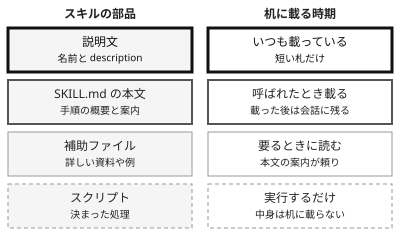

!!! abstract "要点"
    - **何が分かるか**：スキルは説明文だけを常駐させ、本文と補助ファイルを必要なときにだけ読む。
    - **いつ引くか**：長い手順を、必要なときだけ読ませたいとき。手順を書き足すたびに CLAUDE.md が長くなるとき。
    - **前提**：<!-- link:begin attention-budget -->[コンテキストウィンドウと注意の予算](../basics/attention-budget.md)<!-- link:end -->

<!-- textlint-disable -->
別名：progressive disclosure・段階的な開示
<!-- textlint-enable -->

スキルは、手順を「札」と「中身」に分けて持つ仕組みである。札にあたる説明文だけが毎回 Claude に見え、中身は必要な場面で読まれる。この段階に分けた読み込みを、progressive disclosure（段階的な開示）と呼ぶ。

## 何が起きるか {#what-happens}

長い手順を CLAUDE.md に書き足していくと、手順に関係のない作業でも、その全文が毎回の会話に載る。

たとえば、リリースの手順を 40 行ほど CLAUDE.md に書いたとする。正規表現を直すだけの日も、文書を推敲する日も、この 40 行はコンテキスト（Claude の広い机）の上にある。手順が増えるほど、CLAUDE.md は長くなり、ほかの指示が埋もれやすくなる。

同じ手順をスキルにすると、次のように変わる。

- **Before**：CLAUDE.md に、リリース手順の全文が入っている。毎回の会話に、全文が載る。
- **After**：スキルの説明文に「リリース作業のときに使う」と書く。本文はリリースの話が出たときだけ読まれ、細かい資料は補助ファイルへ分ける。普段の会話に載るのは、説明文だけである。

After で足したのは、「いつ使うか」を書いた短い説明文と、手順を置く場所の分け方である。手順の中身は変わらない。変わるのは、中身が机に載る時期である。

## なぜ手順を後回しにできるのか {#why}

スキルは 4 つの部品を、別々の時期に読み込む。コンテキストを広い机にたとえると、説明文は机にいつも載せる札で、本文と補助ファイルは必要なときに取り出す書類である。

部品ごとの時期は次のとおりである。

1. **説明文**：名前と description。Claude Code では、セッションの開始から毎回入る。Claude はこの説明文と依頼を見比べて、スキルを使うかを決める。
2. **本文（SKILL.md）**：呼ばれたときに入る。概要と、補助ファイルへの案内を書く。公式は<!-- fact:begin skill-md-body-lines -->500 行未満（2026-11-04 時点）<!-- fact:end -->を目安に短く保つよう勧める。入った後は会話に残り続けるので、長いほど毎ターンのコストになる。
3. **補助ファイル**：詳しい資料や例。本文が案内したときに、Claude が必要に応じて読む。
4. **スクリプト**：決まった処理。Claude は中身を読まず、実行して結果を受け取る。

スキルの読み込みの時期は、この辞典の機能の表では「<!-- gen:begin feature skills/load_timing -->セッション開始と使うとき<!-- gen:end feature skills/load_timing -->」で、コンテキストのコストは「<!-- gen:begin feature skills/context_cost -->使うまで小さい<!-- gen:end feature skills/context_cost -->」である。`disable-model-invocation: true` を付けたスキルは、自分が呼ぶまで説明文も入らない。

この形は、オープン標準の Agent Skills に沿っている。作り方は <!-- link:begin writing-skills#supporting-files -->[スキルの作り方 › 補助ファイルとスクリプトに分ける](writing-skills.md#supporting-files)<!-- link:end --> で扱う。

## 圧縮の後に戻るもの {#after-compaction}

会話が長くなって圧縮が走ると、スキルの部品は種類ごとに違う戻り方をする。

- **説明文**：今あるスキルの一覧から作り直して入れ直される。この挙動が入る前の版では戻らなかった。入った版は <!-- fact:begin skill-description-rebuild-min-version -->Claude Code 2.1.304 以降（2026-11-06 時点）<!-- fact:end -->（[公式の変更履歴](https://code.claude.com/docs/en/changelog)で確かめる）。
- **呼んだスキルの本文**：上限つきで入れ直される。1 つあたり<!-- fact:begin skill-reattach-tokens-each -->先頭から 5000 トークンまで（2026-11-04 時点）<!-- fact:end -->、全体で<!-- fact:begin skill-reattach-tokens-total -->合計 25000 トークンまで（2026-11-04 時点）<!-- fact:end -->で、古く呼んだものから落ちる。
- **補助ファイルの中身**：読んだだけで本文に入っていないものは、圧縮で要約に溶けうる。必要になったら、もう一度読ませる。

本文は先頭を残して切られるので、大事な指示は SKILL.md の上のほうに書く。圧縮で何が残るかの全体は、<!-- link:begin what-survives-compaction#reloaded -->[圧縮（compaction）で何が残り、何が消えるか › 入れ直されるもの](../basics/what-survives-compaction.md#reloaded)<!-- link:end --> にある。

## 何に効くか {#effects}

このページの仕組みは、原理「見せる」に関わる。必要な情報を、必要なときに Claude の見える所へ載せる、という考え方である。

- **散らかっている**を防ぐ：使わない手順を、常駐の指示から外せる。机の上の書類が減るので、大事な指示への目配りが薄まりにくい。机に載る量と注意の関係は <!-- link:begin attention-budget#effects -->[コンテキストウィンドウと注意の予算 › 何に効くか：見せることと、散らかっていること](../basics/attention-budget.md#effects)<!-- link:end --> にある。
- **見えていない**を防ぐ：説明文に「いつ使うか」を書けば、手順の存在が Claude に見える。本文は、必要な場面で呼ばれる。

何を常駐させ、何を使うときだけ読ませるかの整理は、<!-- link:begin always-on-costs#resident-vs-on-demand -->[常駐するもののコスト（CLAUDE.md・MCP・スキル） › 常駐するものと、使うときだけ読むもの](../context/always-on-costs.md#resident-vs-on-demand)<!-- link:end --> にある。繰り返しが見えてから仕組みに移す順序は、<!-- link:begin when-to-add-what -->[拡張を足すタイミング](when-to-add-what.md)<!-- link:end --> で扱う。

## 入れすぎたときに残るコスト {#residual-cost}

本文を後回しにしても、説明文のコストは残る。スキルを入れるたびに、使わなくても説明文がセッションごとに載る。

- 説明文の一覧に載る description と、使う場面を足す欄の when_to_use は、合わせて 1 件ごとに<!-- fact:begin skill-listing-entry-max-chars -->1536 字で切られる（2026-11-04 時点）<!-- fact:end -->。
- 一覧全体にも予算があり、既定は<!-- fact:begin skill-listing-budget-fraction -->コンテキストウィンドウの 1%（2026-11-04 時点）<!-- fact:end -->である。超えると、使われていないスキルから説明が落ちる。
- 説明が落ちたスキルは、Claude に見えにくくなる。入れすぎは、起動のしにくさにもなる。

常駐を小さく保つ理由は <!-- link:begin always-on-costs#why-small -->[常駐するもののコスト（CLAUDE.md・MCP・スキル） › なぜ常駐を小さく保つのか](../context/always-on-costs.md#why-small)<!-- link:end --> に、使っていないスキルを外す手順は <!-- link:begin pruning-extensions#measure -->[拡張の棚卸しと剪定 › 測る](pruning-extensions.md#measure)<!-- link:end --> にある。

## 判断例 {#examples}

!!! example "判断例：手順を CLAUDE.md に残すか、スキルにするか"
    - **状況**：CLAUDE.md が手順で長くなってきた。テストの実行コマンド 3 行と、月に 1 回のリリース手順 40 行がある。
    - **迷う候補**：全部を CLAUDE.md に残す。リリース手順だけをスキルに移す。
    - **選んだもの**：リリース手順だけをスキルに移し、テストの実行コマンドは CLAUDE.md に残す。
    - **理由**：テストのコマンドは毎回使うので、常駐のままでよい。リリース手順は月に 1 回しか使わず、長い。常駐させる費用に見合わないので、必要なときだけ読ませる。

!!! example "判断例：スキルにせず、別の仕組みに任せる"
    - **状況**：コミット前のフォーマッタを、毎回必ずかけたい。手順は短い。
    - **迷う候補**：スキルにして、説明文に「コミット前に使う」と書く。フックで必ず走らせる。
    - **選んだもの**：フックで走らせる。
    - **理由**：スキルは Claude が使うかを決めるお願いで、強制力は「<!-- gen:begin feature skills/enforcement -->お願い<!-- gen:end feature skills/enforcement -->」である。例外なく走らせたいなら、鍵であるフックが向く。違いは <!-- link:begin hook-vs-skill -->[フックとスキルの違い](hook-vs-skill.md)<!-- link:end --> にある。

手順を今の会話で読ませるか、別の担当に任せるかで迷うときは、<!-- link:begin skill-vs-subagent -->[スキルとサブエージェントの違い](skill-vs-subagent.md)<!-- link:end --> を引く。CLAUDE.md・rules・スキルのどこに置くかは、<!-- link:begin claude-md-vs-rules-skills-styles#how-to-choose -->[CLAUDE.md・rules・スキル・出力スタイルの違い › 指示の置き場所の選び方](claude-md-vs-rules-skills-styles.md#how-to-choose)<!-- link:end --> にある。

## 面ごとの違い {#surfaces}

=== "アプリ"

    アプリでは、Excel・Word・PowerPoint・PDF 用の組み込みのスキルが、関連する場面で自動的に使われる。自作のスキルも置ける。スキルを使うには code execution が有効である必要がある。使われないときは、スキルのスイッチがオンかを確かめ、プロンプトでスキル名を挙げる。画面の操作は変わりやすいので、<!-- link:begin skills-in-the-app#not-triggered -->[アプリでスキルを使う › 使われないとき](../app/skills-in-the-app.md#not-triggered)<!-- link:end --> を見る。

=== "Claude Code"

    説明文はセッションの開始から入り、本文は呼ばれたときに入る。配置の場所（個人・プロジェクト・プラグイン）と、呼び出し方を制限する設定は、<!-- link:begin writing-skills -->[スキルの作り方](writing-skills.md)<!-- link:end --> で扱う。

=== "API"

    API では、スキルは code execution の道具を通して使う。段階的な読み込みが Claude Code と同じ順かは、この辞典では確かめていない。使う前に公式の文書で確かめる。

## 誤解 {#misconceptions}

- **「スキルは入れても費用がかからない」**：本文は後回しになるが、説明文は載り続ける。数が増えると、一覧の予算を超えて説明が落ちる。
- **「説明文があれば必ず使われる」**：使うかどうかは Claude が説明文と依頼を見て決める。強制はされない。使われないときは、説明文の書き方を直す。直し方は <!-- link:begin skill-descriptions -->[スキルの description の書き方](skill-descriptions.md)<!-- link:end --> にある。
- **「補助ファイルは勝手に読まれる」**：補助ファイルは、本文が案内したときに読まれる。本文に、何がどこにあるかを書いておく。
- **「一度呼べば、圧縮の後も全部残る」**：呼んだスキルの本文は上限つきで入れ直されるので、長い本文は後ろが切られる。
- **「スクリプトの中身は文脈に見えるので、安全だ」**：スクリプトは中身を読まずに実行される。中身が会話に出ないので、入れる前に自分で読む必要がある。確認の手順は <!-- link:begin vetting-extensions#read-contents -->[MCP・プラグイン・スキルを入れる前の確認 › 中身を読む（道具の説明・フック・スクリプト）](../safety/vetting-extensions.md#read-contents)<!-- link:end --> にある。

毎回同じ説明を繰り返している状態から、移し先を決めたいときは <!-- link:begin repeating-the-same-explanation -->[毎回同じ説明をしている](../symptoms/repeating-the-same-explanation.md)<!-- link:end --> を引く。

<!-- gen:begin references -->
<!-- textlint-disable -->

## 参考 {#references}

- [Extend Claude with skills](https://code.claude.com/docs/en/skills)：Anthropic・英語・確認日 2026-11-04
- [Explore the context window](https://code.claude.com/docs/en/context-window)：Anthropic・英語・確認日 2026-11-04
- [Extend Claude Code](https://code.claude.com/docs/en/features-overview)：Anthropic・英語・確認日 2026-11-04
- [Claude Code changelog](https://code.claude.com/docs/en/changelog)：Anthropic・英語・確認日 2026-11-04
- [Use skills in Claude](https://support.claude.com/en/articles/12512180-use-skills-in-claude)：Anthropic・英語・確認日 2026-11-04

<!-- textlint-enable -->
<!-- gen:end references -->

<!-- gen:begin page-links -->
<!-- textlint-disable -->

**前提**

- [コンテキストウィンドウと注意の予算](../basics/attention-budget.md)

**次に読む**

- [アプリでスキルを使う](../app/skills-in-the-app.md)
- [CLAUDE.md・rules・スキル・出力スタイルの違い](claude-md-vs-rules-skills-styles.md)
- [スキルの作り方](writing-skills.md)
- [フックとスキルの違い](hook-vs-skill.md)
- [スキルとサブエージェントの違い](skill-vs-subagent.md)

**関連**

- [スキルの description の書き方](skill-descriptions.md)
- [常駐するもののコスト（CLAUDE.md・MCP・スキル）](../context/always-on-costs.md)
- [圧縮（compaction）で何が残り、何が消えるか](../basics/what-survives-compaction.md)
- [拡張の棚卸しと剪定](pruning-extensions.md)
- [拡張を足すタイミング](when-to-add-what.md)
- [毎回同じ説明をしている](../symptoms/repeating-the-same-explanation.md)
- [MCP・プラグイン・スキルを入れる前の確認](../safety/vetting-extensions.md)

<!-- textlint-enable -->
<!-- gen:end page-links -->
