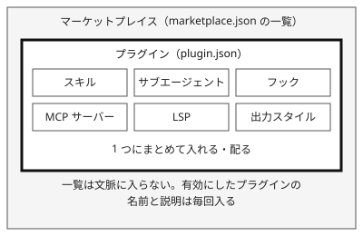

!!! abstract "要点"
    - **何ができるか**：スキル・サブエージェント・フック・MCP などを 1 つのプラグインに束ねて入れ、マーケットプレイスの一覧で配れる。
    - **いつ引くか**：別のリポジトリにも同じ設定を作ろうとしているとき。作った手順や設定を、チームに配りたいとき。チームで同じ設定を使いたいとき。
    - **読み込みとコスト**：読み込みの時期は <!-- gen:begin feature plugins/load_timing -->セッション開始と使うとき<!-- gen:end feature plugins/load_timing -->、コンテキストのコストは<!-- gen:begin feature plugins/context_cost -->使うまで小さい<!-- gen:end feature plugins/context_cost -->。ただし中身による。成熟度は <!-- gen:begin feature plugins/maturity -->GA<!-- gen:end feature plugins/maturity --> である。
    - **止めるもの**：強制力は「<!-- gen:begin feature plugins/enforcement -->なし<!-- gen:end feature plugins/enforcement -->」で、プラグインは道具を束ねて配るだけである。入れたコードは使う人の権限で動くので、止めるのは入れる前の確認と、マーケットプレイスを絞る管理設定である。
    - **前提**：<!-- link:begin extensions-at-a-glance -->[拡張機能の全体図と使い分け早見表](extensions-at-a-glance.md)<!-- link:end -->

<!-- textlint-disable -->
別名：marketplace・/plugin・plugin.json・marketplace.json
<!-- textlint-enable -->

プラグインとマーケットプレイスは、作った拡張を別のリポジトリや他の人へ運ぶための仕組みである。プラグインが配る荷物の単位で、マーケットプレイスが荷物の一覧である。便利さと引き換えに、入れたものが常駐し、他人のコードを自分の権限で動かすことになる。

## 使いどころ {#when-to-use}

プラグインが防ぐのは、設定が散らかることと、共有の境界がないことである。公式の文書は、拡張を足すきっかけとして「2 つ目のリポジトリにも同じ設定を作ろうとしている」を挙げ、そのときの答えをプラグインにしている。同じスキルやフックを何度もコピーして貼ると、コピー元の直しが届かず、どの版が正しいか分からなくなる。1 か所に束ねれば、直しが 1 回で済む。

プラグインに束ねられるものは、スキル、サブエージェント、フック、MCP サーバー、LSP、出力スタイルなどである。マーケットプレイスは、プラグインの一覧（`marketplace.json`）を持つカタログで、ストアではない。一覧そのものは文脈に入らない。



束ねるのは、複数の場所で使うと決まったものだけにする。1 つのリポジトリでしか使わない設定は、そのリポジトリの `.claude/` に置けば足りる。配る前に、何をどこに置くかは「<!-- link:begin extensions-at-a-glance#how-to-choose -->[拡張機能の全体図と使い分け早見表 › 移す先の選び方](extensions-at-a-glance.md#how-to-choose)<!-- link:end -->」で選ぶ。

!!! example "判断例：同じスキルを別のリポジトリでも使いたい"
    - **状況**：レビューの手順をスキルにして、リポジトリ A で使っている。リポジトリ B と C でも、同じ手順を使いたい。
    - **迷う候補**：スキルのフォルダを B と C へコピーする。または、プラグインにしてマーケットプレイスから入れる。
    - **選んだもの**：チームの複数人が複数のリポジトリで使うなら、プラグインにする。自分だけが 2 つのリポジトリで使うなら、コピーのままでもよい。
    - **理由**：コピーは手元で簡単だが、直しが各リポジトリへ届かない。プラグインは作る手間が増える代わりに、直しを 1 か所で配れる。人数と場所が増えるほど、プラグインが割に合う。

## 最小の使い方 {#minimal}

最小の使い方は、プラグインを 1 つ入れて、スキルを呼ぶことである。プラグインのスキルは、名前の衝突を避けるため、プラグイン名を前に付けた `/プラグイン名:スキル名` で呼ぶ。面ごとに入れ方が違う。

=== "アプリ"

    アプリでは、Plugins のページ（以前は Customize という名前で、展開中のため画面は変わりうる）から探して入れる。アプリのプラグインはアカウントに保存され、Claude Code へ同期される。入れられる中身と画面の操作は「<!-- link:begin plugins-in-the-app#contents -->アプリでプラグインを使う<!-- link:end -->」にある。同期の仕組みと必要な版は「<!-- link:begin plugins-in-the-app#sync -->アプリでプラグインを使う<!-- link:end -->」にある。

    アプリで入れたプラグインも、Claude Code に同期されれば、次の「入れる前の確認」と常駐のコストの対象になる。フックとローカルの MCP は、Cowork と Claude Code でだけ動く。

=== "Claude Code"

    Claude Code では、`/plugin` の Discover タブで探して入れる。シェルからは `claude plugin install <プラグイン名>@<マーケットプレイス名>` でも入れられる。公式のマーケットプレイス `claude-plugins-official` は、最初の対話の起動で自動的に足される。作っているプラグインを試すだけなら、`--plugin-dir` でディレクトリを渡せば、マーケットプレイスなしで読み込める。

    入れる場所（スコープ）は user・project・local の 3 つである。project は `.claude/settings.json` に書くのでチームに共有されるが、各自のマシンでの確認は要る。local の設定で入れたプラグインは、クラウドのセッションに届かない。

## 入れる前の確認 {#before-install}

プラグインは、入れた人の権限でコードを動かす。そのため、入れる前に出所と中身を確かめる。配る側も同じで、チームに配る前に、まず自分が確認する。

入れる前に見るのは次の 3 つである。

- **出所**：誰が作り、どのマーケットプレイスの一覧に載っているか。公式のマーケットプレイスに載っていても、中身の確認は省かない。確かめ方は「<!-- link:begin vetting-extensions#provenance -->[MCP・プラグイン・スキルを入れる前の確認 › 出所を確かめる](../safety/vetting-extensions.md#provenance)<!-- link:end -->」にある。
- **中身**：フック、スクリプト、MCP サーバーの定義、スキルの説明を読む。フックと MCP サーバーは、会話の外でコードを動かす。読み方は「<!-- link:begin vetting-extensions#read-contents -->[MCP・プラグイン・スキルを入れる前の確認 › 中身を読む（道具の説明・フック・スクリプト）](../safety/vetting-extensions.md#read-contents)<!-- link:end -->」にある。
- **常駐のコスト**：有効にしたプラグインのスキル・サブエージェント・コマンドの名前と説明は、使わないセッションでも毎回の文脈に入る。公式のマーケットプレイスの画面は、常駐する量の推定（Context cost）を出す。

入れた後も、確認は終わらない。中身は後から変わることがある。変わり方は「<!-- link:begin vetting-extensions#changes-after-install -->[MCP・プラグイン・スキルを入れる前の確認 › 入れた後に変わる（rug pull）](../safety/vetting-extensions.md#changes-after-install)<!-- link:end -->」にある。使っていないものは外す。`/plugin` の Installed タブでは、<!-- fact:begin plugin-not-used-recently-threshold -->14 日かつ 10 セッション（2026-11-05 時点）<!-- fact:end -->使われていないものが「Not used recently」に移るので、外す候補になる。棚卸しの手順は「<!-- link:begin pruning-extensions#measure -->[拡張の棚卸しと剪定 › 測る](pruning-extensions.md#measure)<!-- link:end -->」にある。

プラグインの一種に、Claude Code の画面や挙動そのものを変える mod がある。動くコードが深く入り込むので、ほかのプラグインより確認を重くする。くわしくは「<!-- link:begin mods -->Mods（プラグインで挙動を深く変える）<!-- link:end -->」を見る。

## チームのマーケットプレイスを作る {#team-marketplace}

チームに配るときは、チーム用のマーケットプレイスを作る。マーケットプレイスは、`.claude-plugin/marketplace.json` を持つディレクトリかリポジトリである。非公開のリポジトリでもよい。配る前に、守りを先に決める。

- **確認を通したものだけを載せる**。載せたプラグインは、チーム全員の権限で動く。入れる前の確認は、載せる側が先に済ませる。
- **変更をレビューに通す**。一覧とプラグインの中身の変更は、プルリクエストを通してから取り込む。自動更新（`autoUpdate`）を有効にすると、取り込んだ変更が背景で各自の手元に届くからだ。
- **使えるマーケットプレイスを絞る**。組織の管理設定の `strictKnownMarketplaces` で、使えるマーケットプレイスの出どころを限れる。配る経路は「<!-- link:begin org-managed-settings-and-mcp#delivery -->組織に設定と MCP サーバーを配る<!-- link:end -->」にある。

最小の一覧は、名前（`name`）、所有者（`owner`）、プラグインの配列（`plugins`）の 3 つが必須である。配列の各項目には、名前と取得元（`source`）を書く。同じマーケットプレイスの中のプラグインは、一覧の根からの相対のパスで指す。次の雛形は、1 つのプラグインを載せた一覧である。

<!-- gen:begin snippet plugins-and-marketplaces/team-marketplace -->
<!-- textlint-disable -->

??? example "雛形：チーム用のマーケットプレイスの一覧（marketplace.json）"

    ```json
    {
      "name": "team-tools",
      "description": "Plugins for our team",
      "owner": {
        "name": "Platform Team"
      },
      "plugins": [
        {
          "name": "review-helpers",
          "source": "./plugins/review-helpers",
          "description": "Review skills and a pre-commit check hook"
        }
      ]
    }
    ```

    動作を確かめていない雛形。要る最低の版：Claude Code 2.0.12。

<!-- textlint-enable -->
<!-- gen:end snippet plugins-and-marketplaces/team-marketplace -->

プラグイン側には、最小の定義（`.claude-plugin/plugin.json`）を置く。一覧の項目の名前と、定義の名前は同じにする。違うと、定義の名前で入れようとしたときに、見つからないと言われる。

<!-- gen:begin snippet plugins-and-marketplaces/minimal-plugin -->
<!-- textlint-disable -->

??? example "雛形：最小のプラグインの定義（plugin.json）"

    ```json
    {
      "name": "review-helpers",
      "description": "Review skills and a pre-commit check hook"
    }
    ```

    動作を確かめていない雛形。要る最低の版：Claude Code 2.0.12。

<!-- textlint-enable -->
<!-- gen:end snippet plugins-and-marketplaces/minimal-plugin -->

書いたら、配る前に自分のマシンで通す。まず `claude plugin validate ./` で書式を確かめる。次に `claude plugin marketplace add ./` と `claude plugin install <プラグイン名>@<マーケットプレイス名>` で入れる。最後に `claude plugin list` に出ることを見る。手元のディレクトリから入れたものは、編集が次のセッション開始か `/reload-plugins` で反映される。`claude-plugins-official` などの公式の名前は、自分のマーケットプレイスに付けられない。

チームのリポジトリには、`.claude/settings.json` にマーケットプレイスと有効にするプラグインを書く。メンバーがそのフォルダを信頼すると、マーケットプレイスが登録される。信頼していないフォルダでは、メッセージなしに無視される。

<!-- gen:begin snippet plugins-and-marketplaces/project-settings -->
<!-- textlint-disable -->

??? example "雛形：プロジェクトでチームのマーケットプレイスとプラグインを有効にする .claude/settings.json"

    ```json
    {
      "extraKnownMarketplaces": {
        "team-tools": {
          "source": {
            "source": "github",
            "repo": "your-org/team-tools"
          }
        }
      },
      "enabledPlugins": {
        "review-helpers@team-tools": true
      }
    }
    ```

    動作を確かめていない雛形。要る最低の版：Claude Code 2.0.12。

<!-- textlint-enable -->
<!-- gen:end snippet plugins-and-marketplaces/project-settings -->

プラグインの取得元が一覧の外（プラグイン自身の GitHub リポジトリなど）にあるときは、この設定だけでは入らない。各自が `claude plugin install <プラグイン名>@<マーケットプレイス名> --scope project` を流すまで、有効だが入っていない、という表示が出る。チームの設定ファイルをどこまで共有するかは「<!-- link:begin share-team-settings#shared-vs-personal -->[チームで設定を共有する › 共有するものと個人に残すもの](../team/share-team-settings.md#shared-vs-personal)<!-- link:end -->」にある。組織の全員へ強制して配るなら「<!-- link:begin org-managed-settings-and-mcp -->組織に設定と MCP サーバーを配る<!-- link:end -->」を見る。

## 効かない場面と落とし穴 {#limits}

プラグインにも、効かない場面がある。

- **束ねても常駐は減らない**。入れるほど、名前と説明が毎回の文脈に増える。使わないものは外す。常駐の費用の見方は「<!-- link:begin always-on-costs#resident-vs-on-demand -->[常駐するもののコスト（CLAUDE.md・MCP・スキル） › 常駐するものと、使うときだけ読むもの](../context/always-on-costs.md#resident-vs-on-demand)<!-- link:end -->」にある。
- **フックは文脈に載らないが、動く**。フックはモデルの文脈のコストを持たない。そのかわり、会話の外でコードを動かすので、入れる前の確認の中心になる。
- **クラウドのセッションでは同じに動かないことがある**。ローカルの設定で入れたプラグインは、クラウドのセッションに届かない。リポジトリの設定で有効にしたものが、クラウドでどこまで動くかは、公式の文書が面ごとに書き分けているので、使う前に確かめる。この辞典では未確認である。
- **同期されたものも対象になる**。アプリで入れたプラグインは Claude Code に同期されるので、気づかないうちに常駐が増えていることがある。管理者は `syncClaudeAiPlugins` で同期を止められる。
- **取得元が一覧の外だと、設定だけでは入らない**。プラグイン自身の GitHub リポジトリなどを取得元にすると、`.claude/settings.json` に書いても、各自が `claude plugin install` を流すまで入らない。
- **サンドボックスは MCP サーバーとフックを囲わない**。囲うのは Bash などのシェルコマンドだけである。プラグインに入った MCP サーバーとフックの安全は、サンドボックスに頼らず、入れる前の確認で見る。
- **WSL・Linux の CLI 以外は未確認**。ほかの OS と IDE 拡張の動作は、この辞典では確かめていない。

## 比べる相手 {#compare}

プラグインは、拡張を運ぶ手段であり、拡張の種類ではない。配り方で比べる。

- **リポジトリの `.claude/` に置く**：そのリポジトリだけで使うなら足りる。ほかのリポジトリへは、手でコピーする。
- **個人の設定に置く**：自分のすべてのプロジェクトで使える。チームには届かない。
- **プラグインとマーケットプレイス**：複数のリポジトリと複数の人へ、同じ版を配る。作る手間と、他人のコードを入れる責任が増える。
- **組織の管理設定**：全員に強制できる。配る経路は「<!-- link:begin org-managed-settings-and-mcp -->組織に設定と MCP サーバーを配る<!-- link:end -->」にある。

拡張の層の全体と、置く先の選び方は「<!-- link:begin extensions-at-a-glance#layers -->[拡張機能の全体図と使い分け早見表 › 拡張の 4 つの層](extensions-at-a-glance.md#layers)<!-- link:end -->」にある。スキルの作り方は「<!-- link:begin writing-skills -->[スキルの作り方](writing-skills.md)<!-- link:end -->」、MCP のつなぎ方は「<!-- link:begin connecting-mcp -->[MCP をつなぐ](connecting-mcp.md)<!-- link:end -->」を見る。型のある言語の code intelligence プラグインは「<!-- link:begin code-intelligence-plugins -->[code intelligence プラグイン（LSP）](code-intelligence-plugins.md)<!-- link:end -->」にある。チームに広める流れは「<!-- link:begin rolling-out-to-teams -->チームに広める（/team-onboarding など）<!-- link:end -->」を見る。

<!-- gen:begin page-links -->
<!-- textlint-disable -->

<div class="ca-page-links" markdown>

**前提**

- [拡張機能の全体図と使い分け早見表](extensions-at-a-glance.md)

**次に読む**

- [code intelligence プラグイン（LSP）](code-intelligence-plugins.md)

**関連**

- [MCP・プラグイン・スキルを入れる前の確認](../safety/vetting-extensions.md)
- [チームで設定を共有する](../team/share-team-settings.md)
- [拡張の棚卸しと剪定](pruning-extensions.md)
- [スキルの作り方](writing-skills.md)
- [MCP をつなぐ](connecting-mcp.md)
- [常駐するもののコスト（CLAUDE.md・MCP・スキル）](../context/always-on-costs.md)

</div>

<!-- textlint-enable -->
<!-- gen:end page-links -->

<!-- gen:begin references -->
<!-- textlint-disable -->

## 参考 {#references}

- [Plugins overview](https://code.claude.com/docs/en/plugins/overview)：Anthropic・英語・確認日 2026-11-04
- [Measure plugin cost and usage](https://code.claude.com/docs/en/plugins/measure)：Anthropic・英語・確認日 2026-11-04
- [Create a marketplace](https://code.claude.com/docs/en/plugins/create-marketplace)：Anthropic・英語・確認日 2026-11-04
- [Manage Claude Code plugins for your organization](https://code.claude.com/docs/en/plugins/org)：Anthropic・英語・確認日 2026-11-05
- [Extend Claude Code](https://code.claude.com/docs/en/features-overview)：Anthropic・英語・確認日 2026-11-04
- [Use plugins in Claude](https://support.claude.com/en/articles/13837440-use-plugins-in-claude)：Anthropic・英語・確認日 2026-11-04

<!-- textlint-enable -->
<!-- gen:end references -->
