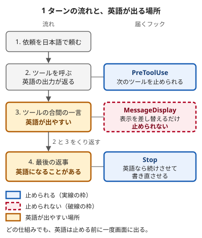

!!! abstract "要点"
    - **何ができるか**：英語のツール出力やサブエージェントの報告を読んだ後に英語へ戻る返答を、`language` の設定・CLAUDE.md の指示・Stop フックの順に重ねて減らせる。どれも完全には防げず、ツールの合間の短い一言は、表示される前に止める仕組みがない。
    - **いつ引くか**：言語を日本語に設定しても、英語の返事が混ざるとき。Claude Code の返事を、いつも日本語にしたいとき。最後の返事が英語のときに、自動で日本語に直させたいとき。
    - **前提**：<!-- link:begin align-japanese-output -->日本語の出力を揃える：お願いで足りること、仕組みが要ること（準備中）<!-- link:end -->

<!-- textlint-disable -->
別名：英語への回帰・返答の言語を固定する・language 設定
<!-- textlint-enable -->

日本語で返し続けさせる手順は、`language` の設定と CLAUDE.md の指示に、Stop フックを順に重ねるものである。前の 2 つは守られる保証のない「お願い」（非決定論的な指示）で、毎回実行される「鍵」（決定論的な制御）は Stop フックだけだが、その鍵も、ツールの合間の短い一言までは止められない。「お願い」と「鍵」の区別は、「<!-- link:begin request-vs-lock -->お願いと鍵（決定論的か、非決定論的か）（準備中）<!-- link:end -->」で説明している。

## 英語に戻りやすい場面 {#when}

Claude Code の返答が日本語から英語に戻るのは、1 ターン（依頼を送ってから最後の返事までの 1 区切り）の中の決まった場所に偏る。偏りが出やすいのは、英語のツール出力を読んだ直後である（根拠：中。GitHub の issue と実践者の記事の記録が一致する）。この現象そのものを書いた公式の文書は見つからなかった。日本語以外の言語の利用者も、同じ症状を報告している。

英語が出る場所は 2 つある。1 つは、ツールを呼ぶ前後に Claude が書く短い一言である（例：日本語なら「設定ファイルを読む」となる所が、「Let me read the config file」になる）。もう 1 つは、長い作業の後の最後の返事である。次の図は、この 2 つの場所と、それぞれに届くフックを示す。



図の要点は 2 つある。止められるのは、最後の返事を終えるとき（Stop が差し戻して書き直させる）と、次のツールの実行（PreToolUse が止める）である。ツールの合間の一言は、表示される前に止める仕組みがない。公式の [Hooks reference](https://code.claude.com/docs/en/hooks#messagedisplay) によれば、MessageDisplay は画面に出す文字を差し替えるだけで、Claude が見る内容も会話の記録も変えない。PreToolUse を使う実践例は、[Stop フックの節](#stop-hook)にある。

場面ごとの報告を整理する。

| 場面 | 報告されていること |
| --- | --- |
| ツールの合間の短い一言 | 英語のツール出力を読んだ直後に、一言が英語になる。出力の例は、仕様書、ログ、コメントの多いスクリプト、サブエージェントの報告、コードレビューの出力である（根拠：中） |
| 最後の返事 | 長いツール作業の後のまとめが英語になる（根拠：中） |
| 訂正した直後 | 日本語に戻るが、またすぐ英語になる（根拠：中） |
| 圧縮の後 | 圧縮の要約が英語で書かれた、という報告がある（根拠：弱。単独の報告） |

ある世代のモデルで増えた、という利用者の記録がある。ただし、モデルの切り替えと Claude Code の更新が同じ日に重なった例があり、原因は決められない（根拠：中）。モデルごとの癖は固定した事実として扱わない。自分が使うモデルで起きるかは、[どこまで減ったかを測る節](#measure)の手順で確かめる。

場面が分かったら、設定・指示・Stop フックの順に重ねて対処する。原因の切り分けは、症状のページ「<!-- link:begin replies-in-english -->英語で返ってくる（準備中）<!-- link:end -->」が、安く確かめられる順に進める。このページは、切り分けた後の対処を書く。

## 言語の設定と、効かないときに確かめること {#language-setting}

`language` は、返答の言語を指定する Claude Code の設定である（[All settings](https://code.claude.com/docs/en/settings-reference#language)）。値は言語名で、Claude Code は値を検証せず、「いつもその言語で答える」という指示として、そのまま Claude に渡す。指示を渡すだけで、守らせる仕組みを持たないので、強制力は「<!-- gen:begin feature language-setting/enforcement -->お願い<!-- gen:end feature language-setting/enforcement -->」である。同じ値が、音声入力の言語と、自動で付くセッションの題名の言語も決める。

**書く場所**：個人の好みなので、ユーザー設定 `~/.claude/settings.json` に書く。共有のプロジェクト設定 `.claude/settings.json` に書くと、優先順位が高いため、チームの全員の個人設定を上書きする（[Settings files and precedence](https://code.claude.com/docs/en/settings#settings-precedence)）。共有側に `language` があって困るときは、そのプロジェクトの `.claude/settings.local.json` に自分の値を書くと、自分のセッションだけ戻せる。ユーザー設定に書いた `language` は、クラウドのセッションには届かない。サブエージェントと圧縮の後に効くかは、調べた範囲の公式の文書に書かれていない。場所ごとの対処は、[届かない所の節](#reach)にある。

<!-- gen:begin snippet keep-replies-in-japanese/user-settings -->
<!-- textlint-disable -->

??? example "雛形：language の設定（個人の設定に置く）"

    ```json
    {
      "language": "japanese"
    }
    ```

    動作を確かめていない雛形。要る最低の版：Claude Code 2.1.0。

<!-- textlint-enable -->
<!-- gen:end snippet keep-replies-in-japanese/user-settings -->

**確かめ方**：新しいセッションで `/status` を開き、`Setting sources` の行に `User settings` が出ることを見る。この行は、読み込まれたファイルの一覧である。どのファイルがどのキーを出したかまでは示さない。もう 1 つの目安は、セッションの題名である。題名は最初の依頼から自動で付き、`/resume` で開く一覧に出る（[Manage sessions](https://code.claude.com/docs/en/sessions)）。英語で最初の依頼を書いても、題名が日本語になれば、値が読まれた目安になる。

**効かないときに確かめること**：安く確かめられる順で並べる。

1. 値の綴りを見る。値は検証されないので、綴りを誤ってもエラーにならず、書いたまま Claude に届く。
2. JSON の誤りを探す。設定ファイルは厳密な JSON で、コメントや末尾のカンマは構文エラーになる。壊れたファイルや受け付けられない値は読み飛ばされ、何を読み飛ばしたかは `claude doctor` で見られる。
3. 上の層に別の値がないかを見る。優先順位は、高い順に管理設定、コマンドラインの `--settings`、`.claude/settings.local.json`、`.claude/settings.json`、`~/.claude/settings.json` である。リポジトリ側に `language` があれば、個人の設定より優先される。`/status` はキーの出どころを示さないので、各ファイルを開いて確かめる。層の読み方は「<!-- link:begin settings-layers#verify -->設定ファイルの階層と優先順位 › 効いているかを確かめる（準備中）<!-- link:end -->」にある。

ここまでを確かめても混ざるなら、設定の限界である。設定は指示なので、守られない場面が残る。次の節以降で重ねる。

`language` がコミットメッセージやコードのコメントにも効くかは、公式の文書に書かれていない。その扱いは「<!-- link:begin commit-and-comment-language -->コミットメッセージ・コメントの言語（準備中）<!-- link:end -->」にある。

## CLAUDE.md と出力スタイル（お願いの層） {#instructions}

CLAUDE.md と出力スタイルは、設定で足りない場面を指示で補う層である。どちらも指示であり、公式は、どちらも守られる保証はないと書く（[How Claude remembers your project](https://code.claude.com/docs/en/memory)、[Output styles](https://code.claude.com/docs/en/output-styles)）。CLAUDE.md の内容は、システムプロンプトではなく、その後のユーザーメッセージとして届く。出力スタイルは、毎回のリクエストに指示を足す。

**書き方**：英語に戻りやすい場面を名指しして、短く具体的に書く。次の Before と After は、同じ規則の書き方を並べたものである。

Before：

```text
日本語で答えること。
```

After：

<!-- gen:begin snippet keep-replies-in-japanese/reply-language -->
<!-- textlint-disable -->

??? example "雛形：返答の言語の規則（CLAUDE.md）"

    ```markdown
    # 返答の言語

    - 返答は日本語で書く。ツールを呼ぶ前後の短い一言も日本語で書く。
    - 英語のログ・ドキュメント・スクリプト・サブエージェントの報告を読んだ後も、日本語に戻って書く。
    - コード・コマンド・パス・エラーメッセージの引用は、原文のまま書く。
    - サブエージェントに作業を頼むときは、依頼文に「報告は日本語で書く」と書く。
    - 英語で答えるよう頼まれたときは、その依頼を優先する。

    理由：日本語で作業の流れを追っている。途中の一言が英語になると、何をしているのかを見失う。
    ```

    動作を確かめていない雛形。

<!-- textlint-enable -->
<!-- gen:end snippet keep-replies-in-japanese/reply-language -->

After で足したものは 5 つある。

- 英語に戻りやすい場面の名指し（ツールの合間の一言、英語の資料を読んだ後）。
- 原文のままでよいもの（コード・コマンド・パス・エラーメッセージ）。
- サブエージェントへの依頼文に言語を書く一文。
- 英語を頼まれたときの例外。
- 末尾の理由の行。規則から外れそうな場面で Claude が判断する手がかりを渡すために足した（推論・実践例なし）。

公式は、指示は具体的で短いほど一貫して守られると書く。言語の規則にその書き方が効くかを比べた記録はない（類推）。

**置き場所**：個人の好みなら `~/.claude/CLAUDE.md`、チームの決まりならプロジェクトの `CLAUDE.md` に書く。何を知るべきかは CLAUDE.md、どう答えるかは出力スタイルに置くのが公式の分担で、言語の規則はどちらにも置ける。どちらが守られやすいかを比べた記録はない。始めるなら、雛形のある CLAUDE.md を勧める（推論・実践例なし）。出力スタイルの作り方と日本語の応答との関係は、「<!-- link:begin output-style-modes#japanese -->出力スタイルで応答の仕方を切り替える › 日本語の応答との関係（準備中）<!-- link:end -->」にある。

**システムプロンプトに置く**：`--append-system-prompt` は、Claude Code のシステムプロンプトの末尾に文を足す起動時のフラグである。公式は、システムプロンプトの水準で指示したいときの手段として挙げ、起動のたびに渡すので、スクリプトや自動化に向くと書く（[CLI reference](https://code.claude.com/docs/en/cli-reference)）。API の文書は、返答の言語はシステムプロンプトで明示するのが最も確実だと書く（[Multilingual support](https://platform.claude.com/docs/en/build-with-claude/multilingual-support)）。Claude Code に当てはめた効き目の記録はない（類推）。

**毎ターン足しても止まらない**：UserPromptSubmit フックで、規則を毎ターン足す方法がある。ただし、足しても英語に戻ったという報告が複数ある（根拠：中）。これもお願いの層である。

**確かめ方**：新しいセッションで `/context` を開き、Memory files に CLAUDE.md が出ることを見る。1 回の返答が日本語でも、効いた証拠にはならない。測り方は[どこまで減ったかを測る節](#measure)にある。

CLAUDE.md の中に、日本語の規則と食い違う指示や古い指示があると、Claude はどちらかを任意に選ぶことがある。見つけたら消す。

## Stop フックで最後の返事を確かめる {#stop-hook}

Stop フックは、Claude Code が 1 ターンの返事を終えたときに動くフックである（[Hooks reference](https://code.claude.com/docs/en/hooks#stop)）。最後の返事の全文を `last_assistant_message` として受け取り、`decision` を `block` にして `reason` を返すと、Claude はターンを終えず、その理由を受け取って続ける。最後の返事が英語なら、日本語で書き直させる使い方ができる。このページのスクリプトにできるのは、英語の最後の返事を 1 度は終えさせないところまでである。書き直した返事が日本語になるかは、差し戻しの理由を指示として受け取る Claude の応答しだいである。書き直しも英語なら、スクリプトはそれを通して、ターンを終える。

この節は、仕組みと限界を先に述べ、後半でスクリプトを置く・登録する・確かめる作業を順に書く。

指示だけで足りるかは、立場が分かれる。

- **公式の立場**：CLAUDE.md と出力スタイルは指示で、守られる保証はない。例外なく守らせるものはフックに置く。
- **実践者の幅**：CLAUDE.md の規則を訂正しても続かなかった、毎ターン規則を注入しても止まらなかった、という報告がある（根拠：中）。Stop フックで最後の返事を差し戻した後は、英語の割合が下がったという自己申告もある。ただし、単独の実運用と、過去の記録に当てはめた再生実験で、統制された比較ではない（根拠：弱）。
- **この教材の推奨**：設定と短い指示から始め、足りない場面に Stop フックを足し、効いたかを測る。

Stop フックが届かないことを、先に知っておく。

- **ツールの合間の一言は見ない**。Stop が受け取るのは最後の返事だけである。
- **英語は一度画面に出る**。最後の返事は、フックが動く前に表示されている。直すのは後である。画面の読み上げで作業を追う場合のように、英語が一度でも出ては困る使い方では足りない。
- **続けて止められる回数に上限がある**。上限を過ぎると、英語のままターンが終わる。下のスクリプトは、書き直しの返事を判定しない（`stop_hook_active` が true なら通す）。止め続けるループを避けるためで、書き直しも英語なら、2 回目は通って、英語のままターンが終わる。上限の扱いは、『<!-- link:begin stop-hooks#block-cap -->Stop フックで「終わらせない」 › 続けて止められる回数の上限（準備中）<!-- link:end -->』にある。
- **英語で答えさせたい作業でも止まる**。翻訳のように英語の返事が正しい作業も止めるので、その間は `ALLOW_ENGLISH_REPLY=1` を付けて Claude Code を起動し直し、判定を切る。
- **判定は文字の割合で、誤判定がある**。下のスクリプトは、英字が 40 字以上あり、英字とかな・漢字の合計に占めるかな・漢字の割合が 0.25 未満の返事を、英語とみなす。そのため、英字が 40 字に満たない短い英語の返事は通る。英語の返事でも、日本語の語が混ざって割合が 0.25 以上になれば通る。逆に、コードの外に英単語や識別子を並べた日本語の返事は、英語とみなされて止まる。閾値は最初の値で、測って直す。`MIN_JA_SHARE` を下げると止まりにくく、上げると止まりやすい。`MIN_LATIN` を上げると、短い返事を通しやすい。
- **場所によっては Stop フックが動かない**。ユーザーの `~/.claude/settings.json` に登録したフックは、クラウドのセッションに届かない。サブエージェントの最終報告は、SubagentStop フックの担当である。場所ごとの対処は、[届かない所の節](#reach)にある。

ツールの合間の一言には、フックを組み合わせて日本語を保つ実践例がある。MessageDisplay で英語の一言を見つけて印を残し、次の PreToolUse で印を見て、ツールの実行を止めて言い直させる。DevelopersIO の記事（2026-10-20）が、この組み合わせを 2026-10 の環境で確かめたと書く（根拠：弱。単独の実践者の記事）。記事は、英語が一度画面に出るのは防げないと書き、MessageDisplay が途中から動かないように見えた場面も挙げる。原因は確かめられていない。Stop と PreToolUse のフックを入れても、直後の一言がまた英語になったという報告もある（根拠：弱。単独の報告）。この教材は、判定と印の受け渡しが複雑で手元で確かめていないので、その雛形を載せない。

Stop フックを入れる作業は 3 つある。1 つ目は、スクリプトを `.claude/hooks/require-japanese.py` に置くことである。手元だけで試す間は、このファイルをコミットしない。スクリプトは、コードの塊・インラインコード・URL・パス・引用を除いた文章を調べる。英字が一定数以上あり、かな・漢字の割合が一定未満なら、英語とみなして差し戻す。

<!-- gen:begin snippet keep-replies-in-japanese/require-japanese -->
<!-- textlint-disable -->

??? example "雛形：Stop フックのスクリプト（最後の返事が英語なら書き直させる）"

    ````python
    #!/usr/bin/env python3
    """Stop フック：最後の返事が英語なら、日本語で書き直させる。"""
    import json
    import os
    import re
    import sys

    MIN_LATIN = 40       # 英字がこれより少ない短い返事は判定しない
    MIN_JA_SHARE = 0.25  # 英字とかな・漢字のうち、かな・漢字の割合がこれ未満なら英語とみなす
    REASON = (
        "直前の返答が日本語ではありません。内容は変えず、日本語で書き直してください。"
        "コード・コマンド・パス・エラーメッセージは原文のままでかまいません。"
    )

    if os.environ.get("ALLOW_ENGLISH_REPLY") == "1":    # 英語で答えさせる作業では判定を切る
        sys.exit(0)

    try:
        data = json.loads(sys.stdin.buffer.read())
    except ValueError:
        sys.exit(0)
    if data.get("stop_hook_active"):                     # 書き直しの返事は判定しない（止め続けない）
        sys.exit(0)

    text = data.get("last_assistant_message") or ""
    text = re.sub(r"```.*?```", " ", text, flags=re.S)   # コードの塊
    text = re.sub(r"`[^`]*`", " ", text)                 # インラインコード
    text = re.sub(r"https?://\S+", " ", text)            # URL
    text = re.sub(r"(?:[A-Za-z0-9_.~-]*/)+[A-Za-z0-9_.-]*", " ", text)  # パス
    text = re.sub(r"(?m)^>.*$", " ", text)               # 引用

    latin = len(re.findall(r"[A-Za-z]", text))
    ja = len(re.findall(r"[ぁ-んァ-ヶー一-龠々ｦ-ﾟ]", text))   # かな・漢字
    if latin >= MIN_LATIN and ja / (ja + latin) < MIN_JA_SHARE:
        sys.stdout.reconfigure(encoding="utf-8")
        print(json.dumps({"decision": "block", "reason": REASON}, ensure_ascii=False))
    sys.exit(0)
    ````

    動作を確かめていない雛形。要る最低の版：Claude Code 1.0.38。

<!-- textlint-enable -->
<!-- gen:end snippet keep-replies-in-japanese/require-japanese -->

上に出る「要る最低の版」は、フック全体の版である。`last_assistant_message` が入力に入った版は、確かめていない。入力にこの項目がなければ、スクリプトは何も判定せずに通す。

2 つ目は、手元の `.claude/settings.local.json` に登録することである。まず手元だけで試し、効いたのを確かめてから常設する。Stop には matcher が使えず、毎回動く。

<!-- gen:begin snippet keep-replies-in-japanese/hook-settings -->
<!-- textlint-disable -->

??? example "雛形：Stop フックの登録（settings）"

    ```json
    {
      "hooks": {
        "Stop": [
          {
            "hooks": [
              {
                "type": "command",
                "command": "python3 \"$CLAUDE_PROJECT_DIR/.claude/hooks/require-japanese.py\"",
                "timeout": 10
              }
            ]
          }
        ]
      }
    }
    ```

    動作を確かめていない雛形。要る最低の版：Claude Code 1.0.38。

<!-- textlint-enable -->
<!-- gen:end snippet keep-replies-in-japanese/hook-settings -->

3 つ目は、確かめることである。まず、標準入力に擬似の JSON を渡して、スクリプトだけを動かす。英語の例は差し戻しの JSON を返し、日本語の例は何も出さない。

```bash
# 英語の例：差し戻しの JSON を返す
echo '{"stop_hook_active": false, "last_assistant_message": "I updated the parser and ran the tests. Everything passes, and the new case is covered by a regression test."}' \
  | python3 .claude/hooks/require-japanese.py

# 日本語の例：何も出さない
echo '{"stop_hook_active": false, "last_assistant_message": "パーサーを更新し、テストを流した。すべて通り、新しい場合も回帰テストで覆われている。"}' \
  | python3 .claude/hooks/require-japanese.py
```

次に、新しいセッションで、フックを働かせるために、わざと英語の返事を引き出す。英語のファイルを読ませ、英語で要約するよう頼む。CLAUDE.md の雛形には、英語を頼まれたら依頼を優先する一文がある。それでも、このスクリプトは依頼を見ず、最後の返事だけを見るので、差し戻しは起きる。公式によれば、`decision` を `block` にした差し戻しはフックのエラーとして表示される。差し戻しが起きて、続きの返事が日本語になれば、フックは動いている。1 回の試行では判断せず、[どこまで減ったかを測る節](#measure)の手順で測る。

常用するときは、登録を `~/.claude/settings.json` に移す。スクリプトは `~/.claude/hooks/` に置き、コマンドのパスを `$HOME/.claude/hooks/require-japanese.py` に直す。

サブエージェントの最終報告には、同じ形の SubagentStop フックが使える（[Hooks reference](https://code.claude.com/docs/en/hooks#subagentstop)）。`decision` を `block` にして `reason` を返すと、サブエージェントは続けて作業し、理由を次の指示として受け取る。同じスクリプトを登録できるはずだが、この教材では試していない。

ここまでの手順は WSL・Linux の CLI を基準にする。macOS・Windows・IDE の拡張・デスクトップアプリでの動作は未確認である。

## 届かない所（サブエージェント・圧縮の要約・クラウドのセッション） {#reach}

`language` の設定・CLAUDE.md や出力スタイルの指示・Stop フックが、そのままは届かない所が 3 つある。サブエージェント、圧縮の要約、クラウドのセッションである。届く範囲の考え方は、「<!-- link:begin align-japanese-output#reach -->日本語の出力を揃える：お願いで足りること、仕組みが要ること › 届く範囲（サブエージェント・圧縮の後・クラウドのセッション）（準備中）<!-- link:end -->」にある。ここでは、場所ごとの対処を書く。

**サブエージェント**：サブエージェントは、自分のシステムプロンプトで動く。出力スタイルは、会話を引き継ぐ fork を除いて届かない。CLAUDE.md は届くが、組み込みの Explore と Plan には届かない（[Create custom subagents](https://code.claude.com/docs/en/sub-agents)）。`language` が届くかは、調べた範囲の公式の文書に書かれていない。対処は 3 つある。

- サブエージェントの定義（`.claude/agents/` のファイル）の本文に、「報告は日本語で書く」と書く。
- 依頼文に言語を書く。CLAUDE.md の例（[CLAUDE.md と出力スタイルの節](#instructions)）にも、同じ 1 行を入れてある。
- 報告が英語でも、その後の親の返答は Stop フックが確かめる。サブエージェントの最終報告そのものを確かめるなら、SubagentStop フックを使う。

報告を日本語にすれば、親が英語を読む場面が減る（推論・実践例なし）。引き継がれないものの一覧は、「<!-- link:begin what-subagents-dont-inherit -->サブエージェントに引き継がれないもの（準備中）<!-- link:end -->」にある。

!!! example "判断例：サブエージェントの報告を読んだ後だけ英語になる"
    - **状況**：`language` と CLAUDE.md の規則を入れた。調べものをサブエージェントに任せると、報告を受けた直後の返答だけ英語になる。
    - **迷う候補**：CLAUDE.md の規則をもっと強く書く。サブエージェントの定義と依頼文に日本語の指示を書く。Stop フックで最後の返事を確かめる。
    - **選んだもの**：定義と依頼文に「報告は日本語で書く」と書き、最後の返事は Stop フックで確かめる。
    - **理由**：組み込みの Explore と Plan には CLAUDE.md が届かず、`language` が届くかも書かれていない。報告が日本語なら、親が英語を読む場面が減る。それでも戻る分は、Stop フックが最後の返事で拾う。規則を強く書き足しても、お願いの層のままである。

**圧縮の要約**：圧縮（compaction）は、会話を要約に置き換える操作である（[Explore the context window](https://code.claude.com/docs/en/context-window)）。

- **消えるもの**：会話の中だけで出した指示は、要約に溶けて消えることがある。サブディレクトリに置いた CLAUDE.md（入れ子の CLAUDE.md）も要約に消え、必要な場面で読み直される。
- **残るもの**：プロジェクトの根の CLAUDE.md は、圧縮の後にディスクから読み直されて入り直す。出力スタイルは毎回のリクエストで送られるので、圧縮の後も効く。フックは会話の外で動くので、圧縮の後も働く。`language` が圧縮の後も効くかは、調べた範囲の公式の文書に書かれていない。
- **報告**：圧縮の要約が英語で書かれたという報告もある（根拠：弱。単独の報告）。
- **対処**：規則は会話で言い直すのではなく、根の CLAUDE.md・出力スタイル・フックに置く。残るものの一覧は、「<!-- link:begin what-survives-compaction -->圧縮（compaction）で何が残り、何が消えるか（準備中）<!-- link:end -->」にある。

**クラウドのセッション**：Anthropic が用意するクラウドの環境（自前のランナーで動かす環境ではないほう）のセッションは、リポジトリの新しい複製で動く。手元にしかないものは読まれない（[Configure cloud environments](https://code.claude.com/docs/en/cloud-environments#what-carries-over-from-your-setup)）。

- **届かない**：手元にある `~/.claude/settings.json`（`language` を書く場所）・`.claude/settings.local.json`・`~/.claude/CLAUDE.md`。
- **届く**：リポジトリの `CLAUDE.md`。リポジトリの `.claude/settings.json` のフックは、リポジトリを 1 つだけ選んだセッションで届く。リポジトリを複数選んだセッションと、プロジェクトのスレッドでは届かない（[Settings files and precedence](https://code.claude.com/docs/en/settings#settings-in-cloud-sessions)）。
- **チームの全員に効かせる**：日本語の規則と Stop フックをクラウドで使うなら、`CLAUDE.md`・`.claude/settings.json`・スクリプトをリポジトリに入れる。この方法は、チームの全員に効く。
- **自分にだけ効かせる**：環境のセットアップスクリプトに `~/.claude/CLAUDE.md` を書かせる方法が、公式にある（[Configure cloud environments](https://code.claude.com/docs/en/cloud-environments#add-personal-preferences-without-committing-to-the-repo)）。セットアップスクリプトは、セッションの開始時、Claude Code の起動前に走る Bash スクリプトである。共有の環境ではなく、自分の環境に置く。

プロジェクトのスレッドとは、Claude Code の Projects（claude.ai/code にある機能）の中で、Claude が作業ごとに始めるスレッドである。詳しくは [Let Claude coordinate ongoing work with Projects](https://code.claude.com/docs/en/claude-projects) を見る。手元の設定との違いは、「<!-- link:begin cloud-sessions-and-teleport#settings -->クラウドセッションと teleport › 手元の設定との違い（準備中）<!-- link:end -->」にある。

## アプリと API の場合 {#app-and-api}

アプリ（claude.ai）と API では、Claude Code の `language` の設定やフックが使えず、返答の言語を保つ手段が変わる。

=== "アプリ"

    claude.ai には、返答の言語を固定する設定がない。表示の言語（プロフィールのアイコンから「言語」）は画面の表示だけを変え、Claude は書いた言語で答える（[How to use Claude in your preferred language](https://support.claude.com/en/articles/10769299-how-to-use-claude-in-your-preferred-language)）。音声の言語は別の設定である。

    固定したいときは、指示で頼むしかない。使えるのは、アカウントの Claude への指示、プロジェクトの指示、組織で使っているなら組織の指示である。どれも指示であり、返答の言語を機械的に確かめる仕組みは、調べた範囲の公式の文書に書かれていない。置き場所の選び方は、「<!-- link:begin where-to-put-instructions -->アプリの指示の置き場所（Claude への指示・プロジェクト・メモリ・スキル）（準備中）<!-- link:end -->」にある。

=== "API"

    API では、Claude は会話から返答の言語を推測する。公式の [Multilingual support](https://platform.claude.com/docs/en/build-with-claude/multilingual-support) は、本番のアプリでは対象の言語を明示するよう勧める。最も確実な置き場所はシステムプロンプトで、会話のどのターンでも指示が安定する。利用者が言語を選べるアプリでは、その選択をシステムプロンプトに埋め込む。入力と出力の言語を明示すると、信頼性が上がる。

    英語のツール結果を読んだ後に英語へ戻る現象は、公式の文書に書かれていない。API で自作のエージェントを動かす場合の頻度は、この教材では確かめていない。API にはフックがない。応答の言語を自分のコードで判定し、英語なら「日本語で書き直して」を会話に足して再送する、という Stop フックと同じ形が考えられる（推論・実践例なし）。

## どこまで減ったかを測る（検証ノート） {#measure}

設定・指示・フックのどれが効いたかは、1 回の会話から判断できない。英語の返答が毎回出るわけではなく、その割合も人や環境で大きく違うからである（自己申告。根拠：弱）。次の手順で、自分の環境の英語の割合を測る。変更が効いたかを小さな eval で確かめる一般の手順は、「<!-- link:begin measure-changes -->変更が効いたかを測る（小さな eval）（準備中）<!-- link:end -->」にある。

1. 数える単位を 2 つに分ける。ツールの合間の一言と、ターンの最後の返事である。どちらも会話の記録（transcript）から取り出す。取り出し方は、「<!-- link:begin measure-changes#read-transcripts -->変更が効いたかを測る（小さな eval） › transcript を読む（準備中）<!-- link:end -->」にある。
2. 英語かどうかは、一言と最後の返事のそれぞれについて、コードの塊・インラインコード・URL・パスを除いた文章で決める。除いた後に 30 字以上残るものだけを数え、かな・漢字の割合が閾値を下回れば英語と数える。閾値は測る前に決め、全条件で同じ値に固定する。Stop フックのスクリプトの閾値と同じにしなくてもよい。
3. 作業を 2 種類にする。英語のログや README を読ませる作業と、読ませない作業を、同じ回数ずつ流す。
4. 条件を 3 つ、それぞれ同じ回数ずつ流す。`language` だけ、CLAUDE.md だけ、両方 + Stop フックである。
5. モデル・Claude Code の版・日付を記録する。
6. 一言と最後の返事のそれぞれで、条件の間の英語の割合を比べ、Stop フックを足すかを決める。

試行が数回なら「観察」と書く。回数の上限を決めて繰り返したものだけを「傾向」と書く。

**この教材の測定結果**：まだ載せていない。

**自分の測定の記録欄**：次の表は、自分の環境で測った数を書き込む欄である。各欄には、一言の英語の数と総数、最後の返事の英語の数と総数を書く。

| 条件 | 英語のツール出力を読む作業 | 読まない作業 |
| --- | --- | --- |
| `language` だけ | | |
| CLAUDE.md だけ | | |
| 両方 + Stop フック | | |

それでも英語が残るときの切り分けは、「<!-- link:begin replies-in-english#diagnosis -->英語で返ってくる › 原因を安く確かめる順（準備中）<!-- link:end -->」を見る。

<!-- gen:begin references -->
<!-- textlint-disable -->

## 参考 {#references}

- [All settings](https://code.claude.com/docs/en/settings-reference)：Anthropic・英語・確認日 2026-11-04
- [Settings files and precedence](https://code.claude.com/docs/en/settings)：Anthropic・英語・確認日 2026-11-04
- [How Claude remembers your project](https://code.claude.com/docs/en/memory)：Anthropic・英語・確認日 2026-11-04
- [Output styles](https://code.claude.com/docs/en/output-styles)：Anthropic・英語・確認日 2026-11-04
- [CLI reference](https://code.claude.com/docs/en/cli-reference)：Anthropic・英語・確認日 2026-11-04
- [Hooks reference](https://code.claude.com/docs/en/hooks)：Anthropic・英語・確認日 2026-11-04
- [Create custom subagents](https://code.claude.com/docs/en/sub-agents)：Anthropic・英語・確認日 2026-11-04
- [Explore the context window](https://code.claude.com/docs/en/context-window)：Anthropic・英語・確認日 2026-11-04
- [Configure cloud environments](https://code.claude.com/docs/en/cloud-environments)：Anthropic・英語・確認日 2026-11-04
- [Let Claude coordinate ongoing work with Projects](https://code.claude.com/docs/en/claude-projects)：Anthropic・英語・確認日 2026-11-04
- [Manage sessions](https://code.claude.com/docs/en/sessions)：Anthropic・英語・確認日 2026-11-04
- [How to use Claude in your preferred language](https://support.claude.com/en/articles/10769299-how-to-use-claude-in-your-preferred-language)：Anthropic・英語・確認日 2026-11-04
- [Multilingual support](https://platform.claude.com/docs/en/build-with-claude/multilingual-support)：Anthropic・英語・確認日 2026-11-04
- [Claude Opus 5.5 の返事が英語になりがちだったのでClaude Code のフック機能でこの問題を解決してみた](https://dev.classmethod.jp/articles/claude-code-hooks-prevent-english-reply/)：クラスメソッド（DevelopersIO）・確認日 2026-11-04
- [\[BUG\] Replies drift into English right after reading English tool output, despite a CLAUDE.md rule requiring Japanese; corrections do not hold（Issue #96326）](https://github.com/anthropics/claude-code/issues/96326)：GitHub の anthropics/claude-code の issue（利用者の報告）・英語・確認日 2026-11-04
- [Responses drift into English mid-task despite \`language: "japanese"\` and CLAUDE.md language rules（Issue #99800）](https://github.com/anthropics/claude-code/issues/99800)：GitHub の anthropics/claude-code の issue（利用者の報告）・英語・確認日 2026-11-04
- [\[BUG\] Claude switches to English mid-session despite Japanese conversation and "language": "japanese" (Windows desktop app)（Issue #101940）](https://github.com/anthropics/claude-code/issues/101940)：GitHub の anthropics/claude-code の issue（利用者の報告）・英語・確認日 2026-11-04

<!-- textlint-enable -->
<!-- gen:end references -->

<!-- gen:begin page-links -->
<!-- textlint-disable -->

<div class="ca-page-links" markdown>

**前提**

- 日本語の出力を揃える：お願いで足りること、仕組みが要ること（準備中）

**次に読む**

- コミットメッセージ・コメントの言語（準備中）

**関連**

- 英語で返ってくる（準備中）
- アプリの指示の置き場所（Claude への指示・プロジェクト・メモリ・スキル）（準備中）
- Stop フックで「終わらせない」（準備中）
- 出力スタイルで応答の仕方を切り替える（準備中）
- 設定ファイルの階層と優先順位（準備中）
- サブエージェントに引き継がれないもの（準備中）
- 圧縮（compaction）で何が残り、何が消えるか（準備中）
- クラウドセッションと teleport（準備中）
- エージェントループと tool use（準備中）
- システムプロンプト・ユーザーメッセージ・CLAUDE.md の位置（準備中）
- 代表的なフックのレシピ（準備中）
- 変更が効いたかを測る（小さな eval）（準備中）

</div>

<!-- textlint-enable -->
<!-- gen:end page-links -->
