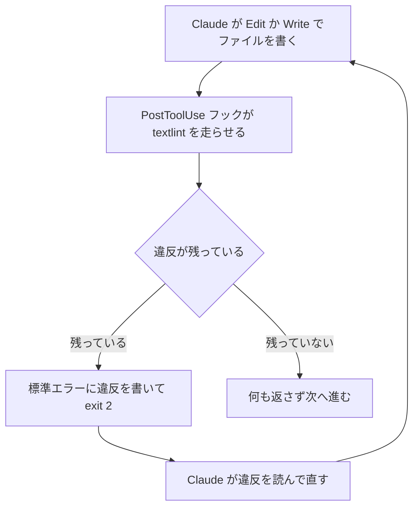

!!! abstract "要点"
    - **何ができるか**：ファイルを書いた直後に textlint を走らせ、残った違反を Claude に返して直させられる。機械で見つかる範囲の文体と表記を、仕組みで揃える。
    - **いつ引くか**：用語集を渡して頼んでも、表記の揺れが残るとき。文体や表記の決まりを、毎回自動で守らせたいとき。日本語のドキュメントを Claude Code で大量に書かせているとき。
    - **前提**：<!-- link:begin align-japanese-output -->[日本語の出力を揃える：お願いで足りること、仕組みが要ること](align-japanese-output.md)<!-- link:end -->、<!-- link:begin block-with-exit-2 -->[フックで止めて理由を返す（exit 2 と JSON）](../enforce/block-with-exit-2.md)<!-- link:end -->

<!-- textlint-disable -->
別名：textlint の hook・textlint・文章の lint・書いた後に検査して差し戻す・日本語の文章を機械で検査する
<!-- textlint-enable -->

textlint をフックで回す手順は、PostToolUse フックで Edit か Write の直後に textlint を走らせ、残った違反を標準エラーで Claude に返すものである。文体と表記の指示は「お願い」で、守られる保証がない。この手順は、機械で見つけられる範囲だけを、守られたかを毎回確かめる仕組みに替える。見つけられない範囲は、残る。

## どのルールを機械に任せるか {#rules}

機械に任せるのは、機械で見つけられて、直し方がほぼ決まっている規則だけである。指示（お願いの層）と、確かめて差し戻す層（フックと lint）の役割の分け方は、「<!-- link:begin align-japanese-output#lock-layer -->[日本語の出力を揃える：お願いで足りること、仕組みが要ること › 確かめて差し戻す層：フックと lint](align-japanese-output.md#lock-layer)<!-- link:end -->」にある。このページは、後者を textlint で組む手順を書く。

| 規則の例 | 機械に任せるか | 理由 |
|---|---|---|
| です・ます調とだ・である調の混在 | 任せる | 文末を機械で数えられる。直し方も決まっている |
| 用語の表記の揺れ（サーバーとサーバ） | 任せる | 辞書に正しい表記を持てば、違反が一意に決まる |
| 1 文の長さ、読点の数、助詞の重複、全角と半角の混在 | 任せる | 数や並びで判定できる |
| 読みやすさ、構成、定型の言い回し | 任せない | 判断が要る。lint の誤検出が増える |
| 内容の正しさ、事実 | 任せない | textlint の守備範囲の外である |

読みにくさの型のうち、lint に任せる所と判断の要る所の線引きは、「<!-- link:begin less-ai-sounding-japanese#lint-vs-judgment -->日本語の「AI 臭さ」を減らす › lint に任せる所と、判断の要る所（準備中）<!-- link:end -->」にある。文体の混在の見つけ方は「<!-- link:begin consistent-politeness#lint -->[です・ます／だ・であるを揃える › 混在を lint で見つける](consistent-politeness.md#lint)<!-- link:end -->」、表記の一覧の作り方は「<!-- link:begin consistent-notation#single-source -->[表記ゆれと漢字の開き › 一覧を指示と lint の両方に使う](consistent-notation.md#single-source)<!-- link:end -->」が持つ。ここでは繰り返さない。

公式の文書とリポジトリには、textlint の例がない。形が同じ公式の例は、編集後に整形するフック（Prettier）と、型検査を Stop フックで強制する例である。この雛形は、その形を textlint に当てはめた実践者の記事（根拠：弱。単独の事例）を参考にして、この辞典で組んだ。同じ形のフックは「<!-- link:begin hook-recipes#format-after-edit -->代表的なフックのレシピ › 編集の後に整形する（準備中）<!-- link:end -->」にもある。

!!! example "判断例：用語集を渡しても揺れが残る"
    - **状況**：用語集を CLAUDE.md に載せて渡したが、「サーバー」と「サーバ」が同じ文書に混ざって出る。
    - **迷う候補**：CLAUDE.md の指示を強める。または、同じ用語集から作った辞書で textlint を走らせ、違反を返させる。
    - **選んだもの**：辞書つきの textlint を、書いた直後に走らせる。
    - **理由**：指示を強めても、守られる保証は増えない。辞書は人が持つ正本から作れるので、指示と検査が同じ一覧を使える。ただし辞書にない語の揺れは見つからない。

## 書いた後に走らせて差し戻す {#post-tool-use}

書いた後に走らせて差し戻す手順は、textlint の設定、スクリプト、フックの登録の 3 つを置き、最後に新しいセッションで動かすものである。フックそのものの考え方は「<!-- link:begin hooks-basics#minimal -->[フックの考え方とイベント › 最小の使い方](../enforce/hooks-basics.md#minimal)<!-- link:end -->」にある。

差し戻しに PostToolUse の exit 2 を使う理由は、次のとおりである。PostToolUse では道具がもう実行されているので、exit 2 は操作を止めない。代わりに標準エラーが Claude に見える（公式の文書）。止める用途の PreToolUse とは、役割が違う。exit 2 と JSON の返し方の違いは、「<!-- link:begin block-with-exit-2#exit-2-vs-json -->[フックで止めて理由を返す（exit 2 と JSON） › exit 2 と JSON の違い](../enforce/block-with-exit-2.md#exit-2-vs-json)<!-- link:end -->」にある。



図の要点は 2 つである。違反が残る限り、書く、検査する、直すが回る。違反がなくなったときだけ、フックは黙って終わる。

**1 段目：textlint の設定を置く。** 次の設定が、文体の混在、1 文の長さ、読点の数、辞書による表記の検査を有効にする。ルールは、`textlint-rule-preset-japanese`、`textlint-rule-no-mix-dearu-desumasu`、`textlint-rule-prh` を、プロジェクトの `node_modules` に入れておく。`prh.yml` は、表記の一覧（用語集）から作る。作り方は、先に挙げた表記の一覧のページにある。

<!-- gen:begin snippet textlint-hook/textlintrc -->
<!-- textlint-disable -->

??? example "雛形：文体と表記のルールを入れた textlint の設定（.textlintrc.json）"

    ```json
    {
      "rules": {
        "preset-japanese": {
          "sentence-length": { "max": 150 },
          "max-ten": { "max": 3 }
        },
        "no-mix-dearu-desumasu": true,
        "prh": { "rulePaths": ["./prh.yml"] }
      }
    }
    ```

    動作を確かめていない雛形。要る最低の版：Claude Code 1.0.38。

<!-- textlint-enable -->
<!-- gen:end snippet textlint-hook/textlintrc -->

確かめ：手で `npx textlint` を、わざと違反を作った Markdown に走らせ、違反が出ることを見る。ここで出ないなら、フックにしても出ない。

**2 段目：スクリプトを置く。** 次のスクリプトは、標準入力の JSON からファイルのパスを読み、対象の拡張子なら textlint を走らせる。違反が残れば、一覧を標準エラーに書いて exit 2 で終わる。textlint を起動できないときも exit 2 で終わる。黙って検査が止まるのを避けるためである。返す行数に上限を付けているのは、違反が多いファイルで Claude の文脈を使い切らないためである。

<!-- gen:begin snippet textlint-hook/textlint-after-write -->
<!-- textlint-disable -->

??? example "雛形：Edit・Write の後に textlint を走らせ、違反を返すフック"

    ```python
    #!/usr/bin/env python3
    """Edit・Write の後に、書いた文章のファイルを textlint で検査し、違反を Claude に返す。

    - 違反が残っていれば、標準エラーに一覧を書いて exit 2 で終わる（PostToolUse では、標準エラーが Claude に返る）
    - 検査の対象外のファイルは、何もせず exit 0 で終わる
    - textlint を起動できないときも exit 2 で終わる（黙って検査が止まるのを避ける）
    """
    import json
    import os
    import subprocess
    import sys

    TARGET_SUFFIXES = (".md", ".mdx", ".txt")  # 検査する拡張子。広げすぎない
    MAX_LINES = 20  # Claude に返す違反の行数の上限。文脈を食いつぶさないため


    def main() -> int:
        try:
            path = json.load(sys.stdin)["tool_input"]["file_path"]
        except (ValueError, KeyError, TypeError):
            print("textlint フック：入力から file_path を読めなかった。", file=sys.stderr)
            return 2

        if not path.endswith(TARGET_SUFFIXES) or not os.path.isfile(path):
            return 0

        project = os.environ.get("CLAUDE_PROJECT_DIR", os.getcwd())
        try:
            # --no-install：未導入のときに、勝手に取得して走らせない
            result = subprocess.run(
                ["npx", "--no-install", "textlint", "--format", "unix", path],
                cwd=project,
                capture_output=True,
                text=True,
                timeout=60,
            )
        except (OSError, subprocess.TimeoutExpired) as e:
            print(f"textlint フック：textlint を実行できなかった（{e}）。", file=sys.stderr)
            return 2

        if result.returncode == 0:
            return 0

        lines = (result.stdout or result.stderr).strip().splitlines()
        if result.returncode != 1:
            # 1 は「違反あり」。それ以外は textlint 自体の失敗（設定の誤りなど）
            print("textlint フック：textlint が異常終了した。設定を確かめること。", file=sys.stderr)
        else:
            print(f"textlint の違反が {path} に残っている。次の箇所を直すこと。", file=sys.stderr)
        for line in lines[:MAX_LINES]:
            print(line, file=sys.stderr)
        if len(lines) > MAX_LINES:
            print(f"（ほか {len(lines) - MAX_LINES} 行。先に上の違反を直すこと）", file=sys.stderr)
        return 2


    if __name__ == "__main__":
        sys.exit(main())
    ```

    動作を確かめていない雛形。要る最低の版：Claude Code 1.0.38。

<!-- textlint-enable -->
<!-- gen:end snippet textlint-hook/textlint-after-write -->

確かめ：違反のある Markdown のパスを入れた JSON を標準入力に渡し、終了コードが 2 で、標準エラーに違反が出ることを見る。

**3 段目：フックを登録する。** 次の設定を、プロジェクトの `.claude/settings.json` に入れる。matcher は `Edit|Write` にする。現行の公式の文書では、MultiEdit は legacy の扱いである。スクリプトは、シェルを通さずに起動する形（`args`）で呼ぶ。

<!-- gen:begin snippet textlint-hook/register-hook -->
<!-- textlint-disable -->

??? example "雛形：textlint のフックを PostToolUse に登録する設定"

    ```json
    {
      "hooks": {
        "PostToolUse": [
          {
            "matcher": "Edit|Write",
            "hooks": [
              {
                "type": "command",
                "command": "python3",
                "args": ["${CLAUDE_PROJECT_DIR}/.claude/hooks/textlint-after-write.py"],
                "onFailure": "block"
              }
            ]
          }
        ]
      }
    }
    ```

    動作を確かめていない雛形。要る最低の版：Claude Code 1.0.38。

<!-- textlint-enable -->
<!-- gen:end snippet textlint-hook/register-hook -->

確かめ：新しいセッションで `/hooks` を開き、PostToolUse の `Edit|Write` にこのフックが出ることを見る。

**自動修正を先に走らせるか。** `--fix` を先に走らせて、直せなかった分だけを返す方法もある。実践者の記事は、この順で組んでいる（根拠：弱）。ただし、フックがファイルを書き換えるので、Claude が持つ内容とファイルがずれる。ずれて次の編集が失敗しないかは、確かめていない。この雛形は、書き換えず、検査だけをする形にした。

## 動いたかを確かめる {#verify}

動いたかの確かめは、フックが違反を返すことと、Claude がそれを直すことの 2 つを、別々に見るものである。1 回の成功だけで常設にしない。

1. 違反のない Markdown を書かせる。フックが何も返さず、作業が止まらないことを見る。
2. 設定の規則に触れる Markdown を書かせる。違反の一覧が Claude に返り、同じファイルを直す動きになることを見る。
3. 拡張子が `.py` のファイルを書かせる。対象外で、何も返らないことを見る。
4. スクリプトを一時的に消して、Markdown を書かせる。フックの失敗が Claude に見えることを見る。フックが落ちたときの確認である。

順に見て、4 つとも期待どおりなら、チームに配る。揺れが残るときの切り分けは、「<!-- link:begin inconsistent-japanese-style#diagnosis -->[文体や表記が揃わない › 原因を安く確かめる順](../symptoms/inconsistent-japanese-style.md#diagnosis)<!-- link:end -->」にある。辞書にない語の揺れや、textlint が見ない範囲の揺れは、フックを足しても減らない。

## 拾えない書き込み（シェルで書いたファイル） {#gaps}

`Edit|Write` に付けた PostToolUse フックは、Edit と Write の道具で書いたファイルだけを拾う。Bash のヒアドキュメントやリダイレクト、スクリプトの出力で書いたファイルは、拾えない。Claude が書き込みの経路を変えると、検査が黙って抜ける。

- **FileChanged で拾う**：どこから書き換えても拾うイベントとして、FileChanged がある。ただし matcher は、監視するファイル名を並べて指定する形である。任意の Markdown をすべて拾う使い方には向かない。入力の詳細は未確認で、雛形も載せていない。
- **終わりに一括検査する**：Stop フックを使い、変わったファイルをまとめて検査する形がある。公式の文書には、型検査を Stop フックで強制する例があり、標準エラーは exit 2 で Claude に返る。textlint に当てはめた実例は見つかっていない（推論・実践例なし）。最後の返事を確かめる Stop フックの書き方は、「<!-- link:begin keep-replies-in-japanese#stop-hook -->[日本語で返し続けさせる › Stop フックで最後の返事を確かめる](keep-replies-in-japanese.md#stop-hook)<!-- link:end -->」にある。
- **お願いで補う**：文章は Edit か Write で書くよう、CLAUDE.md に一行書く。これはお願いなので、守られる保証はない。
- **最後の網を別に置く**：コミット前や CI でも textlint を走らせる。フックを抜けた分を、人の側の仕組みで拾う。

## フックが落ちたときと、規則を増やしすぎないこと {#failure-and-few}

フックは、失敗すると操作を通すのが既定である。次のどれも「止めない誤り」になる。起動できない。0 と 2 以外で終わる。タイムアウトする。出力の JSON が壊れている。textlint を入れ忘れた環境で、検査が黙って止まるのは、この既定のためである。書き方の一般則は、「<!-- link:begin writing-safe-hooks#fail-open -->フックを安全に書く › 既定は失敗すると通す（fail-open）（準備中）<!-- link:end -->」にある。

textlint のフックでは、失敗を次の 2 段で見えるようにする。

- スクリプトの中で、textlint を起動できない、異常終了した、の 2 つを exit 2 に倒す（雛形の `except` と終了コードの分岐）。
- 設定に `"onFailure": "block"` を付け、スクリプトが起動できない失敗や、想定外の終了コードで落ちた失敗も、exit 2 と同じ扱いにする。command か http のフックで使え、<!-- fact:begin hook-on-failure-block-min-version -->Claude Code 2.1.295 以降（2026-11-05 時点）<!-- fact:end -->で入った。スクリプトが中で失敗しても 0 で終われば、`onFailure` があっても通る。

どちらも、PostToolUse では「Claude に失敗が見える」にとどまる。道具の実行そのものは止まらない。判断をモデルが行う prompt 型と agent 型のフックは、別のモデルの判断なので、強制にならない。決まった検査には command 型を使う。

規則を増やしすぎると、別の失敗が起きる。縛りが多いと、柔軟な対応ができなくなり、不適切な対処が増える。縛る規則は少なく絞るのが原則である。textlint では、次の形で表れる。

- 誤検出の規則が残ると、Claude が直せない違反を、毎回返され続ける。直す先の文章が正しくても、同じ指摘が繰り返される。
- 文体の規則を増やすと、直しの往復が増え、本来の作業に使う文脈が減る。

対策は 3 つある。規則は、1 つずつ足して、効きを確かめる。誤検出の多い規則は外す。例外にしたい箇所だけ、`<!-- textlint-disable -->` の囲みで外す。違反の一覧に行数の上限を付けたのも、同じ理由である。

## チームで共有する {#share}

チームで共有するものは、フックの設定、スクリプト、`.textlintrc.json`、`prh.yml`、textlint の依存の宣言である。フックの設定は、リポジトリの `.claude/settings.json` に入れる。個人の好みや秘密を共有のファイルに入れない分け方は、「<!-- link:begin share-team-settings#shared-vs-personal -->チームで設定を共有する › 共有するものと個人に残すもの（準備中）<!-- link:end -->」にある。

- **信頼してから効く**：初めて開いたリポジトリのフックは、信頼の確認を済ませるまで動かない設定がある。新しい参加者には、その旨を伝える。詳しくは「<!-- link:begin share-team-settings#after-trust -->チームで設定を共有する › 信頼してから効く設定（準備中）<!-- link:end -->」にある。
- **クラウドのセッション**：ユーザーの設定のフックとプラグインは効かない。リポジトリの `.claude/settings.json` に入れたものは、1 つのリポジトリのセッションで効く。そこに textlint が入っているかは、環境ごとに確かめる（未確認）。
- **フックは利用者の権限で動く**：他人のスクリプトは、コードとして読んでから使う。「<!-- link:begin writing-safe-hooks#runs-as-you -->フックを安全に書く › フックは利用者の権限で動く（準備中）<!-- link:end -->」を見る。
- **設定を書き換えて違反を消さない**：Claude は `.textlintrc.json` も Edit できる。違反を消すために、規則を外す直し方をされるおそれがある。直す対象は文章で、設定ではないと CLAUDE.md に一行書く。厳しく守らせるなら、設定のファイルへの編集を PreToolUse で止め、理由と代わりの手段を返す（推論・実践例なし）。止め方は「<!-- link:begin block-with-exit-2#when -->[フックで止めて理由を返す（exit 2 と JSON） › 使いどころ](../enforce/block-with-exit-2.md#when)<!-- link:end -->」にある。

<!-- gen:begin references -->
<!-- textlint-disable -->

## 参考 {#references}

- [Hooks reference](https://code.claude.com/docs/en/hooks)：Anthropic・英語・確認日 2026-11-04
- [Automate actions with hooks](https://code.claude.com/docs/en/hooks-guide)：Anthropic・英語・確認日 2026-11-04
- [Best practices for Claude Code](https://code.claude.com/docs/en/best-practices)：Anthropic・英語・確認日 2026-11-04
- [\[進化版\] VSCode + Claude Code Hooksでマークダウンの文書作成を爆速化する環境構築方法](https://zenn.dev/yuki_fujisawa/articles/a01e472dc190cf)：Zenn（yuki\_fujisawa）・確認日 2026-11-04

<!-- textlint-enable -->
<!-- gen:end references -->

<!-- gen:begin page-links -->
<!-- textlint-disable -->

<div class="ca-page-links" markdown>

**前提**

- [日本語の出力を揃える：お願いで足りること、仕組みが要ること](align-japanese-output.md)
- [フックで止めて理由を返す（exit 2 と JSON）](../enforce/block-with-exit-2.md)

**関連**

- [です・ます／だ・であるを揃える](consistent-politeness.md)
- [表記ゆれと漢字の開き](consistent-notation.md)
- [文体や表記が揃わない](../symptoms/inconsistent-japanese-style.md)
- 代表的なフックのレシピ（準備中）
- [フックの考え方とイベント](../enforce/hooks-basics.md)
- フックを安全に書く（準備中）
- チームで設定を共有する（準備中）
- 日本語の「AI 臭さ」を減らす（準備中）
- [日本語で返し続けさせる](keep-replies-in-japanese.md)

</div>

<!-- textlint-enable -->
<!-- gen:end page-links -->
