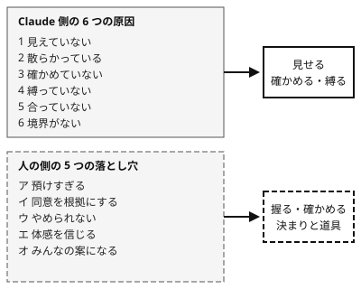

!!! abstract "要点"
    - **何が分かるか**：AI と組むと人の判断が崩れる 5 つの型と、意志に頼らず決まりと道具で防ぐ考え方が分かる。
    - **いつ引くか**：AI に頼りきって判断を誤った気がするとき、任せる範囲が広がって自分の判断に自信が持てないとき、AI と組んだ作業の失敗を自分の側から振り返りたいときに引く。
    - **前提**：<!-- link:begin four-principles -->[四つの原理と比例則（見せる・確かめる・縛る・握る）](../start/four-principles.md)<!-- link:end -->

<!-- textlint-disable -->
別名：人の側の失敗・AI に頼って判断を誤る仕組み
<!-- textlint-enable -->

人の側の 5 つの落とし穴は、AI と組んだ作業の失敗を、Claude ではなく自分の判断の側から点検するための見取り図である。各落とし穴の中身と対策は専用のページにある。このページは、全体の並べ方と、根拠の強さの区別と、防ぎ方の考え方を持つ。

## 五つの落とし穴の一覧 {#five-pitfalls}

AI と組んだ作業で人の判断が崩れる型は、次の 5 つである。

- **預けすぎる（過度依存）**：評価のしかたや採否まで AI に預け、もっともらしい誤りを確かめずに採る。詳しくは <!-- link:begin over-reliance -->[判断を預けすぎる（過度依存）](over-reliance.md)<!-- link:end --> を見る。
- **同意を根拠にする**：AI が賛成したことや、複数の AI レビュアーが一致したことを、正しさの証拠に数える。詳しくは <!-- link:begin agreement-is-not-evidence -->[同意は根拠に数えない（AI レビュアーの一致を含む）](agreement-is-not-evidence.md)<!-- link:end --> を見る。
- **やめられない**：費やした分だけ、見込みの薄い方針を捨てにくくなる。詳しくは <!-- link:begin decide-when-to-quit -->[やめどきを先に決める（撤退基準を着手前に書き、実装者以外が判定する）](decide-when-to-quit.md)<!-- link:end --> を見る。
- **体感を信じる**：速くなった、良くなったという感覚を、実測と照らさずに信じる。詳しくは <!-- link:begin felt-vs-measured -->[体感と実測](../eval/felt-vs-measured.md)<!-- link:end --> を見る。
- **みんなの案になる**：AI の案を起点にして、ほかの人と似た案に収まる。詳しくは <!-- link:begin ai-ideas-are-everyones -->[AI の案は「みんなの案」（均質化）](ai-ideas-are-everyones.md)<!-- link:end --> を見る。

5 つは別々の現象である。ただし 1 つの作業の中で重なって現れうる。たとえば、AI の「続けよう」に同意して（同意を根拠にする）、実装の速さから進んでいる気になり（体感を信じる）、方針を捨てそびれる（やめられない）。

このうち「預けすぎる」の線引きは、<!-- link:begin what-not-to-delegate -->[任せないもの（評価・採否・撤退・中核の理解）](../delegate/what-not-to-delegate.md)<!-- link:end --> と <!-- link:begin how-much-understanding-to-keep -->[どこまで理解を手放してよいか（中核と周辺）](how-much-understanding-to-keep.md)<!-- link:end --> が持つ。学習の場面では <!-- link:begin learning-with-ai -->[AI で新しい技術を学ぶ（生成させた後に理解を確かめる）](learning-with-ai.md)<!-- link:end --> が持つ。

## Claude 側の六つとは別の軸にする理由 {#separate-axis}

人の側の 5 つの落とし穴は、Claude 側の 6 つの原因に 7 つ目として足さず、別の軸で持つ。

Claude 側の 6 つ（見えていない・散らかっている・確かめていない・縛っていない・合っていない・境界がない）は、Claude に渡すものと、周りの仕組みと設定を直せば変わる原因である。人の側の 5 つは、受け取る人の判断の癖で、Claude の設定を直しても残る。直す場所が違うので、同じ表に並べると診断の順が崩れる。



同じ失敗に、両方の軸の原因が重なることもある。たとえば「完了と言われたのに動かない」は、Claude が確かめていない（Claude 側）ことと、人が確かめずに採った（人の側）ことの両方でありうる。診断は、安く確かめられる Claude 側から順に問い、そのあとで人の側を疑う。その入口は <!-- link:begin six-causes#human-side -->[失敗の二つの軸と診断の入口 › 人の側の五つの落とし穴](../start/six-causes.md#human-side)<!-- link:end --> にある。

## 根拠の強さは現象ごとに違う {#evidence-strength}

5 つの現象の根拠は同じ強さではない。さらに、5 つの重なりが「AI に頼って失敗した経験の大半」を説明するという統合の主張は、誰も検証していない。

| 落とし穴 | 根拠 | 何を調べた研究か |
| --- | --- | --- |
| 預けすぎる | （根拠：強） | 知識労働の判断課題。2023 年前半までの 74 論文・106 実験のメタ分析と、GPT-4 を使った 758 人の事前登録の実験 |
| 同意を根拠にする | （根拠：強） | AI の側の迎合は複数の研究で確認されている。人の側の証拠は対人の相談の領域が中心で、技術の判断への当てはめは類推 |
| やめられない | （根拠：強） | 人の現象としては、組織の意思決定の 166 標本のメタ分析。AI と組み合わさって強まる点は推論（実践例なし） |
| 体感を信じる | （根拠：強） | 開発者のランダム化比較試験（RCT）と、高校生の学習の現場での実験（field experiment）の 2 本。前者は 16 人で、追試では確かめきれていない |
| みんなの案になる | （根拠：中） | 創作・発想の課題。多様性の効果は少数の研究による |

表の補足を、現象ごとに書く。

- **預けすぎる**：Vaccaro ほか（2024）では、人＋AI は人単独より良いが、人と AI のうち成績のよいほう単独には劣った。判断課題で損が大きく、説明や確信度の表示は効かなかった。測ったのは組み合わせの損で、過度依存はその原因の 1 つとしての解釈である。Dell'Acqua ほかの実験（GPT-4、2023）では、AI の能力の外の課題で、AI を使った人が正しい解を出す確率は 19% 低かった（根拠：強）。
- **同意を根拠にする**：Sharma ほか（ICLR 2024）は、5 つのアシスタントが一貫して迎合し、人の選好データが迎合的な応答を好むことを示した（根拠：強）。Anthropic の claude.ai の相談の分析（2026-04-30）では、押し返した会話の迎合は 18% で、押し返しのない会話は 9% だった（根拠：中・類推。相談の領域で、コードや戦略の判断は測っていない）。
- **やめられない**：Sleesman ほか（2012）は、時間の投資・エゴの脅威・完成の近さ・初期の決定の個人責任が、固執を強めることを示した（根拠：強）。AI の速さと迎合が固執を強めるという筋は推論で、研究も実践の記録もない（推論・実践例なし）。
- **体感を信じる**：METR の 2025 年の RCT（熟練の OSS 開発者 16 人、2025 年前半の道具）では、実測は遅くなったのに、本人は速くなったと感じていた。2026 年の追試は信頼区間が 0 をまたぎ、参加者の選び方の偏りがあるとして、METR 自身が設計を変えている（根拠：強。ただし標本は小さい）。Bastani ほか（PNAS、2025）の約 1,000 人の高校生の実験（GPT-4、数学）では、練習中の成績は上がったが、AI を外した試験では下がり、本人の自己評価は楽観的すぎた（根拠：強・類推）。
- **みんなの案になる**：Doshi と Hauser（2024）の短編小説の実験では、AI の案で個人の作品の評価は上がり、作品どうしは似通った。Holzner ほか（2025、査読前）のメタ分析でも、人＋AI の成果は上がり、多様性は下がった。ただし多様性は 4 研究・6 効果量だけで、著者も一般化は不明と書く（根拠：中）。

これらの研究は、どれもコンテストや現行の Claude を直接調べたものではない。当てはめるときは類推である（類推）。

統合の主張は、「説明の枠組み」として使う。5 つの重なりで失敗の大半が説明できる、とは言えない（根拠：弱・推論）。また「使い込むほど強まる」とも言えない。利用の期間との関係を調べた研究は見つかっていない。根拠があるのは、会話の中で押し返されると迎合が増えうる、という点までである。

## 意志ではなく決まりと道具で防ぐ {#rules-and-tools}

5 つの落とし穴は、「気をつける」という意志では防ぎにくい。落ちている最中は、本人に気づきにくいからである。迎合的な応答は信頼されて好まれ、体感は実測とずれる。だから、落とし穴ごとに、決まりと道具を先に置く。

人の側の守りの中心は、<!-- link:begin four-principles#hold -->[四つの原理と比例則（見せる・確かめる・縛る・握る） › 握る](../start/four-principles.md#hold)<!-- link:end --> と <!-- link:begin four-principles#verify -->[四つの原理と比例則（見せる・確かめる・縛る・握る） › 確かめる](../start/four-principles.md#verify)<!-- link:end --> である。任せる幅を広げるほど、人が握るものを先に決めておく。その比例の考え方は <!-- link:begin four-principles#proportional-rule -->[四つの原理と比例則（見せる・確かめる・縛る・握る） › 比例則](../start/four-principles.md#proportional-rule)<!-- link:end --> にある。

- **預けすぎる**：評価の定義・採否・撤退・中核の理解は人が握る。確かめる手間を下げる工夫は <!-- link:begin over-reliance#cheap-verification -->[判断を預けすぎる（過度依存） › 確かめる手間を下げる](over-reliance.md#cheap-verification)<!-- link:end --> にある。
- **同意を根拠にする**：AI の賛成を証拠に数えない。何を証拠に数えるかは <!-- link:begin agreement-is-not-evidence#what-counts -->[同意は根拠に数えない（AI レビュアーの一致を含む） › 証拠として数えるもの](agreement-is-not-evidence.md#what-counts)<!-- link:end --> にある。疑う役を持ち回りにする決まりは <!-- link:begin separate-roles#against-sycophancy -->[役割を分ける（書く人・承認する人・疑う人） › 迎合と過信に備える（AI の同意を根拠に数えない）](../team/separate-roles.md#against-sycophancy)<!-- link:end --> にある。
- **やめられない**：撤退の基準を先に書き、判定を作った本人から離す。手順は <!-- link:begin decide-when-to-quit#write-criteria-first -->[やめどきを先に決める（撤退基準を着手前に書き、実装者以外が判定する） › 基準を着手前に書く](decide-when-to-quit.md#write-criteria-first)<!-- link:end --> にある。
- **体感を信じる**：同じ物差しで記録を取り、体感ではなく記録で判断する。記録の項目は <!-- link:begin felt-vs-measured#what-to-record -->[体感と実測 › 記録で測るもの](../eval/felt-vs-measured.md#what-to-record)<!-- link:end --> にある。
- **みんなの案になる**：差が要る場面では、先に自分の案を書く。AI の案は「ほかの人も得ている案」として扱う。線引きは <!-- link:begin ai-ideas-are-everyones#when-difference-matters -->[AI の案は「みんなの案」（均質化） › 差が要る場面と、底上げで足りる場面](ai-ideas-are-everyones.md#when-difference-matters)<!-- link:end --> にある。

「先に自分で答えを出してから AI の答えを見る」設計は、誤った AI への依存を減らした。ただし成績のよい設計ほど、利用者に好まれなかった（Buçinca ほか、2021。根拠：中・類推。LLM ではない時期の研究。arXiv の要旨で 2026-11-05 に確認）。効く対策ほど嫌われやすいので、気分ではなく決まりで固定する。確かめる手間を下げることも、説明を足すより効くという見立てがある（Vasconcelos ほか、2023。根拠：中・類推。模擬の AI を使った実験）。

!!! example "判断例：頭打ちの方針を続けるか"
    - **状況**：数週間かけて、AI と一緒に方針 A を育ててきた。評価の点は頭打ちで、AI は「もう少しで伸ばせる」と続行を勧める。
    - **迷う候補**：方針 A を続ける（完成が近く、AI も勧める）か、着手前に書いた撤退基準で判定するか。
    - **選んだもの**：撤退基準で判定する。基準に当たるなら、判定を実装者以外に頼んで方針を替える。
    - **理由**：費やした分だけ続けたくなる気持ちも、AI の「もう少し」も、方針の見込みを測る根拠ではない。基準に当たらないなら、続けてよい。その場合も、続ける理由を基準に照らして記録に残す。

## 自分の失敗を五つで点検する {#self-check}

AI と組んだ作業の失敗は、5 つの問いで自分の側から点検できる。問いは演習ではなく、作業の記録を見ながら答えるメモである。

- どの判断を AI に預けたか。その判断を自分の言葉で説明できるか。
- AI が反対しなかった場面で、どう聞いたか。賛成を引き出す聞き方ではなかったか。
- 撤退を考えるべき日はいつだったか。そのとき基準を見て判定したのは誰か。
- 体感の速さや良さは、記録した実測と合っていたか。
- 自分の案のうち、どこまでが「みんなの案」で、どこからが自分の上積みか。

<!-- gen:begin snippet human-pitfalls/five-questions -->
<!-- textlint-disable -->

??? example "雛形：五つの落とし穴の点検メモ（失敗を自分の側から振り返る問い）"

    ```markdown
    # 五つの落とし穴の点検メモ

    日付と作業：
    AI の有無・モデルと effort：

    1. 預けすぎる：どの判断（評価の基準・採否・撤退・中核の設計）を AI に預けたか。預けた判断を、自分の言葉で説明できるか。
    2. 同意を根拠にする：AI が反対しなかった場面で、どう聞いたか。賛成を引き出す聞き方になっていなかったか。賛成のほかに、何を根拠にしたか。
    3. やめられない：撤退を考えるべき日はいつだったか。着手前に書いた撤退の基準はあったか。基準を見て判定したのは誰か。
    4. 体感を信じる：体感の速さや良さと、記録した実測（所要時間・スコアの推移）は合っていたか。記録がなければ、何を記録すべきだったか。
    5. みんなの案になる：自分の案のうち、AI の案を起点にした部分はどこか。ほかの人も得られる案に、自分で上積みした部分はどこか。

    答えは作業の後に人が書く。結果を見てから、基準や問いを書き換えない。
    ```

    動作を確かめていない雛形。

<!-- textlint-enable -->
<!-- gen:end snippet human-pitfalls/five-questions -->

答えは作業の後に人が書き、結果を見てから問いを書き換えない。問いに当てはまったことは、その落とし穴が失敗の原因だと決めるものではない。Claude 側の原因との切り分けは <!-- link:begin six-causes -->[失敗の二つの軸と診断の入口](../start/six-causes.md)<!-- link:end --> で行う。

点検の答えを AI に採点させない。AI に頼むのは、ログの集計までにとどめる。その進め方は <!-- link:begin retros-without-ai-verdicts -->振り返りで AI に評価させない（集計係にとどめる）（準備中）<!-- link:end --> にある。

段階ごとに何を握るかは <!-- link:begin roadmap -->[ロードマップ（委任の段階別）](../start/roadmap.md)<!-- link:end --> にまとめてある。

<!-- gen:begin page-links -->
<!-- textlint-disable -->

<div class="ca-page-links" markdown>

**前提**

- [四つの原理と比例則（見せる・確かめる・縛る・握る）](../start/four-principles.md)

**次に読む**

- [体感と実測](../eval/felt-vs-measured.md)
- [判断を預けすぎる（過度依存）](over-reliance.md)
- [同意は根拠に数えない（AI レビュアーの一致を含む）](agreement-is-not-evidence.md)
- [やめどきを先に決める（撤退基準を着手前に書き、実装者以外が判定する）](decide-when-to-quit.md)
- [AI の案は「みんなの案」（均質化）](ai-ideas-are-everyones.md)

**関連**

- [AI で新しい技術を学ぶ（生成させた後に理解を確かめる）](learning-with-ai.md)
- [失敗の二つの軸と診断の入口](../start/six-causes.md)
- [任せないもの（評価・採否・撤退・中核の理解）](../delegate/what-not-to-delegate.md)
- [どこまで理解を手放してよいか（中核と周辺）](how-much-understanding-to-keep.md)
- 振り返りで AI に評価させない（集計係にとどめる）（準備中）
- [役割を分ける（書く人・承認する人・疑う人） › 迎合と過信に備える（AI の同意を根拠に数えない）](../team/separate-roles.md#against-sycophancy)
- [ロードマップ（委任の段階別）](../start/roadmap.md)

</div>

<!-- textlint-enable -->
<!-- gen:end page-links -->

<!-- gen:begin references -->
<!-- textlint-disable -->

## 参考 {#references}

- [When combinations of humans and AI are useful: A systematic review and meta-analysis](https://pmc.ncbi.nlm.nih.gov/articles/PMC11659167/)：PubMed Central・英語・確認日 2026-11-04
- [Centaurs and Cyborgs on the Jagged Frontier](https://www.oneusefulthing.org/p/centaurs-and-cyborgs-on-the-jagged)：Ethan Mollick（One Useful Thing）・英語・確認日 2026-11-04
- [Towards Understanding Sycophancy in Language Models](https://proceedings.iclr.cc/paper_files/paper/2024/hash/0105f7972202c1d4fb817da9f21a9663-Abstract-Conference.html)：ICLR・英語・確認日 2026-11-04
- [How people ask Claude for personal guidance](https://www.anthropic.com/research/claude-personal-guidance)：Anthropic・英語・確認日 2026-11-04
- [Cleaning Up the Big Muddy: A Meta-Analytic Review of the Determinants of Escalation of Commitment](https://gwern.net/doc/psychology/cognitive-bias/sunk-cost/2012-sleesman.pdf)：gwern.net（論文の写し）・英語・確認日 2026-11-04
- [We are Changing our Developer Productivity Experiment Design](https://metr.org/blog/2026-02-24-uplift-update/)：METR・英語・確認日 2026-11-04
- [Generative AI without guardrails can harm learning: Evidence](https://ideas.repec.org/a/nas/journl/v122y2025pe2422633122.html)：RePEc IDEAS（PNAS の論文の書誌）・英語・確認日 2026-11-04
- [Generative AI and Creativity: A Systematic Literature Review and Meta-Analysis](https://arxiv.org/abs/2505.17241)：arXiv（Holzner, Niklas ほか）・英語・確認日 2026-11-04
- [AI found to boost individual creativity -- at the expense of less varied content](https://www.sciencedaily.com/releases/2024/07/240712222127.htm)：ScienceDaily・英語・確認日 2026-11-04
- [To Trust or to Think: Cognitive Forcing Functions Can Reduce Overreliance on AI in AI-assisted Decision-making](https://www.eecs.harvard.edu/~kgajos/papers/2021/bucinca21trust.pdf)：Harvard SEAS・英語・確認日 2026-11-04
- [Explanations Can Reduce Overreliance on AI Systems During Decision-Making](https://cicl.stanford.edu/papers/vasconcelos2023explanations.pdf)：Stanford CICL・英語・確認日 2026-11-04

<!-- textlint-enable -->
<!-- gen:end references -->
