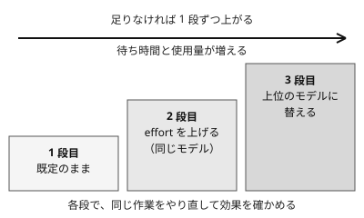

!!! abstract "要点"
    - **何が分かるか**：まず既定のモデルで試し、足りなければ effort を上げ、それでも足りないときだけ上位のモデルに替える順で選べる。
    - **いつ引くか**：effort を上げるかモデルを替えるか迷うとき。一番賢いモデルを常に使うべきか知りたいとき。モデルを替えたのに、良くなったのかどうか分からないとき。
    - **確かめ方**：1 段進めるたびに、同じ作業をやり直して比べる。体感で決めない。
    - **前提**：<!-- link:begin current-models -->[現行モデルの一覧と位置づけ](current-models.md)<!-- link:end -->

<!-- textlint-disable -->
別名：どのモデルを使うか・モデル選択・effort を上げるかモデルを替えるか
<!-- textlint-enable -->

モデルの選び方（三段階）は、モデルと effort を動かす順番を決める考え方である。どの作業にも合う単一のモデルはない。小さい変更から順に試し、作業の重さに合う組み合わせを自分の作業で確かめて決める。

## 三段階：既定 → effort → 上位のモデル {#three-steps}

三段階とは、既定のモデルのまま始め、足りなければ effort を上げ、それでも足りないときだけ上位のモデルに替える順である。

1. **既定のまま始める**：日常の用途は既定の設定で足りる、と公式のヘルプが案内している。既定のモデルと effort は、面・プラン・版で違う。いま何が既定かは、<!-- link:begin current-models#by-surface -->[現行モデルの一覧と位置づけ › 面とプランごとに選べるモデル](current-models.md#by-surface)<!-- link:end -->と<!-- link:begin effort-levels#defaults-by-surface -->[effort の段階と使い分け › 既定の段（モデル × 面の表）](effort-levels.md#defaults-by-surface)<!-- link:end -->で確かめる。
2. **同じモデルで effort を上げる**：複雑な作業で足りないときは、モデルを替えずに考える深さを上げる。最も高い段は過剰に考えることがあると公式の文書が注意しているので、最初から最高の段にせず、1 段ずつ上げる。各段の振る舞いは<!-- link:begin effort-levels#levels -->[effort の段階と使い分け › 段ごとの振る舞い](effort-levels.md#levels)<!-- link:end -->にある。
3. **上位のモデルに替える**：effort を上げても足りないときだけ、上位のモデルに替える。向く仕事は、何時間も続く自律的な作業や、多段の調査のような重い仕事である。どのモデルが上位かは版で変わるので、<!-- link:begin current-models#lineup -->[現行モデルの一覧と位置づけ › 系統ごとの位置づけ（表）](current-models.md#lineup)<!-- link:end -->で確かめる。

モデルを替えたら、effort を前のモデルから持ち越さない。API の文書は、旧モデルの設定を流用せず、自分の評価で effort を振って確かめるよう勧めている。

### 始め方は 2 つある

公式のモデル選択ガイドには、始め方が 2 つ書かれている。

- **能力優先**：高い能力のモデルから始め、effort を下げたり下位のモデルに替えたりして最適化する。最も高い effort でも足りなければ、さらに上位へ進む。
- **効率優先**：軽いモデルから始め、性能が足りない部分だけ上位に替える。

この辞典は、対話で頼み始める読者には、既定から始める三段階を勧める（この辞典の推奨）。大量処理・分類・サブエージェントのように件数の多い作業は、効率優先で軽いモデルから上げる。軽いモデルの使いどころは<!-- link:begin split-models-by-role#lighter-models -->[計画・実装・サブエージェントでモデルを分ける › 軽いモデルの使いどころ](split-models-by-role.md#lighter-models)<!-- link:end -->にある。

### モデルと effort を替える場所

面によって、替える場所が違う。

=== "アプリ"

    送信ボタンの横のモデルのメニューで切り替える。変更は次の応答から反映される。

=== "Claude Code"

    `/model` でモデルを切り替える。選んだモデルは、新しいセッションの既定として保存される。ピッカーで `s` を押すと、そのセッションだけに効く。effort は `/effort` で変える。

=== "API"

    リクエストの `model` を替える。effort は、effort のパラメーターで指定する。

面ごとの effort の変え方は、<!-- link:begin effort-levels#how-to-set -->[effort の段階と使い分け › 面ごとの変え方](effort-levels.md#how-to-set)<!-- link:end -->にある。

## モデルより effort を先に動かす理由 {#effort-first}

effort を先に動かすのは、公式の選択ガイドがそう勧めているからである。

> Tuning effort is often a better lever than switching models

出典：[Choosing the right model](https://platform.claude.com/docs/en/about-claude/models/choosing-a-model)

この辞典は、理由を次のように整理している（この辞典の整理）。

- **変わるものが少ない**：effort を動かしても、モデルは同じままである。変わるのは考える深さで、速さ・料金・癖といったモデルの違いは混ざらない。効いたかどうかを切り分けやすい。
- **戻しやすい**：1 段戻すだけで元の状態になる。モデルを替えると、効いたのがモデルの差なのか、ほかの違いなのかが分かりにくい。
- **釣り合いが見える**：高い effort ほど、時間とトークンを多く使うと公式のヘルプは述べている。段を上げた分の待ち時間と使用量を、効果と見比べて決められる。

effort にも限りがある。最も高い段でも足りない仕事が、上位のモデルに替える場面である。そのときも、替えた後に effort を確かめ直す。

## 何に効くか（原理と防ぐ原因） {#what-it-prevents}

このページの考え方は、原理「確かめる」と、原因「合っていない」に結び付く。

原因「合っていない」とは、選んだモデルや effort が、その作業の重さに合っていないことである。合っていない形は 2 つある。

- **軽すぎる**：浅い推測で終わる、見落としが出る。effort を上げるか、モデルを替える。
- **重すぎる**：簡単な作業で待たされ、使用量だけが増える。1 段戻す。

どちらの場合も、原理「確かめる」に従い、替える前と後で同じ作業を比べて決める。差が出ないなら、原因はモデルや effort ではない可能性がある。結果の差が、検証の手段・渡す文脈・指示といったハーネスから来る場合は、<!-- link:begin harness-over-model#when-harness-matters -->[モデルの差よりハーネスの差 › 差がハーネスから来るとき](harness-over-model.md#when-harness-matters)<!-- link:end -->を見る。

## プランとの関係 {#plans}

モデルを選ぶときは、プランとの関係も見る。選ぶモデルで、上限の減り方が変わるからである。

- **上位のモデルの扱いはプランで違う**：枠に含まれるか、追加の支払いから引かれるかが、プランによって違う（<!-- fact:begin top-model-by-plan -->未確認<!-- fact:end -->）。どの枠から引かれるかは<!-- link:begin before-using-top-model#which-limit -->[最上位のモデルを使う前に › どの枠から引かれるか（プランごとの表）](../cost/before-using-top-model.md#which-limit)<!-- link:end -->の表で確かめる。
- **プランの比べ方**：使う面・上位のモデルの扱い・上限の形は<!-- link:begin choosing-a-plan#plan-table -->[プランの選び方 › プランの表（確認日つき）](../cost/choosing-a-plan.md#plan-table)<!-- link:end -->で比べる。
- **減り方は自分で見る**：モデルを替えた後は、`/usage` で上限の減り方を確かめる。
- **選べるモデルが絞られていることがある**：組織の管理者が、使えるモデルや effort を制限している場合がある。上位のモデルが選べないときは、3 段目に進めない。2 段目の effort で足りるかを先に確かめる。

「上位のモデルは高いから避ける」という古い助言も、一律には当てはまらない。今どうするかは<!-- link:begin outdated-advice-ledger#avoid-opus-as-expensive -->[古くなった助言の台帳](../changes/outdated-advice-ledger.md#avoid-opus-as-expensive)<!-- link:end -->にある。要点は、避けると決めず、自分の作業で比べて選ぶことである。

## 替えた効果の確かめ方 {#verify}

公式の選択ガイドは、良い評価セットを持つことを、選ぶ過程で最も大事な段階だと述べている。ここでの評価セットは、自分の作業から選んだ、判断の基準になる作業の組である。

1. **基準を先に決める**：何ができたら成功かを、替える前に決める。
2. **失敗した作業を選ぶ**：うまくいかなかった作業を、比べる相手にする。
3. **変えるのは 1 つだけ**：effort か、モデルか、どちらか一方だけを動かす。
4. **同じ条件で複数回走らせる**：一度の試行では決めない。

手順の詳細は<!-- link:begin measure-changes#small-eval -->[変更が効いたかを測る（小さな eval） › 小さな eval の手順](../eval/measure-changes.md#small-eval)<!-- link:end -->、試行の数と差の大きさは<!-- link:begin measure-changes#how-many-runs -->[変更が効いたかを測る（小さな eval） › 試行の数と差の大きさ](../eval/measure-changes.md#how-many-runs)<!-- link:end -->にある。速くなった、良くなったという体感は、実測とずれることがある。理由は<!-- link:begin felt-vs-measured#why -->[体感と実測 › なぜ体感はずれるか](../eval/felt-vs-measured.md#why)<!-- link:end -->にある。

## 判断例 {#examples}

!!! example "判断例：既定で浅い推測に終わった調査"
    - **状況**：Claude Code で、複数のファイルにまたがる不具合の原因調査を、既定の設定のまま頼んだ。返ってきたのは、浅い推測だった。
    - **迷う候補**：effort を上げて同じ依頼をやり直す。上位のモデルに替える。
    - **選んだもの**：同じモデルのまま effort を 1 段上げ、同じ依頼をやり直す。
    - **理由**：それまで既定で足りていたので、足りないのは考える深さだと先に疑える。変えるのが 1 つなら、効いたかも切り分けられる。数段上げても変わらないときに、上位のモデルへ進む。

!!! example "判断例：大量の短い分類を API で回す"
    - **状況**：API で、件数の多い短い分類を回す。1 件ずつの難しさは低い。
    - **迷う候補**：上位のモデルで全部回す。軽いモデルから始める。
    - **選んだもの**：軽いモデルから始め、誤りが多い種類だけ上位のモデルに回す。
    - **理由**：公式が示す効率優先の始め方に当たる。件数が多い作業では、待ち時間と使用量が積み上がる。誤りが多い種類は、自分の作業から選んだ判断用の作業の組（評価セット）で見つける。

!!! example "判断例：モデルを替えたが、良くなったのか分からない"
    - **状況**：上位のモデルに替えたら、出力が良くなったように感じる。根拠は体感だけである。
    - **迷う候補**：このまま使い続ける。元のモデルに戻す。
    - **選んだもの**：失敗していた作業を、替える前と後で同じ条件のまま複数回走らせて比べる。
    - **理由**：一度の試行や体感では、偶然と区別できない。差が出ないなら、元のモデルに戻し、ハーネスや指示の側を疑う。

!!! example "判断例：個人のプランで上位のモデルの減りが速い"
    - **状況**：個人向けのプランで上位のモデルに替えたところ、上限の減りが速い。
    - **迷う候補**：上位のモデルのまま使い続ける。2 段目の effort までで足りる作業は、元のモデルに戻す。
    - **選んだもの**：重い仕事の間だけ上位のモデルを使い、ほかは元のモデルで effort を調整する。
    - **理由**：どの枠から引かれるかはプランで違う。減り方を `/usage` で確かめたうえで、上位のモデルが要る仕事に絞る。

## 誤解しやすい点と三段階の外 {#misconceptions}

- **一番賢いモデルを常に使えばよい**：重い仕事には効くが、簡単な作業では待ち時間と使用量が増えるだけになる。3 段目は、2 段目で足りなかったときの手である。
- **最高の effort にしておけば安心**：最も高い段は、過剰に考えることがある。先に試すのは途中の段である。
- **effort はモデルを替えても持ち越せる**：持ち越さない。既定の段も、選べる段もモデルで違うので、替えた後に確かめ直す。
- **モデルを替えれば結果が良くなる**：差の原因がハーネスにあるときは、替えても変わらない。モデルを替える前にハーネスを見る。
- **三段階で足りないとき**：速さが要るときの fast mode や、要所だけ質を上げる advisor は<!-- link:begin fast-mode-and-advisor -->fast mode と advisor（準備中）<!-- link:end -->にある。計画と実装でモデルを分ける形は<!-- link:begin split-models-by-role#patterns -->[計画・実装・サブエージェントでモデルを分ける › 分ける形（計画と実装・本体とサブエージェント）](split-models-by-role.md#patterns)<!-- link:end -->にある。

<!-- gen:begin references -->
<!-- textlint-disable -->

## 参考 {#references}

- [Choosing the right model](https://platform.claude.com/docs/en/about-claude/models/choosing-a-model)：Anthropic・英語・確認日 2026-11-04
- [Models overview](https://platform.claude.com/docs/en/models/overview)：Anthropic・英語・確認日 2026-11-04
- [Effort](https://platform.claude.com/docs/en/build-with-claude/effort)：Anthropic・英語・確認日 2026-11-04
- [Model configuration](https://code.claude.com/docs/en/model-config)：Anthropic・英語・確認日 2026-11-04
- [Change the model, effort, and thinking settings](https://support.claude.com/en/articles/8664678-change-the-model-effort-and-thinking-settings)：Anthropic・英語・確認日 2026-11-04

<!-- textlint-enable -->
<!-- gen:end references -->

<!-- gen:begin page-links -->
<!-- textlint-disable -->

**前提**

- [現行モデルの一覧と位置づけ](current-models.md)

**次に読む**

- [モデルの差よりハーネスの差](harness-over-model.md)
- [モデル別の癖と、プロンプトの合わせ方](model-quirks.md)
- [新しいモデルに替えたら見直すこと](after-switching-models.md)
- [計画・実装・サブエージェントでモデルを分ける](split-models-by-role.md)
- [最上位のモデルを使う前に](../cost/before-using-top-model.md)

**関連**

- [effort の段階と使い分け](effort-levels.md)
- fast mode と advisor（準備中）
- [変更が効いたかを測る（小さな eval）](../eval/measure-changes.md)
- [体感と実測](../eval/felt-vs-measured.md)
- [プランの選び方](../cost/choosing-a-plan.md)

<!-- textlint-enable -->
<!-- gen:end page-links -->
