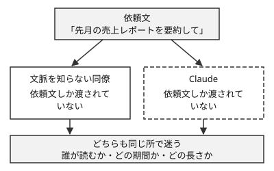

!!! abstract "要点"
    - **何が分かるか**：会話の外の事情を知らない新人に頼むつもりで書くと、依頼に何を書き足すかが分かる。文脈を知らない同僚が迷う依頼は、Claude も迷う
    - **いつ引くか**：自分には当たり前の前提が伝わっていないとき。頼み方の基本を 1 つだけ押さえたいとき
    - **前提**：なし

<!-- textlint-disable -->
別名：文脈のない新人として扱う・Be clear and direct・明確かつ直接的に・brilliant but new employee
<!-- textlint-enable -->

新人の同僚に頼むつもりで書くとは、Claude を「能力は高いが、この会話の外の事情を知らない新人」として扱う頼み方である。依頼を出す前に、文脈を知らない人が読む場面を想像し、迷う所を書き足す。頼み方の原則のうち、最初に身につけるものである。

## 文脈のない同僚に見せて確かめる {#colleague-test}

文脈のない同僚に依頼文を見せて確かめるとは、あなたの事情をほとんど知らない人にその依頼文だけを読ませ、迷う所があるかを見ることである。公式の Prompting best practices は、この確かめ方を key test として挙げている。同僚が読んで混乱する依頼は、Claude も混乱する。

見せる前の依頼に、次のものが抜けていることが多い。どれも、頼む本人には当たり前なので書き忘れる。

- 読み手と目的：誰が、何のために読むか。
- 社内や手元の用語・前提：その場だけで通じる言葉の意味。
- 前の経緯：すでに決まったこと、すでに試したこと。
- 制約：使えない手段、守る決まり。
- 完了の形：何が出れば終わりか。

経緯と完了の形のように、依頼の対象・状況・完了・手本として書き足すものは、<!-- link:begin four-specifics#before-after -->[具体性の 4 点（対象・状況・完了・手本） › 同じ依頼を 4 点で書き直す](four-specifics.md#before-after)<!-- link:end --> で詳しく扱う。ここでは、読み手と用語を例に、書き足す前と後を比べる。

**Before**

> 先月の売上レポートを要約して。

**After**

> 来週の経営会議で、営業部長が短い時間で読む前提で、添付の先月の売上レポートを要約してほしい。部長は数値の細目より、前の月から動いた要因を知りたい。分量は短い段落 1 つにする。レポートの「粗利」は返品を引いた後の値を指す。

After で足したものは次のとおりである。

- 読み手と目的：経営会議で部長が読む。細目より要因を知りたい。
- 分量：短い段落 1 つ。
- 手元の用語：「粗利」の意味。

Before のままでも、Claude は何かを返す。ただし、誰向けかも、どこを厚くするかも知らないので、無難な要約になる。同僚に見せれば「誰が読むのか」「粗利は何を引くのか」と聞かれる。その質問の答えが、書き足す内容である。

!!! example "判断例：同僚の質問を全部書くか"
    - **状況**：依頼文を同僚役の人に見せたら、質問がいくつも出た。
    - **迷う候補**：質問の答えを全部依頼に書く。答えで結果が変わるものだけを書く。
    - **選んだもの**：答えで結果が変わるものだけを書く。
    - **理由**：答えても結果が変わらない情報は、依頼を長くするだけである。読み手は肝心の前提を探す手間が増える。読み手が人でも Claude でも同じである。

実務家の講演や投稿にも、同じ趣旨の頼み方が見られる。新しい上級エンジニアに頼むつもりで、関連するファイルと良い実装例を渡す。Claude は、明示すれば非常に有能なジュニア開発者として扱う。こうした助言が複数の実務家に見られる（根拠：中。複数の実務家の一致）。

形容詞でしか伝えられない好みは、同僚にも伝わらない。「もっとパンチを」と言われた同僚は、どう直すかで迷う。嫌な点は、具体例で伝えるほうがよい（根拠：弱。単独の実践者の経験談）。例の選び方は <!-- link:begin show-examples#choose -->[例を見せる › 典型的で多様な例を選ぶ](show-examples.md#choose)<!-- link:end --> にある。

依頼の雛形を次に置く。空欄のうち、答えで結果が変わるものだけを埋める。

<!-- gen:begin snippet brief-a-new-colleague/brief-template -->
<!-- textlint-disable -->

???+ example "雛形：同僚に見せて確かめる依頼の雛形"

    ```text
    【目的と読み手】
    ＜誰が、何のために、この結果を使うか＞

    【背景】
    ＜会話の外にある事情。手元の用語の意味、前の経緯、すでに試したこと＞

    【頼むこと】
    ＜してほしいことを、動詞ではっきり書く＞

    【求める水準】
    ＜基本で足りるか、できるだけ広げてほしいか＞

    【制約と完了】
    ＜使えない手段、守る決まり。何が出れば終わりか＞
    ```

    動作を確かめていない雛形。

<!-- textlint-enable -->
<!-- gen:end snippet brief-a-new-colleague/brief-template -->

最初から完璧に書く必要はない。まず平易に頼み、返事を見て足りない所を足す進め方は <!-- link:begin refine-in-conversation#start-plain -->頼み方は一回で決めない（会話で詰める） › まず平易に頼み、足りない分を足す（準備中）<!-- link:end --> にある。

## 役割を一文で伝える {#role}

役割を一文で伝えるとは、「あなたは何に詳しい誰として答えるか」を、依頼の冒頭に短く書くことである。公式の Prompting best practices は、システムプロンプトに 1 文の役割を書くだけでも効くとして、Python に詳しいコーディング支援者という例を挙げている。システムプロンプトは、API で会話の前に渡す指示である。

同僚に頼むときも、「この件は経理の目で見てほしい」と最初に言えば、見る観点が決まる。役割の一文はそれと同じ働きをする。

役割を書く場所は面で違う。

=== "アプリ"
    会話の最初の依頼に、役割と状況を一文で書く。毎回同じ前提を書くなら、依頼のたびに書き直さず、常に読まれる指示の置き場所へ移す。

=== "Claude Code"
    依頼の冒頭に一文で書く。毎回同じ前提なら `CLAUDE.md` に置く。

=== "API"
    システムプロンプトの冒頭に一文で書く。依頼ごとに変わる状況は、user のメッセージに書く。

雛形を次に置く。

<!-- gen:begin snippet brief-a-new-colleague/role-line -->
<!-- textlint-disable -->

??? example "雛形：役割を一文で伝える"

    ```text
    あなたは Python に詳しいコーディング支援者である。
    ```

    動作を確かめていない雛形。

<!-- textlint-enable -->
<!-- gen:end snippet brief-a-new-colleague/role-line -->

役割の一文は、文脈の代わりにならない。誰のために何をするかは、依頼の本文に書く。

## 期待以上を望むなら、そう書く {#ask-for-more}

期待以上を望むなら、そう書くとは、基本にとどまらない出来を求めるとき、Claude の推測に頼らず、求める水準を依頼へ明示することである。同僚に「いい感じに」と頼んで基本の出来が返ってきても、不思議はない。水準を聞いていないからである。

公式の Prompting best practices は、次の依頼を例に挙げている。

> Create an analytics dashboard. Include as many relevant features and interactions as possible. Go beyond the basics to create a fully-featured implementation.

日本語にすると、次の形になる。

**Before**

> 分析ダッシュボードを作って。

**After**

> 分析ダッシュボードを作って。関連する機能と操作をできるだけ多く入れる。基本にとどまらず、機能の揃った実装にする。

After で足したものは、求める水準である。「できるだけ多く」「基本にとどまらず」が、基本で足りるのか、広げてほしいのかを決める。

逆も同じである。基本で足りるなら、足りると書く。水準を書かないと、Claude は推測で決める。広げすぎは、頼んでいないものが増える原因になる。広げる範囲と終わりの条件は <!-- link:begin four-specifics#done -->[具体性の 4 点（対象・状況・完了・手本） › 完了：何が起きれば終わりか](four-specifics.md#done)<!-- link:end --> で決める。

## なぜ文脈を書くと効くのか {#why}

文脈を書くと効くのは、Claude に見えているものだけが判断の材料になるからである。この辞典の原理で言えば「見せる」にあたる。<!-- link:begin four-principles#show -->[四つの原理と比例則（見せる・確かめる・縛る・握る） › 見せる](../start/four-principles.md#show)<!-- link:end --> で全体の考え方を扱う。Claude 側の原因で言えば「見えていない」にあたる。6 つの原因の一覧は <!-- link:begin six-causes#claude-side -->[失敗の二つの軸と診断の入口 › Claude 側の六つの原因](../start/six-causes.md#claude-side)<!-- link:end --> にある。

比喩で言えば、広い机である。Claude が使えるのは、机の上に出ているもの、つまり会話に渡された文章とファイル、設定した指示である。あなたの頭の中の事情は、机に載っていない。



図のとおり、依頼文だけなら、同僚と Claude は同じ所で迷う。だから同僚で試せば、出す前に抜けが分かる。同僚が迷う所が、机に載っていないものである。

Claude Code は、ファイルや `CLAUDE.md` を読んで机に載せられる。それでも、載せたものが依頼に関係するかどうかは、頼む側が知っている。読ませたいファイルや前提は、依頼で指す。

## 効かない場面と誤解 {#limits}

同僚に見せて確かめる方法で見つかるのは、書いていない前提だけである。書いてあるのに守られない場合は、別の原因を疑う。意図と違うものが出るときの切り分けは <!-- link:begin not-what-i-meant#diagnosis -->[意図と違うものが出てくる › 原因を安く確かめる順](../symptoms/not-what-i-meant.md#diagnosis)<!-- link:end --> にある。安く確かめられる順の診断は <!-- link:begin six-causes#diagnosis -->[失敗の二つの軸と診断の入口 › 安く確かめられる順の診断](../start/six-causes.md#diagnosis)<!-- link:end --> にある。

誤解しやすい点を挙げる。

- 「新人」は、能力が低いという意味ではない。公式の言い方は「brilliant but new」で、能力が高く、文脈だけを知らない人である。噛み砕きすぎた幼い書き方は要らない。
- 長く書けばよいわけではない。足すのは、同僚が迷った所の答えである。関係のない背景を足すと、依頼が読みにくくなる。
- 一度で決める必要はない。ずれが大きければ、元の依頼を直して頼み直す。進め方は <!-- link:begin refine-in-conversation#edit-the-request -->頼み方は一回で決めない（会話で詰める） › 訂正を重ねるより依頼を直す（準備中）<!-- link:end --> にある。
- 呪文ではない。「新人として扱ってください」と Claude に言う必要はない。書き手が、新人に読ませる気持ちで依頼を書く。

書き換え前後の例をもっと見るには、<!-- link:begin before-after-prompts#specifics -->[Before/After プロンプト集 › 具体性を足す](before-after-prompts.md#specifics)<!-- link:end --> を引く。理由を添える書き方は <!-- link:begin give-reasons#tts-example -->[理由を添える › 禁止より理由（読み上げの例）](give-reasons.md#tts-example)<!-- link:end --> にある。言葉で説明しにくい画面や図は <!-- link:begin images-and-voice#images -->[画像・スクリーンショット・音声で渡す › 画像で渡すと速いもの](images-and-voice.md#images)<!-- link:end --> で渡す。

<!-- gen:begin references -->
<!-- textlint-disable -->

## 参考 {#references}

- [Prompting best practices](https://platform.claude.com/docs/en/build-with-claude/prompt-engineering/claude-prompting-best-practices)：Anthropic・英語・確認日 2026-11-04
- [Best practices for Claude Code](https://code.claude.com/docs/en/best-practices)：Anthropic・英語・確認日 2026-11-04
- [27 Claude tips after 1,800 hours.](https://ruben.substack.com/p/1800-hours-of-claude)：Ruben Hassid・英語・確認日 2026-11-04
- [Think Harder: How I Prompt — Thorsten Ball, Laracon US 2026](https://thorstenball.com/talks/how-i-prompt/)：Thorsten Ball・英語・確認日 2026-11-04
- [Claude Code Tips & Techniques from the HN Community](https://sankalp.bearblog.dev/claude-code-tips-techniques-from-the-hn-community/)：sankalp・英語・確認日 2026-11-04

<!-- textlint-enable -->
<!-- gen:end references -->

<!-- gen:begin page-links -->
<!-- textlint-disable -->

<div class="ca-page-links" markdown>

**前提**

- なし

**次に読む**

- [理由を添える](give-reasons.md)
- [具体性の 4 点（対象・状況・完了・手本）](four-specifics.md)
- [例を見せる](show-examples.md)
- [画像・スクリーンショット・音声で渡す](images-and-voice.md)
- 頼み方は一回で決めない（会話で詰める）（準備中）

**関連**

- [アプリの指示の置き場所（Claude への指示・プロジェクト・メモリ・スキル）](../app/where-to-put-instructions.md)
- [Before/After プロンプト集](before-after-prompts.md)
- [意図と違うものが出てくる](../symptoms/not-what-i-meant.md)
- [失敗の二つの軸と診断の入口](../start/six-causes.md)
- [四つの原理と比例則（見せる・確かめる・縛る・握る）](../start/four-principles.md)

</div>

<!-- textlint-enable -->
<!-- gen:end page-links -->
