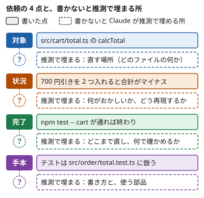

!!! abstract "要点"
    - **何が分かるか**：依頼に対象・状況・完了の形・倣う手本の 4 点を書くと、Claude が推測で埋める所が減る。結果がずれたら、欠けていた点が次に書き足すものになる
    - **いつ引くか**：直してと頼んだのに、見当違いの場所を直されたとき。1 回で意図どおりに動いてほしいとき
    - **まず足すもの**：見当違いの場所を直されたなら、対象を書き足す。ほかのずれ方は[ずれ方から、次に足す点を探す](#which-to-add)で見当をつける。書き写せる依頼の型は[4 点を書く雛形](#templates)にある
    - **関わる原理と原因**：原理は、対象・状況・手本で必要な情報を「見せる」ことと、完了で結果を「確かめる」こと。防ぐ原因は、Claude 側の 6 つの原因のうち「見えていない」である。依頼と会話のどちらにも書かれていないことは、Claude に見えない
    - **前提**：<!-- link:begin brief-a-new-colleague -->[新人の同僚に頼むつもりで](brief-a-new-colleague.md)<!-- link:end -->

<!-- textlint-disable -->
別名：具体的なプロンプト・Write a specific prompt・対象のファイルと症状を書く
<!-- textlint-enable -->

具体性の 4 点は、依頼に対象・状況・完了の形・倣う手本を書く頼み方である。書かれていない点は、Claude が推測で埋めるので、4 点を書くと意図とのずれが減りやすい。4 点という数え方はこの教材のもので、元は Claude Code の公式文書 [Best practices](https://code.claude.com/docs/en/best-practices#write-a-specific-prompt) の「Write a specific prompt」の助言である。

## 同じ依頼を 4 点で書き直す {#before-after}

同じバグ修正の依頼を、具体性の 4 点（対象・状況・完了・手本）のない形と、ある形で並べる。次は説明のために作った依頼の例で、Claude に試した結果ではない。

**Before**

```text
カートの合計がおかしいので直して
```

**After**

```text
対象：src/cart/total.ts の calcTotal
状況：1,000 円の商品に 700 円引きのコードを 2 つ入れると、
      合計がマイナスになる。合計は 0 円で止めたい
完了：この症状を再現する失敗テストを先に書き、
      直したあとで npm test -- cart が通れば終わり
手本：テストの書き方は src/order/total.test.ts に倣う
```

After は、Before に 4 点を 1 項目ずつ足した形である。対象の項目は直す場所を、状況の項目は何がおかしいかを伝える。完了の項目は終わりの基準を、手本の項目は書き方を伝える。ラベルは読みやすくするためのもので、文章で書いてもよい。Before では、どのファイルのどこがどうおかしいかも、何をもって終わりとするかも、Claude には見えない。

この例の手本の項目は、リポジトリにテストの書き方が複数あり、order のテストに揃えたい、という想定で付けた。書き方が 1 つしかなければ、この項目は要らない（[効かない場面とやりすぎ](#limits)）。

Claude Code の Best practices は、ファイルを名指しし、症状を書き、直った状態を先に言うことを勧める。同じ文書の「Instead of / Try」の対比表には、倣うパターンを指定する例もある。After の 4 項目は、名指し・症状・直った状態・倣うパターンの 4 つに当たる。

4 点のどれかを書かないと、Claude はその点を推測で埋める。次の図は、After の各項目と、その項目を書かなかったときに Claude が推測で埋める所を並べたものである。



実線の枠が書いた点、点線の枠が推測で埋まる所である。

公式の例は開発の依頼だが、同じ 4 点は文章やデータ分析の依頼にも読み替えられる（類推）。公式の [Prompting best practices](https://platform.claude.com/docs/en/build-with-claude/prompt-engineering/claude-prompting-best-practices) の基本原則（文脈のない新人に頼むつもりで書く、例を示す）も、開発に限らない。場面ごとの読み替えは、対象〜手本の各節と末尾の雛形に書く。

## ずれ方から、次に足す点を探す {#which-to-add}

結果が意図とずれたときは、具体性の 4 点（対象・状況・完了・手本）のうち何が欠けていたかを、ずれ方から見当づけ、その点を書き足して頼み直す。次の対応はこの教材の目安で、ずれに複数の点が絡むこともある（推論・実践例なし）。

| 起きたこと | 疑う点 |
| --- | --- |
| 見当違いのファイル・画面・文書・シートが直された | 対象 |
| 直したと言われたが、困っていた症状（エラー・食い違う数字・合わない文章）が残っている | 状況 |
| 終わったと言われたが、確かめた形跡がない（動かない・数字が合わない・分量や構成が違う） | 完了 |
| 出来はよいが、いつもの書き方・調子・集計の形と違う | 手本 |
| 依頼の文を別の意味に取られた。境界の入力（空・0・上限）で壊れる | 誤読されやすい所 |

表の 5 行目だけは、4 点とは別で、依頼の文そのものの読み違いである。詳しくは[誤読されやすい所](#misreadings)で述べる。

同じずれを 2 回訂正しても直らないときは、3 回目の訂正を足さない。足しても、失敗した試みが残った会話を Claude が読み返し続けるだけになるからである。Claude Code の Best practices は、`/clear` で会話を空にして、分かったことを織り込んだ 1 つの依頼で頼み直すことを勧める。ほとんどの場合そのほうがうまくいく、とも述べる。アプリでは新しい会話を開き、API では新しい `messages` から始めて、同じことができる（類推）。4 点以外の原因も含めて切り分けるときは、<!-- link:begin not-what-i-meant -->[意図と違うものが出てくる](../symptoms/not-what-i-meant.md)<!-- link:end --> を使う。

## 対象：どのファイル・どの画面か {#target}

対象は、具体性の 4 点のうち、直す・読む・書く相手を名指しする点である。ファイルのパスと関数名、画面の名前、文書の節の見出しなど、Claude が探し回らなくてもたどり着ける名前で書く。

Claude Code の Best practices は、ファイルの名指し、症状、直った状態を先に書くと、あとの訂正を 1 回分省けることが多いと述べる。対象は、その最初に挙がる点である。

- 開発：ファイルのパスと関数名。画面の不具合なら、画面の名前と、そこへ着く操作
- 文章：直す文書の名前と、節や段落。本文は貼るか、添付する
- データ分析：ファイルとシートの名前、使う列、対象の期間

対象を会話に入れる手段は、面で違う。

=== "アプリ"

    ファイルは添付し、短いものは本文に貼る。画面の不具合は、スクリーンショットを添付する。どの部分を見てほしいか（シート名、ページ、節の見出し）は、依頼にも書く。

=== "Claude Code"

    `@` とパスを打つと、ファイルの中身が依頼に入る。画面やエラーのスクリーンショットは、プロンプトに貼れる。コマンドの出力は、`cat error.log | claude -p "…"` のように、シェルからパイプで渡せる。絞り方は <!-- link:begin choose-what-to-read -->[@参照と、何を読ませるかの絞り込み](../context/choose-what-to-read.md)<!-- link:end --> にある。

=== "API"

    API では、対象の中身を、自分でリクエストの `messages` に入れる。ファイルの名前は、中身の前に添える。中身が長いときは、中身を先に置き、見てほしい部分や質問をそのあとに書く。Prompting best practices は、複数の文書を渡すときに、各文書を `<document>` で囲み、名前を `<source>`、中身を `<document_content>` に入れる形を挙げる。配置の細部は <!-- link:begin long-context-first -->[長い資料は先、質問は最後](long-context-first.md)<!-- link:end --> にある。

Claude がコードを読めば見つけられる所まで、細かく書く必要はない。書かなくてよい範囲は、[効かない場面とやりすぎ](#limits)で述べる。

## 状況：症状と再現の手順 {#situation}

状況は、具体性の 4 点のうち、いま何が起きていて何に困っているかを伝える点である。開発では、症状、再現の手順、期待する動きの 3 つを書く。

症状は、起きたことを、起きる条件と一緒に書く。症状だけでは、同じことを起こす操作と、本当はどうなるはずかを、Claude が推測で埋める。そこで、再現の手順と期待する動きも書く。冒頭の例（カートの合計の依頼）では、症状は合計がマイナスになること、再現の手順は 700 円引きのコードを 2 つ入れること、期待する動きは 0 円で止めることである。

エラーの文面やログは、症状に関わる数行を貼る。絞り方は <!-- link:begin choose-what-to-read#trim-output -->[@参照と、何を読ませるかの絞り込み › 出力を絞る](../context/choose-what-to-read.md#trim-output)<!-- link:end --> にある。

- 開発：症状、再現の手順、期待する動き
- 文章：読み手と文書の使い道、いまの文章のどこが合わないか
- データ分析：何を判断するための分析か、いまの数字のどこが引っかかるか

読み手や判断の目的は、理由の書き方として <!-- link:begin give-reasons -->[理由を添える](give-reasons.md)<!-- link:end --> が扱う。

## 完了：何が起きれば終わりか {#done}

完了は、具体性の 4 点のうち、何が起きれば終わりかを、Claude 自身が確かめられる形にして伝える点である。冒頭の例（カートの合計の依頼）では、再現する失敗テストを先に書かせ、`npm test -- cart` の結果で終わりとしている。

Claude は、作業が終わったように見えた所で止まる。確かめるものを持たないと、「終わったように見える」ことが判断の材料のすべてになる、と Claude Code の Best practices は述べる。そこで、完了は、実行できる確認と、その結果で書く。

- 開発：実行するコマンドと、通るべき結果。再現する失敗テストを先に書かせる形もある
- 文章：分量、構成、入れるものと入れないもの、読み終えた人が分かっているべきこと
- データ分析：出力の形（表の列やグラフの種類）と、突き合わせて確かめる数字

Claude がコマンドを実行できないとき（アプリや API で、実行する道具を渡していないとき）は、書き方が変わる。確かめる手順と通るべき結果を依頼に書き、実行は自分で行って、出力を会話に貼って返す。Best practices は、確かめるものを、Claude が結果を読めればほぼ何でもよいとする。貼って返す形は、その考えをアプリと API に当てはめたものである（類推）。

実行を伴わない確認なら、依頼の末尾に「終える前に、上の基準に照らして答えを確かめて」と添える頼み方もある。Prompting best practices が挙げる頼み方である。モデルによって要るかどうかが違うので、効くかは自分の環境で試す。

どこまで望むかも、完了の一部である。公式は、Claude が依頼を控えめに読み、満たす最小のものを作りがちだと述べる。その理由は、どこまで望んでいるかが、依頼から見えないことだと説明する。境界の入力の扱いや、続く作業まで欲しいときは、そう書く。書き方は <!-- link:begin brief-a-new-colleague#ask-for-more -->[新人の同僚に頼むつもりで › 期待以上を望むなら、そう書く](brief-a-new-colleague.md#ask-for-more)<!-- link:end --> にある。

完了の定義の決め方は <!-- link:begin define-done -->[「完了」を定義して渡す](../verify/define-done.md)<!-- link:end --> が扱う。バグ修正で渡す完了の形は <!-- link:begin fix-a-bug#reproduce-and-define-done -->[バグを直す › 再現と「直った」の定義を渡す](../recipes/fix-a-bug.md#reproduce-and-define-done)<!-- link:end --> にある。

## 手本：倣う既存のコードや文章 {#model}

手本は、具体性の 4 点のうち、倣ってほしい既存のコードや文章を指す点である。Claude Code の Best practices の例は、既存のウィジェットのファイルを挙げて、同じ型で新しいウィジェットを作らせる。

Claude はリポジトリを読んで、規約や既存の部品の作りを見つけるのが得意だと公式は述べる。そのため、手本を書く価値が高いのは、次の 2 つの場合である。

- 似た書き方が複数あり、どれに倣うかを自分が決めたいとき。妥当な方法が 2 つあって選び方を気にするなら、コードからは読み取れないので先に言う、と公式は勧める
- リポジトリの外にある好みを写したいとき。たとえば、自分の文章の調子や、前回のレポートの構成である

場面ごとの手本は、次のとおりである。

- 開発：倣う既存のファイルのパス
- 文章：調子や構成が近い、自分の過去の文章
- データ分析：前回のレポートや、同じ形の集計表

手本の中身も、対象と同じ手段で会話に入れる。Claude Code はパスで指せるが、アプリと API では中身そのものを会話に入れる。手段は、[対象の節](#target)のタブにある。

例の選び方と、手本に合わせすぎる危険は <!-- link:begin show-examples -->[例を見せる](show-examples.md)<!-- link:end --> が扱う。

## 誤読されやすい所（仕様の解釈・境界の入力） {#misreadings}

具体性の 4 点（対象・状況・完了・手本）をそろえても、依頼の文そのものが複数に読めるときや、境界の入力（空・0・上限など）を依頼が語らないときは、Claude が別の意味に取る余地が残る。この節は、その 2 つを依頼に書き込む方法を述べる。

LLM が生成したコードの不具合 333 件を分類した研究では、仕様の誤解釈が 20.77% で最も多く、コーナーケースの漏れが 15.27% で次に多かった（根拠：中・類推）。誤解釈は、生成コードが依頼の意図から外れることである。コーナーケースの漏れは、ふつうの入力では正しく動くが、境界の入力を見落とすことである。調べたのは CodeGen・PanGu-Coder・Codex が生成したコードで、Claude の結果ではなく、論文の公表も 2024 年である。333 件の分類なので、傾向として読む。

書き込む対象は、この 2 つの類型に対応して、次の 2 つである。

- 仕様の誤解釈には、解釈が割れる文を言い換える。望む動きを、複数の読み方が残らないように書く。「合計がマイナスにならないように」とだけ書くと、「2 つ目のコードを断る（合計は 300 円）」とも「合計を 0 円で止める」とも読める。冒頭の例の After が「合計は 0 円で止めたい」と書くのは、その読みを絞るためである
- コーナーケースの漏れには、境界の入力を依頼に書く。空・0・同点・上限・単位・時刻の扱いなど、ふつうの入力には出てこない値は、依頼に列挙するか、完了のテストに含める

ほかの類型は、それぞれ別のページが扱う。存在しない関数を使われるときは <!-- link:begin uses-nonexistent-apis -->[存在しない関数やパッケージを使う](../symptoms/uses-nonexistent-apis.md)<!-- link:end -->、頼んでいない処理が増えるときは <!-- link:begin state-the-scope -->[範囲を伝える（やらないこと）](state-the-scope.md)<!-- link:end --> を見る。

## なぜ 4 点が効くか {#why}

具体性の 4 点（対象・状況・完了・手本）が効くのは、依頼とリポジトリのどちらにも書かれていないことが Claude に見えず、推測で埋められやすいからである。Claude Code の Best practices は、期待どおりに進まなかった理由をいくつかに分ける。4 点に関わるのは、次の 2 つである。

1 つは、リポジトリを読んでも得られない情報が足りないことである。チームが会議で決めたことや、誰かの頭の中にある手順が、その例になる。もう 1 つは、作業を確かめる手段がないことである。

対象・状況・手本は、1 つ目の理由を埋める情報で、原理の「見せる」にあたる（<!-- link:begin four-principles#show -->[四つの原理と比例則（見せる・確かめる・縛る・握る） › 見せる](../start/four-principles.md#show)<!-- link:end -->）。完了は、2 つ目の理由を埋める基準で、原理の「確かめる」にあたる（<!-- link:begin four-principles#verify -->[四つの原理と比例則（見せる・確かめる・縛る・握る） › 確かめる](../start/four-principles.md#verify)<!-- link:end -->）。防ぐ原因は、<!-- link:begin six-causes -->[失敗の二つの軸と診断の入口](../start/six-causes.md)<!-- link:end -->のうち「見えていない」である。

依頼への書き足しは、6 つの原因の中でも、安く確かめられる手である。設定を足す前に、4 点のどれが欠けているかを見る。原因を安く確かめる順は <!-- link:begin not-what-i-meant#diagnosis -->[意図と違うものが出てくる › 原因を安く確かめる順](../symptoms/not-what-i-meant.md#diagnosis)<!-- link:end --> にある。

4 点は、会話の外の事情を知らない新人の同僚に渡す引き継ぎと、同じ中身でもある。そうした同僚が読んで迷う依頼は、Claude も迷う。この見方は <!-- link:begin brief-a-new-colleague -->[新人の同僚に頼むつもりで](brief-a-new-colleague.md)<!-- link:end --> にある。

## 効かない場面とやりすぎ {#limits}

具体性の 4 点（対象・状況・完了・手本）は、どの依頼にも毎回そろえるものではない。この節は、4 点を書いても効かない場面と、書きすぎになる例を述べる。

- 読めば分かることは書かない。Claude Code の Best practices は、書く前に次の 2 つを問う。コードを読めば見つかるか。Claude は実際に探しに行くか。どちらもそうなら、書かなくてよい
- 探索の依頼は曖昧でよい。まだ直す対象が決まっていないときに、このファイルで直したい所を尋ねるような依頼は、Best practices も問題ないとする。代わりに、訂正が少し増える
- 守らせたいことは、依頼では保証できない。例外を許さない禁止や、必ず実行する手順は、依頼に書き足しても守られる保証にならない。フックや deny ルールで縛る。考え方は <!-- link:begin state-the-scope#two-layers -->[範囲を伝える（やらないこと） › 例外を許さない範囲は仕組みで縛る（二層）](state-the-scope.md#two-layers)<!-- link:end --> にある
- 手順の指図とは別である。4 点は、どこを・何で測るかを具体的に書くことで、やり方を細かく命じることではない。成果で頼む場面との線引きは <!-- link:begin ask-for-outcomes -->細かく指図するか、成果で頼むか（準備中）<!-- link:end --> が扱う
- 情報の不足では説明できないずれもある。4 点を書いてもずれるときは、原因を安く確かめる順に切り分ける。順は <!-- link:begin not-what-i-meant#diagnosis -->[意図と違うものが出てくる › 原因を安く確かめる順](../symptoms/not-what-i-meant.md#diagnosis)<!-- link:end --> にある

## 4 点を書く雛形 {#templates}

次の雛形は、具体性の 4 点（対象・状況・完了・手本）を欄にして依頼を書くための型である。`<` と `>` で囲んだ所を埋め、要らない欄は消す。

<!-- gen:begin snippet four-specifics/dev -->
<!-- textlint-disable -->

??? example "雛形：4 点を書く依頼（開発）"

    ```text
    対象：<直すファイルのパスと、関数やクラスの名前。画面の不具合なら、画面の名前とそこへ着く操作>
    状況：<症状（エラーの文面を含む）、再現の手順、期待する動き>
    完了：<実行するコマンドと、通るべき結果。再現する失敗テストを先に書かせるなら、そう書く>
    手本：<倣う既存のファイルのパス>
    ```

    動作を確かめていない雛形。

<!-- textlint-enable -->
<!-- gen:end snippet four-specifics/dev -->

<!-- gen:begin snippet four-specifics/writing -->
<!-- textlint-disable -->

??? example "雛形：4 点を書く依頼（文章）"

    ```text
    対象：<直す文書の名前と、節や段落。本文は下の【対象の本文】に貼る>
    状況：<読み手と、文書の使い道。いまの文章のどこが合わないか>
    完了：<分量、構成、入れるものと入れないもの、読み終えた人が分かっているべきこと>
    手本：<調子や構成が近い、自分の過去の文章。本文は下の【手本の本文】に貼る>

    【対象の本文】
    <ここに貼る>

    【手本の本文】
    <ここに貼る>
    ```

    動作を確かめていない雛形。

<!-- textlint-enable -->
<!-- gen:end snippet four-specifics/writing -->

<!-- gen:begin snippet four-specifics/data-analysis -->
<!-- textlint-disable -->

??? example "雛形：4 点を書く依頼（データ分析）"

    ```text
    対象：<ファイルとシートの名前、使う列、対象の期間>
    状況：<何を判断するための分析か。いまの数字のどこが引っかかるか>
    完了：<出力の形（表の列、グラフの種類）。突き合わせて確かめる数字>
    手本：<前回のレポートや、同じ形の集計表>
    ```

    動作を確かめていない雛形。

<!-- textlint-enable -->
<!-- gen:end snippet four-specifics/data-analysis -->

<!-- gen:begin references -->
<!-- textlint-disable -->

## 参考 {#references}

- [Best practices for Claude Code](https://code.claude.com/docs/en/best-practices)：Anthropic・英語・確認日 2026-11-04
- [Prompting best practices](https://platform.claude.com/docs/en/build-with-claude/prompt-engineering/claude-prompting-best-practices)：Anthropic・英語・確認日 2026-11-04
- [Bugs in Large Language Models Generated Code: An Empirical Study](https://arxiv.org/abs/2403.08937)：arXiv（Tambon, Florian ほか）・英語・確認日 2026-11-04

<!-- textlint-enable -->
<!-- gen:end references -->

<!-- gen:begin page-links -->
<!-- textlint-disable -->

<div class="ca-page-links" markdown>

**前提**

- [新人の同僚に頼むつもりで](brief-a-new-colleague.md)

**次に読む**

- [提案してほしいのか、実行してほしいのか](suggest-or-do.md)
- [範囲を伝える（やらないこと）](state-the-scope.md)
- [質問させる・インタビューさせる](let-claude-ask.md)
- [Before/After プロンプト集](before-after-prompts.md)
- 細かく指図するか、成果で頼むか（準備中）
- 用途別プロンプトの型（準備中）

**関連**

- [意図と違うものが出てくる](../symptoms/not-what-i-meant.md)
- [「完了」を定義して渡す](../verify/define-done.md)
- [例を見せる](show-examples.md)
- [@参照と、何を読ませるかの絞り込み](../context/choose-what-to-read.md)
- [バグを直す](../recipes/fix-a-bug.md)
- [存在しない関数やパッケージを使う](../symptoms/uses-nonexistent-apis.md)

</div>

<!-- textlint-enable -->
<!-- gen:end page-links -->
