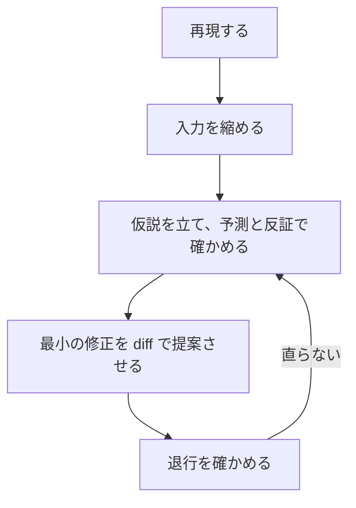

!!! abstract "要点"
    - **何ができるか**：バグは、再現の手順と「直った」の定義を渡し、失敗するテストで再現させてから直させる。
    - **いつ引くか**：エラーの原因を突き止めて直させたいとき。直したと言われたのに条件を変えると同じバグが出るとき。修正を頼むたびに的外れな場所が書き換えられるとき。
    - **前提**：<!-- link:begin evidence-not-reports -->[報告ではなく証拠を求める](../verify/evidence-not-reports.md)<!-- link:end -->

<!-- textlint-disable -->
別名：デバッグ・不具合の修正・エラーを直させる・バグ修正
<!-- textlint-enable -->

バグを直す依頼は、「このエラーを直して」だけだと、症状を隠す修正や的外れな書き換えを招きやすい。このページは、再現、縮小、仮説と反証、最小の修正、退行の確認の順に Claude を進める頼み方を示す。手順の各段で、何を渡し、何で終わったと見なすかを決める。

## 先に整える守り {#guards-first}

バグ修正の依頼を出す前に、確かめる守りと戻れる状態を整える。

- 確かめる守り：どのコマンドがどう返れば直ったかを書いて渡す（<!-- link:begin define-done#what-to-include -->[「完了」を定義して渡す › 完了の定義に入れるもの](../verify/define-done.md#what-to-include)<!-- link:end -->）。完了の報告は、実行したコマンドと生の出力と分母のそろった証拠で受け取る（<!-- link:begin evidence-not-reports#what-counts -->[報告ではなく証拠を求める › 証拠の形（コマンド・生の出力・分母）](../verify/evidence-not-reports.md#what-counts)<!-- link:end -->）。
- 縛る守り：テストは正しさを確かめるもので、解を決めるものではない。テストや期待値を書き換えて通されないよう、依頼に変えないものを書く（<!-- link:begin protect-tests#in-the-request -->[テストを守る（改ざんを防ぐ） › 依頼に書くこと](../verify/protect-tests.md#in-the-request)<!-- link:end -->）。
- 戻れる状態：作業の前に変更をコミットするか退避しておく。Claude Code では、チェックポイントでも戻せる（<!-- link:begin checkpoints-and-rewind -->[チェックポイントと /rewind（git との違い）](../cli/checkpoints-and-rewind.md)<!-- link:end -->）。戻せる範囲に限りがあるので、git で戻せる状態を基本にする。

## 進める順番と、各段の終わりの印 {#flow}

デバッグでは「直して」を繰り返さず、再現、縮小、仮説と反証、最小の修正、退行の確認の順に進める。段ごとに、終わったと見なす印を先に決めておく。



図の要点は次のとおりである。流れは 5 段で、直らなければ仮説に戻る。製品のコードを変えるのは 4 段目からで、それまでは観察と確認と、落ちるテストの追加だけをさせる。

| 段 | 終わった印 | 詳しい節 |
| --- | --- | --- |
| 再現 | 再現のコマンドの失敗と、落ちるテストの失敗を、出力で見た | [再現と「直った」の定義を渡す](#reproduce-and-define-done) |
| 縮小 | 小さな入力でも同じ失敗が出る | [再現と「直った」の定義を渡す](#reproduce-and-define-done) |
| 仮説と反証 | 仮説ごとの予測と、確かめた結果が残っている | [直す前に仮説を確かめさせる](#hypotheses-before-fixes) |
| 最小の修正 | diff に症状だけを隠す変更が入っていない | [症状を隠す修正を認めない](#no-symptom-patches) |
| 退行の確認 | 落ちたテストが通り、既存のテストが分母つきで通る | [直ったかを全体で確かめる](#verify-the-fix) |

## 再現と「直った」の定義を渡す {#reproduce-and-define-done}

再現の手順と「直った」の定義は、バグ修正の依頼で最初に渡す 2 つである。公式の手順も、再現のコマンドとスタックトレースを渡し、常に起きるのか間欠的なのかを伝えるよう勧める。

依頼に入れるものは次のとおりである。

- 再現のコマンドと、期待する結果、実際の結果。エラーは全文を貼る。
- 起きる条件。毎回起きるかの別、入力、seed、環境の版。
- 「直った」の定義。再現のテストが通ることと、既存のテストが分母つきで通ることを書く。
- 変えないもの。既存のテスト、公開している関数の名前と引数など。
- 止まって報告する条件。再現できないとき、変えないものを変える必要が出たとき。

直す前に、バグで落ちるテストを 1 つ書かせ、修正の前に落ちることを確かめさせる。テストを先に書かせる手順は <!-- link:begin tests-first#steps -->[テストを先に書かせる › 手順](../verify/tests-first.md#steps)<!-- link:end --> にある。落ちることを見ずに書いたテストは、直った後の挙動をなぞるだけになりやすい。

入力が大きいときは、直させる前に最小の再現例へ縮める。縮める処理は、何度でも同じ結果を出すスクリプトとして書かせる。LLM に入力を直接縮めさせるより、縮小スクリプトを 1 つ書かせるほうが成功しやすかった。縮めた失敗入力を修正の依頼に渡すと、元の入力を渡すより直る率が上がった。AtCoder 由来の問題を使った研究（ReduceFix、arXiv、2025）の結果で、対象の LLM は Claude とは限らない（根拠：中）。手順は <!-- link:begin shrink-failing-inputs -->失敗する入力を縮めるスクリプトを書かせる<!-- link:end --> にある。前は動いていたものが壊れたときは、原因のコミットを絞る <!-- link:begin bisect-regressions -->退行の原因を git bisect で探させる<!-- link:end --> から入る。

面によって、再現の渡し方が違う。

=== "アプリ"

    コマンドを実行できる道具がない会話では、Claude は再現を自分で確かめられない。エラーの全文、入力、期待する結果、関係するコードを貼って渡す。貼った情報から分かることと推測を分けて答えるよう頼む。

=== "Claude Code"

    Claude が再現のコマンドを自分で実行できるので、コマンドそのものを渡し、失敗する出力を貼らせる。落ちるテストの追加と、その失敗の確認まで、修正の前に済ませさせる。

依頼の雛形を次に置く。

<!-- gen:begin snippet fix-a-bug/reproduce-request -->
<!-- textlint-disable -->

??? example "雛形：再現と「直った」の定義を含む依頼（バグ修正）"

    ```text
    直したいバグ：<対象のファイルと、いまの症状>

    再現の手順：
    - 再現のコマンド：<例：pytest tests/test_parser.py::test_empty_input>
    - 期待する結果：<こう返るはず>
    - 実際の結果：<エラーの全文、またはスタックトレース>
    - 起きる条件：<毎回か、間欠か。入力・seed・環境の版>

    進め方：
    1. コードを変える前に、上のコマンドを実行して失敗することを確かめ、出力をそのまま貼ること
    2. このバグで落ちるテストを 1 つ書き、修正の前に落ちることを確かめること

    「直った」の定義：
    - 2 で書いたテストが通ること
    - <既存のテストの実行コマンド> が通ること。件数は「通った数 / 全体の数」の形で貼ること
    - 出力が空、または途中で切れていたら、直ったとは書かず、そのことを報告すること

    変えないもの：
    - <既存のテスト、公開している関数の名前と引数、など>

    止まって報告する条件：
    - 再現のコマンドが実行できない、または失敗を再現できないとき
    - 直すために「変えないもの」を変える必要が出たとき
    ```

    動作を確かめていない雛形。要る最低の版：Claude Code 2.0.0。

<!-- textlint-enable -->
<!-- gen:end snippet fix-a-bug/reproduce-request -->

## 直す前に仮説を確かめさせる {#hypotheses-before-fixes}

仮説を確かめる前は、コードを変えさせない。「まず原因を直して」と頼むと、読んでいない部分を推測で補った修正が最初に適用されやすい。

進め方は 4 つの動作で決まる。

1. 関係するファイルを実際に開かせ、再現の入力で処理がどの順に流れるかを説明させる。読んでいない部分は推測と明記させる。
2. 原因の仮説を複数挙げさせ、仮説ごとに「正しければこう観測されるはず」という予測と、反対の証拠を書かせる。
3. ログの追加や実行で予測を確かめさせ、反証された仮説を捨てさせる。
4. 残った仮説に対する最小の修正を、diff で提案させる。適用は diff を見てからにする。

この順を勧める理由は、直す場所の取り違えが多いからである。Defects4J（Java の実際のバグを集めたデータセット）のバグを GPT-5、DeepSeek-R1、Claude Sonnet 4.5 に直させた研究（arXiv、2026）は、修正の多くで「幻覚」が見つかったと報告する。最多は、原因でない箇所を直す誤った因果特定だった。原因を引き起こすテストを正確に特定できたときほど、修正も成功しやすかった（根拠：中。数値はこの辞典で未確認）。

検証つきの修正を扱った小規模な実験（arXiv、2025）では、うまくいかない例の典型は、同じ誤りを繰り返す「幻覚ループ」と、既存の仮説を前提にしたプロンプトだった。成功率が最も高かったのは、コードと検証器の出力を渡し、diff を求め、試す前にレビューする型である。標本が小さいので傾向として読む（根拠：中）。実務家の報告にも、「直して」を繰り返して時間を失ったが、処理の流れを説明させたら短時間で原因に着いた例がある（根拠：弱。単独の経験談）。

原因の見当がつかないときは、結論を出させる代わりに、ログや集計の道具を作らせて観察する。道具の作らせ方は <!-- link:begin build-observation-tools -->[観察の道具を作らせる（可視化・集計・ログ）](build-observation-tools.md)<!-- link:end --> にある。競合する仮説が複数あって切り分けにくいときは、互いの仮説を反証させ合う構成が公式に紹介されている（<!-- link:begin agent-teams -->エージェントチーム（複数の Claude に分担させる）<!-- link:end -->）。担当の数だけトークンを使う。版に依存する機能なので、使う前に最新の説明を確かめる。

まず、同じ依頼の Before と After を比べる。そのあとに、依頼の雛形を置く。

??? example "Before / After：エラーを直す依頼"

    **Before**：「このエラーを直して。」

    **After**：症状と再現の手順に、次の指示を足す。コードはまだ変えない。ファイルを開いて処理の流れを説明する。仮説ごとに予測と反対の証拠を書く。ログで確かめる。最小の修正を diff で提案する。

    足したものは 3 つである。コードを変える前に観察させる順番、仮説ごとの予測と反証、修正を diff で見てから適用する関門である。Before/After の考え方は <!-- link:begin before-after-prompts -->[Before/After プロンプト集](../prompting/before-after-prompts.md)<!-- link:end --> にある。

<!-- gen:begin snippet fix-a-bug/hypothesis-request -->
<!-- textlint-disable -->

??? example "雛形：説明、仮説、反証、最小の修正の順に進める依頼"

    ```text
    症状と再現の手順：<再現の依頼と同じ>

    まだコードを変えないこと。次の順に進めること。

    1. 関係するファイルを実際に開き、再現の入力で処理がどの順に流れるかを説明すること。読んでいない部分は、推測と明記すること
    2. 原因の仮説を複数挙げること。仮説ごとに、次の 2 つを書くこと
       - 正しければ、こう観測されるはず（予測）
       - こう観測されたら、その仮説は違う（反対の証拠）
    3. ログの追加や実行で予測を確かめ、結果を貼ること。反証された仮説は捨て、理由を 1 行で書くこと
    4. 残った仮説に対する最小の修正を、diff で提案すること。適用は私が diff を見てから
    5. 適用後に、再現のテストと既存のテストを実行し、修正の前後の結果を並べて貼ること
    ```

    動作を確かめていない雛形。要る最低の版：Claude Code 2.0.0。

<!-- textlint-enable -->
<!-- gen:end snippet fix-a-bug/hypothesis-request -->

## 症状を隠す修正を認めない {#no-symptom-patches}

症状を隠す修正は、失敗した入力だけを通し、原因を残す。依頼で禁止し、diff で確かめる。

禁止する具体例は次のとおりである。

- 特定の seed や特定の入力だけを通す分岐
- 例外の握りつぶし
- 閾値や期待値を、失敗した値に合わせて変えること
- 失敗するケースを、対象から除外すること

テスト入力専用の解を書かない、という公式の文例も同じ趣旨である。LLM が書いたコードの誤りの類型を調べた研究（arXiv、2024）でも、プロンプトの例にしか合わないコードが挙がる（根拠：中）。

禁止は依頼に書くだけでは鍵にならない。例外を許さないなら、テストの保護をフックや権限で強制する（<!-- link:begin protect-tests#layers -->[テストを守る（改ざんを防ぐ） › 守りの層](../verify/protect-tests.md#layers)<!-- link:end -->）。依頼に書く条項の雛形を次に置く。

<!-- gen:begin snippet fix-a-bug/no-symptom-patches -->
<!-- textlint-disable -->

??? example "雛形：症状を隠す修正を禁じる条項"

    ```text
    修正の条件：
    - 原因を直すこと。症状だけを抑える修正はしないこと。次のものは禁止
      - 特定の seed や特定の入力だけを通す分岐
      - 例外の握りつぶし、エラーを無視して先へ進める処理
      - 閾値や期待値を、失敗した値に合わせて変えること
      - 失敗するケースを、対象から除外すること
    - テストの入力にだけ合う解を書かないこと。テストや期待値を書き換えて通さないこと
    - 原因を直せないと思ったときは、直した形にせず、分かったことと詰まった理由を報告すること
    ```

    動作を確かめていない雛形。要る最低の版：Claude Code 2.0.0。

<!-- textlint-enable -->
<!-- gen:end snippet fix-a-bug/no-symptom-patches -->

提案された diff で見る点は 3 つある。分岐や例外処理が、失敗した入力だけに効く形になっていないか。テストや期待値が変わっていないか。直した場所が、仮説の段で確かめた原因と合っているか。テストが書き換えられていたときは <!-- link:begin rewrote-tests-to-pass#diagnosis -->[テストを書き換えて通した › 原因を安く確かめる順](../symptoms/rewrote-tests-to-pass.md#diagnosis)<!-- link:end --> で原因を切り分ける。

## 直ったかを全体で確かめる {#verify-the-fix}

直ったかどうかは、Claude の「直りました」という報告ではなく、手元で見た証拠を基準にする。確かめる順は次のとおりである。

1. 修正の前に落ちたテストが、修正の後に通ったことを、実行した出力で見る。
2. 既存のテストが、通った数と全体の数の形で通ったことを見る。出力が途中で切れていないかも見る。
3. 入力を変えて試す。別の seed、境界値、空の入力を足す。「条件を変えると同じバグが出る」症状は、ここで見つかる。境界値と条件式は、競技の問題で LLM の誤りが多い所でもある（Wei らの研究、arXiv、2025。根拠：中）。
4. 答えの分かる遅い解があるなら、それと突き合わせる。正解の側を、本解に合わせて直させない（<!-- link:begin differential-testing#protect-the-oracle -->[答えの分かる遅い解と比べる（差分テスト・オラクル） › 正解の側を守る](../eval/differential-testing.md#protect-the-oracle)<!-- link:end -->）。
5. 説明と事実が食い違ったら、実行・grep・git で見た事実を正とする（<!-- link:begin evidence-not-reports#facts-win -->[報告ではなく証拠を求める › 説明と事実が食い違ったら](../verify/evidence-not-reports.md#facts-win)<!-- link:end -->）。

「最後に double-check して」と書き足す古い頼み方は、モデルによって扱いが違う。今どうするかは台帳にある（<!-- link:begin outdated-advice-ledger#add-double-check -->[古くなった助言の台帳](../changes/outdated-advice-ledger.md#add-double-check)<!-- link:end -->）。基本は、見直させるより、確かめる手段を渡す。

## 直らないときは巻き戻して頼み直す {#when-stuck}

同じ点の修正が重ねて失敗したら、訂正を重ねず、巻き戻して頼み直す。会話に誤った試みが残ると、次の答えがそれに引きずられるからである（<!-- link:begin rewind-dont-correct#why -->[違うと返すより、巻き戻す・編集する › なぜ訂正より巻き戻しか](../context/rewind-dont-correct.md#why)<!-- link:end -->）。公式の手引きも、修正が重ねて失敗したときは会話を新しくし、学んだことを織り込んだ新しい依頼を書くよう勧める。もう一度修正を頼むと、失敗した分の会話を読み直すだけになる。

頼み直しの手順は次のとおりである。

1. 失敗の跡を要約する。試した修正と直らなかった理由、反証された仮説、確かめられた事実を書く。
2. 巻き戻すか、新しい会話にする。面ごとのやり方は <!-- link:begin rewind-dont-correct#how -->[違うと返すより、巻き戻す・編集する › 面ごとの戻し方](../context/rewind-dont-correct.md#how)<!-- link:end --> にある。
3. 要約を、最初の依頼と同じ形の再現・完了の定義と一緒に渡す。仮説の立て直しから始めさせる。

Claude Code では、チェックポイントで会話とファイルを戻せる（<!-- link:begin checkpoints-and-rewind -->[チェックポイントと /rewind（git との違い）](../cli/checkpoints-and-rewind.md)<!-- link:end -->）。Bash だけが変えたファイルは戻らない場合があるので、先に git で戻せる状態にしておく。

頼み直しの依頼の雛形を次に置く。

<!-- gen:begin snippet fix-a-bug/restart-request -->
<!-- textlint-disable -->

??? example "雛形：失敗の跡を要約して新しい会話で頼み直す依頼"

    ```text
    直したいバグ：<最初の依頼と同じ症状>
    再現の手順と「直った」の定義：<最初の依頼と同じ>

    ここまでに分かったこと：
    - 試して直らなかった修正：<内容> ／ 直らなかった理由：<出力で分かったこと>
    - 反証された仮説：<仮説> ／ 反証した観測：<何を見たか>
    - 確かめられた事実：<コマンドと出力で確かめたもの>

    避けること：
    - <効かなかった方向。例：入力の検査を足して逃げる>

    最初に、確かめられた事実から原因の仮説を立て直し、予測と反対の証拠を書くこと。コードを変えるのはその後。
    ```

    動作を確かめていない雛形。要る最低の版：Claude Code 2.0.0。

<!-- textlint-enable -->
<!-- gen:end snippet fix-a-bug/restart-request -->

!!! example "判断例：直したと言われたのに、別の入力で同じ失敗が出た"
    - **状況**：落ちるテストを直すよう頼み、「直りました」と返ってきた。別の入力で試すと同じ失敗が出る。もう一度、その入力を貼って直すよう頼もうとしている。
    - **迷う候補**：その入力を貼って訂正を続ける。巻き戻して、要約つきで頼み直す。
    - **選んだもの**：まず、貼る入力で新しい事実（原因が別の場所にある証拠）が出るかを見る。出ないなら、巻き戻して頼み直す。
    - **理由**：新しい事実が出るなら、訂正を続けても前の試みに引きずられにくい。事実が出ず、同じ種類の修正が続いているなら、誤った試みが会話に残っているので、巻き戻したほうが早い。

直らない理由によって、読む先が違う。

| 起きていること | 読むページ |
| --- | --- |
| 同じ失敗を繰り返す | <!-- link:begin going-in-circles#diagnosis -->[同じ失敗を繰り返す（堂々巡り） › 原因を安く確かめる順](../symptoms/going-in-circles.md#diagnosis)<!-- link:end --> |
| 「完了」と言うが終わっていない | <!-- link:begin claims-done-but-isnt#diagnosis -->[「完了」と言うが終わっていない › 原因を安く確かめる順](../symptoms/claims-done-but-isnt.md#diagnosis)<!-- link:end --> |
| 直し続けて方針を疑わない | <!-- link:begin wont-rethink-approach#diagnosis -->[直し続けて方針を疑わない（またはすぐ撤退を勧める） › 原因を安く確かめる順](../symptoms/wont-rethink-approach.md#diagnosis)<!-- link:end --> |
| 存在しない関数やパッケージを使う | <!-- link:begin uses-nonexistent-apis#diagnosis -->[存在しない関数やパッケージを使う › 原因を安く確かめる順](../symptoms/uses-nonexistent-apis.md#diagnosis)<!-- link:end --> |

直すために依存のパッケージを足させるときは、入れる前の確かめ方を <!-- link:begin vetting-extensions#dependencies -->[MCP・プラグイン・スキルを入れる前の確認 › 依存のパッケージを入れる前に（存在しない名前・後から登録された名前）](../safety/vetting-extensions.md#dependencies)<!-- link:end --> で見る。

<!-- gen:begin page-links -->
<!-- textlint-disable -->

<div class="ca-page-links" markdown>

**前提**

- [報告ではなく証拠を求める](../verify/evidence-not-reports.md)

**関連**

- [「完了」を定義して渡す](../verify/define-done.md)
- [観察の道具を作らせる（可視化・集計・ログ）](build-observation-tools.md)
- [同じ失敗を繰り返す（堂々巡り）](../symptoms/going-in-circles.md)
- [「完了」と言うが終わっていない](../symptoms/claims-done-but-isnt.md)
- [テストを書き換えて通した](../symptoms/rewrote-tests-to-pass.md)
- [違うと返すより、巻き戻す・編集する](../context/rewind-dont-correct.md)
- [テストを先に書かせる](../verify/tests-first.md)
- [テストを守る（改ざんを防ぐ）](../verify/protect-tests.md)
- [答えの分かる遅い解と比べる（差分テスト・オラクル）](../eval/differential-testing.md)
- [直し続けて方針を疑わない（またはすぐ撤退を勧める）](../symptoms/wont-rethink-approach.md)
- [存在しない関数やパッケージを使う](../symptoms/uses-nonexistent-apis.md)
- [MCP・プラグイン・スキルを入れる前の確認 › 依存のパッケージを入れる前に（存在しない名前・後から登録された名前）](../safety/vetting-extensions.md#dependencies)
- [Before/After プロンプト集](../prompting/before-after-prompts.md)
- [チェックポイントと /rewind（git との違い）](../cli/checkpoints-and-rewind.md)

</div>

<!-- textlint-enable -->
<!-- gen:end page-links -->

<!-- gen:begin references -->
<!-- textlint-disable -->

## 参考 {#references}

- [Common workflows](https://code.claude.com/docs/en/common-workflows)：Anthropic・英語・確認日 2026-11-04
- [Best practices for Claude Code](https://code.claude.com/docs/en/best-practices)：Anthropic・英語・確認日 2026-11-04
- [Checkpointing](https://code.claude.com/docs/en/checkpointing)：Anthropic・英語・確認日 2026-11-04
- [Better Understanding, Better Fixes? A Study of Hallucination in LLM-based Automated Program Repair](https://arxiv.org/abs/2609.04909)：arXiv（Cai, Xuemeng ほか）・英語・確認日 2026-11-04
- [Do AI models help produce verified bug fixes?](https://arxiv.org/abs/2507.15822)：arXiv（Huang, Li ほか）・英語・確認日 2026-11-04
- [Input Reduction Enhanced LLM-based Program Repair](https://arxiv.org/abs/2507.15251)：arXiv（Yang, Boyang ほか）・英語・確認日 2026-11-04
- [Bugs in Large Language Models Generated Code: An Empirical Study](https://arxiv.org/abs/2403.08937)：arXiv（Tambon, Florian ほか）・英語・確認日 2026-11-04
- [Evaluating and Improving Large Language Models for Competitive Program Generation](https://arxiv.org/abs/2506.22954)：arXiv（Wei, Minnan ほか）・英語・確認日 2026-11-04
- [Claude Codeに「丸投げしていい作業」と「させてはいけない作業」を線引きする実践パターン](https://qiita.com/ennagara128/items/0f35168cfc887c38e152)：Qiita（ennagara128）・確認日 2026-11-04
- [Prompting Claude Opus 5](https://platform.claude.com/docs/en/build-with-claude/prompt-engineering/prompting-claude-opus-5)：Anthropic・英語・確認日 2026-11-04
- [Prompting best practices](https://platform.claude.com/docs/en/build-with-claude/prompt-engineering/claude-prompting-best-practices)：Anthropic・英語・確認日 2026-11-04

<!-- textlint-enable -->
<!-- gen:end references -->
