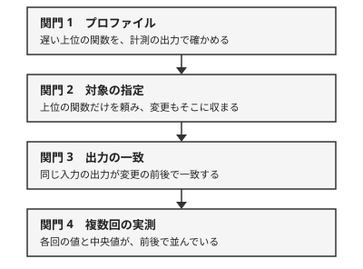

!!! abstract "要点"
    - **何ができるか**：遅い処理の高速化を、プロファイルで遅い箇所を確かめてから対象を指定して頼み、速くなったという報告を出力の一致と複数回の実測で受け取れる。
    - **いつ引くか**：遅い処理を Claude に速くしてもらいたいとき。桁違いに速くなったと報告されたが怪しいとき。速くしてと頼んだら、遅くない所ばかり書き換えられたとき。
    - **前提**：<!-- link:begin suspect-too-good-results -->[良すぎる結果を疑う](../verify/suspect-too-good-results.md)<!-- link:end -->・<!-- link:begin differential-testing -->[答えの分かる遅い解と比べる（差分テスト・オラクル）](../eval/differential-testing.md)<!-- link:end -->

<!-- textlint-disable -->
別名：高速化・最適化・プロファイリング・パフォーマンスチューニング・遅い処理を速くする
<!-- textlint-enable -->

性能改善を頼むレシピは、速くしたい処理を、遅い箇所の確認、対象の指定、出力の一致、複数回の実測という 4 つの関門を通して任せる手順である。速さは報告の文で返ってくるので、報告ではなく、変更の前後で取った記録を証拠にする。

## 先に整える守り {#guard-first}

高速化の依頼で先に整えるのは、速くなったかを測る側を Claude が動かせない状態と、変更前の実装を基準として残すことの 2 つである。

- **評価物を動かせなくする**：評価スクリプト、入力、公式の道具は変更禁止にする。依頼に書くのはお願いにとどまるので、止めたいなら権限とサンドボックスで固定する。やり方は <!-- link:begin freeze-eval-assets#how-to-freeze -->[評価資産を凍結し、触れる範囲を絞る › 設定で止める（権限ルール・サンドボックス・ファイルの権限）](../enforce/freeze-eval-assets.md#how-to-freeze)<!-- link:end --> にある
- **変更前の実装を基準に残す**：変更前のコードと、その出力を残し、変更後の出力と突き合わせる。遅くても正しい側と突き合わせる考え方は、<!-- link:begin differential-testing#guard-first -->[答えの分かる遅い解と比べる（差分テスト・オラクル） › 先に整える守り](../eval/differential-testing.md#guard-first)<!-- link:end --> が持つ。基準の側は、変更後に合わせて直させない
- **報告ではなく証拠を受け取る**：実行したコマンドと生の出力を付けさせる。形は <!-- link:begin evidence-not-reports#what-counts -->[報告ではなく証拠を求める › 証拠の形（コマンド・生の出力・分母）](../verify/evidence-not-reports.md#what-counts)<!-- link:end --> にある

## 手順の全体 {#steps}

高速化の手順は、4 つの関門を順に通る。各段に、終わったと言える確かめを置く。



1. **プロファイルを取る**：遅い上位の関数を決める。終わりの確かめは、貼られたプロファイルの出力に上位の関数が並んでいること
2. **対象を指定して頼む**：上位の関数だけを頼む。終わりの確かめは、差分が対象の関数とその周りに収まっていること
3. **出力の一致を見る**：同じ入力の出力を変更の前後で比べる。終わりの確かめは、diff のコマンドと生の出力が報告にあること
4. **複数回測る**：変更の前後を複数回ずつ測る。終わりの確かめは、各回の値と中央値が前後で並んでいること

この 4 段を 1 つの依頼にした雛形を示す。雛形の「固定反復数モード」「固定時間モード」は、反復数または時間を固定して動かす計測用の実行方法で、[出力の一致と実測を証拠にする](#same-output-and-timing)で説明する。出力が変わる候補の扱いは、[出力が変わる最適化は分ける](#output-changing-changes)で述べる。

<!-- gen:begin snippet performance-tuning/measured-speedup-request -->
<!-- textlint-disable -->

??? example "雛形：計測つきの高速化の依頼の雛形"

    ```text
    次のプロファイルの結果を踏まえて、上位の関数 <対象の関数名> だけを速くしてほしい。ほかの関数は変えない。

    （ここにプロファイルの生の出力を貼る。perf・gprof・cProfile・py-spy など）

    進め方と受け入れ条件：
    - 変更の前に、固定反復数モードで seed 0..199 の出力を全部保存する。変更の後に同じ入力で出力を取り、ビット単位で一致することを diff で確かめる。コマンドと生の出力を見せる
    - 速さは固定時間モードの iter/sec で比べる。変更の前後で 5 回ずつ測り、各回の値と中央値を並べて見せる
    - 評価スクリプト・入力・公式の道具は変更しない
    - 乱数生成器の差し替えや exp の近似など、出力が変わる候補は、別のコミットに分ける。その候補の受け入れ条件は、出力の一致ではなく、seed 0..199 で平均と最悪の帯が劣化しないこと
    - 2 倍を超える向上が出たら、報告の前に、近傍の入力での退化やスコア計算の省略がないかを自分で点検し、点検の結果を付ける
    ```

    動作を確かめていない雛形。

<!-- textlint-enable -->
<!-- gen:end snippet performance-tuning/measured-speedup-request -->

## プロファイルを先に取る {#profile-first}

プロファイルを先に取るとは、依頼の最初に perf、gprof、cProfile、py-spy などの計測の生の出力を貼り、上位の関数だけを対象に指定することである。ボトルネックを探す作業を Claude の推測に任せない。

- **理由**：Claude を含むエージェントは、「この関数を速くして」のように局所化された依頼は得意でも、ボトルネックの特定は苦手である（根拠：強）。SWE-fficiency（Python の 9 リポジトリ、498 タスクの研究。論文 v3）では、専門家の改善の 68% 超が、モデルが編集しない関数にあった。評価したモデルのうち速度向上が最高だった Claude 4.5 Opus でも、専門家の 0.225 倍にとどまった
- **頼み方**：貼ったプロファイルの上位の関数だけを対象にし、「ほかの関数は変えない」と書く。症状「遅くない所ばかり書き換えられた」は、この指定がないときに起きる
- **確かめ**：報告された変更の関数が、貼ったプロファイルの上位に入っているかを、差分で見る
- **手で最適化する前**：SIMD などの手書きの最適化の前に、コンパイラが自動ベクトル化していないかを確かめさせる。SimdBench（LLM の SIMD 生成の研究）では、正しい AVX のコードがスカラーより速かった割合が、`-O0` では 96% だったのに `-O3` では 42% に下がった。コンパイラがすでに効いている場面があるからである（根拠：強）。同じ研究で、失敗の約 41% は存在しないか名前の違う intrinsic によるコンパイルエラーだった。この症状は <!-- link:begin uses-nonexistent-apis -->[存在しない関数やパッケージを使う](../symptoms/uses-nonexistent-apis.md)<!-- link:end --> で扱う

コンテストの探索コードでは、点検の観点と計測の手順を <!-- link:begin search-code-checklist#measure-first -->探索コードと高速化の点検表（AI に書かせたとき）<!-- link:end --> が持つ。

## 出力の一致と実測を証拠にする {#same-output-and-timing}

出力の一致と実測は、高速化の報告を受け取る 2 つの証拠である。一致は「速くしただけで挙動を変えていない」ことを、実測は「本当に速くなった」ことを示す。

**出力の一致**：乱数の seed の集合や入力を固定し、反復数を固定した「固定反復数モード」を用意する。変更の前に出力を保存させ、変更の後の出力とビット単位で一致することを、diff で確かめる。変更の後に基準を取ると、比べる相手がなくなる。乱数を使わない業務のコードでも、同じ入力に対する出力やテストの結果を前後で比べる形に置き換えられる（一部類推）。

**実測**：時間を固定した「固定時間モード」で、1 秒あたりの反復数（iter/sec）を、複数回測った中央値で比べる。回数の例は 5 回で、各回の値も見せさせる。1 回の測定は揺れるので、1 回の値では比べない（一部類推）。体感ではなく同じ物差しの記録で判断する理由は <!-- link:begin felt-vs-measured#why -->[体感と実測 › なぜ体感はずれるか](../eval/felt-vs-measured.md#why)<!-- link:end --> にある。

**計測の邪魔を外す**：計装（プロファイラやログの出力）を常に有効にしたままだと、速さが下がることがある。ISUCON14 の再挑戦の記録は、常時有効の計装でスコアが下がったので、最終の計測の前に外すべきだとしている（根拠：弱・類推）。プロファイルを取る回と、最終の実測の回を分ける。

**入力が複数あるとき**：合計や平均だけでなく、最悪の入力でも劣化していないかを見る。見方は <!-- link:begin measure-changes#by-stratum -->[変更が効いたかを測る（小さな eval） › 合計ではなく、層別と最悪ケースで見る](../eval/measure-changes.md#by-stratum)<!-- link:end --> にある。

## 出力が変わる最適化は分ける {#output-changing-changes}

出力が変わる最適化は、出力の一致を条件にした依頼から外し、別のコミットに分ける。「出力のビット一致」を受け入れ条件にしながら、出力が変わる候補を同じ依頼に混ぜると、条件が矛盾するからである。

出力が変わる候補の例は 2 つある。乱数生成器を速いものに差し替えると、乱数列が変わる。exp をテーブルで近似すると、値が変わる。どちらも、出力のビット一致は成り立たない。

分け方は次のとおりである。

1. 出力が変わらない最適化を先に入れ、出力の一致で受け入れる
2. 出力が変わる候補は、別のコミットで入れる
3. 後者の受け入れ条件は、出力の一致から、決めた入力の集合（たとえば seed 0..199）で、スコアの平均と最悪値の帯（ばらつきの幅）が変更前より劣化しないこと、に切り替える
4. 評価スクリプトと入力の集合は、どちらの段でも変えない

!!! example "判断例：高速な乱数生成器に替えたい"
    - **状況**：焼きなましのコードを速くする依頼で、プロファイルの上位に乱数生成が出ている。Claude が「高速な乱数生成器に替える」と「exp をテーブル化する」を候補に挙げた。
    - **迷う候補**：ほかの最適化と同じコミットに入れ、最後に平均と最悪の帯で見るか、別のコミットに分けて条件を切り替えるか。
    - **選んだもの**：別のコミットに分け、そのコミットだけ、seed 0..199 の平均と最悪の帯が劣化しないことを条件にする。
    - **理由**：同じコミットに混ぜると、出力が変わったとき、バグか乱数列の変更かが区別できなくなる。分けておけば、出力が変わらない側は一致の条件で守れる。

## 良すぎる速度向上を疑う {#too-good-speedups}

良すぎる速度向上は、近道や検証の甘さを疑ってから受け取る。目安として、2 倍を超える向上が出たら、近傍の入力での退化やスコア計算の省略をまず疑わせ、報告の前に自己点検させる（経験則）。点検のさせ方は <!-- link:begin suspect-too-good-results#self-check -->[良すぎる結果を疑う › 報告の前に自己点検させる](../verify/suspect-too-good-results.md#self-check)<!-- link:end --> にある。

偽の高速化は、モデルを問わず起きる。次の研究は、どれも Claude 以外のモデルの結果なので、Claude の傾向としては読まない。ここでは、この種の失敗が起きうることの根拠にだけ使う。

- **PERFOPT-Bench**（C の最適化 12 課題、2026 年。対象は codex-gpt と oc-gpt の構成）：隠しテストを通る「検証済み」の速度向上を測ると、生の 492.8 倍は 13.1 倍に、107.9 倍は 1.2 倍に落ちた（根拠：強）。Claude の構成（Opus 4.7）は、近道の表に出てこなかった
- **KernelBench-Verified**（GPU カーネルの研究。2026 年。最良のモデルは GPT-5.5）：標準の手順で 1.43 倍だった幾何平均の速度向上が、現実的なベースラインと隠しテストでは 0.88 倍に落ちた（根拠：強）
- **Wafer の事例**（企業の一次の報告）：104.89 倍と報告されたカーネルが、実は共有メモリの上限超過でゴミを出していたのに、許容誤差つきの比較を通っていた。複数回実行してビット単位で一致するかを見る決定性のチェックで見つかった（根拠：中）
- **KernelBench v0.1**：ハードウェアの理論上限より速ければ異常とみなすチェックを入れた

ここから取れる疑い方は 3 つある。

1. 同じ入力を複数回実行し、出力がビット単位で一致するか（決定性）を見る
2. 速さの値が、理論上限や常識の範囲を超えていないかを見る
3. 最適化に使っていない別の入力でも、出力の一致と速さを確かめる

研究の対象は Claude 以外のモデルとベンチマークの課題であり、今の Claude の Claude Code での頻度は、この節の根拠からは分からない。頻度ではなく、起きても気づける形にしておく、という使い方をする。

## 確かめ方と失敗したとき {#check-and-failure}

全体の確かめは、報告を受け取る前に次の 5 点が揃っているかを見ることである。

- 差分の関数が、貼ったプロファイルの上位に入っている
- 出力の diff のコマンドと生の出力がある
- 変更の前後それぞれの各回の値と中央値がある
- 2 倍を超える向上には、自己点検の結果が付いている
- 評価スクリプトと入力に差分がない。たとえば `git diff --stat` で、評価物のパスを指定して確かめる

揃わないときは、報告を受け取らず、足りない証拠を取り直させる。

失敗の形ごとの行き先は次のとおりである。

- 評価物やテストを書き換えて通された：<!-- link:begin rewrote-tests-to-pass -->[テストを書き換えて通した](../symptoms/rewrote-tests-to-pass.md)<!-- link:end -->
- 存在しない関数や intrinsic を使われた：<!-- link:begin uses-nonexistent-apis -->[存在しない関数やパッケージを使う](../symptoms/uses-nonexistent-apis.md)<!-- link:end -->
- 前は速かったのに遅くなった原因を探したい：<!-- link:begin bisect-regressions -->退行の原因を git bisect で探させる<!-- link:end -->
- 報告が証拠のない「全部通りました」になる：<!-- link:begin evidence-not-reports -->[報告ではなく証拠を求める](../verify/evidence-not-reports.md)<!-- link:end -->
- 高速化が挙動を変える書き換えに広がった：<!-- link:begin refactor-and-migrate -->[リファクタリングと大規模な移行](refactor-and-migrate.md)<!-- link:end -->
- 試した最適化と結果を残したい：<!-- link:begin experiment-log -->[実験台帳（仮説を先に書く・提案者・分母・検証器の版）](../eval/experiment-log.md)<!-- link:end -->

<!-- gen:begin page-links -->
<!-- textlint-disable -->

<div class="ca-page-links" markdown>

**前提**

- [良すぎる結果を疑う](../verify/suspect-too-good-results.md)
- [答えの分かる遅い解と比べる（差分テスト・オラクル）](../eval/differential-testing.md)

**関連**

- [報告ではなく証拠を求める](../verify/evidence-not-reports.md)
- [観察の道具を作らせる（可視化・集計・ログ）](build-observation-tools.md)
- [リファクタリングと大規模な移行](refactor-and-migrate.md)
- [変更が効いたかを測る（小さな eval） › 合計ではなく、層別と最悪ケースで見る](../eval/measure-changes.md#by-stratum)
- [体感と実測](../eval/felt-vs-measured.md)
- [評価資産を凍結し、触れる範囲を絞る](../enforce/freeze-eval-assets.md)
- [テストを書き換えて通した](../symptoms/rewrote-tests-to-pass.md)
- [存在しない関数やパッケージを使う](../symptoms/uses-nonexistent-apis.md)
- [実験台帳（仮説を先に書く・提案者・分母・検証器の版）](../eval/experiment-log.md)

</div>

<!-- textlint-enable -->
<!-- gen:end page-links -->

<!-- gen:begin references -->
<!-- textlint-disable -->

## 参考 {#references}

- [SWE-fficiency: Can Language Models Optimize Real-World Repositories on Real Workloads?](https://arxiv.org/abs/2511.06090)：arXiv（Ma, Jeffrey Jian ほか）・英語・確認日 2026-11-05
- [PERFOPT-Bench: Evaluating Coding Agents on Software Performance Optimization](https://arxiv.org/abs/2607.07744)：arXiv（Cui, Yingyun ほか）・英語・確認日 2026-11-04
- [KernelBench-Verified: Do LLM-Generated Kernels Actually Beat PyTorch?](https://arxiv.org/abs/2607.16241)：arXiv（Zhang, Yunxiang ほか）・英語・確認日 2026-11-05
- [Case Study: A 104x (?) Speedup on KernelBench](https://www.wafer.ai/blog/reward-hacking)：Wafer・英語・確認日 2026-11-04
- [KernelBench v0.1](https://scalingintelligence.stanford.edu/blogs/kernelbenchv01/)：Stanford Scaling Intelligence Lab・英語・確認日 2026-11-04
- [SimdBench: Benchmarking Large Language Models for SIMD-Intrinsic Code Generation](https://arxiv.org/abs/2507.15224)：arXiv（He, Yibo ほか）・英語・確認日 2026-11-04
- [ISUCONを解いて考える、AI時代のオブザーバビリティ活用](https://www.splunk.com/ja_jp/blog/observability/isucon-rethink-observability-in-the-age-of-ai.html)：Splunk・確認日 2026-11-04

<!-- textlint-enable -->
<!-- gen:end references -->
