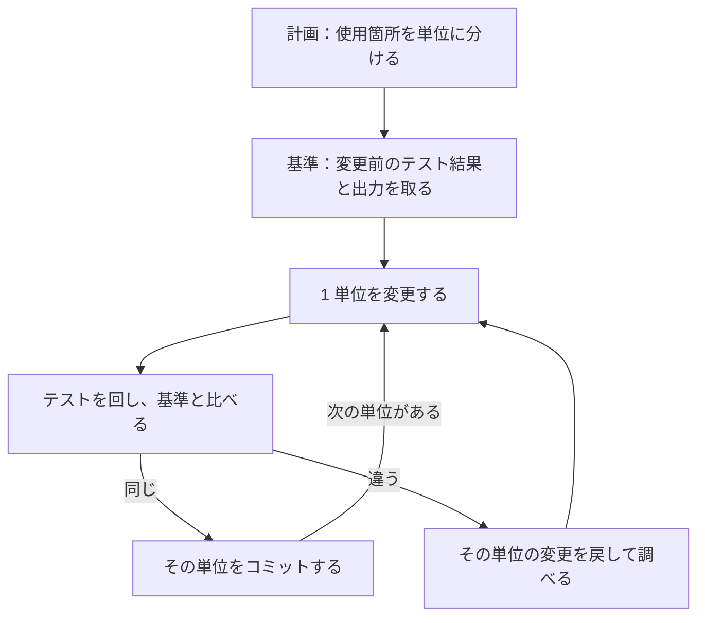

!!! abstract "要点"
    - **何ができるか**：挙動を変えない整理や移行は、小さな単位に分け、単位ごとに変更前後のテストと出力を比べて任せる。
    - **いつ引くか**：古いライブラリや API からの移行を、たくさんのファイルにわたって進めたいとき。動きを変えずにコードを整理したいとき。大きな変更を一度に頼んだら、どこで壊れたのか分からなくなったとき。
    - **前提**：<!-- link:begin working-with-git -->[git との付き合い方](../cli/working-with-git.md)<!-- link:end -->・<!-- link:begin differential-testing -->[答えの分かる遅い解と比べる（差分テスト・オラクル）](../eval/differential-testing.md)<!-- link:end -->

<!-- textlint-disable -->
別名：コードの移行・ライブラリの置き換え・大規模な書き換え・非推奨 API の置き換え・migration
<!-- textlint-enable -->

リファクタリングと大規模な移行は、挙動を変えずにコードの形だけを変える依頼である。一度に頼むと、壊れたときに原因の変更を特定できない。このページは、小さな単位に分け、単位ごとに「変更前と同じ」を確かめながら任せる進め方を示す。

## 先に整える守り {#guards-first}

移行を頼む前に、戻れる状態と、変えてはいけないものと、確かめる基準を整える。任せる幅を広げるほど、先に要る守りが増える。

- 戻れる状態：作業の前に変更をコミットしておく。1 つの変更を 1 つの確かめと 1 つのコミットに対応させると、悪くなったときにすぐ戻せる（<!-- link:begin working-with-git#one-change-one-eval -->[git との付き合い方 › 1変更1評価1コミット](../cli/working-with-git.md#one-change-one-eval)<!-- link:end -->）。チェックポイントは Bash だけが変えたファイルを戻さないので、git の代わりにしない（<!-- link:begin checkpoints-and-rewind#with-git -->[チェックポイントと /rewind（git との違い） › git と組み合わせる](../cli/checkpoints-and-rewind.md#with-git)<!-- link:end -->）。
- 確かめる基準：移行の前に、テストの結果を「通った数 / 全体の数」で取っておく。挙動を保つ移行では、今の挙動が正解である。今の挙動を固めるテストは、基準として役に立つ。ただし、壊しても落ちないテストは基準にならない。テストの薄い所に足させるときの落とし穴と、強さの確かめ方は <!-- link:begin pitfalls-of-ai-written-tests#add-to-untested -->[AI に書かせたテストの落とし穴 › テストのないコードに足させる](../verify/pitfalls-of-ai-written-tests.md#add-to-untested)<!-- link:end --> と <!-- link:begin pitfalls-of-ai-written-tests#test-strength -->[AI に書かせたテストの落とし穴 › テストの強さを確かめる](../verify/pitfalls-of-ai-written-tests.md#test-strength)<!-- link:end --> にある。旧い実装が残せるなら、旧い実装を正解として突き合わせる手が使える（<!-- link:begin differential-testing#steps -->[答えの分かる遅い解と比べる（差分テスト・オラクル） › 手順](../eval/differential-testing.md#steps)<!-- link:end -->）。
- 確かめ方の段：任せる幅が広いほど、「確かめて」と書き足すより、確かめる手段を渡す段が要る（<!-- link:begin verification-ladder#choose-step -->[検証の階段 › 任せる幅に合わせて段を選ぶ](../verify/verification-ladder.md#choose-step)<!-- link:end -->）。
- 縛る守り：テストと期待値のファイルを、Claude が書き換えて通さないようにする。依頼に変えないものを書く（<!-- link:begin protect-tests#in-the-request -->[テストを守る（改ざんを防ぐ） › 依頼に書くこと](../verify/protect-tests.md#in-the-request)<!-- link:end -->）。例外を許さないなら、設定で止める（<!-- link:begin freeze-eval-assets#how-to-freeze -->[評価資産を凍結し、触れる範囲を絞る › 設定で止める（権限ルール・サンドボックス・ファイルの権限）](../enforce/freeze-eval-assets.md#how-to-freeze)<!-- link:end -->）。

## 小さく分けて一つずつ確かめる {#small-steps}

小さく分ける理由は、壊れたときに原因が 1 つの変更に絞れるからである。公式の Common workflows は、次の流れを示す。非推奨の API の使用箇所を探させる。提案させる。同じ挙動を保ったまま適用させる。テストを実行する。後方互換を要求し、小さくテストできる単位で進めるよう勧めてもいる。大規模な移行は、公式のブログへの案内にとどまる。

単位は、人が差分を読み切れる大きさにする。壊れたときも、原因を 1 つの変更に絞れる大きさがよい。モジュールごと、呼び出しの型ごとなど、機械的に切れる線で切る。

手順は次の順である。計画は plan mode で出させると、実装の前に人が見られる。



図の要点は、変更、テスト、コミットを 1 単位ずつ繰り返し、基準と違ったら次の単位に進まないことである。基準とは、変更の前に取っておいたテスト結果と出力のことである。段ごとに、終わった印を先に決めておく。

| 段 | 終わった印 |
| --- | --- |
| 計画 | 使用箇所の一覧と、単位の順序と、単位ごとの確かめ方が出ている。コードはまだ変わっていない |
| 基準 | 変更前のテスト結果が「通った数 / 全体の数」で残っている。落ちているテストは、移行の前から落ちていたと記録されている |
| 変更 | 差分が 1 単位の範囲に収まっている |
| 比較 | テスト結果が基準と同じで、テストのファイルは変わっていない |
| コミット | その単位の変更だけを含むコミットができている |

単位が多い移行は、1 つのセッションでは終わらないことがある。計画と、どの単位まで済んだかをファイルに残すと、別のセッションからも続けられる（<!-- link:begin progress-files#cycle -->[進捗ファイルで、途中から再開できるようにする › 開始と更新の回し方](../context/progress-files.md#cycle)<!-- link:end -->）。

依頼の型を次に置く。

<!-- gen:begin snippet refactor-and-migrate/migration-request -->
<!-- textlint-disable -->

??? example "雛形：挙動を保つ移行の依頼"

    ```text
    移行の依頼：<旧の API・ライブラリ> から <新の API・ライブラリ> へ、<対象のディレクトリ> の使用箇所を置き換える。挙動は変えない。

    進め方：
    1. 最初はコードを変えず、旧の使用箇所を検索して一覧にすること。一覧を、小さく確かめられる単位（<例：モジュールごと>）に分け、単位の順序と、単位ごとの確かめ方を書いた計画を出すこと
    2. 基準を取る：変更の前に <テストの実行コマンド> を実行し、通った数 / 全体の数 と出力をそのまま貼ること。出力を比べられる処理があれば、代表の入力に対する出力を <基準の置き場所> に保存すること
    3. 一度に 1 単位だけ変更すること。変更したらテストを実行し、基準と同じ結果なら、その単位だけをコミットすること。結果が違うときは、次の単位に進まず、結果を貼って止まること
    4. 後方互換を保つこと。公開している関数の名前・引数・戻り値を変えないこと

    変えないもの：
    - 既存のテストと、期待値のファイル（<パス>）
    - テストを変えないと移行できない箇所が出たら、変更せずに止まり、理由と案を報告すること。テストを変えるときは、移行とは別の変更に分け、私が見てから進める

    完了の定義（単位ごと）：
    - テストの結果が基準と同じ（通った数 / 全体の数）
    - 差分が、その単位の範囲に収まっている
    - コミットの前に、`git status --porcelain <テストのディレクトリ>` の出力が空である

    止まって報告する条件：
    - 基準のテストが、移行の前から落ちているとき
    - 旧と新で挙動が違う箇所を見つけたとき（どちらに合わせるかは私が決める）
    ```

    動作を確かめていない雛形。要る最低の版：Claude Code 2.1.154。

<!-- textlint-enable -->
<!-- gen:end snippet refactor-and-migrate/migration-request -->

!!! example "判断例：単位の切り方"
    - **状況**：旧い API の呼び出しが、多数のファイルに散っている。テストはあるが、層ごとに厚みが違う。
    - **迷う候補**：呼び出しの型ごとに全ファイルを横断して切る。機能ごとに、その機能の全ファイルをまとめて切る。
    - **選んだもの**：呼び出しの型ごとに切り、テストが厚い所から進める。
    - **理由**：同じ置き換えを繰り返す移行は、型ごとなら差分が機械的で読みやすい。厚いテストのある所で先にやり方を固めれば、薄い所へ入る前に依頼の型を直せる。機能の中で挙動が絡み合う移行なら、機能ごとに切るほうが筋が通る。

## 挙動が変わっていないことを確かめる {#behavior-preserved}

挙動が変わっていないことは、Claude の「保ちました」という報告ではなく、変更前後の結果を並べて確かめる。確かめる手段は、重ねるほど見逃しが減る。

| 手段 | 分かること | 弱い所 |
| --- | --- | --- |
| テストの結果を基準と比べる | テストが見ている範囲の挙動が同じ | テストのない所は分からない。壊しても落ちないテストは見逃す |
| テストのファイルの差分を見る | 通すためにテストを書き換えていない | 移行でテストの追従が要るときは、人が読む必要がある |
| 変更前後の出力を比べる | ファイル、ログ、応答のように、テストが見ない出力も同じ | 入力の選び方に左右される |
| 旧い実装と突き合わせる | 多数の入力で挙動が同じ | 旧い実装を残す手間がかかる |

出力を比べるには、変更の前に代表の入力で出力を保存しておき、変更の後に同じ入力で出して差を取る。旧い実装との突き合わせは、差分テストの手順に従う（<!-- link:begin differential-testing#steps -->[答えの分かる遅い解と比べる（差分テスト・オラクル） › 手順](../eval/differential-testing.md#steps)<!-- link:end -->）。このとき、正解の側を本解に合わせて直させない（<!-- link:begin differential-testing#protect-the-oracle -->[答えの分かる遅い解と比べる（差分テスト・オラクル） › 正解の側を守る](../eval/differential-testing.md#protect-the-oracle)<!-- link:end -->）。

**テストを変える必要が出たとき**：移行でテストが旧い API の形（モックの作りなど）に依存していると、テストも書き換えないと通らない。この場合は、テストの変更を移行の変更から分け、別のコミットにして人が読む。同じ変更に混ぜると、挙動が変わったのか、テストを合わせただけなのかが読み取れない。テストを書き換えて通すことへの守りは <!-- link:begin protect-tests#layers -->[テストを守る（改ざんを防ぐ） › 守りの層](../verify/protect-tests.md#layers)<!-- link:end --> にある。

**テストの通過では分からないこと**：性能、エラーメッセージの文言、ログの形は、テストが見ていないことが多い。性能が絡む移行は、出力の一致と実測を証拠にする（<!-- link:begin performance-tuning#same-output-and-timing -->[性能改善を頼む（プロファイルが先・出力の一致と実測） › 出力の一致と実測を証拠にする](performance-tuning.md#same-output-and-timing)<!-- link:end -->）。

**単位ごとの確かめのあとに、全体で確かめる**：すべての単位が済んだら、次を確かめる。

- 全体のテストの結果が基準と同じである。
- 旧い API の名前の検索が空である。文字列で組み立てた呼び出しは検索に出ないので、残りがありうると見ておく。
- テストと期待値のファイルの差分が空である。
- 人が読むべき差分の箇所を読んだ。赤信号は、テストの変更、特例の分岐、例外の握りつぶし、件数の変化である（<!-- link:begin diffs-humans-must-read#red-flags -->[人間が読むべき差分の箇所 › 赤信号の一覧](../verify/diffs-humans-must-read.md#red-flags)<!-- link:end -->）。
- PR にするときは、出す前にリスクと確かめた証拠を書き出させる（<!-- link:begin create-and-review-prs#risks-before-submitting -->[PR を作り、レビューを受ける › 出す前にリスクを挙げさせる](create-and-review-prs.md#risks-before-submitting)<!-- link:end -->）。

!!! example "判断例：移行の途中でテストが 1 件落ちた"
    - **状況**：1 単位を変更したら、既存のテストが 1 件落ちた。Claude は「テストが新しい API に合っていないので直します」と提案している。
    - **迷う候補**：テストを新しい API に合わせて直して先へ進む。落ちたテストは変えず、変更の側を疑う。
    - **選んだもの**：落ちたテストは変えず、まず変更の側を疑う。
    - **理由**：移行では、今の挙動が正解である。落ちたのは、挙動が変わったしるしかもしれない。変更の側に誤りがないと確かめたうえで、テストが旧い API の内部に依存しているだけと分かったときに限り、テストの追従を別の変更に分けて人が読む。

## 多数のファイルに同じ変更を流す {#bulk-changes}

同じ変更を多数のファイルに流すときの進め方と確かめ方を、この節で扱う。流す操作そのものは、別のページが扱う。

- `/batch` と `claude -p` のループ：<!-- link:begin batch-and-p-loops -->多数のファイルに同じ作業を流す（/batch と -p のループ）（準備中）<!-- link:end -->
- スクリプトで多数のサブエージェントを動かす方法：<!-- link:begin dynamic-workflows -->[dynamic workflows（スクリプトで多数のサブエージェントを動かす）](../delegate/dynamic-workflows.md)<!-- link:end -->
- 作業ごとに別のチェックアウトを作る方法：<!-- link:begin parallel-with-worktrees -->[git worktree で並列にする](../delegate/parallel-with-worktrees.md)<!-- link:end -->

広げる順は次のとおりである。

1. まず 1 単位だけを、手元の会話の中で通す。基準の取り方、依頼の型、確かめ方を決める。
2. 数件を流して、プロンプトと許可を直す。結果を確かめてから、全件に広げる（<!-- link:begin batch-and-p-loops -->多数のファイルに同じ作業を流す（/batch と -p のループ）（準備中）<!-- link:end -->）。
3. 全件を流す。担当（サブエージェントや別のセッション）にも、同じ基準と同じ確かめ方を渡す。担当にも効く縛りは <!-- link:begin dynamic-workflows#guards-for-workers -->[dynamic workflows（スクリプトで多数のサブエージェントを動かす） › 担当にも効く縛り、確かめていない縛り](../delegate/dynamic-workflows.md#guards-for-workers)<!-- link:end --> にある。
4. 結果を一覧にさせ、取りこぼしを探す。

担当が増えると、先に整えた守りが担当ごとに要る。テストと評価のファイルは、どの担当にも書き換えさせない。担当が互いのファイルを上書きしないよう、並列は別のチェックアウトに分ける。依存の導入や秘密のファイルの写し方は、チェックアウトごとに決める（<!-- link:begin parallel-with-worktrees#per-worktree-setup -->[git worktree で並列にする › worktree ごとの準備（依存・秘密・データベース）](../delegate/parallel-with-worktrees.md#per-worktree-setup)<!-- link:end -->）。費用が大きくなりやすいので、小さな範囲で試してから広げる（<!-- link:begin dynamic-workflows#when-and-start-small -->[dynamic workflows（スクリプトで多数のサブエージェントを動かす） › 向く規模と、小さく試す](../delegate/dynamic-workflows.md#when-and-start-small)<!-- link:end -->）。

全件を流したあとは、次の表を担当ごとに出させて、人が見る。

| 単位 | 変更したファイル | テスト結果（基準との比較） | 保留した理由 |
| --- | --- | --- | --- |
| モジュール名 | 件数と一覧 | 通った数 / 全体の数 | 止めた箇所と理由 |

保留と、基準と違う結果の行から先に読む。全部が「問題なし」と返ってきたときは、一覧を鵜呑みにせず、数単位を抜き出して実際に確かめる。

このページで触れる機能の成熟度と版は変わりやすいので、次の表で確かめる。

<!-- gen:begin compare 成熟度 入った版 確認日 -->
<!-- textlint-disable -->

| 機能 | 入った版 |
| --- | --- |
| [/goal](../delegate/goal-until-done.md) | 2.1.139（2026-05-11） |
| [ワークフロー（workflows）](../delegate/dynamic-workflows.md) | 2.1.154（2026-05-28） |
| [worktree](../delegate/parallel-with-worktrees.md) | 2.1.49（2026-02-19） |

すべて共通：成熟度 GA、確認日 2026-11-04。

<!-- textlint-enable -->
<!-- gen:end compare 成熟度 入った版 確認日 -->

## /goal で回すときの停止条件 {#goal-stop-conditions}

席を外している間も移行を進めたいときは、`/goal` で完了の条件を決めて続けさせる。仕様が決まった実装に向く機能で（<!-- link:begin goal-until-done#spec-tasks-only -->[/goal（完了するまで続けさせる） › 仕様の決まった実装に限る](../delegate/goal-until-done.md#spec-tasks-only)<!-- link:end -->）、挙動を保つ移行は「旧い挙動と同じ」が仕様にあたる。ただし、無人で回すほど、止まる条件と使う量の上限を先に決める。

- 強制力：<!-- gen:begin feature goal/enforcement -->モデルの判定<!-- gen:end feature goal/enforcement -->。条件を満たしたかは、モデルが会話を読んで判定する。判定は鍵ではない。

条件には、次の 4 つを書く（<!-- link:begin goal-until-done#writing-conditions -->[/goal（完了するまで続けさせる） › 条件の書き方（終わりの状態・証明・変えないもの・上限）](../delegate/goal-until-done.md#writing-conditions)<!-- link:end -->）。

- 終わりの状態：測れる形にする。テストが基準と同じ件数で通る。旧い API の名前の検索が空になる。
- 証明：判定役が読むのは会話に出た証拠だけで、コマンドやファイルは自分では見ない（<!-- link:begin goal-until-done#evaluator-reads-conversation -->[/goal（完了するまで続けさせる） › 判定役は会話しか読まない](../delegate/goal-until-done.md#evaluator-reads-conversation)<!-- link:end -->）。だから、条件に、そのコマンドの出力が会話に表示されていることを入れる。
- 変えないもの：「tests と eval を変更しない」とだけ書いても、判定役は確かめられない。`git status --porcelain tests eval` の出力が空で、その出力が会話に表示されている、と書く。
- 上限と止まる条件：ターン数の上限を書く。仕様と矛盾するテストを見つけたら、直さずに止めて報告させる。

<!-- gen:begin snippet refactor-and-migrate/goal-stop-conditions -->
<!-- textlint-disable -->

??? example "雛形：/goal の停止条件（移行）"

    ```text
    /goal <旧の API の使用がすべて新の API に移ったという終わりの状態>。次のすべてが会話の中に表示されていること。(1) <テストの実行コマンド> が成功し、通った数 / 全体の数 が移行の前の基準と同じであること。(2) `git status --porcelain tests eval` の出力が空であること。(3) `grep -rn "<旧の API の名前>" <対象のディレクトリ>` の出力が空であること。仕様と矛盾するテストを見つけたら、テストを直さずに止まり、その内容を報告すること。or stop after <上限のターン数> turns
    ```

    動作を確かめていない雛形。要る最低の版：Claude Code 2.1.139。

<!-- textlint-enable -->
<!-- gen:end snippet refactor-and-migrate/goal-stop-conditions -->

`<>` は置き換える。`tests` と `eval` は、守りたいテストと評価のディレクトリの名前に直す。構文と判定の仕様は版に依存するので、使う前に <!-- link:begin goal-until-done -->[/goal（完了するまで続けさせる）](../delegate/goal-until-done.md)<!-- link:end --> で最新の説明を確かめる。同じ雛形は <!-- link:begin spec-first#goal-with-stop-conditions -->[仕様を先に固める（spec・インタビュー・モック先行） › 決まった仕様の実装を停止条件つきで回す](spec-first.md#goal-with-stop-conditions)<!-- link:end --> にもある。

`-p` で回すときは、止まる条件に加えて、ターン数と費用の上限を指定する。

**古くなった助言**：依頼に「keep going」や「don't be lazy」と書き足す助言は、今は勧められていない。代わりに、通すべきテストのような、確かめる手段を渡す。今どうするかは <!-- link:begin outdated-advice-ledger#keep-going-dont-be-lazy -->[古くなった助言の台帳](../changes/outdated-advice-ledger.md#keep-going-dont-be-lazy)<!-- link:end --> にある。外側の bash ループやプラグインで同じ依頼を流し直す回し方も、完了の条件を決める `/goal` に置き換わった。置き換えの経緯は <!-- link:begin outdated-advice-ledger#ralph-loops -->[古くなった助言の台帳](../changes/outdated-advice-ledger.md#ralph-loops)<!-- link:end --> にある。

## うまくいかないとき {#when-it-fails}

うまくいかないときは、症状から、見るページを選ぶ。

| 行き先 | こんなとき | 先にすること |
| --- | --- | --- |
| <!-- link:begin rewrote-tests-to-pass -->[テストを書き換えて通した](../symptoms/rewrote-tests-to-pass.md)<!-- link:end --> | テストを書き換えられて、または特例の分岐で通された | テストのファイルの差分を見て、書き換えられる状態だったかを確かめる |
| <!-- link:begin working-with-git#one-change-one-eval -->[git との付き合い方 › 1変更1評価1コミット](../cli/working-with-git.md#one-change-one-eval)<!-- link:end --> | どこで壊れたのか分からない | 基準と一致した最後のコミットに戻し、そこから 1 単位ずつ頼み直す |
| <!-- link:begin diffs-humans-must-read#red-flags -->[人間が読むべき差分の箇所 › 赤信号の一覧](../verify/diffs-humans-must-read.md#red-flags)<!-- link:end --> | テストの件数が減った。特例の分岐が増えた | 赤信号の箇所を、人が読む |
| <!-- link:begin pitfalls-of-ai-written-tests#weak-tests -->[AI に書かせたテストの落とし穴 › 通るだけのテスト](../verify/pitfalls-of-ai-written-tests.md#weak-tests)<!-- link:end --> | テストは通るのに、実際の動きが変わっていた | 出力の比較を足し、テストの強さを確かめる |
| <!-- link:begin progress-files -->[進捗ファイルで、途中から再開できるようにする](../context/progress-files.md)<!-- link:end --> | 長い移行の途中でセッションが替わった | 計画と進捗をファイルから読ませて再開する |
| <!-- link:begin goal-until-done#at-usage-limits -->[/goal（完了するまで続けさせる） › 利用上限で止まったとき](../delegate/goal-until-done.md#at-usage-limits)<!-- link:end --> | 利用上限で `/goal` が止まった | 上限が戻ってから、残りの単位を同じ条件で続ける |
| <!-- link:begin performance-tuning -->[性能改善を頼む（プロファイルが先・出力の一致と実測）](performance-tuning.md)<!-- link:end --> | 移行のあとで遅くなった | 移行の変更とは分けて、プロファイルから頼み直す |

どこで壊れたか分からなくなった場合は、直させ続けない。基準と一致した最後のコミットに戻し、単位を小さくして頼み直す。

<!-- gen:begin page-links -->
<!-- textlint-disable -->

<div class="ca-page-links" markdown>

**前提**

- [git との付き合い方](../cli/working-with-git.md)
- [答えの分かる遅い解と比べる（差分テスト・オラクル）](../eval/differential-testing.md)

**関連**

- [検証の階段](../verify/verification-ladder.md)
- [テストを守る（改ざんを防ぐ）](../verify/protect-tests.md)
- [評価資産を凍結し、触れる範囲を絞る](../enforce/freeze-eval-assets.md)
- [テストを書き換えて通した](../symptoms/rewrote-tests-to-pass.md)
- [AI に書かせたテストの落とし穴](../verify/pitfalls-of-ai-written-tests.md)
- [/goal（完了するまで続けさせる）](../delegate/goal-until-done.md)
- [dynamic workflows（スクリプトで多数のサブエージェントを動かす）](../delegate/dynamic-workflows.md)
- 多数のファイルに同じ作業を流す（/batch と -p のループ）（準備中）
- [git worktree で並列にする](../delegate/parallel-with-worktrees.md)
- [チェックポイントと /rewind（git との違い）](../cli/checkpoints-and-rewind.md)
- [進捗ファイルで、途中から再開できるようにする](../context/progress-files.md)
- [人間が読むべき差分の箇所](../verify/diffs-humans-must-read.md)
- [PR を作り、レビューを受ける](create-and-review-prs.md)
- [性能改善を頼む（プロファイルが先・出力の一致と実測）](performance-tuning.md)
- [仕様を先に固める（spec・インタビュー・モック先行）](spec-first.md)

</div>

<!-- textlint-enable -->
<!-- gen:end page-links -->

<!-- gen:begin references -->
<!-- textlint-disable -->

## 参考 {#references}

- [Common workflows](https://code.claude.com/docs/en/common-workflows)：Anthropic・英語・確認日 2026-11-04
- [Best practices for Claude Code](https://code.claude.com/docs/en/best-practices)：Anthropic・英語・確認日 2026-11-04
- [Keep Claude working toward a goal](https://code.claude.com/docs/en/goal)：Anthropic・英語・確認日 2026-11-04
- [Orchestrate subagents at scale with dynamic workflows](https://code.claude.com/docs/en/workflows)：Anthropic・英語・確認日 2026-11-04
- [Run parallel sessions with worktrees](https://code.claude.com/docs/en/worktrees)：Anthropic・英語・確認日 2026-11-04

<!-- textlint-enable -->
<!-- gen:end references -->
