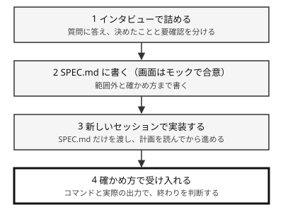

!!! abstract "要点"
    - **何ができるか**：大きな機能は、実装の前に Claude へインタビューさせて SPEC.md に仕様を書かせ、範囲外と確かめ方まで決めてから、新しいセッションで実装させる。
    - **いつ引くか**：大きな機能を作る前に要件の抜けをなくしたいとき。作り始める前に画面の見た目と動きをモックで合意したいとき。何を作るのかを、質問に答えながら詰めたいとき。
    - **前提**：<!-- link:begin let-claude-ask -->[質問させる・インタビューさせる](../prompting/let-claude-ask.md)<!-- link:end -->・<!-- link:begin define-done -->[「完了」を定義して渡す](../verify/define-done.md)<!-- link:end -->・<!-- link:begin when-to-plan -->[plan mode の使いどころ](../cli/when-to-plan.md)<!-- link:end -->

<!-- textlint-disable -->
別名：仕様駆動開発・spec 駆動・SPEC.md・インタビューで仕様を詰める・spec-driven development
<!-- textlint-enable -->

仕様を先に固めるレシピは、作る前に「何を作るか」「何を作らないか」「できたとどう確かめるか」を文書にし、その文書を新しいセッションへ渡して実装させる進め方である。Claude に見えていない頭の中の条件を先に見せ（見せる）、できたかどうかを測れる形にする（確かめる）。作らせ終えてから違いに気づく場面が減る。



## 先に整える守り {#guards-first}

仕様を書かせる前に、確かめる守りと縛る守りを決める。実装を別のセッションや `/goal` へ任せるほど、人が見ない時間が増える。だから見合う守りを先に置く。

- 確かめる守り：どのコマンドがどう返れば終わりかを、仕様の「確かめ方」に書く。書き方は <!-- link:begin define-done#what-to-include -->[「完了」を定義して渡す › 完了の定義に入れるもの](../verify/define-done.md#what-to-include)<!-- link:end --> にある。迷ったら止まって報告する条件も同じ所に決める（<!-- link:begin define-done#stop-and-report -->[「完了」を定義して渡す › 止まって報告する条件](../verify/define-done.md#stop-and-report)<!-- link:end -->）。
- 縛る守り：やらないことを仕様の「範囲外」に書く（<!-- link:begin state-the-scope#anti-goals -->[範囲を伝える（やらないこと） › やらないことを書く](../prompting/state-the-scope.md#anti-goals)<!-- link:end -->）。例外を許さない範囲は、文章ではなく権限やフックで縛る（<!-- link:begin state-the-scope#two-layers -->[範囲を伝える（やらないこと） › 例外を許さない範囲は仕組みで縛る（二層）](../prompting/state-the-scope.md#two-layers)<!-- link:end -->）。
- 方針に迷う作業の計画：実装に入る前に plan mode で計画を読んで直す。使いどころは <!-- link:begin when-to-plan#when -->[plan mode の使いどころ › 計画が効く作業、省いてよい作業](../cli/when-to-plan.md#when)<!-- link:end --> にある。

仕様を書くこと自体にも費用がかかる。小さな変更まで仕様にすると、書く時間のほうが長くなる。

!!! example "判断例：どこから仕様を書くか"
    - **状況**：記事にコメントを付けられる機能を足したい。変更は複数のファイルに広がり、誰が書けるか、削除できるかなど、決めていないことが多い。
    - **迷う候補**：すぐ「コメント機能を作って」と頼む。先にインタビューで仕様を詰める。
    - **選んだもの**：先にインタビューで仕様を詰める。
    - **理由**：決めていない点を Claude が思い込みで埋めると、作り終えてから違いに気づく。1 ファイルの小さな直しで、確かめ方も明らかな作業なら、直接頼むほうが安い。判断は <!-- link:begin when-to-plan#when -->[plan mode の使いどころ › 計画が効く作業、省いてよい作業](../cli/when-to-plan.md#when)<!-- link:end --> の「省いてよい作業」と同じ見方でよい。

## インタビューで仕様を詰める {#interview}

インタビューで仕様を詰めるとは、コードを書かせる前に Claude に質問させ、答えで設計が変わる点を順に決めていくことである。公式のベストプラクティスは、仕様が書けるまでインタビューして SPEC.md に書くよう頼めば、Claude が選択式の質問を返すと案内している。頼み方にツールの名前は要らない。Claude Code では、選択肢を出す質問の道具（AskUserQuestion）が使われる。

次の依頼の雛形は、質問の絞り方、答えられない点の扱い、コードを書かない約束を箇条で渡す。質問のさせ方の詳細は <!-- link:begin let-claude-ask#how -->[質問させる・インタビューさせる › 質問させる頼み方](../prompting/let-claude-ask.md#how)<!-- link:end --> にある。

<!-- gen:begin snippet let-claude-ask/interview-feature -->
<!-- textlint-disable -->

???+ example "雛形：インタビューで仕様を詰める依頼の雛形（機能の例）"

    ```text
    <作りたいものを 1〜2 行で。例：記事にコメントを付けられるようにしたい>

    実装に入る前に、私にインタビューして仕様を詰めてほしい。
    - 分かりきった質問はしない。答えで設計が変わる点だけを聞く
    - 選べる点は選択式で聞き、推奨があれば添える
    - 対象は <範囲。例：src/comments/ と、そこから呼ぶ API> に限る
    - 私が答えられない点は、決めずに「要確認」として残す
    - 質問が尽きたら、仕様を SPEC.md に書く。範囲外のことと、動作の確かめ方も書く
    - コードはまだ書かない
    ```

    動作を確かめていない雛形。要る最低の版：Claude Code 2.1.139。

<!-- textlint-enable -->
<!-- gen:end snippet let-claude-ask/interview-feature -->

答える側の進め方は 3 つある。

- 答えられない点は、無理に決めず「要確認」として残させる。決めたことと確かめることを分ける考え方は <!-- link:begin let-claude-ask#decided-vs-open -->[質問させる・インタビューさせる › 決めたことと、確かめることを分ける](../prompting/let-claude-ask.md#decided-vs-open)<!-- link:end --> にある。
- 自分でも要件が固まっていないときは、作りたいものを 1〜2 行で書き、細部は質問で出させる。
- 質問が浅いと感じたら、範囲を絞り直し、聞いてほしい観点を足して続ける。

この段の終わりの印は、SPEC.md ができ、要確認の欄に答えられなかった点が残っていることである。要確認が空なら、聞き漏らしか、聞かずに埋められた点を疑う。

仕様の誤解釈は、コードを書かせたときに最も多い誤りの類型だった。333 件の誤りを分類した 2024 年公刊の研究（当時のコード生成モデルが対象）は、最大の類型を仕様の誤解釈（20.77%）、次をコーナーケースの漏れ（15.27%）とした（根拠：中）。現行の Claude の傾向とは限らないが、作る前に条件を文書にする理由の 1 つにはなる。

## 仕様に書くこと {#what-goes-in-the-spec}

仕様とは、実装するセッションが会話の履歴なしで読んで作れる、自己完結した文書である。インタビューで決まったことを、次の項目に分けて書かせる。

- 目的：誰の何の困りごとを、どう変えるか。
- 範囲外：やらないこと。頼んでいない機能や変更を防ぐ。
- 関わるファイルとインターフェース：触るファイルと、外から見える入口。変えないものもここに書く。
- 決定事項と要確認事項：決まったことと、答えが出ていないことを別の欄にする。要確認は、実装側が勝手に決めず質問する印になる。
- 確かめ方：実行するコマンドと期待する結果。最後に、通しで動かす手順を置く。

項目の形は次の雛形にある。`<>` の中を、自分の機能に合わせて置き換える。

<!-- gen:begin snippet spec-first/spec-outline -->
<!-- textlint-disable -->

??? example "雛形：SPEC.md の項目の例（目的・範囲外・関わるファイル・決定事項と要確認事項・確かめ方）"

    ```markdown
    # SPEC: <機能の名前>

    ## 目的
    <誰の何の困りごとを、どう変えるか。2〜3 行>

    ## 範囲外（やらないこと）
    - <例：コメントの編集機能は作らない>
    - <例：既存の認証の仕組みは変えない>

    ## 関わるファイルとインターフェース
    - <例：src/comments/ を新しく作る>
    - <例：src/api/articles.ts の getArticle の戻り値に comments を足す>
    - 変えないもの：<例：tests/ と eval/>

    ## 決定事項
    - <インタビューで決まったこと。例：コメントはログイン済みの人だけが書ける>

    ## 要確認事項
    - <答えが出ていない点。決めずに残す。例：削除したコメントを管理者に見せるか>

    ## 画面の決定事項
    - <モックで合意した見た目と動き。モックのファイルの場所>

    ## 確かめ方
    - <実行するコマンドと、期待する結果。例：npm test が終了コード 0>
    - <最後に通しで動かす手順。例：記事を開き、コメントを書き、再読み込みしても残ることを確かめる>
    ```

    動作を確かめていない雛形。要る最低の版：Claude Code 2.1.139。

<!-- textlint-enable -->
<!-- gen:end snippet spec-first/spec-outline -->

評価器や採点の処理のように、検証の道具そのものを作る仕様では、確かめ方に「その道具が正しいことを確かめる手順」も書かせる。仕様を書き終える段で、確かめ方が実行できる形かを見る。

この段の終わりの印は次のとおり。仕様だけを渡した新しいセッションに読ませ、分からない点を挙げさせる。挙がらないか、要確認事項に既にあるものだけなら、仕様は自己完結している。進捗や決定の記録の分け方は <!-- link:begin progress-files#decided-vs-open -->進捗ファイルで、途中から再開できるようにする › 決めたことと、聞くべきことを分ける（準備中）<!-- link:end --> にある。

## モックで先に合意する {#mock-first}

モックで先に合意するとは、画面のある機能で、実装より先に、見た目と動きを捨ててよい試作で見せ、直す点を決めることである。文章の仕様だけでは、画面の見た目や動きは伝わりにくい。試作を見れば、思っていたものと違う点を、作り込む前に指せる。

この節の進め方は、公式の文書で確かめた手順ではなく、この辞典の推奨である（推論・実践例なし）。次の雛形は、動かせる 1 枚の HTML を作らせ、実装には流用しないと約束させる。

<!-- gen:begin snippet spec-first/mock-request -->
<!-- textlint-disable -->

??? example "雛形：モックで先に合意する依頼の雛形"

    ```text
    SPEC.md の「目的」と「範囲外」を読んで、画面のモックを作ってほしい。
    - 動かせる 1 枚の HTML にする（<保存先。例：mock/comments.html>）。本物のデータや API にはつながない
    - 見せたい画面は <例：コメントの一覧、書き込み、書き込み後の表示> の 3 つ
    - 状態は <例：コメントなし、投稿中、投稿に失敗した> も出す
    - 本物のコードは書かない。モックは合意のための試作で、実装には流用しない
    - 作ったら、私が確かめる点を 3 つ挙げる。直す指示は私が出すまで待つ
    ```

    動作を確かめていない雛形。要る最低の版：Claude Code 2.1.139。

<!-- textlint-enable -->
<!-- gen:end snippet spec-first/mock-request -->

モックを見たら、直す点を伝えて作り直させ、合意できた見た目と動きを SPEC.md の「画面の決定事項」に書き写させる。モックのファイルの場所も書いておくと、実装するセッションが参照できる。見た目を手本と見比べて直させる進め方は <!-- link:begin frontend-design -->フロントエンドのデザイン（準備中）<!-- link:end --> にある。

!!! example "判断例：モックを作るか"
    - **状況**：管理画面の新しい一覧画面を作る。並べ方や空のときの表示など、見た目と動きに決めていない点が多い。
    - **迷う候補**：仕様の文章だけで実装に進む。先にモックを作って合意する。
    - **選んだもの**：先にモックを作って合意する。
    - **理由**：見た目と動きは、実装してから直すと手戻りが大きい。画面のない処理や、見た目が既存の画面の複製で決まる作業なら、モックを省いて仕様の文章だけでよい。

この段の終わりの印は、合意した見た目と動きが SPEC.md に書き写されていることである。

## 新しいセッションで実装する {#implement-fresh}

新しいセッションで実装するとは、仕様を書いた会話を引き継がず、SPEC.md だけを渡した新しい会話で実装を始めることである。インタビューの質問や推測が積もった会話から離れ、仕様を唯一の入力にすると、仕様に書き漏らした点がそのまま見つかる。長い会話の損失を避ける考え方は <!-- link:begin handoff-documents#resume -->[handoff 文書と document-and-clear › 新しい会話での再開の仕方](../context/handoff-documents.md#resume)<!-- link:end --> にある。

=== "アプリ"

    新しい会話を開き、SPEC.md の内容を最初のメッセージに添えて、次の雛形で頼む。ファイルの添え方はアプリの版や実行環境で違うので、手順は未確認である。

=== "Claude Code"

    仕様を書いたセッションを閉じ、リポジトリで新しいセッションを始めて、次の雛形で頼む。SPEC.md を作業ディレクトリに置いておけば、Claude が自分で読める。

次の雛形は、SPEC.md を正とする。要確認は自分で決めず、計画を出したら止まり、終わったら確かめ方の出力を見せる。

<!-- gen:begin snippet spec-first/fresh-session-start -->
<!-- textlint-disable -->

??? example "雛形：新しいセッションで仕様を渡して実装に入る依頼の雛形"

    ```text
    SPEC.md を最初から最後まで読んでから、実装の計画を出してほしい。
    - 計画は、SPEC.md の「範囲外」に触れないことを確かめてから出す
    - SPEC.md に書いてあることと、会話で聞いたことが食い違ったら、SPEC.md を正とする。食い違いは報告する
    - 「要確認事項」は決めずに、私に聞く
    - 計画を出したら止まる。承認するまでコードは書かない
    - 実装が終わったら、SPEC.md の「確かめ方」のコマンドを実行し、その出力をそのまま見せる
    ```

    動作を確かめていない雛形。要る最低の版：Claude Code 2.1.139。

<!-- textlint-enable -->
<!-- gen:end snippet spec-first/fresh-session-start -->

Claude Code では、この計画の段を plan mode で行うと、承認するまで編集が止まる。計画の読み方と直し方は <!-- link:begin when-to-plan#review -->[plan mode の使いどころ › 計画の読み方と直し方](../cli/when-to-plan.md#review)<!-- link:end -->、承認の後に起きることは <!-- link:begin when-to-plan#after-approval -->[plan mode の使いどころ › 計画を承認した後](../cli/when-to-plan.md#after-approval)<!-- link:end --> にある。

この段の終わりの印は、出てきた計画が SPEC.md の範囲外に触れていないこと、要確認事項が質問として返っていることである。

## 決まった仕様の実装を停止条件つきで回す {#goal-with-stop-conditions}

停止条件つきの自律反復は、仕様が決まった実装に限って使う。`/goal` は完了の条件を満たすまで Claude にターンを続けさせる機能である（機能の説明は <!-- link:begin goal-until-done -->[/goal（完了するまで続けさせる）](../delegate/goal-until-done.md)<!-- link:end --> にある）。席を外している間も進むぶん、守りが前提になる。

回す前に、次の 3 つが済んでいるかを見る。

- 仕様の要確認事項が解消している。残っていると、判定の基準がぶれる（<!-- link:begin goal-until-done#spec-tasks-only -->[/goal（完了するまで続けさせる） › 仕様の決まった実装に限る](../delegate/goal-until-done.md#spec-tasks-only)<!-- link:end -->）。
- 確かめ方が、コマンドの結果で合否を返す形になっている。仕様からテストを先に書かせる進め方は <!-- link:begin tests-first#steps -->テストを先に書かせる › 手順（準備中）<!-- link:end --> にある。
- 範囲外と、変えてはならないファイルが仕様に書いてある。

`/goal` で条件を満たしたかを各ターンの後に判定する役（判定役）は、会話に出た証拠しか読まない（<!-- link:begin goal-until-done#evaluator-reads-conversation -->[/goal（完了するまで続けさせる） › 判定役は会話しか読まない](../delegate/goal-until-done.md#evaluator-reads-conversation)<!-- link:end -->）。そのため「tests/ と eval/ を変更しない」と書くだけでは、変更していないことを判定できない。変更していないことを示すコマンドの出力を会話に出させる条件にする。条件に入れるもの（終わりの状態・確かめ方・変えないもの・上限）の考え方は <!-- link:begin goal-until-done#writing-conditions -->[/goal（完了するまで続けさせる） › 条件の書き方（終わりの状態・証明・変えないもの・上限）](../delegate/goal-until-done.md#writing-conditions)<!-- link:end --> にある。

<!-- gen:begin snippet goal-until-done/stop-condition -->
<!-- textlint-disable -->

??? example "雛形：停止条件つきの /goal の条件文（終わりの状態・確かめ方・変えないもの・上限）"

    ```text
    /goal tests/ 以下のテストがすべて通り、lint が警告なしで終わっている。確かめ方：最後に `npm test` と `npm run lint` を実行し、終了コードと出力の末尾を会話に表示する。変えないもの：`git status --porcelain tests eval` の出力が空であることも会話に表示されている。上限：または 20 ターンで止まり、残っている失敗と、試したことを報告する（or stop after 20 turns）。
    ```

    動作を確かめていない雛形。要る最低の版：Claude Code 2.1.139。

<!-- textlint-enable -->
<!-- gen:end snippet goal-until-done/stop-condition -->

この雛形の条件は、仕様と矛盾するテストを見つけたときの動きも決めておくと安全になる。回避せず、止まって報告させる（<!-- link:begin define-done#stop-and-report -->[「完了」を定義して渡す › 止まって報告する条件](../verify/define-done.md#stop-and-report)<!-- link:end -->）。上限のターン数も条件に書く。上限に達したときは、残っている失敗と試したことを報告させる。

!!! example "判断例：要確認が残る仕様で /goal を回すか"
    - **状況**：SPEC.md の要確認事項に、削除したコメントを管理者に見せるかどうかが残っている。それ以外の実装は決まっていて、夜のうちに進めたい。
    - **迷う候補**：要確認を残したまま `/goal` を回し、朝に直す。先に要確認を自分で決めて SPEC.md に書き、それから回す。
    - **選んだもの**：先に要確認を決めて書き、それから回す。
    - **理由**：要確認を残したまま回すと、Claude が自分で決めて進め、判定役もそれを満たしたと見なすことがある。回す前の守りが済んでいない状態は、任せる幅を広げるのに見合わない。

この段の終わりの印は、条件に書いたコマンドの出力が会話に出ていること、または上限で止まって、残りの失敗が報告されていることである。

仕様の決まっていない作業で、戦略そのものを改善させ続ける開いたループは、この辞典では勧めない。大きな移行を小さく分けて回す場合の停止条件は <!-- link:begin refactor-and-migrate#goal-stop-conditions -->リファクタリングと大規模な移行 › /goal で回すときの停止条件（準備中）<!-- link:end --> にある。

## 全体の確かめ方 {#verify}

全体の確かめ方とは、実装が終わった時点で、仕様の項目ごとに、実際の出力と差分で受け入れを判断することである。Claude の「できた」という報告だけでは受け入れない（終わったように見えた所で止まる理由は <!-- link:begin define-done#why-it-stops -->[「完了」を定義して渡す › 終わったように見えた所で止まる](../verify/define-done.md#why-it-stops)<!-- link:end --> にある）。

1. 確かめ方に書いたコマンドを実行させ、終了コードと出力をそのまま会話に出させる。
2. 差分が、関わるファイルの外と範囲外に出ていないかを見る。頼んでいない機能が増えていないかの見方は <!-- link:begin does-more-than-asked#prevention -->[頼んでいないことまでやる（過剰設計） › 予防：範囲を先に決め、差分を毎回見る](../symptoms/does-more-than-asked.md#prevention)<!-- link:end --> にある。
3. 要確認事項が、すべて解消されたか、質問として返ってきたかを見る。実装側が勝手に決めたものがないかを見る。
4. 画面があるなら、モックと見比べる。違いがあれば、仕様とモックのどちらを正にするかを人が決める。

実装の途中で仕様を変える必要が出たら、コードより先に SPEC.md を直す。直した SPEC.md を正にして続ければ、仕様と実装が離れない。

## うまくいかないとき {#when-it-fails}

うまくいかないときは、症状から原因を切り分ける。

- 頼んだものと違うものが出てくる：伝えた情報の不足から順に切り分ける（<!-- link:begin not-what-i-meant#diagnosis -->[意図と違うものが出てくる › 原因を安く確かめる順](../symptoms/not-what-i-meant.md#diagnosis)<!-- link:end -->）。
- 頼んでいないことまでやる：範囲の伝え方と差分の確かめ方を見直す（<!-- link:begin does-more-than-asked#diagnosis -->[頼んでいないことまでやる（過剰設計） › 原因を安く確かめる順](../symptoms/does-more-than-asked.md#diagnosis)<!-- link:end -->）。
- 新しいセッションが仕様を読み落とす：引き継ぎの確かめ方と対処は <!-- link:begin handoff-documents#troubleshoot -->[handoff 文書と document-and-clear › 引き継いだのにうまくいかないとき](../context/handoff-documents.md#troubleshoot)<!-- link:end --> にある。
- 作業が長引いて途中から再開する：進捗をファイルに分けて持たせる（<!-- link:begin progress-files#files -->進捗ファイルで、途中から再開できるようにする › ファイルの分け方（準備中）<!-- link:end -->）。
- 与えられた仕様がある：自分で原文を読み、Claude には誤読の指摘だけを頼む（<!-- link:begin read-specs-yourself#read-first -->仕様を自分で読み、AI に誤読を指摘させる › 先に自分で読んで要約する（準備中）<!-- link:end -->）。
- 決めたことと理由をチームで残したい：<!-- link:begin record-decisions -->決定を文書に残す（ADR と週次アップデート）（準備中）<!-- link:end --> を使う。

<!-- gen:begin references -->
<!-- textlint-disable -->

## 参考 {#references}

- [Best practices for Claude Code](https://code.claude.com/docs/en/best-practices)：Anthropic・英語・確認日 2026-11-04
- [Keep Claude working toward a goal](https://code.claude.com/docs/en/goal)：Anthropic・英語・確認日 2026-11-04
- [Choose a permission mode](https://code.claude.com/docs/en/permission-modes)：Anthropic・英語・確認日 2026-11-04
- [Tools reference](https://code.claude.com/docs/en/tools-reference)：Anthropic・英語・確認日 2026-11-04
- [Bugs in Large Language Models Generated Code: An Empirical Study](https://arxiv.org/abs/2403.08937)：arXiv（Tambon, Florian ほか）・英語・確認日 2026-11-04

<!-- textlint-enable -->
<!-- gen:end references -->

<!-- gen:begin page-links -->
<!-- textlint-disable -->

<div class="ca-page-links" markdown>

**前提**

- [質問させる・インタビューさせる](../prompting/let-claude-ask.md)
- [「完了」を定義して渡す](../verify/define-done.md)
- [plan mode の使いどころ](../cli/when-to-plan.md)

**関連**

- 仕様を自分で読み、AI に誤読を指摘させる（準備中）
- フロントエンドのデザイン（準備中）
- [handoff 文書と document-and-clear](../context/handoff-documents.md)
- [範囲を伝える（やらないこと）](../prompting/state-the-scope.md)
- 細かく指図するか、成果で頼むか（準備中）
- テストを先に書かせる（準備中）
- [/goal（完了するまで続けさせる）](../delegate/goal-until-done.md)
- [意図と違うものが出てくる](../symptoms/not-what-i-meant.md)
- [頼んでいないことまでやる（過剰設計）](../symptoms/does-more-than-asked.md)
- 進捗ファイルで、途中から再開できるようにする（準備中）
- 決定を文書に残す（ADR と週次アップデート）（準備中）
- リファクタリングと大規模な移行（準備中）

</div>

<!-- textlint-enable -->
<!-- gen:end page-links -->
