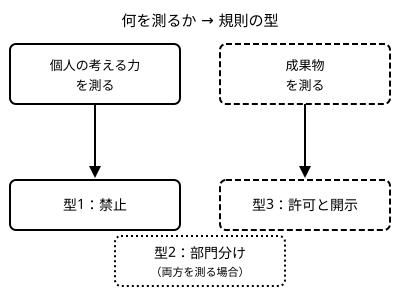

!!! abstract "要点"
    - **何が分かるか**：学校・組織・大会の AI の規則が 3 つの型のどれかを見分け、確認表で確かめる点を押さえられる。規則に AI の文言がないことは、使ってよいことを意味しない。
    - **いつ引くか**：会社や学校で使ってよいか確かめたいとき、AI の利用に規則のある大会に出るとき、規則に AI のことが書かれていないとき、AI が書いたコードを製品や OSS に入れてよいか確かめたいとき。
    - **前提**：なし

<!-- textlint-disable -->
別名：AI の利用の規則・生成 AI のガイドライン・大会の AI のルール・規則の確認表・生成物のライセンス
<!-- textlint-enable -->

学校・組織・コンテストの規則は、AI を使ってよいか、使うならどこまでかを、場ごとに決めている。このページは、その規則が 3 つの型のどれに当たるかを見分け、読むときに確かめる点を確認表にまとめる。個別の規則の条文は載せない。規則は変わるので、読む先と確かめ方だけを示す。

## なぜ規則が割れるか（三つの型） {#why-rules-differ}

AI の規則が場ごとに割れるのは、その場が何を測りたいかが違うからである。規則は「AI が強くなるほど締める」という一方向には動いていない。個人の考える力を測る大会は禁止へ、成果物を測る大会は許可と開示へ、両方を測る大会は部門分けへ向かった（根拠：中。大会の例が根拠で、版に依存する）。



図の 3 つの型は、読むときの手がかりである。

- **禁止**：個人の考える力そのものが測る対象のとき。AI の助けを借りた答えは、測りたいものを測れない。何が AI の利用に当たるか（補完や翻訳を含むか）の線引きを読む。
- **許可と開示**：提出した成果物の質が測る対象のとき。使うことは認めたうえで、どこに使ったかの開示を求める。開示の形と、事前に作ったコードの扱いを読む。
- **部門分け**：両方を測りたいとき。AI を使う部門と使わない部門を分ける。部門を選ぶ期限と、選ばなかった場合の扱いを読む。

授業や仕事の規則にも、同じ理由の割れ方がある。授業の課題が考える力を測るなら禁止に寄り、仕事の成果物が測る対象なら、許可と開示（誰が責任を持つか）に寄る。ただし、これは大会の例からの当てはめである（類推）。学校や組織の規則は、この型に収まらない独自の形をしていることもある。

型が分かっても、個々の規則の中身は版で変わる。主な大会の類型と、版・確認日・一次資料の所在は<!-- link:begin competition-rules#rules-by-type -->[大会の規則の早見（禁止・部門分け・許可と開示） › 類型ごとの大会（確認日付き）](../contest/competition-rules.md#rules-by-type)<!-- link:end -->にある。版が未確認の大会は、出る前に<!-- link:begin competition-rules#unverified-versions -->[大会の規則の早見（禁止・部門分け・許可と開示） › 大会ごとの規則のページと、出る前に確かめること](../contest/competition-rules.md#unverified-versions)<!-- link:end -->で確かめる。

規則が練習と本番で扱いを変えることもある。本番で使えない線をどこに引くかは<!-- link:begin practice-vs-contest-day#rules-change-the-line -->[練習と本番の使い分け（AI を禁じる大会に向けた練習を含む） › 本番で使えない線引き](../contest/practice-vs-contest-day.md#rules-change-the-line)<!-- link:end -->で扱う。

## 確認表 {#checklist}

確認表は、規則を読むときに確かめる点を、読み落とさないための一覧である。規則の条文を写す場所ではない。書くのは、確かめた結果の要点と、規則の所在と、分からなかった点である。

確認する点は、大きく 4 つに分かれる。

- **規則そのもの**：規則の版と日付、部門、当日のマニュアル、形式（個人戦・チーム戦の別、オンサイト・オフラインの別）、提出の環境。当日のマニュアルが規則より優先される場合がある。優先順位は規則の中で確かめる。
- **AI の許可の範囲**：翻訳、補完、チャット、エージェント、結果分析、自動ループの 6 区分に分けて、許可・不許可・条件付き・不明のどれかを書く。「AI は可」と一括りにされた規則でも、エージェントや自動ループだけが別扱いのことがある。この 6 区分は、学校や会社の規則にも使える。
- **開示とデータ**：開示の義務、事前に作ったコードや資料の扱い、外部のデータを使ってよいか、外部へ送ってよいか、外部への相談の可否。開示の考え方は<!-- link:begin disclosure-and-provenance#four-points -->AI 利用の開示と出所の記録 › 開示・相談・出所・意図の四つの観点（準備中）<!-- link:end -->、データの持ち主と契約は<!-- link:begin entrusted-data#whose-data -->[預かったデータ・規約付きのデータを AI に渡してよいか › 誰のデータで、何が決まっているか](entrusted-data.md#whose-data)<!-- link:end -->で扱う。
- **不明点の記録**：分からない点、運営や担当者に質問した日付、回答、チームの結論と合意した日。

学校や組織で使うときは、次の 4 点を足す。データの区分ごとの可否、使ってよい面（アプリ・Claude Code・API）、成果物に AI を使った旨を書く決まり、確認先（指導教員・上長・情報システムなど）である。組織の決まりを自分で書く側に回ったら、<!-- link:begin ai-usage-guidelines#what-to-write -->[社内ガイドラインに書くこと › 書くこと（データの区分・面とモード・レビューの責任）](../team/ai-usage-guidelines.md#what-to-write)<!-- link:end -->を見る。

次が確認表の雛形である。規則を読む前にメモへ写し、読みながら埋める。

<!-- gen:begin snippet checking-ai-rules/rules-checklist -->
<!-- textlint-disable -->

???+ example "雛形：規則の確認表（大会・授業・組織の AI の規則を読むときのメモ）"

    ```markdown
    # AI の利用の規則の確認表

    対象（大会・授業・組織の名前）：
    確認した人と日付：
    読んだ規則の版と日付（規則に書かれたもの）：
    規則の所在（URL や文書名）：

    ## 規則そのもの

    - [ ] 規則の版と日付を控えた。版の記載がなければ、そのことも記録した
    - [ ] 部門や区分がある。自分が入る部門（または区分）はこれである：
    - [ ] 当日のマニュアルや補足の通知がある。規則との優先順位はこうである：
    - [ ] 形式（個人かチームか）、オンサイトかオフラインか、提出の環境を確かめた
    - [ ] AI の文言がない。その場合は「使ってよい」と読まず、運営や担当者に確かめる（下の記録へ）

    ## AI の許可の範囲（6 区分。許可・不許可・条件付き・不明のどれか）

    - 翻訳（問題文や資料の翻訳）：
    - 補完（エディタの入力補完）：
    - チャット（質問して答えを読む）：
    - エージェント（ファイルを読み、編集や実行までさせる）：
    - 結果分析（実行結果や提出結果を読ませて分析する）：
    - 自動ループ（結果に基づく改善を人の手を介さず繰り返す）：

    ## 開示とデータ

    - [ ] 開示の義務がある。いつ、何を、どの形で書くか：
    - [ ] 事前に作ったコードや資料（ライブラリ、過去の自作物）の扱い：
    - [ ] 外部のデータを使ってよいか。外部へ送信してよいか：
    - [ ] 外部への相談（他人や他のサービスへの質問）の可否：

    ## 学校・組織で足す欄

    - [ ] 扱うデータの区分（公開・社内・顧客のものなど）ごとに、AI に渡してよいか：
    - [ ] 使ってよい面（アプリ・Claude Code・API）と、契約のあるプランかどうか：
    - [ ] 成果物に AI を使った旨を明記する決まり（種類・箇所）：
    - [ ] 指導教員、上長、情報システムなどの確認先と、連絡先：

    ## 不明点と合意の記録

    - 不明点と、運営や担当者への質問の日付：
    - 回答（誰から、いつ、どの形で）：
    - チームの結論と、合意した日：
    ```

    動作を確かめていない雛形。安全のための雛形なので、守りとして頼る前に、止めたい操作が自分の環境で止まるかを確かめる。

<!-- textlint-enable -->
<!-- gen:end snippet checking-ai-rules/rules-checklist -->

欄が埋まらないときは、空のまま使い始めず、「不明」と書いて、運営や担当者に質問して確かめる。手順は、次の「文言がないとき・分からないとき」の節にある。

## 文言がないとき・分からないとき {#when-unclear}

規則に AI の文言がないことは、使ってよいことを意味しない。規則が AI の登場より前に書かれたまま更新されていないだけのことも、行動規範や上位の規則が別にあるだけのこともある。文言がない場合は、「許可されている」とも「禁止されている」とも読まず、「不明」として扱う。

分からないときは、次の順で確かめる。

1. 同じ場の上位の規則を探す。大会なら行動規範や参加規約、学校なら学部や授業の指針、組織なら情報セキュリティや外部サービスの利用の規則が候補である。AI を扱う記述が、そこにある場合がある。
2. 運営や担当者（大会の運営、指導教員、上長、情報システム）に、AI のどの使い方をしたいかを具体的に書いて質問する。6 区分のどれに当たるかを添えると、答えが具体的になる。
3. 質問した日付と回答を、確認表の記録の欄に残す。口頭の回答は、後で文面にして相手に確かめる。
4. 回答が出るまでは、不明の区分では AI を使わない。

この手順の目的は、使ってよいかの判断を AI にも自分の推測にも任せず、規則を決める側の答えに置くことである。境界を人が握る、という原理（握る）の、規則に対する具体的な形である。大会の例は<!-- link:begin competition-rules#hold-the-boundary -->[大会の規則の早見（禁止・部門分け・許可と開示） › 規則の境界を人が握る](../contest/competition-rules.md#hold-the-boundary)<!-- link:end -->で扱う。

!!! example "判断例：規約に AI の文言がない学生向けの大会"
    - **状況**：学生向けのコンテストに出る。公式ページは、要項と行動規範を熟読するよう求めるだけで、生成 AI には触れていない。
    - **迷う候補**：文言がないので、普段どおり使う。または、運営に質問して回答を得てから使う。
    - **選んだもの**：運営と指導教員に、使いたい AI の使い方を具体的に質問し、回答を確認表に記録する。回答が出るまでは、AI を使わずに準備する。
    - **理由**：文言がないことは許可を意味しない。使って失格になる損失は、質問して待つ手間より大きい。回答を残しておけば、後で説明を求められたときの根拠になる。

AI を禁じる場で、課題の資料や問題文の中に AI 向けの指示が仕込まれていたときは、その指示に従う前に規則を確かめる。扱いは<!-- link:begin instructions-hidden-in-materials#check-rules -->[課題資料・問題文に仕込まれた指示 › 規則を先に確かめる](instructions-hidden-in-materials.md#check-rules)<!-- link:end -->にある。

規則に従う範囲を知りたいだけなのに、AI に断られたときは<!-- link:begin when-requests-are-refused -->[正当な依頼が断られたとき](when-requests-are-refused.md)<!-- link:end -->を見る。

## 生成物の権利とライセンス（確かめる先だけ） {#rights-and-licenses}

AI が書いたコードや文章を製品や OSS に入れてよいかは、このページでは判断しない。権利やライセンスの解釈は、法令と契約に依存するので、ここでは確かめる先だけを挙げる。

- **提供元の利用規約**：使っている面（アプリ・Claude Code・API）とプランの規約で、生成物の扱いの定めを読む。公式の最新の規約を使う。面やプランで、適用される規約が違うことがある。契約のある面かどうかの考え方は<!-- link:begin entrusted-data#contracted-surfaces -->[預かったデータ・規約付きのデータを AI に渡してよいか › 契約のある面だけで使う](entrusted-data.md#contracted-surfaces)<!-- link:end -->にある。
- **所属する組織の規則**：AI が書いたコードを製品に入れる条件（レビュー、ライセンスの確認、開示）を、組織が決めていることがある。法務や OSS の担当が窓口のことが多い。
- **入れる先のプロジェクトの規則**：OSS には、AI の生成物を受け入れるか、どう明記するかの貢献の規則を持つものがある。貢献の前に、そのプロジェクトの貢献ガイドを読む。
- **材料に付いたライセンス**：AI に読ませた元のコードや資料に、ライセンスや秘密保持の条件が付いている場合は、その条件が出力にも関わることがある。

どこにも答えが書かれていない、または解釈が分かれるときは、自分で決めず、組織の担当に確かめる。このページは法令の解釈を書かない。

入れてよいと分かった後に、AI をどこに使ったかを開示し、出所を記録する方法は<!-- link:begin disclosure-and-provenance#provenance -->AI 利用の開示と出所の記録 › 出所を記録する（準備中）<!-- link:end -->で扱う。

<!-- gen:begin page-links -->
<!-- textlint-disable -->

<div class="ca-page-links" markdown>

**前提**

- なし

**次に読む**

- [社内ガイドラインに書くこと](../team/ai-usage-guidelines.md)
- [大会の規則の早見（禁止・部門分け・許可と開示）](../contest/competition-rules.md)
- AI 利用の開示と出所の記録（準備中）

**関連**

- [練習と本番の使い分け（AI を禁じる大会に向けた練習を含む）](../contest/practice-vs-contest-day.md)
- [預かったデータ・規約付きのデータを AI に渡してよいか](entrusted-data.md)
- [課題資料・問題文に仕込まれた指示](instructions-hidden-in-materials.md)
- [送ったデータの行方（学習・保持期間）](where-your-data-goes.md)
- [正当な依頼が断られたとき](when-requests-are-refused.md)

</div>

<!-- textlint-enable -->
<!-- gen:end page-links -->
