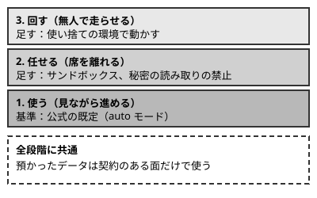

!!! abstract "要点"
    - **何ができるか**：見ている間は公式の既定を基準にし、席を離れる・無人で回すなら、段階ごとに設定を足す。
    - **いつ引くか**：安全のために最低限どこまで設定すればよいかを知りたいとき、アプリと Claude Code の既定の違いを知りたいとき、Claude に任せる範囲を広げようとしているとき。
    - **前提**：<!-- link:begin where-your-data-goes -->[送ったデータの行方（学習・保持期間）](where-your-data-goes.md)<!-- link:end -->、<!-- link:begin permission-modes-overview -->[権限モードの選び方](../cli/permission-modes-overview.md)<!-- link:end -->

<!-- textlint-disable -->
別名：安全の既定・安全の設定の早見表・最低限の安全の設定
<!-- textlint-enable -->

安全の早見表は、アプリ・Claude Code・API の安全に関わる既定を並べ、任せる段階ごとに足す設定を示すページである。公式の既定を基準にして、その限界と、足すものを一続きで引ける。

## 面ごとの既定（生成の表） {#defaults-by-surface}

安全に関わる機能を、面・成熟度・強制力で並べた表を次に示す。確認日が古いときは、公式の文書で確かめ直す。

<!-- gen:begin compare 面 強制力 成熟度 確認日 -->
<!-- textlint-disable -->

| 機能 | 面 | 強制力 |
| --- | --- | --- |
| [権限モード](../cli/permission-modes-overview.md) | Claude Code | 鍵 |
| [auto モード](../enforce/what-auto-mode-stops.md) | Claude Code | モデルの判定 |
| [サンドボックス](../enforce/sandboxing.md) | Claude Code | 鍵 |
| [シークレットチャット（incognito chats）](../app/incognito-chats.md) | アプリ | — |
| [メモリ（アプリ。memory）](../app/how-memory-works.md) | アプリ | — |

すべて共通：成熟度 GA、確認日 2026-11-04。

<!-- textlint-enable -->
<!-- gen:end compare 面 強制力 成熟度 確認日 -->

表の「強制力」は、会話の外で効く仕組み（鍵）かどうかを表す。「—」の行は、鍵ではなく、判断や記録の仕組みである。鍵として頼るのは表で「鍵」の権限モード（と権限ルール）とサンドボックスで、auto モードは確認を減らす仕組みとして使う。

既定の値そのものは版・プラン・管理者の設定で変わるので、このページには書かない。観点ごとに、値を確かめる先を示す。

- **権限**：既定の開始モードは版で変わってきた。対話の端末と VS Code の既定は、<!-- fact:begin permission-mode-default-interactive -->auto モード（Claude Code 2.1.283 以降の、ターミナルと VS Code の対話のセッション。どのプランと提供元でも）（2026-11-04 時点）<!-- fact:end -->。手元の既定は <!-- link:begin permission-modes-overview#defaults -->[権限モードの選び方 › 既定のモードと版](../cli/permission-modes-overview.md#defaults)<!-- link:end --> で確かめる。非対話の実行（`-p` と Agent SDK）は対話と既定が違い、<!-- fact:begin permission-mode-default-noninteractive -->Manual（Claude Code 2.1.302 以降。承認の要る呼び出しは、allow ルール・フック・canUseTool・--permission-prompt-tool で認めない限り拒否）（2026-11-04 時点）<!-- fact:end -->。承認に答える人がいないので、<!-- link:begin headless-basics#permissions -->[非対話モード（claude -p）の基本 › 許可と権限モード](../delegate/headless-basics.md#permissions)<!-- link:end --> を先に読む
- **通信と読み書き**：Claude が動かすコマンドの囲いは、サンドボックスが担う。サンドボックスの既定の状態は、<!-- fact:begin sandbox-default-state -->未確認<!-- fact:end -->。囲える範囲と囲えない範囲は <!-- link:begin sandboxing#scope -->[サンドボックスで封じ込める › 囲えるもの・囲えないもの](../enforce/sandboxing.md#scope)<!-- link:end --> に、読み取りが既定で広いことは <!-- link:begin sandboxing#default-reads -->[サンドボックスで封じ込める › 読み取りは既定で広い](../enforce/sandboxing.md#default-reads)<!-- link:end --> にある
- **データ**：送った会話が学習に使われる条件は、個人向けと商用の規約で分かれる。条件は <!-- link:begin where-your-data-goes#consumer-vs-commercial -->[送ったデータの行方（学習・保持期間） › 個人のプランと商用のプラン](where-your-data-goes.md#consumer-vs-commercial)<!-- link:end -->、設定の場所は <!-- link:begin where-your-data-goes#training-setting -->[送ったデータの行方（学習・保持期間） › 学習への利用の設定](where-your-data-goes.md#training-setting)<!-- link:end --> にある
- **記録**：手元の記録は、送ったデータの扱いとは別に残る。<!-- link:begin where-your-data-goes#local-transcripts -->[送ったデータの行方（学習・保持期間） › 手元に残る記録](where-your-data-goes.md#local-transcripts)<!-- link:end --> で場所と期間を確かめる。アプリで記録を残さず試すなら <!-- link:begin incognito-chats#retention -->[シークレットチャット（記録を残さない会話） › 残らないもの・残るもの](../app/incognito-chats.md#retention)<!-- link:end --> を読む

面ごとの違いの大筋は、次のタブのとおりである。

=== "アプリ"

    権限は、確認なしに進める Auto と、毎回確かめる Manual から選ぶ。既定はプランと管理者の設定で変わりうる。いまの既定は、<!-- fact:begin app-default-permission-mode -->未確認<!-- fact:end -->。選び方は <!-- link:begin permission-modes-in-the-app#modes -->[アプリの権限モード（Auto と Manual）と安全 › Auto と Manual](../app/permission-modes-in-the-app.md#modes)<!-- link:end --> にある。

    記録と記憶は、会話ごとの設定とシークレットチャットで調整する。表の incognito と app-memory の行が対応する。シークレットチャットの保持期間は次のとおり：
    <!-- fact:begin incognito-retention-period -->30 日（Enterprise は組織の保持期間）。履歴・メモリ・学習には使わない（2026-11-05 時点）<!-- fact:end -->

=== "Claude Code"

    権限は権限モードで決まり、その上に権限ルールを重ねる。囲いはサンドボックスで足す。auto モードが止めるものと通すものは <!-- link:begin what-auto-mode-stops#defaults -->[auto モードは何を止め、何を止めないか › 既定で止めるもの・通すもの](../enforce/what-auto-mode-stops.md#defaults)<!-- link:end --> にある。

    WSL・Linux の CLI を基準に書いた。ほかの OS と IDE 拡張の動作は未確認である。

=== "API"

    API だけで組む構成には、Claude Code やアプリの権限モードがない。道具を実行するのは自分のコードなので、確認と封じ込めは自分の側で作る。送ったデータの扱いは商用の規約で決まる。

## 段階ごとに足すもの {#by-stage}

任せる段階ごとに、公式の既定の上へ足す安全の設定をここにまとめる。この節が安全の既定の正本で、ほかのページは既定を繰り返さずにここを指す。

基準は公式の既定である。見ながら進める間は、その既定のまま使ってよい。席を離れるほど、あとから止められないので、足す設定を増やす。これは、任せる幅を広げるほど確かめる仕組みと封じ込めを強める比例則に沿った置き方である。比例則は <!-- link:begin four-principles#proportional-rule -->[四つの原理と比例則（見せる・確かめる・縛る・握る） › 比例則](../start/four-principles.md#proportional-rule)<!-- link:end --> にある。

図のとおり、段階が上がるほど足す設定が積み上がる。各段階の内容は次のとおりである。

- **1. 使う（見ながら進める）**：公式の既定を基準にする。足すのは、データと記録の確認である。学習への利用の設定と手元の記録の場所を一度見ておく。<!-- link:begin where-your-data-goes#training-setting -->[送ったデータの行方（学習・保持期間） › 学習への利用の設定](where-your-data-goes.md#training-setting)<!-- link:end --> と <!-- link:begin approval-fatigue#reduce-prompts -->[承認疲れ › 確認を減らす順番](approval-fatigue.md#reduce-prompts)<!-- link:end --> が入口になる。確認を増やすより、確認を減らして残す確認を読む形にする
- **2. 任せる（席を離れる）**：サンドボックスと、秘密の読み取りの禁止を足す。どちらも会話の外で効く鍵である。秘密の置き方と二重にする設定は <!-- link:begin protecting-secrets#two-layers -->[秘密情報（.env・API キー）を守る › 権限ルールとサンドボックスの二重にする](protecting-secrets.md#two-layers)<!-- link:end -->、囲いの範囲は <!-- link:begin sandboxing#scope -->[サンドボックスで封じ込める › 囲えるもの・囲えないもの](../enforce/sandboxing.md#scope)<!-- link:end --> にある。囲いが起動できないときに通さない設定は <!-- link:begin sandboxing#fail-if-unavailable -->[サンドボックスで封じ込める › 起動できないときに通さない](../enforce/sandboxing.md#fail-if-unavailable)<!-- link:end --> で確かめる
- **3. 回す（無人で走らせる）**：使い捨ての環境で動かす。確認をすべて外すモードや無人の実行は、隔離した環境だけで動かす。理由と環境の条件は <!-- link:begin where-bypass-is-ok#why-isolate -->[bypassPermissions と無人の実行はどこで動かすか › なぜ隔離した環境だけか](where-bypass-is-ok.md#why-isolate)<!-- link:end --> と <!-- link:begin where-bypass-is-ok#requirements -->[bypassPermissions と無人の実行はどこで動かすか › 使い捨ての環境の条件](where-bypass-is-ok.md#requirements)<!-- link:end --> にある。走らせる前の問いは <!-- link:begin five-questions-before-delegating#five-questions -->[任せ方の段階と、無人で走らせる前の五つの問い › 無人で走らせる前の五つの問い](../delegate/five-questions-before-delegating.md#five-questions)<!-- link:end --> で答える
- **全段階に共通**：預かったデータや、NDA・規約の付いたデータは、契約で扱いが決まっている面だけで使う。判断の基準は <!-- link:begin entrusted-data#contracted-surfaces -->[預かったデータ・規約付きのデータを AI に渡してよいか › 契約のある面だけで使う](entrusted-data.md#contracted-surfaces)<!-- link:end --> にある

面ごとに、任せる段階の足し方は次のように違う。

=== "アプリ"

    読める範囲と行動できる範囲を同時に広げない。同時に広げる前に、専用のフォルダと低いリスクの作業から始める。置き方は <!-- link:begin permission-modes-in-the-app#two-conditions -->[アプリの権限モード（Auto と Manual）と安全 › 読める範囲と行動できる範囲を同時に広げない](../app/permission-modes-in-the-app.md#two-conditions)<!-- link:end --> と <!-- link:begin permission-modes-in-the-app#start-small -->[アプリの権限モード（Auto と Manual）と安全 › 専用のフォルダと、低いリスクの作業から](../app/permission-modes-in-the-app.md#start-small)<!-- link:end --> にある。

=== "Claude Code"

    サンドボックスと deny ルールで足す。確認を外す代わりに、囲いと禁止で守る。名指しで止めたい操作は、会話で頼まずに deny ルールにする。

=== "API"

    自分のコードで、許す道具と止まる上限を決める。三つの能力、すなわち信頼できない入力・秘密や私的なデータ・外への送信や変更を同時に持たせない。当てはめは <!-- link:begin lethal-trifecta#by-surface -->[三つを同時に持たせない（lethal trifecta と Rule of Two） › 面ごとの当てはめ](lethal-trifecta.md#by-surface)<!-- link:end --> にある。

!!! example "判断例：夜のあいだに依存の入れ替えを任せる"
    - **状況**：Claude Code を対話で使っていて、既定のまま困っていない。夜のあいだに、多数のファイルにまたがる依存の入れ替えを任せて、席を離れたい。
    - **迷う候補**：既定のまま任せる。または、サンドボックスと秘密の読み取りの禁止を足してから任せる。
    - **選んだもの**：足してから任せる。
    - **理由**：席を離れると、危ない操作に気づいて止める人がいなくなる。既定は見ている前提で調整されているので、見ない間の備えは足す。足すのは会話の外で効く設定にする。

!!! example "判断例：顧客から預かった資料を要約させたい"
    - **状況**：顧客から NDA つきで預かった資料を、要約させたい。履歴に残したくないので、シークレットチャットで渡す案がある。
    - **迷う候補**：シークレットチャットで渡す。または、契約で扱いが決まっている面で渡す。
    - **選んだもの**：契約で扱いが決まっている面で渡す。
    - **理由**：シークレットチャットは履歴とメモリに残さないが、保持そのものはなくならず、使えない機能もある。預かったデータが使えるかは、残るかどうかではなく契約で決まる。

## 公式の既定の限界 {#limits}

公式の既定は、確認を減らしながら危ない操作を止める設計であり、安全を保証するものではない。限界は 4 つある。

**1. 判断は決定論ではない。** auto モードは、別の分類器のモデルが、実行前の操作を見て止める。deny ルールと明示の ask ルールは分類器より先に効くが、分類器そのものの判断は毎回同じとは限らない。公式も、確認を減らすが安全を保証しないと書く。すり抜けうる操作は <!-- link:begin what-auto-mode-stops#limits -->[auto モードは何を止め、何を止めないか › すり抜けと限界](../enforce/what-auto-mode-stops.md#limits)<!-- link:end --> にある。

**2. 会話で言った境界は、圧縮で消えうる。** 「ここには触れない」という発言は、会話の記録から読み直される。記録が圧縮されて発言が消えると、効かなくなりうる。確かな保証が要る禁止は、deny ルールかサンドボックスに置く。

**3. 人の確認も限界がある。** Anthropic の 2026-08-07 の記事は、有償の被験者 1,053 人の実験を報告する。確認の 1 回を明らかに危ないコマンドに差し替えたところ、止めたのは auto モードが 89 %、人が 13.6 % だった。人はセッションが長くなるほど止めなくなった。これは自社の報告で、対象のモデルは記事の時点のものである（根拠の強さ：中）。確認を増やして守る発想には限りがある。だから、確認を減らして残す確認を絞る。理由は <!-- link:begin approval-fatigue#why -->[承認疲れ › なぜ読まなくなるか](approval-fatigue.md#why)<!-- link:end --> にある。なお、auto モードの検出率はデータの作り方で大きく変わる。1 つの値を「検出率」として覚えない。

**4. 信頼できない内容は構成で防ぐ。** 公式は、信頼できない内容について 4 つを勧める。コマンドを承認前に見る。信頼できない内容を直接パイプしない。重要なファイルの変更を確かめる。外部のサービスと関わる作業は VM で動かす。さらに、仕込まれた指示に気づけない前提で、信頼できない入力・秘密・外への送信を同じ構成に置かない。考え方は <!-- link:begin lethal-trifecta#when-all-three -->[三つを同時に持たせない（lethal trifecta と Rule of Two） › 三つとも要るとき](lethal-trifecta.md#when-all-three)<!-- link:end --> にある。

### 組み合わせ方

会話の外で効く鍵と、確認を減らす仕組みは、役割を分けて重ねる。

- **鍵に置くもの**：秘密の読み取りの禁止、囲い、触れてはならない操作。deny ルールとサンドボックスが担う
- **確認を減らす側に置くもの**：日常の承認。auto モードや allow ルールで減らし、残した確認を読む
- **会話に書くもの**：禁止そのものではなく、理由と相談の基準。例外を許さない禁止は会話に頼らない

全体の考え方は <!-- link:begin four-principles#overview -->[四つの原理と比例則（見せる・確かめる・縛る・握る） › 4 つの原理の一覧](../start/four-principles.md#overview)<!-- link:end --> を、面ごとの手段は <!-- link:begin four-principles#by-surface -->[四つの原理と比例則（見せる・確かめる・縛る・握る） › 面ごとの手段](../start/four-principles.md#by-surface)<!-- link:end --> を読む。

<!-- gen:begin page-links -->
<!-- textlint-disable -->

**前提**

- [送ったデータの行方（学習・保持期間）](where-your-data-goes.md)
- [権限モードの選び方](../cli/permission-modes-overview.md)

**次に読む**

- [事務作業の半自動化（経費・報告）](../recipes/office-paperwork.md)
- [禁止ではなく安全な道を作る](../team/paved-roads.md)

**関連**

- [auto モードは何を止め、何を止めないか](../enforce/what-auto-mode-stops.md)
- [サンドボックスで封じ込める](../enforce/sandboxing.md)
- [秘密情報（.env・API キー）を守る](protecting-secrets.md)
- [bypassPermissions と無人の実行はどこで動かすか](where-bypass-is-ok.md)
- [預かったデータ・規約付きのデータを AI に渡してよいか](entrusted-data.md)
- [三つを同時に持たせない（lethal trifecta と Rule of Two）](lethal-trifecta.md)
- [承認疲れ](approval-fatigue.md)
- [アプリの権限モード（Auto と Manual）と安全](../app/permission-modes-in-the-app.md)
- [四つの原理と比例則（見せる・確かめる・縛る・握る）](../start/four-principles.md)
- [任せ方の段階と、無人で走らせる前の五つの問い](../delegate/five-questions-before-delegating.md)
- [非対話モード（claude -p）の基本](../delegate/headless-basics.md)
- [シークレットチャット（記録を残さない会話）](../app/incognito-chats.md)

<!-- textlint-enable -->
<!-- gen:end page-links -->

<!-- gen:begin references -->
<!-- textlint-disable -->

## 参考 {#references}

- [Choose a permission mode](https://code.claude.com/docs/en/permission-modes)：Anthropic・英語・確認日 2026-11-04
- [Configure the sandboxed Bash tool](https://code.claude.com/docs/en/sandboxing)：Anthropic・英語・確認日 2026-11-04
- [Security](https://code.claude.com/docs/en/security)：Anthropic・英語・確認日 2026-11-04
- [Claude Cowork and chat are one Claude](https://support.claude.com/en/articles/16761823-claude-cowork-and-chat-are-one-claude)：Anthropic・英語・確認日 2026-11-04
- [Use incognito chats](https://support.claude.com/en/articles/12260368-use-incognito-chats)：Anthropic・英語・確認日 2026-11-04
- [Use Claude’s chat search and memory to build on previous context](https://support.claude.com/en/articles/11817273-use-claude-s-chat-search-and-memory-to-build-on-previous-context)：Anthropic・英語・確認日 2026-11-04
- [How long do you store my data?](https://privacy.claude.com/en/articles/10023548-how-long-do-you-store-my-data)：Anthropic（Privacy Center）・英語・確認日 2026-11-04
- [Auto mode is now the default in Claude Code for Pro, Max, Ultra, and Team plans](https://claude.com/resources/articles/auto-mode-default-in-claude-code)：Anthropic・英語・確認日 2026-11-04
- [How we built Claude Code auto mode: a safer way to skip permissions](https://www.anthropic.com/research/claude-code-auto-mode)：Anthropic・英語・確認日 2026-11-04

<!-- textlint-enable -->
<!-- gen:end references -->
