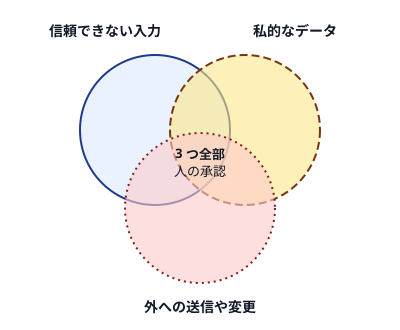

!!! abstract "要点"
    - **何が分かるか**：信頼できない入力・私的なデータ・外への送信や変更のうち、同時に持たせてよいのは 2 つまでという設計の原則が分かる。
    - **いつ引くか**：メールや Web を読ませつつ社内のデータにもつなぎたいとき、コネクタや MCP を増やして何でもできる構成になったとき、Web ページやメールを読ませるのが不安なとき。
    - **前提**：<!-- link:begin prompt-injection-in-practice -->[プロンプトインジェクションの実際](prompt-injection-in-practice.md)<!-- link:end -->

<!-- textlint-disable -->
別名：lethal trifecta・Rule of Two・Agents Rule of Two・最小権限
<!-- textlint-enable -->

このページは、仕込まれた指示が被害につながる経路を、Claude に持たせる能力の組み合わせで断つ考え方を扱う。読ませる文章の中身を見張るのではなく、1 つの構成に何を同時に持たせるかを決める。

## 三つの能力 {#three-capabilities}

lethal trifecta は、AI エージェントが情報を盗まれる条件を 3 つの能力で表した言い方である。実践者の Simon Willison が 2025 年 6 月に提案した。3 つがそろうと、攻撃者が Claude を騙して私的なデータを外へ出させられる。

| 能力 | 中身 | 例 |
| --- | --- | --- |
| A 信頼できない入力 | 攻撃者が書き込める文章を読む | Web ページ、受信メール、公開リポジトリの issue、MCP の道具が返す内容 |
| B 私的なデータ | 外に出てはいけない情報に触れる | 社内の資料、private リポジトリ、メール、`.env` |
| C 外への送信や変更 | 外部へ出す、または状態を変える | メールの送信、PR の作成、外部への通信、ファイルの書き込み |

Meta の Agents Rule of Two（2025 年 10 月）は、同じ考えをエージェントの設計の原則にした。1 回のセッションで満たしてよいのは、A 信頼できない入力の処理、B 機微なシステムや私的データへのアクセス、C 状態の変更や外部との通信のうち、2 つまでとする。3 つとも要るなら、自律で動かさず、人の承認などで監督する。

2 つの言い方には違いがある。lethal trifecta はデータの窃取を扱う。Rule of Two は C に状態の変更を含める。Willison は、現時点でエージェントを設計するための最良の実践的助言は Rule of Two だと評価している（根拠：弱。実践者の評価）。

なぜ 3 つで足りるのか。Claude は、読んだ文章の中の指示と、利用者の指示を確実には区別できない。A があれば、指示が紛れ込む余地が生まれる。紛れ込んだ指示が害を出すには、触れるもの B と、外へ作用する手段 C が要る。経路の詳しい型は <!-- link:begin prompt-injection-in-practice#patterns -->[プロンプトインジェクションの実際 › よくある型（無害な再現）](prompt-injection-in-practice.md#patterns)<!-- link:end --> にある。

A を完全には消せない理由として、公開済みの 12 の防御に適応型の攻撃を行い、多くで成功率が 90% を超えたと報告した論文（The Attacker Moves Second）がある。2025 年 11 月のニュースレターが紹介した（根拠：中。二次の引用で、原典と対象のモデルは未確認）。検出に頼れない理由は <!-- link:begin prompt-injection-in-practice#why-detection-fails -->[プロンプトインジェクションの実際 › 検出に頼れない理由](prompt-injection-in-practice.md#why-detection-fails)<!-- link:end --> で読める。だから対策は、構成の側に置く。

## 3 つがそろった例 {#example}

3 つがそろった構成の実例が、GitHub の MCP サーバーに対する報告である（Invariant Labs、2025 年 5 月。デモの対象は Claude Desktop と Claude 4 Opus。根拠：中。企業の一次の報告）。

- **A 信頼できない入力**：公開リポジトリに立てられた、悪意ある issue。
- **B 私的なデータ**：同じ利用者の private リポジトリの内容。
- **C 外への送信**：公開リポジトリへの PR の作成。

利用者が「open issue を見て」と頼むと、Claude が issue の指示に従い、private リポジトリの情報を公開の PR に書き出した。道具そのものは改ざんされていない。報告は、GitHub 側のパッチでは完全には直せず、モデルの alignment だけでも足りないとした。挙げられた対策は、最小権限（1 セッション 1 リポジトリなど）と監視である。

最小権限とは、各セッションに作業に要る分の権限だけを渡す考え方である。この例では、読めるリポジトリを 1 つに絞れば、B が外れて経路が切れる。

## 何に効くか {#what-it-prevents}

このページの考え方は、原理「縛る」に当たる。「issue の指示に従わないで」とお願いするのではなく、持たせる能力の組み合わせで、従っても被害が出ない構成にする。

防ぐ原因は、Claude 側の「境界がない」である。信頼できる入力と信頼できない入力、読める範囲と行える範囲の間に仕切りがないと、読んだ文章の指示が、手元の権限をすべて使えてしまう。3 つを同時に持たせない設計は、この仕切りを能力の側に引く。

仕切りの引き方は、3 つの能力（A 信頼できない入力、B 私的なデータ、C 外への送信や変更）のどれを外すかで分かれる。

| 外すもの | やり方の例 | 失うもの |
| --- | --- | --- |
| A | 読ませる先を自分で管理する資料に限る。Web やメールを読む作業を別のセッションに分ける | 外の情報を使った調べもの |
| B | 秘密を置かない。読める範囲を作業に要る分に狭める | 社内のデータを使った作業 |
| C | 外への通信を囲う。書き込みの道具を持たせない。送信は人が押す | 最後まで自動で終わる流れ |

B を外す具体的な手は <!-- link:begin protecting-secrets#two-layers -->[秘密情報（.env・API キー）を守る › 権限ルールとサンドボックスの二重にする](protecting-secrets.md#two-layers)<!-- link:end --> に、C のうち通信を囲う手は <!-- link:begin sandboxing#scope -->[サンドボックスで封じ込める › 囲えるもの・囲えないもの](../enforce/sandboxing.md#scope)<!-- link:end --> にある。どれを外すかは、作業が何を失ってよいかで決める。

!!! example "判断例：受信メールを読んで顧客台帳と突き合わせる"
    - **状況**：受信メールを読み、社内の顧客台帳と突き合わせて返信案を作る作業を、メールと台帳のコネクタで頼みたい。
    - **迷う候補**：メールの送信までコネクタに任せて 1 回で終わらせる。台帳は読ませるが、送信は人が押す。
    - **選んだもの**：台帳は読ませ、送信は人が押す。
    - **理由**：メール本文は A、台帳は B なので、送信まで任せると 3 つがそろう。C を人に戻せば、メールに仕込まれた指示があっても、外へ出る前に人が止められる。

## 面ごとの当てはめ {#by-surface}

アプリの安全の指針は、3 つを同時に持たせない原則と同じ形の説明をしている。prompt injection が成立するのは、「信頼境界の外の情報を読める」と「被害につながる行動ができる」の両方がそろったときで、片方を外せば攻撃は難しくなる、という説明である。

この 2 条件を 3 つの能力に当てると、条件 1 が A、条件 2 が C に当たる。指針は B を数えず、A と C がそろう場面全体を見ている（この辞典の読み方。推論・実践例なし）。Rule of Two も C に状態の変更を含めるので、B を持たなくても A と C だけで被害が出うる点は同じ側にある。Rule of Two は 2 つまで許す目安で、2 つなら安全という保証ではない。

面ごとに、3 つの能力が入ってくる所が違う。

=== "アプリ"

    - **A**：読ませる Web、貼ったり添付したりした文章、メールやカレンダーなどのコネクタが返す内容。
    - **B**：コネクタでつないだ社内の資料やメール、Claude に開かせたフォルダ。
    - **C**：コネクタを通した送信や変更、computer use による画面の操作、予定のタスクの中の操作。
    - 公式の指針は、Claude 専用の作業フォルダを作る、低リスクの作業から始める、信頼できる MCP や plugin だけを使う、送信や購入のような取り消しにくい操作を予定のタスクにしない、と案内している。computer use には、Claude とアプリの間にサンドボックスがない。
    - 読める範囲と行動できる範囲を同時に広げない置き方は <!-- link:begin permission-modes-in-the-app#two-conditions -->アプリの権限モード（Auto と Manual）と安全 › 読める範囲と行動できる範囲を同時に広げない（準備中）<!-- link:end --> に、コネクタを使うときだけ読ませる方法は <!-- link:begin connectors-in-the-app#on-demand -->コネクタ（MCP）をアプリで使う › 使うときだけ読ませる（On demand）（準備中）<!-- link:end --> にある。
    - 任せない操作の線引きは <!-- link:begin tasks-and-schedules-in-the-app#what-not-to-schedule -->タスクと定期タスク（Cowork） › 定期タスクにしないもの（準備中）<!-- link:end --> に、画面操作が届く範囲は <!-- link:begin browser-agent-cautions#reach -->ブラウザや画面の操作を任せるときの注意 › 届く範囲（ログイン済みのサイト・開いているアプリ）（準備中）<!-- link:end --> にある。

=== "Claude Code"

    - **A**：Web の取得結果、issue や PR の本文、MCP サーバーが返す内容、開いたリポジトリの中身。
    - **B**：作業ディレクトリのファイル、`.env` や認証情報、private リポジトリ。
    - **C**：シェルからの通信、リモートへの push、MCP の書き込み系の道具、ファイルの書き込み。
    - 能力を外す手段は、権限ルールとサンドボックスである。秘密は読ませず、通信は囲う。手順は <!-- link:begin protecting-secrets#two-layers -->[秘密情報（.env・API キー）を守る › 権限ルールとサンドボックスの二重にする](protecting-secrets.md#two-layers)<!-- link:end --> と <!-- link:begin sandboxing#scope -->[サンドボックスで封じ込める › 囲えるもの・囲えないもの](../enforce/sandboxing.md#scope)<!-- link:end --> にある。
    - auto モードは確認を減らす仕組みで、安全を保証しない。何を止め、何を通すかは <!-- link:begin what-auto-mode-stops#limits -->[auto モードは何を止め、何を止めないか › すり抜けと限界](../enforce/what-auto-mode-stops.md#limits)<!-- link:end --> で確かめる。
    - 入れる MCP の出所と中身の確認は <!-- link:begin vetting-extensions#provenance -->[MCP・プラグイン・スキルを入れる前の確認 › 出所を確かめる](vetting-extensions.md#provenance)<!-- link:end --> にある。この節の内容は WSL・Linux の CLI を基準にしている。ほかの OS と IDE 拡張の動きは未確認である。

=== "API"

    - 自分でエージェントを組むときは、渡す tool の一覧が、3 つの能力の持たせ方そのものになる。
    - **A**：tool の結果やプロンプトに入れる、外から来た文章。Web、メール、利用者の入力、ほかのシステムの出力。
    - **B**：tool で触れさせる DB や社内の API。
    - **C**：外へ書き込む tool や、外へリクエストを送る tool。
    - 設計の段階で、エージェントごとに tool を A・B・C に分類する。3 つがそろうエージェントは、tool を分けるか、C の直前に人の承認を置く。
    - 面ごとの既定の比較は <!-- link:begin default-safety-settings#defaults-by-surface -->[安全の早見表（面ごとの既定と、段階ごとに足すもの） › 面ごとの既定（生成の表）](default-safety-settings.md#defaults-by-surface)<!-- link:end --> にある。

## 三つとも要るとき {#when-all-three}

作業の都合で 3 つとも要ることがある。そのときの手立てを、効きの強い順に並べる。

1. **本当に 3 つとも要るかを疑う**：読ませる Web を限る、B を要約だけにする、C を下書きの作成にとどめる、のように、1 つを弱める。
2. **最小権限にする**：1 セッションに渡すリポジトリ、フォルダ、コネクタを作業に要る分に絞る。コネクタは使うときだけ読ませ、信頼してよいかを <!-- link:begin connectors-in-the-app#trust -->コネクタ（MCP）をアプリで使う › 信頼してよいか（準備中）<!-- link:end --> で確かめる。
3. **C の直前に人の承認を置く**：Rule of Two は、3 つとも要るなら人の承認などで監督するとする（根拠：弱。提案する側の立場の表明で、実践者の評価と一致する）。承認の画面で、送信先と中身が全部見えることが前提になる。WhatsApp の MCP を使った報告には、大量の空白の後ろに履歴を隠し、確認画面には短い挨拶しか見えないようにした例がある（根拠：中。Docker の記事による二次の紹介）。
4. **セッションを分ける**：A を読むセッションと、B を持つセッションを分ける。間で渡すのは、人が読める短い要約に限る（推論・実践例なし）。渡した要約も A を経た文章なので、これだけで安全にはならない。
5. **無人にしない**：予定のタスクや、人がいない実行では、承認を挟めない。任せる幅を広げるほど、確かめ方と封じ込めを強める。段階の考え方は <!-- link:begin five-questions-before-delegating#autonomy-stages -->[任せ方の段階と、無人で走らせる前の五つの問い › 任せ方の段階](../delegate/five-questions-before-delegating.md#autonomy-stages)<!-- link:end --> にある。

秘密が外へ出てしまった後の初動は、このページの外にある。<!-- link:begin secrets-exposed#first-response -->[秘密の情報を読まれた・外に出された › まず鍵を無効にする](../symptoms/secrets-exposed.md#first-response)<!-- link:end --> を引く。

## よくある誤解 {#misconceptions}

- **「賢いモデルなら見抜く」**：モデルの判断に頼る設計は、適応型の攻撃で破られた報告がある。防ぐ手立ては、持たせる権限と通信の側にある。詳しくは <!-- link:begin prompt-injection-in-practice#what-works -->[プロンプトインジェクションの実際 › 防ぐ手立ては権限と通信の側にある](prompt-injection-in-practice.md#what-works)<!-- link:end --> にある。
- **「読み取りしかさせないから安全」**：画像の読み込みやリンクの生成のような外向きのリクエストも、情報が漏れる経路になりうる（根拠：弱。実践者の指摘）。C は、送信ボタンの形をしているとは限らない。
- **「有名な、改ざんのない道具だから大丈夫」**：GitHub MCP の例では、道具は改ざんされていなかった。道具が返す中身、つまり issue の本文が攻撃の入口だった。道具の出所と、道具が返す中身は、別々に考える。
- **「承認を挟めば足りる」**：毎回の承認が多すぎると、読まずに押すようになる。止める場所を C の直前に絞り、止めるべき操作が通る穴を <!-- link:begin what-auto-mode-stops#when-blocked -->[auto モードは何を止め、何を止めないか › 止められたときの見直し方](../enforce/what-auto-mode-stops.md#when-blocked)<!-- link:end --> で見直す。
- **「2 つなら安全」**：Rule of Two は目安である。A と C の組でも、状態を壊す被害は出うる。

<!-- gen:begin references -->
<!-- textlint-disable -->

## 参考 {#references}

- [The lethal trifecta for AI agents: private data, untrusted content, and external communication](https://simonwillison.net/2025/Jun/16/the-lethal-trifecta/)：Simon Willison・英語・確認日 2026-11-04
- [Agents Rule of Two: A Practical Approach to AI Agent Security](https://ai.meta.com/blog/practical-ai-agent-security/)：Meta AI・英語・確認日 2026-11-04
- [New prompt injection papers: Agents Rule of Two and The Attacker Moves Second](https://simonw.substack.com/p/new-prompt-injection-papers-agents)：Simon Willison・英語・確認日 2026-11-04
- [GitHub MCP Exploited: Accessing private repositories via MCP](https://invariantlabs.ai/blog/mcp-github-vulnerability)：Invariant Labs・英語・確認日 2026-11-04
- [MCP Horror Stories: WhatsApp Data Exfiltration](https://www.docker.com/blog/mcp-horror-stories-whatsapp-data-exfiltration-issue/)：Docker・英語・確認日 2026-11-04
- [Use Claude Cowork safely](https://support.claude.com/en/articles/13364135-use-claude-cowork-safely)：Anthropic・英語・確認日 2026-11-04

<!-- textlint-enable -->
<!-- gen:end references -->

<!-- gen:begin page-links -->
<!-- textlint-disable -->

**前提**

- [プロンプトインジェクションの実際](prompt-injection-in-practice.md)

**次に読む**

- アプリの権限モード（Auto と Manual）と安全（準備中）
- クラウドの定期タスク（準備中）

**関連**

- [MCP・プラグイン・スキルを入れる前の確認](vetting-extensions.md)
- ブラウザや画面の操作を任せるときの注意（準備中）
- [サンドボックスで封じ込める](../enforce/sandboxing.md)
- [秘密情報（.env・API キー）を守る](protecting-secrets.md)
- [秘密の情報を読まれた・外に出された](../symptoms/secrets-exposed.md)
- [auto モードは何を止め、何を止めないか](../enforce/what-auto-mode-stops.md)
- [安全の早見表（面ごとの既定と、段階ごとに足すもの）](default-safety-settings.md)
- コネクタ（MCP）をアプリで使う（準備中）
- [MCP をつなぐ](../extend/connecting-mcp.md)
- [任せ方の段階と、無人で走らせる前の五つの問い](../delegate/five-questions-before-delegating.md)
- タスクと定期タスク（Cowork）（準備中）

<!-- textlint-enable -->
<!-- gen:end page-links -->
