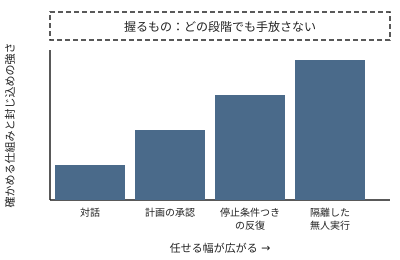

!!! abstract "要点"
    - **何ができるか**：うまくいかない理由と次の一手を、見せる・確かめる・縛る・握るの 4 つの原理で考えられる。
    - **いつ引くか**：個別の小技ではなく、うまく使うための考え方の筋をつかみたいとき。どこまで任せてよいかを決める基準がほしいとき。
    - **前提**：なし

<!-- textlint-disable -->
別名：見せる・確かめる・縛る・握る・比例則・背骨の考え方
<!-- textlint-enable -->

この辞典の背骨は、見せる・確かめる・縛る・握るの 4 つの原理と、任せる幅に合わせて守りを強める 1 つの比例則である。個々の機能やコツが入れ替わっても、この筋は変わりにくい。各ページは、この 4 つのどれを満たす手段なのかを見れば位置づけられる。

## 4 つの原理の一覧 {#overview}

4 つの原理は、Claude に任せた作業が期待どおりに進まないときの考え方を、動詞で整理したものである。次の表は、各原理の一文と、なぜそうなるかを説明するページを並べる。

| 原理 | 一文で | なぜ成り立つか |
| --- | --- | --- |
| 見せる | 必要なものを見せ、余計なものは片付ける | <!-- link:begin attention-budget -->[コンテキストウィンドウと注意の予算](../basics/attention-budget.md)<!-- link:end -->、<!-- link:begin context-rot -->[context rot と紛らわしい情報](../basics/context-rot.md)<!-- link:end --> |
| 確かめる | 完了は自己申告でなく証拠で決める | <!-- link:begin agent-loop -->[エージェントループと tool use](../basics/agent-loop.md)<!-- link:end -->、<!-- link:begin why-hallucinations -->[ハルシネーションはなぜ起きるか](../basics/why-hallucinations.md)<!-- link:end --> |
| 縛る | 例外を許さないものは仕組みに任せる | <!-- link:begin request-vs-lock -->[お願いと鍵（決定論的か、非決定論的か）](../basics/request-vs-lock.md)<!-- link:end -->、<!-- link:begin data-vs-instructions -->[データと命令を区別できない（prompt injection の原理）](../basics/data-vs-instructions.md)<!-- link:end --> |
| 握る | 何を良しとするか・採るか・やめるか・中核の理解は人が持ち続ける | <!-- link:begin verifier-defines-problem -->[検証器が問題を定義する（Claude は置かれたループを何でも加速する）](../eval/verifier-defines-problem.md)<!-- link:end -->、<!-- link:begin human-pitfalls -->[人の側の五つの落とし穴（総論）](../judgment/human-pitfalls.md)<!-- link:end --> |

比例則は、任せる幅を広げるほど、確かめる仕組みと封じ込めを強めるという規則である。どの段階でも、握るものは手放さない。

最初の 3 つは、Claude Code の公式の Best practices の考え方を整理し直したものである。公式は、うまくいかなかったセッションをほぼ 4 つの場合に分け、指示を「従う保証のない指示」と「毎回必ず実行される制御」に分けている。4 つ目の「握る」は、この辞典がコンテストの補完調査から足した。Claude が置かれたループを何でも加速するので、評価が誤っていれば誤りも同じ速さで増える、という観察が根拠である。したがって「握る」は公式の分類ではなく、この辞典の提案である。

## うまくいかないときの引き方 {#from-trouble}

うまくいかないようすから、先に疑う原理を引く表である。表の見立ては出発点で、確かめた結果で直す。

| うまくいかないようす | 先に疑う原理 | 次の一手 |
| --- | --- | --- |
| 的外れな答え。資料や前提を知らないようす | 見せる | 依頼と資料を具体的にする。長い会話なら新しく始める（<!-- link:begin tidy-the-desk#four-actions -->机を整える：新鮮さ・巻き戻し・書き出し・委任 › 四つの動作（準備中）<!-- link:end -->） |
| 「できた」と言うが、動かない | 確かめる | 合否を返すテストなどを渡す（<!-- link:begin agent-loop#close-the-loop -->[エージェントループと tool use › 合否を返すものを渡してループを閉じる](../basics/agent-loop.md#close-the-loop)<!-- link:end -->） |
| 書いたはずの禁止が何度も破られる | 縛る | 例外のない規則を鍵に移す（<!-- link:begin when-to-lock#signals -->[お願いを鍵に移す判断 › 鍵に移す合図](../enforce/when-to-lock.md#signals)<!-- link:end -->） |
| 結果は出たが、採るかどうか決められない | 握る | 評価の基準を先に自分で決める（<!-- link:begin what-not-to-delegate#what-humans-hold -->[任せないもの（評価・採否・撤退・中核の理解） › どの段階でも人が握るもの](../delegate/what-not-to-delegate.md#what-humans-hold)<!-- link:end -->） |

原因を安く確かめられる順に切り分けたいときは、<!-- link:begin six-causes#diagnosis -->[失敗の二つの軸と診断の入口 › 安く確かめられる順の診断](six-causes.md#diagnosis)<!-- link:end --> を使う。人の側の判断の崩れも疑うなら、<!-- link:begin six-causes#human-side -->[失敗の二つの軸と診断の入口 › 人の側の五つの落とし穴](six-causes.md#human-side)<!-- link:end --> を見る。

## 見せる {#show}

見せるとは、Claude に必要なものを見せ、余計なものは片付けることである。Claude には、見せたものと、取りに行けたものしか分からない。一方で、見せすぎても質が下がる。

**なぜ成り立つか。** 毎ターン、会話の全履歴が読み直される。毎回読み直す受験者の机に、関係のない資料が積まれるほど、大事なものへの注意は薄くなる。これが context rot であり、似ているが違う情報が混ざるほど質は下がりやすい。失敗した試みが会話に残ると、それも紛らわしい情報になる。

**代表的な手段。** 具体的な依頼、資料、`CLAUDE.md`、会話を新しくすること、handoff 文書、サブエージェントでの隔離がある。片付けも「見せる」に入る。コンテキストを溢れさせない節約術ではなく、答えの質と費用のための整頓だからである。詳しくは <!-- link:begin tidy-the-desk#why-now -->机を整える：新鮮さ・巻き戻し・書き出し・委任 › 溢れの心配から、質と費用へ（準備中）<!-- link:end --> にある。

**効かない場面。** 見せても、確かめる手段がなければ、終わったように見えたところで止まる。また、見せる資料を増やせば増やすほど良いわけではない。

## 確かめる {#verify}

確かめるとは、完了を自己申告ではなく証拠で決めることである。Claude は「文脈を集める、行動する、結果を確かめる」の輪を回す。確かめる手段がないと、終わったように見えたところで止まる（<!-- link:begin agent-loop#why-stops -->[エージェントループと tool use › 確かめる手段がないと、終わったように見えたところで止まる](../basics/agent-loop.md#why-stops)<!-- link:end -->）。分からないときも答えを作ってしまう性質があるので、事実の主張にも証拠が要る。

**代表的な手段。** テスト、画面での確認、引用の照合、独立したレビュー、検証器、`/goal`、Stop フックがある。「念のため確認して」と書き足すより、確かめる手段を渡すほうが効く。どの段を選ぶかは、任せる幅で決める（<!-- link:begin verification-ladder#choose-step -->[検証の階段 › 任せる幅に合わせて段を選ぶ](../verify/verification-ladder.md#choose-step)<!-- link:end -->）。

**手段を渡すと何が変わるか。** 競技プログラミングの長期最適化問題の評価 ALE-Bench（2025 年の論文）に、Gemini 2.5 Pro を使い、部品を 1 つずつ足して効果を比べた実験（アブレーション）がある。素のエージェントのスコア 1167 は、知識を注入すると 1264 になった。手元の採点（局所評価）で候補を選ぶ探索を加えると 1879（上位 6.8%）になった。知識で約 +100、評価ループで約 +600 である。「知識を足す（見せる）より評価ループを回す（確かめる）ほうが効く」ことを示す例である（根拠：中）。この数値は競技の設定での結果で、ほかの作業にそのまま当てはまるとは限らない（類推）。

**人の側の根拠。** AI の出力を確かめる手間が小さいほど、人が AI に頼りすぎる度合いは減る（根拠：強。Vasconcelos ほか、2023 年）。確かめる手段が安いことは、Claude のためだけでなく、人が鵜呑みにしないためにも効く。

**効かない場面。** 確かめる基準そのものが誤っていると、誤りもそのまま速く増える。基準を誰が決めるかは「握る」の話である。また、AI のループそのものを禁じる大会や部門がある。そこで人が再現できるのは、人が回すローカル評価のループだけで、規則で使える範囲の確認は人の仕事である。

## 縛る {#lock}

縛るとは、例外を許さないものを、お願いではなく仕組みに任せることである。`CLAUDE.md` やプロンプトの指示は、Claude が読んで判断するお願いで、従う保証はない。会話で言った禁止は、圧縮で消えることもある。フック、deny ルール、管理設定のような鍵は、効く範囲と条件の中で毎回必ず効く。

**代表的な手段。** フック、権限の deny ルール、サンドボックス、管理設定、textlint のような機械的な検査、ブランチ保護がある。仕組みは面ごとに違う。アプリ・Claude Code・API の手段は、このページの面ごとの手段の節に並べた。

**何を鍵にしないか。** 判断を含む規則は鍵にしない。鍵に移すのは、例外がなく、機械で判定できる規則である。移す合図は、同じ注意を 2 回した、強調しても破られた、会話で言った禁止が圧縮で消えた、の 3 つである（<!-- link:begin when-to-lock#signals -->[お願いを鍵に移す判断 › 鍵に移す合図](../enforce/when-to-lock.md#signals)<!-- link:end -->）。

**読ませた文書は命令にならない。** 読ませた Web ページやファイルの中の文は、頼んだ指示と同じ文脈に並ぶ。Claude はデータと命令を確実には分けられないので、頼みの言葉ではなく、権限と経路で守る（<!-- link:begin data-vs-instructions -->[データと命令を区別できない（prompt injection の原理）](../basics/data-vs-instructions.md)<!-- link:end -->）。

!!! example "判断例：禁止が破られたとき"
    - **状況**：`CLAUDE.md` に「本番用の設定ファイルは編集しない」と書いたのに、作業の途中で編集されてしまった。
    - **迷う候補**：文面を強調して書き直す。または、そのファイルへの編集を deny ルールで禁じる。
    - **選んだもの**：deny ルールで禁じる。`CLAUDE.md` には、理由と、どんなとき人に相談するかだけを残す。
    - **理由**：例外がなく、機械で判定できる禁止だからである。強調は古い助言で、鍵ほどの効き目はない（<!-- link:begin outdated-advice-ledger -->[古くなった助言の台帳](../changes/outdated-advice-ledger.md)<!-- link:end -->）。

## 握る {#hold}

握るとは、良しとする基準、採否、撤退、中核の理解を、人が持ち続けることである。Claude は、渡された検証器（テスト・採点・ベンチマーク）が定める問題を解き、置かれたループを何でも速める。評価が誤っていれば、誤りも同じ速さで増える（<!-- link:begin verifier-defines-problem#loops-amplify -->[検証器が問題を定義する（Claude は置かれたループを何でも加速する） › ループは何でも速める](../eval/verifier-defines-problem.md#loops-amplify)<!-- link:end -->）。だから、評価の定義は人が握る。

**握るもの。** 評価の定義、採否と撤退の判断、説明できないものは採らないという決め、大会や職場の規則の確認である。撤退の基準は、着手する前に決めておく。

**任せてよいものとの分け方。** 分ける軸は、出力を機械的に確かめられるかである（<!-- link:begin what-not-to-delegate#verifiable-axis -->[任せないもの（評価・採否・撤退・中核の理解） › 分ける軸：機械的に確かめられるか](../delegate/what-not-to-delegate.md#verifiable-axis)<!-- link:end -->）。実装の量、周辺作業、集計や可視化のように、結果を機械的に確かめられるものは任せてよい。方針の採否は人が決める。コンテストの参加者の報告は、この線引きにほぼ収束している（根拠：中）。

**理解を外注しない。** AI の支援がコーディングの技能の形成に与える影響を調べた無作為化比較試験（2026 年）では、デバッグの問題で差が最も大きかった（根拠：強。AI 群が使ったアシスタントは GPT-4o ベース）。自分で説明できないコードを採ると、次に壊れたとき、直せない。

**握る力は、意志だけでは保ちにくい。** 預けすぎる、同意を根拠にする、といった判断の崩れが人の側にある。意志に頼らず、決まりと道具で防ぐ（<!-- link:begin human-pitfalls#rules-and-tools -->[人の側の五つの落とし穴（総論） › 意志ではなく決まりと道具で防ぐ](../judgment/human-pitfalls.md#rules-and-tools)<!-- link:end -->）。どの段階でも人が握るものの一覧は、<!-- link:begin roadmap#always-hold -->[ロードマップ（委任の段階別） › どの段階でも人が握るもの](roadmap.md#always-hold)<!-- link:end --> にもある。

## 比例則 {#proportional-rule}

比例則とは、任せる幅を広げるほど、確かめる仕組みと封じ込めを強める規則である。握るものは、どの段階でも手放さない。

**任せ方の段階。** 作業の任せ方は、対話、計画の承認、停止条件つきの反復、隔離した無人実行の順に広がる。無人で走らせる前には、5 つの問いに答える（<!-- link:begin five-questions-before-delegating#five-questions -->[任せ方の段階と、無人で走らせる前の五つの問い › 無人で走らせる前の五つの問い](../delegate/five-questions-before-delegating.md#five-questions)<!-- link:end -->）。段ごとに何を強めるかは <!-- link:begin five-questions-before-delegating#proportional-guards -->[任せ方の段階と、無人で走らせる前の五つの問い › 段ごとに強める確かめ方と封じ込め](../delegate/five-questions-before-delegating.md#proportional-guards)<!-- link:end --> にまとまっている。

**なぜ広げるほど強めるのか。** 確認を減らすほど、人の目が届かない操作は増える。承認を求めすぎると、人は中身を見ずに承認するようになる（承認疲れ）。自動の分類器にも見逃しはある。auto モードは確認を減らす仕組みで、安全を保証しない（<!-- link:begin what-auto-mode-stops#limits -->[auto モードは何を止め、何を止めないか › すり抜けと限界](../enforce/what-auto-mode-stops.md#limits)<!-- link:end -->）。信頼できない入力、秘密や私的なデータ、外への送信や変更の 3 つを 1 つの構成に同時に持たせないことも、封じ込めの核になる（<!-- link:begin lethal-trifecta#three-capabilities -->[三つを同時に持たせない（lethal trifecta と Rule of Two） › 三つの能力](../safety/lethal-trifecta.md#three-capabilities)<!-- link:end -->）。

**既定の中身は繰り返さない。** 面ごとの安全の既定と、段階ごとに足す設定は <!-- link:begin default-safety-settings#by-stage -->[安全の早見表（面ごとの既定と、段階ごとに足すもの） › 段階ごとに足すもの](../safety/default-safety-settings.md#by-stage)<!-- link:end --> が正本である。任せる幅は、危険の小さい作業から広げる。組織でも同じで、AI は土台の強さも弱さも増幅する（<!-- link:begin paved-roads#amplifier -->禁止ではなく安全な道を作る › AI は土台の強さも弱さも増幅する（広げる前に見直すもの）（準備中）<!-- link:end -->）。

!!! example "判断例：夜のうちにテストを直させたい"
    - **状況**：失敗しているテストが多数ある。夜の間に Claude Code に反復して直させたい。
    - **迷う候補**：1 件ずつ見守り、操作を都度承認する。または、停止条件をつけて任せ、朝に結果を確かめる。
    - **選んだもの**：停止条件つきで任せる。ただし、先に合否を返すテストを渡し、作業は専用のフォルダに閉じ込め、削除や外への送信は許可しない。
    - **理由**：任せる幅を広げる分、確かめる手段（テスト）と封じ込め（専用フォルダ、許可しない操作）を先に強めるからである。どのテストを直し、どの変更を採るかの判断は、朝に人が握る。

## 面ごとの手段 {#by-surface}

同じ原理でも、手段は面によって違う。次のタブに、代表的な手段を並べる。詳しい手順は、各手段の持ち主のページと公式の文書で確かめる。Claude Code は WSL・Linux の CLI を基準にしている。ほかの OS と IDE 拡張の動作は未確認である。

=== "アプリ"

    - **見せる**：具体的な依頼、Projects、新しいチャット、`@` での参照。
    - **確かめる**：引用の確認、Research の出典の確認、複数の案を作らせて比べること。
    - **縛る**：connector の承認設定、権限モード、ネットワーク設定。
    - **握る**：採否と評価の基準は自分で決める。

=== "Claude Code"

    - **見せる**：`CLAUDE.md`、`/clear`、handoff 文書、サブエージェントでの隔離。
    - **確かめる**：テスト、`/goal`、Stop フック、独立したレビュー。
    - **縛る**：フック、deny ルール、サンドボックス、管理設定、ブランチ保護。
    - **握る**：評価の定義、採否と撤退の判断。

=== "API"

    - **見せる**：system prompt、prompt caching、compaction。
    - **確かめる**：citations、eval。
    - **縛る**：structured outputs、strict tool use。
    - **握る**：eval で何を良しとするかの定義。

<!-- gen:begin page-links -->
<!-- textlint-disable -->

**前提**

- なし

**次に読む**

- [任せないもの（評価・採否・撤退・中核の理解）](../delegate/what-not-to-delegate.md)
- [人の側の五つの落とし穴（総論）](../judgment/human-pitfalls.md)

**関連**

- [失敗の二つの軸と診断の入口](six-causes.md)
- [ロードマップ（委任の段階別）](roadmap.md)
- [コンテキストウィンドウと注意の予算](../basics/attention-budget.md)
- [context rot と紛らわしい情報](../basics/context-rot.md)
- [エージェントループと tool use](../basics/agent-loop.md)
- [ハルシネーションはなぜ起きるか](../basics/why-hallucinations.md)
- [お願いと鍵（決定論的か、非決定論的か）](../basics/request-vs-lock.md)
- [データと命令を区別できない（prompt injection の原理）](../basics/data-vs-instructions.md)
- 机を整える：新鮮さ・巻き戻し・書き出し・委任（準備中）
- [検証の階段](../verify/verification-ladder.md)
- [お願いを鍵に移す判断](../enforce/when-to-lock.md)
- [検証器が問題を定義する（Claude は置かれたループを何でも加速する）](../eval/verifier-defines-problem.md)
- [安全の早見表（面ごとの既定と、段階ごとに足すもの） › 段階ごとに足すもの](../safety/default-safety-settings.md#by-stage)
- [任せ方の段階と、無人で走らせる前の五つの問い](../delegate/five-questions-before-delegating.md)
- [auto モードは何を止め、何を止めないか](../enforce/what-auto-mode-stops.md)
- [三つを同時に持たせない（lethal trifecta と Rule of Two）](../safety/lethal-trifecta.md)
- 禁止ではなく安全な道を作る › AI は土台の強さも弱さも増幅する（広げる前に見直すもの）（準備中）
- [古くなった助言の台帳](../changes/outdated-advice-ledger.md)

<!-- textlint-enable -->
<!-- gen:end page-links -->

<!-- gen:begin references -->
<!-- textlint-disable -->

## 参考 {#references}

- [Best practices for Claude Code](https://code.claude.com/docs/en/best-practices)：Anthropic・英語・確認日 2026-11-04
- [How Claude Code works](https://code.claude.com/docs/en/how-claude-code-works)：Anthropic・英語・確認日 2026-11-04
- [Effective context engineering for AI agents](https://www.anthropic.com/research/effective-context-engineering-for-ai-agents)：Anthropic・英語・確認日 2026-11-04
- [Steering Claude Code: when to use CLAUDE.md, skills, hooks, and subagents](https://claude.com/resources/articles/steering-claude-code-skills-hooks-rules-subagents-and-more)：Anthropic・英語・確認日 2026-11-04
- [ALE-Bench: A Benchmark for Long-Horizon Objective-Driven Algorithm Engineering](https://arxiv.org/abs/2506.09050)：arXiv（Imajuku, Yuki ほか）・英語・確認日 2026-11-04
- [Explanations Can Reduce Overreliance on AI Systems During Decision-Making](https://cicl.stanford.edu/papers/vasconcelos2023explanations.pdf)：Stanford CICL・英語・確認日 2026-11-04

<!-- textlint-enable -->
<!-- gen:end references -->
