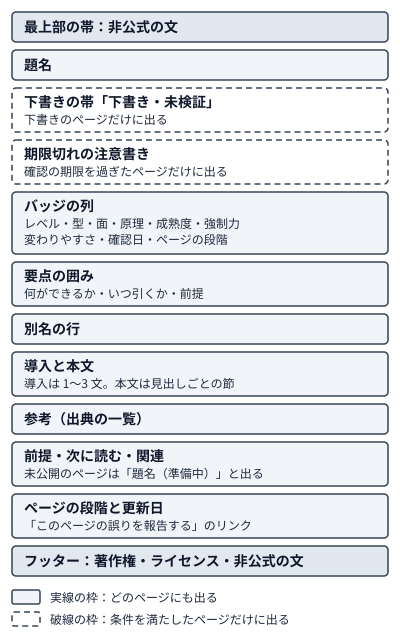

!!! abstract "要点"
    - **何ができるか**：困りごと・やりたいこと・名前から目的のページへ着く道と、冒頭の要点・バッジ・確認日・下書きの帯の読み方が分かる。公式の文書や教材との使い分けと、誤りや古い情報の報告のしかたも分かる。
    - **まず何をするか**：困りごとがあれば、逆引き辞典でその言葉から引く。なければ、ロードマップで自分のレベル（委任の段階）を見る。開くページは[引き方](#lookup)の表にある。
    - **いつ引くか**：
        - この辞典を初めて開いたとき（[引き方](#lookup)の節）。
        - 書いてあることをどこまで信用してよいか知りたいとき（[信用してよいかの見方](#trust)の節）。
        - 自分の AI にこの辞典を読ませたいとき（[自分の AI に読ませる](#llms-txt)の節）。
        - 公式の文書や講座との使い分けを知りたいとき（[公式の文書・公式の教材との役割分担](#official-docs)の節）。
        - 辞典の内容に誤りや古い情報を見つけたとき（[誤りや古い情報の報告](#report)の節）。
    - **前提**：なし

<!-- textlint-disable -->
別名：使い方・辞典の使い方・バッジの読み方・確認日の読み方・下書きの帯
<!-- textlint-enable -->

この辞典の引き方は、入口から目的のページへ着く道と、各ページの冒頭に並ぶバッジや帯の読み方である。読み通す本ではなく、場面から引く辞書として作ってある。対象は、Claude や Claude Code をかなり使っていて、開発の経験がある人である。

## 引き方（困りごと・やりたいこと・名前から） {#lookup}

この辞典は、困りごと・やりたいこと・置かれた状況・名前のどれからでも引ける。手元にあるものから、最初に開くページを選ぶ。初めて開いたときは、困りごとがあれば逆引き辞典から入り、なければロードマップで自分のレベル（委任の段階）を見る。

| 手元にあるもの | 最初に開くページと、そこで分かること |
| --- | --- |
| うまくいかなかった場面（例：指示が守られない） | <!-- link:begin reverse-index#by-symptom -->[逆引き辞典（症状・やりたいこと・状況） › 困りごとから引く](reverse-index.md#by-symptom)<!-- link:end -->。困りごとの言葉から、引くページと疑う原因へ進める。着く先の症状のページ（困りごとを診断するページ）は、原因を安く確かめられる順に問い、対処のページへ振り分ける |
| やりたいこと（例：長い作業を任せたい） | <!-- link:begin reverse-index#by-goal -->[逆引き辞典（症状・やりたいこと・状況） › やりたいことから引く](reverse-index.md#by-goal)<!-- link:end -->。やりたいことの言葉から、読むページへ進める |
| 置かれた状況（例：チームで導入する・大会に出る） | <!-- link:begin reverse-index#by-situation -->[逆引き辞典（症状・やりたいこと・状況） › 置かれた状況から引く](reverse-index.md#by-situation)<!-- link:end -->。状況の言葉から、読むページへ進める |
| 機能名・旧名・英語名・公式の日本語訳 | <!-- link:begin term-index -->[用語索引と旧名の対応](term-index.md)<!-- link:end -->。語から、その語のページを引ける。旧名には今の名前が添えてある |
| この辞典の独自の用語（例：お願いと鍵） | <!-- link:begin glossary -->[用語集（独自の用語と公式の訳語）](glossary.md)<!-- link:end -->。用語の意味と、公式の用語との対応 |

ほかに知りたいことがあるときは、次のページを開く。

| 知りたいこと | 開くページ |
| --- | --- |
| 原因の見当が付かないとき、どこから疑うか | <!-- link:begin six-causes -->[失敗の二つの軸と診断の入口](six-causes.md)<!-- link:end --> |
| 考え方の背骨 | <!-- link:begin four-principles -->[四つの原理と比例則（見せる・確かめる・縛る・握る）](four-principles.md)<!-- link:end --> |
| 自分のレベルで何から読むか | <!-- link:begin roadmap -->[ロードマップ（委任の段階別）](roadmap.md)<!-- link:end --> |
| ページの前提関係（図で見たい） | <!-- link:begin knowledge-map -->[知識マップ](knowledge-map.md)<!-- link:end --> |
| アプリ・Claude Code・API の関係 | <!-- link:begin product-map -->[全体地図：Claude の面と層](product-map.md)<!-- link:end --> |
| 読んだ助言が今も通じるか | <!-- link:begin outdated-advice-ledger -->[古くなった助言の台帳](../changes/outdated-advice-ledger.md)<!-- link:end -->と<!-- link:begin dating-information -->[いつの情報かを見分ける](../changes/dating-information.md)<!-- link:end --> |

ナビゲーションの大きな区分を分野と呼ぶ。症状のページだけを章（分野の中の区切り）ごとに並べた分野が、ナビゲーションの<!-- link:begin field:symptoms -->[症状辞典](../symptoms/index.md)<!-- link:end -->である。逆引き辞典を通らずに、章から症状を探すときは、そこを開く。

サイトの検索欄は、題名・見出し・本文の語で当たる。ページ冒頭の別名の行は本文にあるので、旧名・別の呼び方・公式の日本語訳でも当たる。

見つからないときは、次のようにたどる。

- 語が合っていないとき：用語索引を引く。近いページが見つかったら、そのページの別名の行に、言い換えの語が並んでいる
- どの入口にもないとき：[公式の文書・公式の教材との役割分担](#official-docs)の節の表で、公式の文書を探す

着いたページは、冒頭の要点で用が足りれば、そこで読み終えてよい。足りなければ本文へ進み、さらに前提のページや原理のページへさかのぼる。ページ下部の前提・次に読む・関連が、次に開くページの道になる。

## 冒頭の要点とバッジ {#badges}

ページの冒頭には、本文を読む前に信用の度合いを判断するための部品が並ぶ。上から、下書きの帯と期限切れの注意書き、バッジの列、要点の囲み、別名の行、導入の順である。



見取り図では、実線の枠がどのページにも出る部品、破線の枠が条件を満たしたページだけに出る部品を表す。最上部の帯とフッターには、非公式の教材であることを示す文が出る。文の中身は<!-- link:begin ai-and-sources#unofficial -->[出典と AI 利用の方針 › 非公式の教材であること](ai-and-sources.md#unofficial)<!-- link:end -->に置く。バッジの列に並ぶ項目は、ページの型によって違う。

冒頭の部品の読み方は次のとおりである。

| 部品 | 示すことと読み方 |
| --- | --- |
| 下書きの帯 | ページの段階が下書きのページにだけ出る。「下書き・未検証」と出て、確認日と版がまだないことを示す。詳しくは[段階・下書きの帯・「準備中」の題名](#stage)の節にある |
| 期限切れの注意書き | 確認の期限を過ぎたページにだけ出る。出たページの助言は、使う前に公式の文書で確かめる |
| 要点の囲み | 何ができるか・いつ引くか・前提が基本で、型によって項目が増える。用が足りれば、そこで読み終えてよい |
| 別名の行 | 旧名・別の呼び方・公式の日本語訳が並ぶ。検索で当たる語の手がかりになる |

バッジの列の読み方は次のとおりである。

| バッジ | 示すことと読み方 |
| --- | --- |
| レベル | ページが想定する読者のレベル（委任の段階）。自分のレベルより上のページは、前提のページを先に読む。レベルの一覧は[レベル（委任の段階）](#levels)の節にある |
| 型 | ページの種類。考え方・機能・症状・比較・手順・判断・台帳・案内がある |
| 面 | ページが扱う面（アプリ・Claude Code・API）。自分の面が入っているかを見る |
| 原理 | ページが扱う原理（見せる・確かめる・縛る・握る）。意味は<!-- link:begin four-principles -->[四つの原理と比例則（見せる・確かめる・縛る・握る）](four-principles.md)<!-- link:end -->にある |
| 成熟度 | 機能のページに出る。GA・beta・research preview・experimental のどれか。GA でない機能は、名前や挙動が変わることがある |
| 強制力 | 機能のページに出る。お願いか鍵か。お願い（非決定論的な指示。CLAUDE.md の文など）は守られないことがあるので、必ず守らせたいことは鍵（決定論的な制御。権限の deny ルールやフックなど）で縛る（<!-- link:begin request-vs-lock -->[お願いと鍵（決定論的か、非決定論的か）](../basics/request-vs-lock.md)<!-- link:end -->） |
| 変わりやすさ | 内容が古くなる速さ（低・中・高）。高いページは、確認日が古いときに公式の文書で確かめ直す |
| 確認日 | 出典を読み直した日と、そのとき使った版。下書きのページは「未検証」と出る |
| 更新日 | ページ下部に出る。読者に見える中身を最後に変えた日で、確認日とは別である |
| 段階（ページの段階） | バッジの列には、分かりやすさ確認済みと完成のページだけに出る。下書きのページは、バッジの代わりに帯で示す。ページ下部の段階の表示は、公開したどのページにも出る。詳しくは[段階・下書きの帯・「準備中」の題名](#stage)の節にある |

確認日のバッジに Claude Code の版が付いているときは、手元の版と見比べる。手元の版は `claude --version` で見られる。手元の版がバッジの版より古いと、ページに書いてある機能がまだ手元にないことがある。新しいときは、その後に挙動が変わっていないかを[Claude Code の変更履歴](https://code.claude.com/docs/en/changelog)（英語）で見る。

Claude Code の更新には、リリースチャネルが 2 つある（latest と stable）。stable は latest より遅れた版を配り、大きな退行のある版を飛ばす。そのため、latest で確かめた機能は、stable を使う人の手元にまだ入っていないことがある。リリースチャネルの設定は、公式の文書[高度なセットアップ](https://code.claude.com/docs/ja/setup)のリリースチャネルの節にある。

## 信用してよいかの見方 {#trust}

書いてあることをどこまで信用してよいかは、ページの冒頭に出る部品と、本文の印で見分ける。次のものがあるときは、使い方を変える。

- 下書きの帯がある：助言を使う前に、出典か公式の文書で確かめる（詳しくは[段階・下書きの帯・「準備中」の題名](#stage)の節）
- 期限切れの注意書きが出ている、または変わりやすさが高くて確認日が古い：公式の文書で今の記述を見る（詳しくは[冒頭の要点とバッジ](#badges)の節）
- 根拠の印が `（根拠：弱）`・`（類推）`・`（推論・実践例なし）`：判断の柱にせず、自分の環境で確かめる（詳しくは[根拠の強さの書き分け](#evidence)の節）
- 成熟度が GA でない：名前や挙動が変わりうるので、使う前に公式の文書で今の状態を見る（詳しくは[冒頭の要点とバッジ](#badges)の節）

## レベル（委任の段階） {#levels}

レベルは、ページが想定する読者の委任の段階である。使う・整える・任せる・仕組みにする・回すの順に上がり、バッジの「レベル」に出る。案内と台帳の型のページは、レベルを持たない。ページの書き進み具合を表すページの段階（骨格・下書き・分かりやすさ確認済み・完成）とは別のものである。

| レベル | このレベルの読者 |
| --- | --- |
| 使う | 対話で頼み、返答を読んで使う |
| 整える | 頼み方・資料・会話の長さを整え、結果を確かめて直す |
| 任せる | 計画させてから任せ、長い作業を途中で舵取りする |
| 仕組みにする | CLAUDE.md・スキル・フック・権限・MCP・プラグインで常設化し、共有する |
| 回す | 並列・無人・定期・プログラムから動かす |

レベルが上がるほど、任せる幅が広がる。その分、確かめる仕組みと、被害の範囲を狭める封じ込め（権限・サンドボックスなど）を先に厚くする。これを比例則と呼ぶ。

| 知りたいこと | 開くページ |
| --- | --- |
| 比例則の中身 | <!-- link:begin four-principles#proportional-rule -->[四つの原理と比例則（見せる・確かめる・縛る・握る） › 比例則](four-principles.md#proportional-rule)<!-- link:end --> |
| 次のレベルへ上がる条件と、レベルごとに読む順 | <!-- link:begin roadmap -->[ロードマップ（委任の段階別）](roadmap.md)<!-- link:end --> |
| どのレベルでも人が握るもの | <!-- link:begin roadmap#always-hold -->[ロードマップ（委任の段階別） › どの段階でも人が握るもの](roadmap.md#always-hold)<!-- link:end --> |

## 確認日と期限切れの注意書き {#freshness}

確認日と期限切れの注意書きは、ページの情報がいつ時点のものかを示す。

ページ上部の確認日のバッジは、出典を読み直した日と、そのとき使った版を示す。点検で影響がないと確かめた日があれば、バッジにポインタを置くと「点検」の日として出る。下書きのページには確認日がなく、「未検証」と出る。

ページごとに期限の日がある。ページの確認日（読み直した日と点検の日の新しいほう）にページの期限を足した日と、ページが含む各数値の確認日に数値の期限を足した日のうち、早いほうを、道具が計算する。変わりやすさが高いほど、期限は短い。

期限の日を過ぎたページには、「確認の期限切れ」の注意書きが出る。ブラウザが今日の日付と期限の日を比べて出すので、JavaScript が動かない環境では出ない。注意書きが出たページの助言は、使う前に公式の文書で確かめる。

## 根拠の強さの書き分け {#evidence}

研究や数値を根拠にする主張には、主張の文の後に根拠の強さの印が付く。公式の文書で確かめた機能の挙動には印を付けず、出典（ページ末尾の参考）で示す。

| 印 | 付く主張と読み方 |
| --- | --- |
| `（根拠：強）` | 無作為化比較試験・メタ分析・大規模な実験、大会の主催者の規約や公式の記録に付く。主張の根拠として使える |
| `（根拠：中）` | 小規模な研究、企業の一次の報告、複数の実務家の一致に付く。傾向として読み、自分の環境で確かめる |
| `（根拠：弱）` | 単独の経験談、二次の報道、立場の表明に付く。参考にとどめ、判断の柱にしない |
| `（類推）` | 隣接分野の結果を当てはめた主張に付く。条件の違いを疑う。強さと並ぶこともある（`（根拠：強・類推）`） |
| `（推論・実践例なし）` | 研究も実践例もない推論や、この辞典の提案に付く。試して確かめる。必須のページの中心には置かない |

印のほかに、次の読み方がある。

- 研究の結果には、どのモデルの世代の結果かが添えてある。旧世代や他社のモデルの結果は、現行の Claude の傾向として読まない
- 小さな研究の結果は「傾向」と書いてあり、標本の大きさが添えてある
- 根拠の弱い数値には「自己申告」「経験則」と書いてある。主張の根拠としては読まない
- 実践者の間で意見が割れる論点は、「公式の立場」「実践者の幅」「この辞典の推奨」の三段に分けて書いてある。公式の立場は公式の文書が示す立場、実践者の幅は実践者の間の違いを指す。「この辞典の推奨」は、この辞典自身の推奨であり、公式の立場ではない

## 面のタブ {#surface-tabs}

面は、Claude を使う入口の種類で、アプリ・Claude Code・API がある。同じ目的でも、面ごとに手段の違う場合がある。この辞典は、面ごとにページを分けず、手段が違う所をページの中のタブで並べる。

タブの名前と順は、アプリ・Claude Code・API で決まっている。ページが扱う面のタブだけが出る。同じ名前のタブは、ページの中で一緒に切り替わる。ページ上部のバッジ「面」でも、扱う面が分かる。

面に固有の操作の詳しい手順は、面の分野のページに任せる。アプリは分野「アプリを使いこなす」、Claude Code は分野「Claude Code の基本操作」、API は分野「API・SDK の概念」にある。面の関係は<!-- link:begin product-map -->[全体地図：Claude の面と層](product-map.md)<!-- link:end -->で見られる。

Claude Code の操作は、WSL と Linux の CLI を基準に書く。ほかの OS と IDE の拡張の動作は、確かめていなければ「未確認」と書く。

## 段階・下書きの帯・「準備中」の題名 {#stage}

ページの段階は、ページの書き進み具合を表す。レベル（委任の段階）とは別のものである。段階は骨格・下書き・分かりやすさ確認済み・完成の順に進み、画面には、下書きの帯と段階の表示が出る。ページを誰がどう確かめるかの流れは、<!-- link:begin ai-and-sources#ai-writing -->[出典と AI 利用の方針 › AI で書いていることと確かめ方](ai-and-sources.md#ai-writing)<!-- link:end -->にある。

| ページの段階（画面の表示） | 読者にとっての意味 |
| --- | --- |
| stub（準備中） | 骨格だけのページ。公開していないので、開けない |
| draft（下書き。帯は「下書き・未検証」） | 書き終えたが、書いた担当とは別の担当による分かりやすさの確認がまだ。確認日と版もまだない |
| reviewed（分かりやすさ確認済み） | 書いた担当とは別の担当が、分かりやすさを確かめ直した。本文の事実を一次資料と照らし直した、という意味ではない。確認日と版は、出典を読み直したページにだけ付く |
| done（完成） | 最後の段階。意味は<!-- link:begin ai-and-sources#done -->[出典と AI 利用の方針 › 段階「完成」の意味](ai-and-sources.md#done)<!-- link:end -->に書いてある |

下書きの帯が出るページは、確認日のバッジが「未検証」になる。帯のリンクは、この節を指す。下書きのページの助言は、使う前に出典や公式の文書で確かめる。

「題名（準備中）」は、まだ公開していないページを指す所に出る、リンクにならない文字である。前提・次に読む・関連や本文の案内では、相手のページが未公開のとき、リンクにせず、題名の後ろに「（準備中）」を付けた文字だけを出す。逆引きや用語索引、一覧、llms.txt のような生成されるページには、公開したページだけが載る。相手のページが公開されると、同じ場所がリンクに変わる。準備中のページを待たずに、別の入口から公開済みのページを探す。たとえば、困りごとの言葉で見つからなければ、機能名や用語で引く。

## 公式の文書・公式の教材との役割分担 {#official-docs}

この辞典が書くのは判断である。なぜうまくいかないか、次に何を足してどう確かめるか、どこまで任せて何を人が握るかを書く。手順の細部や全項目の一覧は、公式の文書に任せてリンクで済ませる。

| 知りたいこと | 引く先 |
| --- | --- |
| 原因の見当、次の一手、確かめ方、任せる幅 | この辞典 |
| インストール・OS ごとの設定・更新 | Claude Code の文書の[高度なセットアップ](https://code.claude.com/docs/ja/setup) |
| 全コマンド・全設定キー・全フックイベント | Claude Code の文書の[CLI リファレンス](https://code.claude.com/docs/ja/cli-reference)・[すべての設定](https://code.claude.com/docs/ja/settings-reference)・[Hooks リファレンス](https://code.claude.com/docs/ja/hooks) |
| API のパラメータ・コードの例 | Claude Platform の文書。[Claudeの紹介](https://platform.claude.com/docs/ja/intro)から入る |
| アプリの画面の操作・プラン・請求 | [Anthropicヘルプセンター](https://support.claude.com/ja/) |
| 機能の追加や変更の履歴 | [Claude Code の変更履歴](https://code.claude.com/docs/en/changelog)（英語）・ヘルプセンターの[リリースノート](https://support.claude.com/en/articles/12138966-release-notes)（英語） |
| 手を動かして順に学ぶ | 下の公式の教材 |

Claude Code の文書・Claude Platform の文書・ヘルプセンターには、日本語版がある。ただし Claude Code の変更履歴に日本語版はなく、日本語版の URL は英語の変更履歴へ転送される。公式の日本語版では、同じ語の表記が文書の間で割れていることがある。この辞典の表記の決め方は<!-- link:begin glossary#translation-policy -->[用語集（独自の用語と公式の訳語） › 訳語の決め方](glossary.md#translation-policy)<!-- link:end -->に、割れている語の扱いは<!-- link:begin glossary#split-terms -->[用語集（独自の用語と公式の訳語） › 公式で表記が割れている語](glossary.md#split-terms)<!-- link:end -->にある。

公式の文書は改稿される。設定のキー名や既定値のように変わりやすいことは、使う前に公式の文書で今の記述を見る。

この辞典は演習を載せない。手を動かして学びたいときは、公式の教材を使う。講座の名前と数は変わるので、入口のページから探す。

| 教材 | 向く用 |
| --- | --- |
| [Claude Academy](https://academy.claude.com/) | 講座・チュートリアル・使い方の例を、入口から探す |
| [anthropics/courses](https://github.com/anthropics/courses)（GitHub） | API の基礎、プロンプトの設計と評価、ツール使用を、題材ごとに学ぶ |
| [Prompt Engineering Interactive Tutorial](https://github.com/anthropics/prompt-eng-interactive-tutorial)（GitHub） | 章立ての演習で、プロンプトの組み立てを順に学ぶ |
| [Claude Code のベストプラクティス](https://code.claude.com/docs/ja/best-practices)（Claude Code の文書） | Claude Code を使うときの設定と進め方の指針を読む |

教材には、書かれた時期のモデルを前提にしているものがある。手を動かす前に、README や講座の説明で前提のモデルを確かめ、手元のモデルで試す。

## 自分の AI に読ませる（llms.txt） {#llms-txt}

llms.txt は、サイトのページの一覧を、AI が読みやすい形で置いたファイルである。この辞典のものは、サイトの URL の直下にある（`https://yuukougun.github.io/claude-atlas/llms.txt`）。1 ページが 1 行で、題名・URL・id・型・レベル・ページの段階・確認日・要約が並ぶ。載るのは公開したページだけで、凡例はファイルの冒頭にも書いてある。

AI に読ませるときの要点は 3 つある。

1. 困りごとかやりたいことと一緒に、llms.txt の URL を AI に渡す。AI が合うページを選ぶ
2. 選んだページの本文まで読ませる。索引の 1 行の要約だけでは、そのページの条件や例外が分からないためである
3. 助言に、そのページの段階・確認日・版を添えさせる。下書きのページや、確認日が「未検証」のページの助言は、公式の文書で確かめるまで仮のものとして扱うためである

次の依頼文は、この要点を AI へ渡せる形にまとめたものである。

<!-- gen:begin snippet how-to-use/ask-ai-with-llms-txt -->
<!-- textlint-disable -->

??? example "雛形：辞典の索引（llms.txt）から AI にページを選ばせる依頼文"

    ```text
    次の索引から、今の困りごとに合うページを選んでください。

    索引：https://yuukougun.github.io/claude-atlas/llms.txt
    困りごと：<うまくいかなかった場面かやりたいことを、ここに書く>

    進め方：
    1. 索引の冒頭にある凡例を読んでから、合いそうなページを 3 つまで選び、選んだ理由を 1 行ずつ書いてください。
    2. 選んだページの本文を読み、助言を短くまとめてください。索引の要約の行だけから助言を作らないでください。本文を読めなかったページは、読めなかったと書いてください。
    3. ページごとに、ページの段階・確認日・版を添えてください。ページの段階が draft のページと、確認日が「未検証」のページの助言は、公式の文書で確かめるまでは仮の助言として、ほかと分けて書いてください。
    ```

    動作を確かめていない雛形。

<!-- textlint-enable -->
<!-- gen:end snippet how-to-use/ask-ai-with-llms-txt -->

AI が URL を読めない環境では、ページの本文を貼って渡す。Claude Code の文書にも[llms.txt](https://code.claude.com/docs/llms.txt)があり、日本語版の索引は[jp.txt](https://code.claude.com/docs/_llms/jp.txt)にある。仕様を AI に確かめさせるときは、この辞典の索引に加えて、公式の索引も渡す。

## 誤りや古い情報の報告 {#report}

誤りや古い情報を見つけたときは、ページの最下部にある「このページの誤りを報告する」から、GitHub の Issue を開ける。ページの題名・URL・確認日・更新日は、あらかじめ入る。GitHub のアカウントが要る。

報告には、次のことを書いてほしい。

- どのページの、どの記述か（題名と URL）
- そのページの確認日と版
- 何が違うか（食い違う公式の文書などの URL。読んだ日と版があれば添える）

報告への返事と、直す時期は約束しない。連絡の窓口の全体は、<!-- link:begin ai-and-sources#contact -->[出典と AI 利用の方針 › 連絡と誤りの報告](ai-and-sources.md#contact)<!-- link:end -->にある。

<!-- gen:begin references -->
<!-- textlint-disable -->

## 参考 {#references}

- [高度なセットアップ](https://code.claude.com/docs/ja/setup)：Anthropic・確認日 2026-11-04
- [CLI リファレンス](https://code.claude.com/docs/ja/cli-reference)：Anthropic・確認日 2026-11-04
- [すべての設定](https://code.claude.com/docs/ja/settings-reference)：Anthropic・確認日 2026-11-04
- [Hooks リファレンス](https://code.claude.com/docs/ja/hooks)：Anthropic・確認日 2026-11-04
- [Claude Code のベストプラクティス](https://code.claude.com/docs/ja/best-practices)：Anthropic・確認日 2026-11-04
- [Claude Code changelog](https://code.claude.com/docs/en/changelog)：Anthropic・英語・確認日 2026-11-04
- [Claude Code Docs llms.txt](https://code.claude.com/docs/llms.txt)：Anthropic・英語・確認日 2026-11-04
- [Claudeの紹介](https://platform.claude.com/docs/ja/intro)：Anthropic・確認日 2026-11-04
- [Anthropicヘルプセンター](https://support.claude.com/ja/)：Anthropic・確認日 2026-11-04
- [Release notes](https://support.claude.com/en/articles/12138966-release-notes)：Anthropic・英語・確認日 2026-11-04
- [Claude Academy · Learn to work and build with Claude](https://academy.claude.com/)：Anthropic（Claude Academy）・英語・確認日 2026-11-04
- [anthropics/courses: Anthropic's educational courses](https://github.com/anthropics/courses)：Anthropic（GitHub）・英語・確認日 2026-11-04
- [Anthropic's Prompt Engineering Interactive Tutorial](https://github.com/anthropics/prompt-eng-interactive-tutorial)：Anthropic・英語・確認日 2026-11-04

<!-- textlint-enable -->
<!-- gen:end references -->

<!-- gen:begin page-links -->
<!-- textlint-disable -->

<div class="ca-page-links" markdown>

**前提**

- なし

**関連**

- [逆引き辞典（症状・やりたいこと・状況）](reverse-index.md)
- [用語索引と旧名の対応](term-index.md)
- [用語集（独自の用語と公式の訳語）](glossary.md)
- [ロードマップ（委任の段階別）](roadmap.md)
- [知識マップ](knowledge-map.md)
- [四つの原理と比例則（見せる・確かめる・縛る・握る）](four-principles.md)
- [失敗の二つの軸と診断の入口](six-causes.md)
- [全体地図：Claude の面と層](product-map.md)
- [出典と AI 利用の方針](ai-and-sources.md)
- [古くなった助言の台帳](../changes/outdated-advice-ledger.md)
- [いつの情報かを見分ける](../changes/dating-information.md)

</div>

<!-- textlint-enable -->
<!-- gen:end page-links -->
