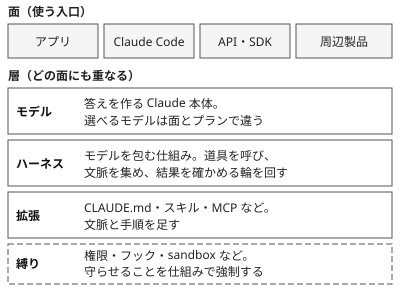

!!! abstract "要点"
    - **何ができるか**：アプリ・Claude Code・API と周辺製品の関係と、モデル・拡張・縛りの層の重なりが分かり、困りごとをどの分野で引くかの見当がつく。
    - **いつ引くか**：Claude の製品と機能の全体像をつかみたいとき。読んでいる記事がアプリ・Claude Code・API のどれの話か分からないとき。
    - **前提**：なし

<!-- textlint-disable -->
別名：製品の全体像・面の地図・全体図・アプリと Claude Code と API の関係
<!-- textlint-enable -->

全体地図は、Claude を使う入口である面と、その下に重なる層を 1 枚にまとめた案内である。説明は各ページに任せ、ここは行き先だけを示す。

## 面の地図 {#surfaces}

面とは、Claude を使う入口のことである。同じ Claude でも、どの面から使うかで、動く場所と触れられるものが変わる。

| 面 | 入口の性格 | 詳しいページ |
| --- | --- | --- |
| アプリ | 会話で頼む。チャットとタスクを一つの会話で扱う | <!-- link:begin choosing-a-surface#app-chat-and-tasks -->[アプリ・Claude Code・API の選び方 › アプリはチャットとタスクを一つの会話で扱う](../surfaces/choosing-a-surface.md#app-chat-and-tasks)<!-- link:end --> |
| Claude Code | エージェントループを動かし、コードとファイルを直接触る。ターミナル・IDE・Desktop・Web・モバイルから使える | <!-- link:begin claude-code-surfaces#comparison-table -->Claude Code の面（ターミナル・IDE・Desktop・Web・モバイル） › 面ごとの違い（表）（準備中）<!-- link:end --> |
| API・SDK | 自分のプログラムから呼ぶ。ループを誰が回すかで層が分かれる | <!-- link:begin sdk-comparison#comparison -->[Client SDK・Agent SDK・Managed Agents・CLI の比較 › 層ごとの比較（自分のプロセスに組み込む・Anthropic にホストさせる・CLI で動かす）](../api/sdk-comparison.md#comparison)<!-- link:end --> |
| 周辺製品 | 本体のアプリの外で使う製品。Office アドインなど | <!-- link:begin peripheral-products#list -->周辺製品の一覧 › 一覧（確認日つき）（準備中）<!-- link:end --> |

どの面で進めるかの判断は <!-- link:begin choosing-a-surface#compare-surfaces -->[アプリ・Claude Code・API の選び方 › 三つの面を比べる](../surfaces/choosing-a-surface.md#compare-surfaces)<!-- link:end --> が持つ。この地図は案内にとどめる。

## 層の重なり {#layers}

層とは、どの面にも重なっている仕組みの段である。面が違っても、モデルを土台に、ハーネス、拡張、縛りの順に重なる。使える手段は面ごとに違うので、その違いは <!-- link:begin what-each-surface-cannot-do#table -->面ごとにできないこと（早見表） › 早見表（面 × 機能）（準備中）<!-- link:end --> で引く。

| 層 | 何を決めるか | 引くページ |
| --- | --- | --- |
| モデル | 答えの質と速さ、料金の位置 | <!-- link:begin current-models#lineup -->[現行モデルの一覧と位置づけ › 系統ごとの位置づけ（表）](../models/current-models.md#lineup)<!-- link:end --> |
| ハーネス | 道具を呼び、文脈を集め、結果を確かめる輪の回し方 | <!-- link:begin agent-loop#what-happens -->[エージェントループと tool use › 何が起きるか](../basics/agent-loop.md#what-happens)<!-- link:end --> |
| 拡張 | 毎回の文脈や手順を足す仕組みの使い分け | <!-- link:begin extensions-at-a-glance -->[拡張機能の全体図と使い分け早見表](../extend/extensions-at-a-glance.md)<!-- link:end --> |
| 縛り | 守らせたいことを、お願いではなく仕組みで強制する | <!-- link:begin four-principles#lock -->[四つの原理と比例則（見せる・確かめる・縛る・握る） › 縛る](four-principles.md#lock)<!-- link:end --> |

結果が期待と違うとき、モデルを替える前に、ハーネスの側を疑う余地がある。見分け方は <!-- link:begin harness-over-model#when-harness-matters -->モデルの差よりハーネスの差 › 差がハーネスから来るとき（準備中）<!-- link:end --> にある。任せる幅を広げるほど、縛りの層を先に厚くする。その比例則は <!-- link:begin four-principles#proportional-rule -->[四つの原理と比例則（見せる・確かめる・縛る・握る） › 比例則](four-principles.md#proportional-rule)<!-- link:end --> で引く。

## 困りごとから分野を引く {#find-by-trouble}

困りごとから分野を引くときは、下の表で読者の言葉に近い行を探す。原因を考え方から整理したいなら、先に <!-- link:begin four-principles#from-trouble -->[四つの原理と比例則（見せる・確かめる・縛る・握る） › うまくいかないときの引き方](four-principles.md#from-trouble)<!-- link:end --> を引く。

| 困りごと | 引く分野 |
| --- | --- |
| 指示を無視される、同じ失敗を繰り返すなど、症状から探したい | <!-- link:begin field:symptoms -->[症状辞典](../symptoms/index.md)<!-- link:end --> |
| なぜそうなるのか、仕組みから知りたい | <!-- link:begin field:basics -->[基礎：なぜそうなるか](../basics/index.md)<!-- link:end --> |
| どの面で何をするか、どこで動かすかを決めたい | <!-- link:begin field:surfaces -->[製品の地図と面の選び方](../surfaces/index.md)<!-- link:end --> |
| モデルや effort を選びたい | <!-- link:begin field:models -->[モデル・effort・思考](../models/index.md)<!-- link:end --> |
| 頼み方を直したい | <!-- link:begin field:prompting -->[頼み方](../prompting/index.md)<!-- link:end --> |
| 長い会話で文脈が散らかる | <!-- link:begin field:context -->[文脈を整える](../context/index.md)<!-- link:end --> |
| アプリの機能を使いこなしたい | <!-- link:begin field:app -->[アプリを使いこなす](../app/index.md)<!-- link:end --> |
| Claude Code を普段使いにしたい | <!-- link:begin field:cli -->[Claude Code の基本操作](../cli/index.md)<!-- link:end --> |
| 指示や手順を CLAUDE.md・スキル・フックに移したい | <!-- link:begin field:extend -->[文脈と指示を仕組みにする](../extend/index.md)<!-- link:end --> |
| 出力が合っているか確かめたい | <!-- link:begin field:verify -->[確かめる](../verify/index.md)<!-- link:end --> |
| 例外を許さないことを仕組みで強制したい | <!-- link:begin field:enforce -->[仕組みで縛る](../enforce/index.md)<!-- link:end --> |
| 安全とデータの扱いを決めたい | <!-- link:begin field:safety -->[安全とデータ](../safety/index.md)<!-- link:end --> |
| 費用と利用上限が気になる | <!-- link:begin field:cost -->[費用と利用上限](../cost/index.md)<!-- link:end --> |
| API・SDK から使いたい | <!-- link:begin field:api -->[API・SDK の概念](../api/index.md)<!-- link:end --> |
| 古い記事の助言が今も有効か知りたい | <!-- link:begin field:changes -->[古くなった助言と変更の記録](../changes/index.md)<!-- link:end --> |

## 記事がどの面の話かを見分ける {#identify-surface}

読んでいる記事がどの面の話かは、書いてある操作の場所で見分けられる。

- ターミナルで `claude` コマンドを動かす話や、`settings.json` を編集する話は、Claude Code の話である。
- コードから Messages API を呼ぶ話や、リクエストの JSON を組み立てる話は、API の話である。
- ブラウザやスマホの画面でチャットし、設定画面のスイッチを入れる話は、アプリの話である。ただし Claude Code も Web・Desktop・モバイルから使えるので、コードやリポジトリを触る話なら Claude Code の話である。
- Excel や Word の中のサイドパネルで使う話は、周辺製品の話である。

記事の面の名前が今の呼び方と合わないときは、記事の日付を見る。面の名前は変わることがあり、古い記事は旧い呼び名で書かれている。主な読み替えは次のとおりである。

- 旧称 Claude Code on the web は、今は <!-- name:begin web-to-cloud-sessions -->クラウドセッション（cloud sessions）<!-- name:end --> と呼ぶ。
- 旧称 Claude in Slack は、今は <!-- name:begin slack-to-claude-tag -->Claude Tag<!-- name:end --> と呼ぶ。
- 旧称 Claude Code SDK は、今は <!-- name:begin code-sdk-to-agent-sdk -->Claude Agent SDK<!-- name:end --> と呼ぶ。

読み替えの全体と、助言そのものの古さは <!-- link:begin field:changes -->[古くなった助言と変更の記録](../changes/index.md)<!-- link:end --> で引く。

## 次に引くページ {#where-next}

この地図から先は、知りたいことごとに次のページへ進む。

| 知りたいこと | 引くページ |
| --- | --- |
| アプリ・Claude Code・API のどれで進めるか | <!-- link:begin choosing-a-surface#examples -->[アプリ・Claude Code・API の選び方 › 判断例](../surfaces/choosing-a-surface.md#examples)<!-- link:end --> |
| クラウドか手元かで何が変わるか | <!-- link:begin where-it-runs#three-locations -->[実行場所の違い（クラウド・自分の PC・リモート操作） › 三つの実行場所](../surfaces/where-it-runs.md#three-locations)<!-- link:end --> |
| Claude Code をどの窓口で使うか | <!-- link:begin claude-code-surfaces#how-to-choose -->Claude Code の面（ターミナル・IDE・Desktop・Web・モバイル） › 選び方（準備中）<!-- link:end --> |
| 使いたい機能がない面から移るか | <!-- link:begin what-each-surface-cannot-do#moving-between-surfaces -->面ごとにできないこと（早見表） › 別の面に移すとき（準備中）<!-- link:end --> |
| Office アドインの位置づけ | <!-- link:begin peripheral-products#office-add-ins -->周辺製品の一覧 › Office アドイン（準備中）<!-- link:end --> |
| SDK や Managed Agents のどの層を使うか | <!-- link:begin sdk-comparison#examples -->[Client SDK・Agent SDK・Managed Agents・CLI の比較 › 選び方の判断例](../api/sdk-comparison.md#examples)<!-- link:end --> |
| アプリの機能が API の何に当たるか | <!-- link:begin feature-to-api-mapping#insights -->[アプリの機能と API の概念の対応表 › 対応から分かること](../api/feature-to-api-mapping.md#insights)<!-- link:end --> |
| いま選べるモデルと、面ごとの違い | <!-- link:begin current-models#by-surface -->[現行モデルの一覧と位置づけ › 面とプランごとに選べるモデル](../models/current-models.md#by-surface)<!-- link:end --> |
| うまくいかない理由を原理で考える | <!-- link:begin four-principles#overview -->[四つの原理と比例則（見せる・確かめる・縛る・握る） › 4 つの原理の一覧](four-principles.md#overview)<!-- link:end --> |

<!-- gen:begin page-links -->
<!-- textlint-disable -->

**前提**

- なし

**関連**

- [アプリ・Claude Code・API の選び方](../surfaces/choosing-a-surface.md)
- [実行場所の違い（クラウド・自分の PC・リモート操作）](../surfaces/where-it-runs.md)
- Claude Code の面（ターミナル・IDE・Desktop・Web・モバイル）（準備中）
- 面ごとにできないこと（早見表）（準備中）
- 周辺製品の一覧（準備中）
- [Client SDK・Agent SDK・Managed Agents・CLI の比較](../api/sdk-comparison.md)
- [アプリの機能と API の概念の対応表](../api/feature-to-api-mapping.md)
- [拡張機能の全体図と使い分け早見表](../extend/extensions-at-a-glance.md)
- [現行モデルの一覧と位置づけ](../models/current-models.md)
- モデルの差よりハーネスの差（準備中）
- [エージェントループと tool use](../basics/agent-loop.md)
- [四つの原理と比例則（見せる・確かめる・縛る・握る）](four-principles.md)

<!-- textlint-enable -->
<!-- gen:end page-links -->

<!-- gen:begin references -->
<!-- textlint-disable -->

## 参考 {#references}

- [How Claude Code works](https://code.claude.com/docs/en/how-claude-code-works)：Anthropic・英語・確認日 2026-11-04
- [Extend Claude Code](https://code.claude.com/docs/en/features-overview)：Anthropic・英語・確認日 2026-11-04
- [Features overview](https://platform.claude.com/docs/en/build-with-claude/overview)：Anthropic・英語・確認日 2026-11-04
- [Agent SDK overview](https://code.claude.com/docs/en/agent-sdk/overview)：Anthropic・英語・確認日 2026-11-04

<!-- textlint-enable -->
<!-- gen:end references -->
