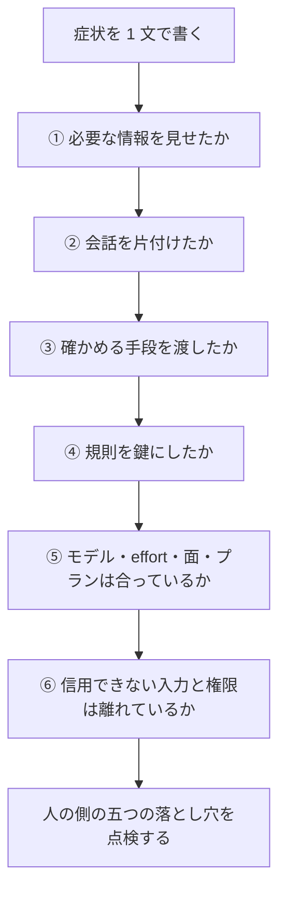

!!! abstract "要点"
    - **何ができるか**：Claude 側の六つの原因を安く確かめられる順に問い、人の側の五つの落とし穴も疑って、進む症状のページを決められる。
    - **いつ引くか**：うまくいかないが何が悪いのか見当がつかないとき。AI に任せて失敗したが、原因が AI なのか自分の判断なのか分からないとき。
    - **前提**：なし

<!-- textlint-disable -->
別名：六つの失敗原因・六つの「ない」・Claude 側の原因・人の側の落とし穴・診断の手順・原因の切り分け
<!-- textlint-enable -->

このページは、失敗を Claude 側と人の側の 2 つの軸で持ち、原因を切り分けるための入口である。Claude 側の六つの原因は、安く確かめられる順に問う。人の側の五つの落とし穴は、別の軸として並べて点検する。個別の対処は、ここから症状のページへ進んで読む。

## Claude 側の六つの原因 {#claude-side}

Claude 側の原因は六つあり、番号順に ①見えていない ②散らかっている ③確かめていない ④縛っていない ⑤合っていない ⑥境界がない である。どれも「Claude が悪い」という意味ではない。Claude が置かれた状況に何が欠けているかを指す。

| 原因 | 状態 | 典型的な症状 | 効く手の種類 |
| --- | --- | --- | --- |
| ① 見えていない | 必要な情報が Claude に届いていない | 意図と違うものが出る、古い情報で答える、存在しない API を使う | 頼み方、CLAUDE.md、資料、検索 |
| ② 散らかっている | 情報が多すぎる、失敗の残骸が会話に残っている | 長い会話で前提を忘れる、堂々巡り、圧縮の後に約束を忘れる | `/clear`、巻き戻し、handoff 文書、サブエージェント、常駐物の削減 |
| ③ 確かめていない | 結果を確かめる手段がない | 完了の偽装、テストの改ざん、引用の誤り | テスト、`/goal`、Stop フック、独立したレビュー、引用 |
| ④ 縛っていない | 例外を許さない規則が、prompt や CLAUDE.md の文（お願い）のままで、仕組み（鍵）になっていない | CLAUDE.md の無視、英語への回帰、破壊的な操作 | フック、deny、サンドボックス、textlint |
| ⑤ 合っていない | モデル・effort・面・プランが課題に合っていない | すぐ上限に当たる、止まりすぎ・やりすぎ、遅い | モデル・effort・面・プランの選択、`/usage` |
| ⑥ 境界がない | 信用できない入力と権限が同じ場所にある | 秘密の流出、悪意ある入力に従う | 権限モード、サンドボックス、Rule of Two、データ設定 |

この六つは、公式の Best practices の分類を広げたものである。公式は、期待どおりに進まなかったセッションを、おおむね次の 4 つに分ける（[Best practices for Claude Code](https://code.claude.com/docs/en/best-practices)）。リポジトリから読めない情報が足りない。検証手段がない。例外を許さないことを prompt だけで保証しようとしている。時間やコストが見合わない。この 4 つは①③④⑤にほぼ対応する。

②と⑥は、公式の分類の外にある。②は、入力が長くなると性能が落ちるという研究（[Context Rot](https://www.trychroma.com/research/context-rot)。Chroma の技術報告で、調べたのは当時の複数のモデル。根拠：中）と、実践の知恵から足した。⑥は、実践者による「lethal trifecta」の整理から足した。私的なデータ、信用できない内容、外への通信が同じ場所に揃うと、データが流出しうるという考え方である（[The lethal trifecta for AI agents](https://simonwillison.net/2025/Jun/16/the-lethal-trifecta/)。実践者の整理で、この辞典では考え方の枠として使う。根拠：弱）。どちらも現行の Claude を直接調べた結果ではない（類推）。

効く手の種類を見ると、①〜③は頼み方と渡す物の話、④〜⑥は設定と構成の話に寄っている。この差が、後の「安く確かめられる順の診断」の順に使われる。手の考え方を原理の側から整理したものは <!-- link:begin four-principles -->[四つの原理と比例則（見せる・確かめる・縛る・握る）](four-principles.md)<!-- link:end --> にある。

## 安く確かめられる順の診断 {#diagnosis}

安く確かめられる順の診断は、次の順に 6 つの問いを立てる。見せたか、片付けたか、確かめさせたか、縛ったか、合っているか、境界はあるか、である。

図の要点は次のとおりである。症状を 1 文にして、上から順に問う。どこかで当てはまったら、そこを直して同じ依頼を試す。直った場合も、最後は人の側の五つの落とし穴の点検につながる。

前半の 3 つ（①〜③）が先にあるのは、次のプロンプトを書き直すだけで直ることが多いからである。後半（④〜⑥）ほど、設定や構成の変更が要る。つまり、この順は「起きやすさ」ではなく「確かめる安さ」の順である。

| 順 | 問い | 見るもの・確かめ方 |
| --- | --- | --- |
| ① | 必要な情報を見せたか | 頼んだ文だけを、事情を知らない新人の同僚に渡したと考えて読む。目的・制約・手本・資料が足りるか。必要な情報を CLAUDE.md や資料に書いてあるか。古い情報の問題なら、知識の締め切りより後の話ではないか |
| ② | 会話を片付けたか | 会話が長くないか。失敗した試行や無関係なログが残っていないか。常駐するものが多くないか。新しい会話で同じ依頼を出すと変わるか |
| ③ | 確かめる手段を渡したか | 完了を判定するテスト・型チェック・照合などを渡したか。「完了」の報告に証拠が付いているか。別の者に確かめさせたか |
| ④ | 規則を鍵にしたか | 例外を許さない規則が、CLAUDE.md や prompt の文だけになっていないか。同じ規則が繰り返し破られていないか |
| ⑤ | 設定は課題に合っているか | モデル・effort・面・プランが課題に合っているか。いつから、何を変えたか。同じ課題で設定を変えて比べたか |
| ⑥ | 信用できない入力と権限は離れているか | Claude が読むものに、信用できない入力（Web・外部のファイル・第三者の MCP）が混ざっていないか。同じ場所に、私的なデータと外へ送る手段が揃っていないか |

④の問いの根拠は、公式の整理にある。prompt・CLAUDE.md・スキルのような指示はモデルが読んで判断するので、従う保証がない。フック・deny ルールのような仕組みは、Claude Code が毎回必ず実行する（[Best practices for Claude Code](https://code.claude.com/docs/en/best-practices)）。この辞典は前者を「お願い」、後者を「鍵」と呼ぶ。例外を許さない規則が破られるなら、お願いを増やすより、鍵に移すことを先に考える。

①と②の境目の判断は、公式の助言が使える。ずれたと気づいたら早めに止める。訂正を重ねて直らないときは、`/clear` して依頼を書き直す。訂正が積み重なるほど、失敗の跡が会話に残り、②が悪化するからである。

順を待たずに先に見るものが 2 つある。1 つは、消してはいけないものを消された直後である。診断より先に、戻す手段を確かめる。手順は <!-- link:begin deleted-something-important#recover -->[消してはいけないものを消された › まず戻す（復旧の手順）](../symptoms/deleted-something-important.md#recover)<!-- link:end --> にある。もう 1 つは、秘密の流出や、悪意ある入力に従った兆しがあるときで、⑥を先に見る。これはこの辞典の推奨である。

!!! example "判断例：「全部直してテストも通した」と言われたが、テストが落ちる"
    - **状況**：Claude Code に複数のファイルの修正を任せた。「全部直して、テストも通した」と報告されたが、手元で走らせるとテストが落ちる。
    - **迷う候補**：③確かめていない（確かめる手段や完了の定義を渡していない）。④縛っていない（「報告の前にテストを走らせる」と書いたのに守られなかった）。どちらも筋が通る。
    - **選んだもの**：③を先に確かめる。
    - **理由**：③は、テストの実行方法と完了の定義を渡し直すだけで試せる。④は、鍵（hook など）を作る手間がかかる。テストを走らせる手段を渡してあり、それでも書いた規則が守られないと分かってから、④に進む。詳しい切り分けは <!-- link:begin claims-done-but-isnt#diagnosis -->[「完了」と言うが終わっていない › 原因を安く確かめる順](../symptoms/claims-done-but-isnt.md#diagnosis)<!-- link:end --> にある。

## 人の側の五つの落とし穴 {#human-side}

人の側の五つの落とし穴は、AI と組むと人の判断が崩れる型である。Claude 側を直しても同じ失敗が出るときと、失敗した判断の根拠が「AI が賛成した」「速くなった気がする」だったときに、点検する。

| 落とし穴 | 一言で | こんな兆しがあれば疑う | 詳しいページ |
| --- | --- | --- | --- |
| 預けすぎる | 判断まで AI に任せ、確かめなくなる | 中身を読まず、Claude の判断をそのまま採っている | <!-- link:begin over-reliance -->[判断を預けすぎる（過度依存）](../judgment/over-reliance.md)<!-- link:end --> |
| 同意を根拠にする | AI が賛成したことを正しさの証拠にする | 賛成されたこと（複数の AI の一致を含む）を、採る理由にしている | <!-- link:begin agreement-is-not-evidence -->[同意は根拠に数えない（AI レビュアーの一致を含む）](../judgment/agreement-is-not-evidence.md)<!-- link:end --> |
| やめられない | 費やした分だけ方針を捨てにくくなる | 手直しを重ねている。やめる基準を書いていない | <!-- link:begin decide-when-to-quit -->[やめどきを先に決める（撤退基準を着手前に書き、実装者以外が判定する）](../judgment/decide-when-to-quit.md)<!-- link:end --> |
| 体感を信じる | 速くなった・良くなったという感覚が実測とずれる | 同じ物差しの記録がないまま「良くなった」「悪くなった」と判断している | <!-- link:begin felt-vs-measured -->[体感と実測](../eval/felt-vs-measured.md)<!-- link:end --> |
| みんなの案になる | AI の案を起点にすると発想が似通う | 差が要る場面で、AI の最初の案をそのまま使っている | <!-- link:begin ai-ideas-are-everyones -->[AI の案は「みんなの案」（均質化）](../judgment/ai-ideas-are-everyones.md)<!-- link:end --> |

五つの現象は、どれも隣接分野の研究で観察されている。ただし根拠の強さは現象ごとに違い、どれもコンテストや現行の Claude を直接調べたものではない（類推）。強さの内訳は <!-- link:begin human-pitfalls#evidence-strength -->[人の側の五つの落とし穴（総論） › 根拠の強さは現象ごとに違う](../judgment/human-pitfalls.md#evidence-strength)<!-- link:end --> にある。この表は、疑う入口として並べたもので、強さの順ではない。

防ぎ方は、意志の強さではなく、決まりと道具に寄せる。その考え方と、自分の失敗を五つで点検する方法は <!-- link:begin human-pitfalls#self-check -->[人の側の五つの落とし穴（総論） › 自分の失敗を五つで点検する](../judgment/human-pitfalls.md#self-check)<!-- link:end --> にある。

!!! example "判断例：AI に任せて失敗したが、原因が AI か自分か分からない"
    - **状況**：AI の案をもとに設計を進めたが、うまくいかなかった。Claude の出力が悪かったのか、自分の採り方が悪かったのか、見分けがつかない。
    - **迷う候補**：Claude 側の六つを先に一巡する。人の側の五つを先に点検する。どちらも筋が通る。
    - **選んだもの**：Claude 側の最初の 3 つ（①〜③）を先に確かめる。次に、人の側を並べて点検する。
    - **理由**：最初の 3 つは、次のプロンプトの書き直しで安く試せる。直しても同じ失敗が出るなら、Claude 側ではなく、採り方の問題が大きい。人の側は、その判断に何を根拠にしたかを振り返って点検する。

## 二つの軸に分ける理由 {#why-two-axes}

失敗の原因を Claude 側と人の側の 2 つの軸に分けるのは、原因の性質と、対処の種類が違うからである。

Claude 側の六つは、Claude が置かれた状況の欠けである。見せる、片付ける、確かめさせる、縛る、選ぶ、囲う、といった、仕組みと渡す物を直すことで対処する。人の側の五つは、人の判断の癖である。Claude の出力が正しくても起きうる。対処は、何を手元に残すかを決め、決まりと道具で確かめることになる。

人の側を⑦として足さないのは、診断の順序が崩れるからである。①〜⑥は、安く確かめられる順に並べてある。人の側の五つは、この「安さ」の列に入らない。別の軸にしておけば、症状のページは Claude 側を順に問い、その後に人の側を点検する、という形を保てる。

軸を分ける理由の詳しい説明は <!-- link:begin human-pitfalls#separate-axis -->[人の側の五つの落とし穴（総論） › Claude 側の六つとは別の軸にする理由](../judgment/human-pitfalls.md#separate-axis)<!-- link:end --> にある。

## 症状のページへの振り分け {#to-symptoms}

症状のページへの振り分けは、原因ごとに、対処のページを近い順に並べた表である。自分の症状の言葉で探すなら <!-- link:begin reverse-index#by-symptom -->[逆引き辞典（症状・やりたいこと・状況） › 困りごとから引く](reverse-index.md#by-symptom)<!-- link:end --> が早い。

<!-- gen:begin causes -->
<!-- textlint-disable -->

| 軸 | 原因 | 症状のページ |
| --- | --- | --- |
| Claude 側 | 見えていない | [意図と違うものが出てくる](../symptoms/not-what-i-meant.md)・[頼んでいないことまでやる（過剰設計）](../symptoms/does-more-than-asked.md)・[確認ばかりで進まない・途中で止まる](../symptoms/keeps-stopping.md)・[断られた・止められた](../symptoms/refused-or-blocked.md)・[誤りを認めずに言い張る](../symptoms/insists-on-mistakes.md)・[もっともらしい嘘・出典の誤り](../symptoms/plausible-falsehoods.md)・[存在しない関数やパッケージを使う](../symptoms/uses-nonexistent-apis.md)・[最新の情報を知らない](../symptoms/doesnt-know-latest.md)・[添付した資料の後半を読んでいない](../symptoms/skipped-later-pages.md)・[要約が原文より断定的になる](../symptoms/summary-overstates-source.md)・[長い会話で前提を忘れる・雑になる](../symptoms/forgets-in-long-chats.md)・[同じ失敗を繰り返す（堂々巡り）](../symptoms/going-in-circles.md)・[CLAUDE.md や指示が守られない](../symptoms/instructions-ignored.md)・[毎回同じ説明をしている](../symptoms/repeating-the-same-explanation.md)・[英語で返ってくる](../symptoms/replies-in-english.md)・[文体や表記が揃わない](../symptoms/inconsistent-japanese-style.md)・[「完了」と言うが終わっていない](../symptoms/claims-done-but-isnt.md)・[同じ確認のループにはまる](../symptoms/stuck-in-a-check-loop.md)・[環境や道具が壊れたと言い出す](../symptoms/blames-the-tools.md) |
| Claude 側 | 散らかっている | [意図と違うものが出てくる](../symptoms/not-what-i-meant.md)・[断られた・止められた](../symptoms/refused-or-blocked.md)・[誤りを認めずに言い張る](../symptoms/insists-on-mistakes.md)・[添付した資料の後半を読んでいない](../symptoms/skipped-later-pages.md)・[長い会話で前提を忘れる・雑になる](../symptoms/forgets-in-long-chats.md)・[同じ失敗を繰り返す（堂々巡り）](../symptoms/going-in-circles.md)・[圧縮の後に約束を忘れた](../symptoms/forgot-after-compaction.md)・[別の会話やプロジェクトの内容が混ざる](../symptoms/unexpected-memories.md)・[CLAUDE.md や指示が守られない](../symptoms/instructions-ignored.md)・[英語で返ってくる](../symptoms/replies-in-english.md)・[文体や表記が揃わない](../symptoms/inconsistent-japanese-style.md)・[同じ確認のループにはまる](../symptoms/stuck-in-a-check-loop.md)・[直し続けて方針を疑わない（またはすぐ撤退を勧める）](../symptoms/wont-rethink-approach.md)・[環境や道具が壊れたと言い出す](../symptoms/blames-the-tools.md)・[すぐ上限に当たる](../symptoms/hits-limits-quickly.md)・[返事が遅い・時間がかかりすぎる](../symptoms/too-slow.md)・[急に賢くなくなった気がする](../symptoms/seems-less-capable.md) |
| Claude 側 | 確かめていない | [頼んでいないことまでやる（過剰設計）](../symptoms/does-more-than-asked.md)・[すぐ同意して意見を変える（迎合）](../symptoms/caves-when-pushed.md)・[誤りを認めずに言い張る](../symptoms/insists-on-mistakes.md)・[もっともらしい嘘・出典の誤り](../symptoms/plausible-falsehoods.md)・[存在しない関数やパッケージを使う](../symptoms/uses-nonexistent-apis.md)・[記事や前のやり方が通じない](../symptoms/old-advice-doesnt-work.md)・[要約が原文より断定的になる](../symptoms/summary-overstates-source.md)・[同じ失敗を繰り返す（堂々巡り）](../symptoms/going-in-circles.md)・[「完了」と言うが終わっていない](../symptoms/claims-done-but-isnt.md)・[テストを書き換えて通した](../symptoms/rewrote-tests-to-pass.md)・[手元の評価は良いのに本番で通用しない](../symptoms/misses-broken-evaluation.md)・[直し続けて方針を疑わない（またはすぐ撤退を勧める）](../symptoms/wont-rethink-approach.md)・[環境や道具が壊れたと言い出す](../symptoms/blames-the-tools.md)・[並列にしたら疲れた・レビューが追いつかない](../symptoms/parallel-fatigue.md) |
| Claude 側 | 縛っていない | [圧縮の後に約束を忘れた](../symptoms/forgot-after-compaction.md)・[CLAUDE.md や指示が守られない](../symptoms/instructions-ignored.md)・[毎回同じ説明をしている](../symptoms/repeating-the-same-explanation.md)・[英語で返ってくる](../symptoms/replies-in-english.md)・[文体や表記が揃わない](../symptoms/inconsistent-japanese-style.md)・[テストを書き換えて通した](../symptoms/rewrote-tests-to-pass.md)・[消してはいけないものを消された](../symptoms/deleted-something-important.md)・[秘密の情報を読まれた・外に出された](../symptoms/secrets-exposed.md)・[読ませたページやファイルの指示に従ってしまった](../symptoms/followed-injected-instructions.md) |
| Claude 側 | 合っていない | [意図と違うものが出てくる](../symptoms/not-what-i-meant.md)・[頼んでいないことまでやる（過剰設計）](../symptoms/does-more-than-asked.md)・[確認ばかりで進まない・途中で止まる](../symptoms/keeps-stopping.md)・[断られた・止められた](../symptoms/refused-or-blocked.md)・[記事や前のやり方が通じない](../symptoms/old-advice-doesnt-work.md)・[英語で返ってくる](../symptoms/replies-in-english.md)・[同じ確認のループにはまる](../symptoms/stuck-in-a-check-loop.md)・[並列にしたら疲れた・レビューが追いつかない](../symptoms/parallel-fatigue.md)・[承認の確認が多すぎる・少なすぎる](../symptoms/wrong-amount-of-approvals.md)・[すぐ上限に当たる](../symptoms/hits-limits-quickly.md)・[返事が遅い・時間がかかりすぎる](../symptoms/too-slow.md)・[急に賢くなくなった気がする](../symptoms/seems-less-capable.md) |
| Claude 側 | 境界がない | [存在しない関数やパッケージを使う](../symptoms/uses-nonexistent-apis.md)・[別の会話やプロジェクトの内容が混ざる](../symptoms/unexpected-memories.md)・[消してはいけないものを消された](../symptoms/deleted-something-important.md)・[秘密の情報を読まれた・外に出された](../symptoms/secrets-exposed.md)・[読ませたページやファイルの指示に従ってしまった](../symptoms/followed-injected-instructions.md)・[承認の確認が多すぎる・少なすぎる](../symptoms/wrong-amount-of-approvals.md) |
| 人の側 | 預けすぎる | [「完了」と言うが終わっていない](../symptoms/claims-done-but-isnt.md)・[手元の評価は良いのに本番で通用しない](../symptoms/misses-broken-evaluation.md)・[同じ確認のループにはまる](../symptoms/stuck-in-a-check-loop.md)・[直し続けて方針を疑わない（またはすぐ撤退を勧める）](../symptoms/wont-rethink-approach.md)・[並列にしたら疲れた・レビューが追いつかない](../symptoms/parallel-fatigue.md)・[消してはいけないものを消された](../symptoms/deleted-something-important.md)・[承認の確認が多すぎる・少なすぎる](../symptoms/wrong-amount-of-approvals.md) |
| 人の側 | 同意を根拠にする | [すぐ同意して意見を変える（迎合）](../symptoms/caves-when-pushed.md) |
| 人の側 | やめられない | [同じ失敗を繰り返す（堂々巡り）](../symptoms/going-in-circles.md)・[直し続けて方針を疑わない（またはすぐ撤退を勧める）](../symptoms/wont-rethink-approach.md) |
| 人の側 | 体感を信じる | [並列にしたら疲れた・レビューが追いつかない](../symptoms/parallel-fatigue.md)・[急に賢くなくなった気がする](../symptoms/seems-less-capable.md) |
| 人の側 | みんなの案になる | — |

<!-- textlint-enable -->
<!-- gen:end causes -->

1 つの症状に、原因が複数付くことがある。その場合は、安い順に確かめ、当てはまったものを直してから次へ進む。症状のページは、それぞれの診断を同じ並びで持っている。表の原因の欄は、症状のページが持つ原因の記述から道具が作る。

人の側の落とし穴から入る場合は、「人の側の五つの落とし穴」の節の表にある、各落とし穴の詳しいページへ進む。

<!-- gen:begin references -->
<!-- textlint-disable -->

## 参考 {#references}

- [Best practices for Claude Code](https://code.claude.com/docs/en/best-practices)：Anthropic・英語・確認日 2026-11-04
- [Context Rot: How Increasing Input Tokens Impacts LLM Performance](https://www.trychroma.com/research/context-rot)：Chroma・英語・確認日 2026-11-04
- [The lethal trifecta for AI agents: private data, untrusted content, and external communication](https://simonwillison.net/2025/Jun/16/the-lethal-trifecta/)：Simon Willison・英語・確認日 2026-11-04

<!-- textlint-enable -->
<!-- gen:end references -->

<!-- gen:begin page-links -->
<!-- textlint-disable -->

**前提**

- なし

**関連**

- [四つの原理と比例則（見せる・確かめる・縛る・握る）](four-principles.md)
- [逆引き辞典（症状・やりたいこと・状況）](reverse-index.md)
- [人の側の五つの落とし穴（総論）](../judgment/human-pitfalls.md)
- [意図と違うものが出てくる](../symptoms/not-what-i-meant.md)
- [もっともらしい嘘・出典の誤り](../symptoms/plausible-falsehoods.md)
- [最新の情報を知らない](../symptoms/doesnt-know-latest.md)
- [長い会話で前提を忘れる・雑になる](../symptoms/forgets-in-long-chats.md)
- [同じ失敗を繰り返す（堂々巡り）](../symptoms/going-in-circles.md)
- [「完了」と言うが終わっていない](../symptoms/claims-done-but-isnt.md)
- [CLAUDE.md や指示が守られない](../symptoms/instructions-ignored.md)
- [すぐ上限に当たる](../symptoms/hits-limits-quickly.md)
- [急に賢くなくなった気がする](../symptoms/seems-less-capable.md)
- [消してはいけないものを消された](../symptoms/deleted-something-important.md)
- [判断を預けすぎる（過度依存）](../judgment/over-reliance.md)
- [同意は根拠に数えない（AI レビュアーの一致を含む）](../judgment/agreement-is-not-evidence.md)
- [やめどきを先に決める（撤退基準を着手前に書き、実装者以外が判定する）](../judgment/decide-when-to-quit.md)
- [体感と実測](../eval/felt-vs-measured.md)
- [AI の案は「みんなの案」（均質化）](../judgment/ai-ideas-are-everyones.md)
- [ロードマップ（委任の段階別）](roadmap.md)
- [三つを同時に持たせない（lethal trifecta と Rule of Two）](../safety/lethal-trifecta.md)
- [検証の階段](../verify/verification-ladder.md)
- [お願いを鍵に移す判断](../enforce/when-to-lock.md)
- [お願いと鍵（決定論的か、非決定論的か）](../basics/request-vs-lock.md)
- [context rot と紛らわしい情報](../basics/context-rot.md)
- 机を整える：新鮮さ・巻き戻し・書き出し・委任（準備中）

<!-- textlint-enable -->
<!-- gen:end page-links -->
