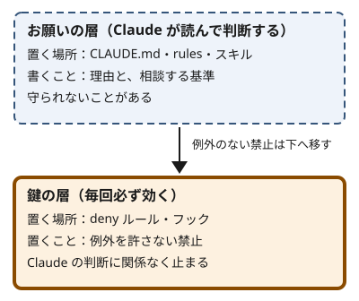

!!! abstract "要点"
    - **何ができるか**：CLAUDE.md・rules・スキルに書いた指示が破られる原因を、見えていない・散らかっている・縛っていないの順に安く確かめられる。書き方を直すか、どれを仕組み（鍵）に移すかも決められる。会話の中で頼んだだけの指示は、このページの対象外である。
    - **いつ引くか**：CLAUDE.md に書いても守られないとき。長い会話の途中から、CLAUDE.md などに書いた規則を無視し始めたとき。作ったスキルが使われないとき。CLAUDE.md を書き足すほど守られなくなったとき。決めたコマンド（uv・pnpm など）を使わず別の方法で実行されるとき。
    - **前提**：<!-- link:begin request-vs-lock -->[お願いと鍵（決定論的か、非決定論的か）](../basics/request-vs-lock.md)<!-- link:end -->、<!-- link:begin where-instructions-sit -->[システムプロンプト・ユーザーメッセージ・CLAUDE.md の位置](../basics/where-instructions-sit.md)<!-- link:end -->

<!-- textlint-disable -->
別名：指示を無視される・CLAUDE.md が効かない・skill が使われない・ルールを破られる・決めたコマンドを使わない
<!-- textlint-enable -->

CLAUDE.md や指示が守られない原因は、見えていない（規則が Claude から見えない）、散らかっている（ほかの文の中で埋もれている）、縛っていない（読まれたうえで Claude の判断で外せる）の 3 つに分けられる。CLAUDE.md は強制する設定ではなく、文脈として渡されるお願い（Claude が読んで判断する指示）なので、縛っていない原因は、書き方を直しても完全には消えない。このページは、安く確かめられる順に原因を切り分け、書き方を直すか、仕組み（鍵。毎回必ず効く制御）に移すかを決める。

## よくある形 {#forms}

困りごとの言い方ごとに、先に疑う原因を添える。原因は 3 つで、見えていない（規則が Claude に届いていない）、散らかっている（ほかの文に埋もれている）、縛っていない（読まれたうえで外される）である。確かめ方は、下の診断にある。

- **CLAUDE.md に書いたが守られない**：「コミットの前にテストを走らせる」と書いても、テストを走らせないままコミットする。原因は分からないので、診断を上から順にたどる。
- **長い会話の途中から規則を無視し始める**：始めは守っていた規則を、作業が進むと破る。CLAUDE.md などに書いた規則は、圧縮（長い会話を要約に置き換えること）の後に消えるものがあるので、先に「見えていない」を疑う。会話の中だけで言った規則は、このページの対象外である。飛び先は、[原因を安く確かめる順](#diagnosis)の冒頭に書いた。
- **作ったスキルが使われない**：使ってほしい場面で、Claude がスキルを呼ばない。先に「見えていない」を疑う。
- **CLAUDE.md を書き足すほど守られなくなった**：破られるたびに一行足したら、前から守られていた規則まで破られ始める。先に「散らかっている」を疑う。
- **決めたコマンド（uv・pnpm など）を使わず別の方法で実行する**：uv で管理するはずが pip で入れる。まず CLAUDE.md が読み込まれているかを確かめ、読まれていて埋もれてもいなければ、「縛っていない」を疑う。

## 原因を安く確かめる順 {#diagnosis}

守られなかった規則を 1 つ選び、書いた場所と、守られなかった場面（会話のどのあたりか、どのファイルを扱っていたか）を控える。上から順に確かめる。上の原因ほど、確かめる手間が小さい。

このページが扱うのは、CLAUDE.md・rules・スキルのように、書いて置いた指示である。会話の中で頼んだだけの指示が守られないときは、先に「<!-- link:begin not-what-i-meant -->[意図と違うものが出てくる](not-what-i-meant.md)<!-- link:end -->」と「<!-- link:begin forgets-in-long-chats -->[長い会話で前提を忘れる・雑になる](forgets-in-long-chats.md)<!-- link:end -->」を見る。圧縮の後に忘れたなら、「<!-- link:begin forgot-after-compaction -->[圧縮の後に約束を忘れた](forgot-after-compaction.md)<!-- link:end -->」も見る。

各項目で原因を直したら、新しい会話を始め、破られた依頼をもう一度出して、守られるかを見る。何度か出しても破られるなら、次の項目に進む。

1. **見えていない**：規則が、守られなかった時点の Claude の手元に入っていない。置いた場所と、読み込まれる時期を確かめる。

    === "アプリ"

        - アプリには、指示の置き場所が複数ある（Claude への指示・プロジェクトの指示・メモリ・スキル）。効く範囲と読まれる時期は、置き場所ごとに違う。規則を書いた場所を思い出し、守られなかったチャットにその場所の指示が届くかを見る。たとえば、プロジェクトの指示は、そのプロジェクトの中のチャットにだけ効く。規則をプロジェクトの指示に書いたのに、プロジェクトの外で始めたチャットで頼んでいたなら、原因は「見えていない」である。
        - 置き場所の比べ方は「<!-- link:begin where-to-put-instructions -->[アプリの指示の置き場所（Claude への指示・プロジェクト・メモリ・スキル）](../app/where-to-put-instructions.md)<!-- link:end -->」にある。
        - 作ったスキルが使われないときの確かめ方は、アプリでは未確認である。

    === "Claude Code"

        - **CLAUDE.md の規則**：`/context all` を実行し、**Memory files** の一覧に、効かせたい CLAUDE.md が出ているかを見る。出ていなければ、Claude には見えていない。ただし、サブフォルダの CLAUDE.md は、読まれるまで一覧に出ない。`/memory` は、CLAUDE.md の置き場所の一覧を出し、選んだファイルを開く。
        - **スキル**：先に `/<スキル名>` で直接呼ぶ（`user-invocable: false` のスキルは呼べない）。動けば、スキルは読み込まれていて、原因は説明（description）が Claude に届いていないか、説明に合う依頼になっていないかである。確かめ方は、下の「スキルの説明が届かない」の項にある。

        それで分からないときは、次を見る。

        - **サブフォルダの CLAUDE.md・paths 付きの rules**：どちらも起動時には読まれない。サブフォルダの CLAUDE.md は、Claude がそのフォルダのファイルを読み書きしたときに読まれる。paths 付きの rules は、rules のファイルの先頭に `paths` で対象のファイルを指定したもので、一致するファイルを扱ったときに読まれる。サブフォルダの CLAUDE.md が読まれると、端末に `Loaded` の行が出るので、それで確かめる。どのファイルがいつ、なぜ読まれたかを残したいときは、InstructionsLoaded フック（CLAUDE.md や rules が読み込まれたときに動くフック）で記録できる。
        - **文字数の上限**：サブフォルダの CLAUDE.md と、必要なときに読まれる rules には、1 ファイルごとの文字数の上限があり、超えると先頭しか入らない。上限の値は、コンテキストの窓の大きさとモデルで違う。`wc -m` で文字数を数え、公式の[How Claude remembers your project](https://code.claude.com/docs/en/memory#claude-ignores-the-end-of-my-subdirectory-claude-md)にある上限と比べる。
        - **圧縮の後**：圧縮（長い会話の要約への置き換え）の後に守られなくなったなら、規則の置き場所を見る。プロジェクトの根の CLAUDE.md は、圧縮の後もディスクから入れ直される。消えているのは、会話の中だけで言った規則、まだ読み直されていないサブフォルダの CLAUDE.md、その後に一致するファイルを扱っていない paths 付きの rules のどれかである。会話だけで言った規則は、CLAUDE.md に書いて残す。
        - **サブエージェント**：サブエージェントに任せた作業で破られたなら、そのサブエージェントが CLAUDE.md を読んで始まったかを見る。組み込みの Explore と Plan は、CLAUDE.md を読まずに始まる。ほかのサブエージェントは、定義で `omitClaudeMd` を設定しない限り、読んで始まる。CLAUDE.md を読まないサブエージェントに守らせたい規則は、任せる依頼の文にあらためて書く。例外を許さない規則は、鍵に移す。settings.json のフックと権限ルールは、サブエージェントの道具の呼び出しにも効く。
        - **スキルの説明が届かない**：説明が Claude に届かない原因は、次の 3 つである。front matter の YAML が壊れていると、説明が空のまま読み込まれる（`--debug` で誤りが出る）。`disable-model-invocation: true` のスキルは、自動では呼ばれない。スキルが多いと、セッション開始に入るスキルの名前と説明の一覧が予算に収まらず、説明が削られる（`/context` の Skills の行と `/doctor` で一覧の大きさを見る）。説明は届いているのに呼ばれないなら、書き方を見直す。直し方は「<!-- link:begin skill-descriptions -->スキルの description の書き方（準備中）<!-- link:end -->」にある。

2. **散らかっている**：規則は届いているが、長さ・食い違い・古い指示・強調の重なりに埋もれている。長いファイルはコンテキストを多く使い、守られにくくなる。

    === "アプリ"

        - 個人の指示と組織の指示が直接食い違うと、組織の指示が優先される（まれに例外がある。詳しくは次の「縛っていない」の項）。個人の指示は、組織の指示が触れていない所で効く。組織の指示がある環境では、規則が食い違っていないかを見る。
        - 指示を足すほど、古い指示や似た指示が混ざる。置き場所をまたいで読み直し、消せるものを消す。

    === "Claude Code"

        - 起動時と `/status` に、推奨の長さを超えたファイルの警告が出ていないかを見る。推奨の長さは、公式が 1 ファイルあたりの行数で示している（[How Claude remembers your project](https://code.claude.com/docs/en/memory)の「Write effective instructions」の節）。出ているなら、まず削る。
        - 警告は 1 ファイルごとに数え、CLAUDE.md、rules のファイル、`@path` で取り込んだファイルを、それぞれ別のファイルとして扱う。そのため、`@path` で分けると 1 ファイルごとの警告は減るが、読み込まれる量は減らない。各ファイルが推奨の長さに収まっていても、合計が上限を超えると、別の警告が出る。
        - `/doctor` が、リポジトリに入れた CLAUDE.md の削れる部分を提案する。ディレクトリ構成や依存の一覧のように、コードから分かる内容が対象である。`/doctor prompt-audit` は、古いモデル向けに書いた指示、存在しないファイルやコマンドへの参照、食い違うファイルを洗い出して報告する。頼むまで、ファイルは書き換えない。
        - ユーザーの CLAUDE.md、プロジェクトの CLAUDE.md、サブフォルダの CLAUDE.md、rules を通して、同じ振る舞いに別の指示がないかを探す。食い違う指示があると、Claude はどちらかを恣意的に選ぶことがある。
        - コミットや PR の規則を書いたなら、Claude Code が自分で足す指針と競合していないかを見る。組み込みの分は `includeGitInstructions` で外せ、署名の文は `attribution` で決められる。
        - 強調（IMPORTANT・YOU MUST・全部が大文字）を足して直そうとしていないかを見る。足しても直らない行は、ファイルが長すぎて埋もれているか、例外を許さない規則かのどちらかである。強調を重ねると、規則を当てはめすぎる原因にもなる。詳しくは「<!-- link:begin emphasis-words -->強調語（IMPORTANT・必ず）の現在（準備中）<!-- link:end -->」にある。

3. **縛っていない**：「見えていない」と「散らかっている」を直しても破られるなら、規則は届いていて、埋もれてもいない。CLAUDE.md・rules・スキルの指示は、Claude が読んで判断するお願いなので、読まれたうえで外れることがある。外れて困る規則を洗い出して、鍵（毎回必ず効く制御）へ移す候補にする。

    - 同じ注意を 2 回したか。強調して頼んでも破られたか。会話で言った禁止が圧縮で消えたか。1 つでも当てはまれば、鍵に移す合図である。判断の手順は「<!-- link:begin when-to-lock -->[お願いを鍵に移す判断](../enforce/when-to-lock.md)<!-- link:end -->」にある。
    - 破られると困る規則か、例外があるかを自分に問う。例外を許さない規則は鍵に移し、CLAUDE.md には理由と相談の基準を残す。例外がある規則は、鍵に移さず、お願いのまま、理由と相談の基準を書く。

    === "アプリ"

        - アプリの指示は、Claude への指示・プロジェクトの指示・組織の指示のどれも、Claude が読んで判断するお願いである。組織の指示は個人の指示より優先され、直接食い違うときは組織の指示に従う。ただし、この優先の決まり自体がプロンプトの層の指示なので、直接食い違う指示では、まれに挙動が一定にならない、と公式が書く。
        - 毎回必ず効かせたい規則に使える鍵は、面ごとに違う。アプリで使える鍵があるかは、この教材ではまだ確かめていない（未確認）。用途ごとの手段は「<!-- link:begin request-lock-table -->お願いと鍵の対応表（準備中）<!-- link:end -->」で見る。守られないと困る規則は、出力を人が確かめる手を足す。

    === "Claude Code"

        - 鍵の選び方（権限ルールの deny か、フックか）は、[予防の節](#prevention)に書いた。
        - 決めたコマンドを使わない場合は、まず CLAUDE.md にコマンドと理由を書く。それでも破られるなら、PreToolUse（道具を呼ぶ直前に動くフックのイベント）のフックで止める。フックの考え方は「<!-- link:begin hooks-basics -->[フックの考え方とイベント](../enforce/hooks-basics.md)<!-- link:end -->」にある。
        - 決めたコマンドが使われない報告と対処は、実践者の記事にある。pip で入れる、指示しても `uv pip install` を使う、という報告が[Basic Claude Code](https://harper.blog/2025/05/08/basic-claude-code/)に、誤ったコマンドを PATH 上の代わりの実行ファイルで止め、`uv run python` を案内する対処が[Agentic Coding Things That Didn’t Work](https://lucumr.pocoo.org/2025/7/30/things-that-didnt-work/)にある（根拠：弱）。
        - スキルの手順が、最初は守られ、後から守られなくなるなら、毎回必ず走らせる分をフックに移す。Claude の判断で使う分は、作業の間ずっと当てはまる指示の形に書き直す。公式が勧める書き方で、たとえば「最初に型を確かめる」のような一度きりの手順は、「型を変えるたびに確かめる」と書く。圧縮の後は、呼んだスキルの本文が外れていることがあるので、外れたと思うときは呼び直す。

1 から 3 のどれを直しても破られ続けるときは、設定を外して同じ依頼を比べ、不調が自分の設定から来るかを切り分ける。方法は「<!-- link:begin isolate-with-safe-mode -->設定を外して切り分ける（--safe-mode）（準備中）<!-- link:end -->」にある。

原因が分かったら、次の表の先へ進む。

<!-- gen:begin routes -->
<!-- textlint-disable -->

| 原因 | 対処のページ（近い順） |
| --- | --- |
| 見えていない | [/context で中身を見る](../context/inspect-context.md)<br>CLAUDE.md の階層と読み込み順（準備中）<br>スキルの description の書き方（準備中） |
| 散らかっている | [CLAUDE.md の長さと剪定](../extend/claude-md-length.md)<br>[CLAUDE.md に書くこと・書かないこと](../extend/what-to-put-in-claude-md.md)<br>.claude/rules と paths で必要なときだけ読ませる（準備中） |
| 縛っていない | [お願いを鍵に移す判断](../enforce/when-to-lock.md)<br>[権限ルール（allow・ask・deny）](../enforce/permission-rules.md)<br>代表的なフックのレシピ › 決めたコマンドへ誘導する（pip の代わりに uv など）（準備中） |

<!-- textlint-enable -->
<!-- gen:end routes -->

## 判断例 {#examples}

!!! example "判断例：書き足すほど守られなくなった CLAUDE.md"
    - **状況**：Claude が規則を破るたびに、CLAUDE.md へ一行足してきた。長くなり、前から守られていた規則まで破られ始めた。
    - **迷う候補**：重要な行を強調する。ファイルを分けて `@` で取り込む。行を剪定する。例外のない規則を鍵に移す。
    - **選んだもの**：行ごとに「消したら誤りが出るか」で剪定し、残った規則のうち例外のない禁止だけを deny ルールかフックに移す。
    - **理由**：取り込みは整理にはなるが、読み込まれる量は減らない。強調は埋もれを直さず、規則を当てはめすぎる原因にもなる。ファイルが短いほど、残した規則は守られやすい。それでも破られる例外のない禁止は、お願いのままでは毎回は守られないので、鍵に移す。

!!! example "判断例：uv を使う決めなのに pip で入れられる"
    - **状況**：プロジェクトは uv で依存を管理している。CLAUDE.md に「uv を使う」と書いたが、ときどき `pip install` で入れられ、`uv.lock` とずれる。
    - **迷う候補**：「必ず」と強調して書く。手順を細かく書き足す。`pip install` を PreToolUse のフックで止め、`uv add` を案内する。
    - **選んだもの**：先に、CLAUDE.md の既存の一行を、使うコマンドと理由が分かる形に置き換える（雛形は[予防の節](#prevention)）。行は足さない。それでも破られるなら、フックで止めて、理由と代わりの手段を返す。CLAUDE.md には、理由と相談の基準を残す。
    - **理由**：コマンドの選び方は例外が少なく、破られると `uv.lock` とずれて困る。強調は埋もれを直さず、書き足しはファイルを長くする。お願いのままでは、どちらも毎回は守られない。一行の置き換えは手間が小さく、先に試せる。フックは、当てる範囲を絞り、効いたかを確かめてから常設する手間がかかる。止めるときに理由と代わりの手段を返せば、回り込み（止められた操作を、別の手で通そうとすること）を減らせる。

## 予防：繰り返す規則は鍵に移す {#prevention}

CLAUDE.md や指示を直しても、同じ規則が破られ続けるときは、書き方を磨くより先に、鍵へ移す。移す合図は、次のどれかである。

- 同じ注意を 2 回した。
- 強調しても破られた。
- 会話で言った禁止が、圧縮（長い会話の要約への置き換え）で消えた。

規則は二層で持つ（この辞典の推奨）。例外を許さない禁止は、deny ルールかフックで止める。CLAUDE.md には、その規則の理由と、例外が要りそうなときに相談する基準だけを書く。お願いだけだと、毎回は守られない。鍵だけだと、Claude が試みた後で止めることになり、止められた操作を別の手で通そうとする回り込みも起きうる。CLAUDE.md が試みる前に理由を知らせておけば、無駄な試みと回り込みを減らせる。



規則を置く 5 つの仕組みを層で分けると、お願いは CLAUDE.md・rules・スキルで、鍵はフックと権限である。次の表は Claude Code の分で、強制力・読み込まれる時期・コンテキストの使い方・圧縮の後の扱いを並べる。

<!-- gen:begin compare 強制力 読み込みの時期 コンテキストのコスト 圧縮で残るか -->
<!-- textlint-disable -->

| 機能 | 強制力 | 読み込みの時期 | コンテキストのコスト | 圧縮で残るか |
| --- | --- | --- | --- | --- |
| [CLAUDE.md](../extend/what-to-put-in-claude-md.md) | お願い | セッション開始 | 常駐 | 残る |
| rules（.claude/rules/）（準備中） | お願い | セッション開始か、一致するファイルを扱うとき | 常駐か、一致するファイルのときだけ | 条件による |
| [スキル（skills）](../extend/writing-skills.md) | お願い | セッション開始と使うとき | 使うまで小さい | 残る |
| [フック（hooks）](../enforce/hooks-basics.md) | 鍵 | イベントが起きたとき | ゼロ（出力を返さない限り） | 残る |
| [権限（permissions）](../enforce/permission-rules.md) | 鍵 | — | — | 残る |

<!-- textlint-enable -->
<!-- gen:end compare 強制力 読み込みの時期 コンテキストのコスト 圧縮で残るか -->

表の読み方は、次の 3 つである。

- 「常駐」は、読み込まれた後、会話の間コンテキストに居続けることを指す。「—」は、その欄に値を置いていないことを指す。
- 「圧縮で残るか」の「残る」の中身は、機能ごとに違う。スキルは、新しい版では名前と説明の一覧が入れ直され、呼んだスキルの本文は、上限つきで入れ直されて古いものから外れる。
- rules の「条件による」は、答えが paths の有無で変わり、1 語で書けないことを指す。paths のない rules は圧縮の後も残り、paths 付きの rules は、一致するファイルを再び扱うまで戻らない。

CLAUDE.md の側には、使うコマンド、理由、例外のときの相談の基準を書く。次の雛形は、uv の例である。鍵の側の雛形は「<!-- link:begin hook-recipes#redirect-commands -->代表的なフックのレシピ › 決めたコマンドへ誘導する（pip の代わりに uv など）（準備中）<!-- link:end -->」にある。

<!-- gen:begin snippet instructions-ignored/claude-md-command-rule -->
<!-- textlint-disable -->

??? example "雛形：CLAUDE.md の例（使うコマンド・理由・相談の基準）"

    ```markdown
    ## Python の依存とコマンド

    - 依存の追加は `uv add <パッケージ>`、実行は `uv run <コマンド>` で行う。
    - `pip install` と `uv pip install` は使わない。`uv.lock` とずれて、ほかの環境で再現できなくなるため。
    - uv で入らない依存が要るときは、実行する前に理由を添えて確認する。
    ```

    動作を確かめていない雛形。

<!-- textlint-enable -->
<!-- gen:end snippet instructions-ignored/claude-md-command-rule -->

鍵は、規則の種類で選ぶ。

- **道具やファイルの使用を禁じる規則**：権限ルールの deny にする。権限ルールは、モデルでなく Claude Code が強制し、deny はどのモードでも止める。ただし、限界が 2 つある。1 つ目は、パスの書き方が合わないルールは当たらないことである。先頭が `/` 1 つのパスは、ファイルシステムの根でなく、設定を置いた場所を基準にする。2 つ目は、子プロセスには効かない場合があることである。Python のスクリプトが自分でファイルを開くときは、Read の deny は働かない。詳しくは「<!-- link:begin permission-rules -->[権限ルール（allow・ask・deny）](../enforce/permission-rules.md)<!-- link:end -->」にある。
- **決めたコマンドへの誘導や、危ない操作の遮断**：PreToolUse（道具を呼ぶ直前に動くフックのイベント）のフックにする。止めるときは、理由と代わりの手段を返す。返し方は「<!-- link:begin block-with-exit-2 -->[フックで止めて理由を返す（exit 2 と JSON）](../enforce/block-with-exit-2.md)<!-- link:end -->」にある。フックは会話の外で動くので、圧縮の後も効く。鍵に数えるのは、コマンドなどの決まった処理を走らせるフックである。prompt と agent の型のフックは、別のモデルが判断するので、鍵に数えない。
- **決まった手順**：スキルのままにするか、フックで必ず走らせるかは、「<!-- link:begin hook-vs-skill -->フックとスキルの違い（準備中）<!-- link:end -->」で選ぶ。

鍵を足したら、効いたかを確かめる。壊れても困らない操作（たとえば、中身のない試験用のファイルの読み取り）をわざと頼み、止まることを見る。止まらなければ、ルールの書き方と、当てはまる範囲を見直す。

縛りを足しすぎると、止めすぎと回り込みが起きる。鍵にする規則は絞り、止めた記録を見直す。見直し方は「<!-- link:begin lock-side-effects -->縛りすぎの害と見直し（止めすぎ・回り込み）（準備中）<!-- link:end -->」にある。

<!-- gen:begin references -->
<!-- textlint-disable -->

## 参考 {#references}

- [How Claude remembers your project](https://code.claude.com/docs/en/memory)：Anthropic・英語・確認日 2026-11-04
- [Extend Claude with skills](https://code.claude.com/docs/en/skills)：Anthropic・英語・確認日 2026-11-04
- [Create custom subagents](https://code.claude.com/docs/en/sub-agents)：Anthropic・英語・確認日 2026-11-04
- [Best practices for Claude Code](https://code.claude.com/docs/en/best-practices)：Anthropic・英語・確認日 2026-11-04
- [Automate actions with hooks](https://code.claude.com/docs/en/hooks-guide)：Anthropic・英語・確認日 2026-11-04
- [Configure permissions](https://code.claude.com/docs/en/permissions)：Anthropic・英語・確認日 2026-11-04
- [Explore the context window](https://code.claude.com/docs/en/context-window)：Anthropic・英語・確認日 2026-11-04
- [Set organization instructions](https://support.claude.com/en/articles/14546867-set-organization-instructions)：Anthropic・英語・確認日 2026-11-04
- [Basic Claude Code](https://harper.blog/2025/05/08/basic-claude-code/)：Harper Reed・英語・確認日 2026-11-04
- [Agentic Coding Things That Didn’t Work](https://lucumr.pocoo.org/2025/7/30/things-that-didnt-work/)：Armin Ronacher・英語・確認日 2026-11-04
- [Claude Code Ignores Your CLAUDE.md? It's the Delivery Mechanism, Not a Bug (2026 Fix)](https://www.shareuhack.com/en/posts/claude-code-claude-md-setup-guide-2026)：Shareuhack・英語・確認日 2026-11-04

<!-- textlint-enable -->
<!-- gen:end references -->

<!-- gen:begin page-links -->
<!-- textlint-disable -->

<div class="ca-page-links" markdown>

**前提**

- [お願いと鍵（決定論的か、非決定論的か）](../basics/request-vs-lock.md)
- [システムプロンプト・ユーザーメッセージ・CLAUDE.md の位置](../basics/where-instructions-sit.md)

**次に読む**

- [/context で中身を見る](../context/inspect-context.md)
- CLAUDE.md の階層と読み込み順（準備中）
- スキルの description の書き方（準備中）
- [CLAUDE.md の長さと剪定](../extend/claude-md-length.md)
- [CLAUDE.md に書くこと・書かないこと](../extend/what-to-put-in-claude-md.md)
- .claude/rules と paths で必要なときだけ読ませる（準備中）
- [お願いを鍵に移す判断](../enforce/when-to-lock.md)
- [権限ルール（allow・ask・deny）](../enforce/permission-rules.md)
- ほか 1 ページ

**関連**

- 強調語（IMPORTANT・必ず）の現在（準備中）
- フックとスキルの違い（準備中）
- お願いと鍵の対応表（準備中）
- [フックの考え方とイベント](../enforce/hooks-basics.md)
- [フックで止めて理由を返す（exit 2 と JSON）](../enforce/block-with-exit-2.md)
- [アプリの指示の置き場所（Claude への指示・プロジェクト・メモリ・スキル）](../app/where-to-put-instructions.md)
- /init と最初の CLAUDE.md（準備中）
- [圧縮の後に約束を忘れた](forgot-after-compaction.md)
- [英語で返ってくる](replies-in-english.md)
- [毎回同じ説明をしている](repeating-the-same-explanation.md)
- [文体や表記が揃わない](inconsistent-japanese-style.md)
- 設定を外して切り分ける（--safe-mode）（準備中）
- 縛りすぎの害と見直し（止めすぎ・回り込み）（準備中）
- [失敗の二つの軸と診断の入口](../start/six-causes.md)
- [意図と違うものが出てくる](not-what-i-meant.md)
- [長い会話で前提を忘れる・雑になる](forgets-in-long-chats.md)

</div>

<!-- textlint-enable -->
<!-- gen:end page-links -->
