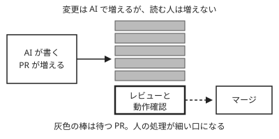

!!! abstract "要点"
    - **何が分かるか**：AI で PR が増えると、人のレビューと動作確認に待ちが積もって詰まり、見守る疲れも溜まる理由が分かる。
    - **いつ引くか**：マネージャーのところで PR が止まるとき。AI で増えた PR を、チームでレビューできる量に合わせて流したいとき。
    - **前提**：<!-- link:begin independent-review -->[書いた本人ではない者にレビューさせる](../verify/independent-review.md)<!-- link:end -->

<!-- textlint-disable -->
別名：レビュー疲れ・review bottleneck
<!-- textlint-enable -->

レビューのボトルネックと疲労は、AI で変更を書く速さが上がっても、読んで確かめて承認する人の速さが上がらないために起きる詰まりと消耗である。ここでは、詰まる場所、事例の数値の読み方、流す量の決め方の順に見る。1 人が並列で動かす本数の判断は <!-- link:begin humans-set-the-parallel-limit -->[並列の上限は人間が決める](../delegate/humans-set-the-parallel-limit.md)<!-- link:end --> が持つ。このページはチームのレビューの流れを扱う。

## 詰まる場所はレビューと動作確認 {#where-it-clogs}

AI で変更が増えたチームで最初に詰まるのは、書く工程ではなく、レビューと動作確認である。書く側は Claude に任せて本数を増やせるが、読んで承認する側は人のままで、人数も 1 日の時間も変わらない。

次の流れで待ちが積もる。

1. メンバーが Claude に作業を任せ始め、PR が増える。
2. 承認する人（多くはマネージャー層）に、読む PR と動かして確かめる PR が集まる。
3. 読む速さは変わらないので、待ちが増え、マージまでの時間が延びる。
4. 待ちを減らそうと急ぐと、中身を読まない承認が増える。確かめていない変更が通りやすくなり、後で直す手間が戻ってくる。

動作確認は、読むだけでは終わらない。差分を読んで筋が通っていても、動かして確かめるまでは、確かめていない変更である。Claude が完了と報告した変更でも、人が動きを見ていなければ同じ扱いになる。この点は <!-- link:begin independent-review#what-happens -->[書いた本人ではない者にレビューさせる › 同じ会話で確かめさせると何が起きるか](../verify/independent-review.md#what-happens)<!-- link:end --> に詳しい。

疲れも同じ場所に溜まる。AI の作業を見守り、出てきたものを確かめる時間そのものが、人の側の負荷になる。承認の確認が多すぎて読まなくなる仕組みは <!-- link:begin approval-fatigue#why -->承認疲れ › なぜ読まなくなるか（準備中）<!-- link:end --> にある。並列にして疲れた、レビューが追いつかないという症状から入るなら、<!-- link:begin parallel-fatigue -->[並列にしたら疲れた・レビューが追いつかない](../symptoms/parallel-fatigue.md)<!-- link:end --> で原因を切り分ける。

## 事例の数値の読み方（自己申告と標本の大きさ） {#reading-case-numbers}

詰まりと疲れの事例として引かれる数値は、どれも小さな標本の自己申告か、自社での計測である。条件を添えて読み、一般化しない。次の 2 件が、よく引かれるものである。

| 事例 | 条件 | 言えること | 言えないこと |
| --- | --- | --- | --- |
| READYFOR の社内アンケート | 開発チーム 12 名、2025 年 7〜9 月、22 項目の自己申告 | 「疲労感が増えた」は 12 人中 5 人（42%）、「並列作業が増えた」は 8 人（66.7%）。 | 「並列作業によって疲れた」という因果。2 つは別々の設問である。 |
| Rehab for JAPAN の導入の振り返り | 3 名ほどのパイロットを含む導入 1 か月、自作の道具での自社計測 | マネージャー層の PR が 16 件から 56 件に増え、マージまでの時間が 93.5% 延びた。全体の PR は 64.5% 増え、メンバー層のマージまでの時間は 33% 短くなった。 | 他の組織でも同じ割合で起きること。第三者の検証はない。 |

READYFOR の元の記事は社内アンケートの報告で、筆者は疲労の一因に AI の作業を見守る時間を挙げている（根拠：弱。自己申告、12 名）。Rehab for JAPAN の事例は、筆者が、増えた PR のレビューと動作確認に時間がかかったためと推定している（根拠：弱。自社計測、導入 1 か月）。

この 2 件から言えるのは、小さなチームで、AI の導入の後にレビュー側の負荷が目に見えた例がある、というところまでである。同じ事例で、メンバー層のマージまでの時間は短くなっている。書く側は速くなり、承認が集まる層だけが遅くなる、という形は読み取れる（推論。標本が小さく、他の原因は分けられていない）。

数値に出会ったときは、次の 4 点を確かめる。

- **誰が・何人で**：標本の大きさと、答えた人の立場を見る。
- **いつ・どれだけの期間か**：導入 1 か月と 3 か月では、慣れの度合いが違う。
- **どう測ったか**：自己申告か、ログの計測か。自作の道具で測ったかも見る。
- **因果を言っているか**：「増えた」と「〜のせいで増えた」は別の主張である。

自分のチームに当てはめるときは、他社の割合を目標や予測に使わない。自分のチームで同じ物差しの記録を取る。方法は <!-- link:begin felt-vs-measured#what-to-record -->[体感と実測 › 記録で測るもの](../eval/felt-vs-measured.md#what-to-record)<!-- link:end --> にある。

## 流す量をレビューに合わせる {#match-review-capacity}

流す量は、変更を出せる速さではなく、人が確かめられる量に合わせる。上限を先に置いてから、読む量を減らす手段を足す。

1. **詰まりを測る。** PR が出てから承認されるまでの時間、承認が集まっている人、差し戻しの回数を記録する。「回っている気がする」という体感だけで判断しない。体感と実測がずれる理由は <!-- link:begin felt-vs-measured#why -->[体感と実測 › なぜ体感はずれるか](../eval/felt-vs-measured.md#why)<!-- link:end --> にある。
2. **流す量に上限を置く。** 1 人が 1 日に動かして確かめられる PR の数を、実際の記録から見積もり、それを超えて出さない。レビューが要る本流は少なく、使い捨ての調査や試作は多めにしてよい。分け方は <!-- link:begin humans-set-the-parallel-limit#mainline-vs-scouting -->[並列の上限は人間が決める › 本流と偵察で本数を分ける](../delegate/humans-set-the-parallel-limit.md#mainline-vs-scouting)<!-- link:end --> にある。
3. **読む深さを分ける。** すべての PR を同じ深さで読まない。リスクの段に分けて、段ごとに人の承認の数と読む深さを決める。段の決め方は <!-- link:begin risk-tiered-approval#three-tiers -->リスク段階別の承認（AI の承認を人の承認に数えない） › 三つの段と承認の数（準備中）<!-- link:end --> に、人が必ず読む箇所は <!-- link:begin diffs-humans-must-read#red-flags -->人間が読むべき差分の箇所 › 赤信号の一覧（準備中）<!-- link:end --> にある。
4. **AI のレビューは下ごしらえに使う。** 人が見る前に指摘を出させて、読む手間を減らす。承認は人が決める。AI の承認は人の承認に数えない（<!-- link:begin risk-tiered-approval#ai-approval-doesnt-count -->リスク段階別の承認（AI の承認を人の承認に数えない） › AI の承認を数えない（準備中）<!-- link:end -->）。仕組みは <!-- link:begin automated-pr-review -->自動 PR レビュー（Code Review・/ultrareview）（準備中）<!-- link:end --> にある。
5. **見落としを観点に戻す。** 見落としが見つかったら、その理由をレビューの観点に足す。育て方は <!-- link:begin grow-review-checklists -->レビューの観点を育てる（準備中）<!-- link:end --> にある。

AI のレビューについては、実践者の報告が 1 件ある。ある開発組織は、AI にコードレビューを任せて、1 件あたり 10〜15 分かかっていたのが 2〜3 分ほどになったと書いている。時間を測った条件は記事に書かれていない（根拠：弱。自己申告）。同じ記事の筆者は、承認までを自動にしたのは「やりすぎ」だったとして、承認を自動にしないルールを置いた。下ごしらえは AI に、承認は人に、と分けた形である。

!!! example "判断例：週の PR が倍になり、マネージャー 1 人に承認が集まった"
    - **状況**：Claude Code でメンバーが作業を任せ始め、週の PR が倍になった。承認はマネージャー 1 人に集まり、レビュー待ちは数日続いている。
    - **迷う候補**：承認できる人を増やして、すべての PR を今までどおりの深さで読む。または、PR を出す数に上限を置き、リスクの低いものは読む深さを浅くする。
    - **選んだもの**：まず上限を置き、リスクの段で読む深さを分ける。承認者を増やす話は、記録を見てから決める。
    - **理由**：承認者を増やすと 1 人あたりは減るが、全体で確かめる量は減らず、確かめられる人もすぐには増えない。上限と段は数日で試せて、測りながら戻せる。危ない場所は常に人が見る決まりを先に置けば、浅く読む PR が増えても守りは残る。

## どの原理・どの原因に関わるか {#principles-and-causes}

このページが関わる原理は「確かめる」と「握る」、防ぐ原因は「確かめていない」、人の側の落とし穴は「預けすぎる」と「体感を信じる」である。

- **確かめる（原理）／確かめていない（Claude 側の原因）**：Claude は、動かして確かめていない変更を、完了として出すことがある。最後の確かめを受け持つのは、レビューと動作確認である。量が確かめる力を超えると、確かめたつもりの承認が増える。確かめる役を書いた本人から離す理由は <!-- link:begin independent-review -->[書いた本人ではない者にレビューさせる](../verify/independent-review.md)<!-- link:end --> にある。
- **握る（原理）／預けすぎる（落とし穴）**：何をどの深さで承認するか、どれだけ流すかは人が決める。承認まで AI に預けると、AI の同意を根拠にしてしまう。役割の分け方は <!-- link:begin separate-roles#against-sycophancy -->役割を分ける（書く人・承認する人・疑う人） › 迎合と過信に備える（AI の同意を根拠に数えない）（準備中）<!-- link:end --> にある。
- **体感を信じる（落とし穴）**：変更が次々に出て回っている感覚は、待ちが積もっていることを隠す。実測で見る。根拠の強さは <!-- link:begin felt-vs-measured#evidence -->[体感と実測 › 何が起きるか（研究と根拠の強さ）](../eval/felt-vs-measured.md#evidence)<!-- link:end --> にある。

AI は組織の土台の強さも弱さも増幅する。広げる前にテストとレビューの体制を見直す考え方は <!-- link:begin paved-roads#amplifier -->禁止ではなく安全な道を作る › AI は土台の強さも弱さも増幅する（広げる前に見直すもの）（準備中）<!-- link:end --> にある。

## よくある誤解 {#misconceptions}

- **「AI にレビューさせれば解消する」**：AI のレビューは、人が見る前の指摘を増やす。人の承認の代わりにはならず、指摘の採否も人が決める。限界は <!-- link:begin independent-review#limits -->[書いた本人ではない者にレビューさせる › 効かない場面と誤解](../verify/independent-review.md#limits)<!-- link:end --> にある。
- **「疲れは並列にしたせいだ」**：READYFOR の例は、疲労と並列の増加を別々の設問で聞いたもので、因果を示していない。原因は並べる数・確かめ方・体感のずれのどれかを切り分けて探す。
- **「詰まるのはマネージャー層だけだ」**：Rehab for JAPAN の例では、マネージャー層で延びていた。承認が集まる層だったためと読める（推論。1 件の自社計測からの読み取り）。チームによって、詰まる人は違う。自分のチームの記録で見る。
- **「承認者を増やせば解決する」**：読む人が増えれば 1 人あたりの量は減る。しかし全体の量は変わらず、確かめられる人は急には増えない。上限と読む深さの分け方を先に決め、人を足すかは記録を見て決める。

<!-- gen:begin references -->
<!-- textlint-disable -->

## 参考 {#references}

- [Claude Code導入3ヶ月後の社内アンケートから分かったこと](https://zenn.dev/resqnet/articles/a1cfd81a562e07)：Zenn（resqnet）・確認日 2026-11-04
- [Claude Code導入による開発効率化と全社展開までの段階的アプローチ](https://findy-tools.io/products/claudecode/1065/825)：Findy Tools・確認日 2026-11-04
- [Claude にコードレビューを任せてみて気づいたこと](https://tech.asoview.co.jp/entry/2026/08/12/113238)：asoview! Tech Blog・確認日 2026-11-04

<!-- textlint-enable -->
<!-- gen:end references -->

<!-- gen:begin page-links -->
<!-- textlint-disable -->

**前提**

- [書いた本人ではない者にレビューさせる](../verify/independent-review.md)

**関連**

- [並列の上限は人間が決める](../delegate/humans-set-the-parallel-limit.md)
- [並列にしたら疲れた・レビューが追いつかない](../symptoms/parallel-fatigue.md)
- 人間が読むべき差分の箇所（準備中）
- 生成コードを自分のものにする（準備中）
- リスク段階別の承認（AI の承認を人の承認に数えない）（準備中）
- 役割を分ける（書く人・承認する人・疑う人）（準備中）
- レビューの観点を育てる（準備中）
- 自動 PR レビュー（Code Review・/ultrareview）（準備中）
- 承認疲れ（準備中）
- [体感と実測](../eval/felt-vs-measured.md)
- 禁止ではなく安全な道を作る › AI は土台の強さも弱さも増幅する（広げる前に見直すもの）（準備中）

<!-- textlint-enable -->
<!-- gen:end page-links -->
