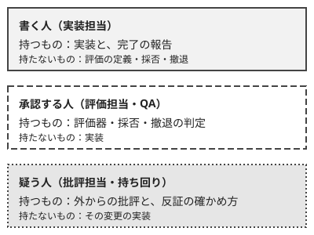

!!! abstract "要点"
    - **何が分かるか**：AI と進めるチームで、書く人・承認する人・疑う人を分けると、評価と撤退を実装する人から離せて、AI の同意を根拠に数えずに済むと分かる。
    - **いつ引くか**：AI と進めるチームで、誰が何を決めるかを決めるとき。実装した人が自分で評価し、撤退も決めているとき。議論で「AI も賛成した」が決め手になっているとき。
    - **前提**：<!-- link:begin independent-review -->[書いた本人ではない者にレビューさせる](../verify/independent-review.md)<!-- link:end -->・<!-- link:begin decide-when-to-quit -->[やめどきを先に決める（撤退基準を着手前に書き、実装者以外が判定する）](../judgment/decide-when-to-quit.md)<!-- link:end -->

<!-- textlint-disable -->
別名：役割分担・評価担当・批評担当・チームで迎合と過信を防ぐ
<!-- textlint-enable -->

役割を分けるとは、AI と進めるチームの仕事を、変更を作る書く人、採否と撤退を決める承認する人、外から指摘する疑う人に割り振り、同じ人が全部を握らないようにすることである。ここでは、分けないと何が起きるか、3 つの役割が持つもの、AI の同意を根拠に数えない決まりの守り方の順に見る。

## 実装した人が評価も撤退も決めると何が起きるか {#what-happens}

作った人が自分で評価して、続けるかやめるかも決めると、確かめていない変更が通り、やめどきが過ぎる。Claude に実装を任せ始めたチームでは、この形が最初に出る。

QA・実装・レビューの形で例を見る。ある機能の改修を、1 人が Claude に任せて進めている。

1. 実装した本人が「テストが通った」「動いた」と報告し、そのまま採用を決める。
2. 評価の基準は、作りながら決まっていく。通ったテストが基準になり、通らないものは「想定外」として外される。
3. 方針が行き詰まっても、費やした分だけ捨てにくく、撤退の判断が先送りになる。
4. 議論になると、Claude に聞いて「その方針でよい」と返ってきたことが、決め手に使われる。

3 は <!-- link:begin decide-when-to-quit#why-escalation -->[やめどきを先に決める（撤退基準を着手前に書き、実装者以外が判定する） › なぜやめられなくなるか](../judgment/decide-when-to-quit.md#why-escalation)<!-- link:end --> の形である。4 は <!-- link:begin agreement-is-not-evidence#agreement-depends-on-asking -->[同意は根拠に数えない（AI レビュアーの一致を含む） › 賛成は聞き方と押し方で増える](../judgment/agreement-is-not-evidence.md#agreement-depends-on-asking)<!-- link:end --> の形で、賛成は聞き方と押し方で増える。どちらも、1 人が書く・承認する・疑うを兼ねることで起きる。

コンテストの長期のチーム戦でも同じ形が出る。そちらの例は <!-- link:begin long-team-competitions#roles -->チーム戦の運用（長期・対戦型） › 役割を分ける（準備中）<!-- link:end --> にある。このページは、業務の形を先に書く。

## 三つの役割が持つもの {#roles}

役割は、書く人・承認する人・疑う人の 3 つで、それぞれが持つものと持たないものを先に決める。人数が足りなければ兼ねてよいが、同じ変更について書く人と承認する人は兼ねない。



| 役割 | 業務での呼び方 | 持つもの | 持たないもの |
| --- | --- | --- | --- |
| 書く人 | 実装担当 | 実装、完了の報告 | 評価の定義、採否、撤退 |
| 承認する人 | 評価担当・QA | 評価器、採否、撤退の判定 | 実装 |
| 疑う人 | 批評担当・レビュー | 外からの批評、反証の確かめ方 | その変更の実装 |

**書く人**は、Claude に実装を任せ、変更を出す。完了の報告は出すが、完了かどうかは決めない。

**承認する人**は、評価の基準を着手前に書き、基準を満たしたかを判定し、やめる条件に達したら撤退を決める。基準を着手前に書く理由と方法は <!-- link:begin decide-when-to-quit#write-criteria-first -->[やめどきを先に決める（撤退基準を着手前に書き、実装者以外が判定する） › 基準を着手前に書く](../judgment/decide-when-to-quit.md#write-criteria-first)<!-- link:end -->、判定を作った本人から離す理由は <!-- link:begin decide-when-to-quit#separate-the-judge -->[やめどきを先に決める（撤退基準を着手前に書き、実装者以外が判定する） › 判定を作った本人から離す](../judgment/decide-when-to-quit.md#separate-the-judge)<!-- link:end --> にある。評価の仕組みを持つなら、検証用のデータを書く人が読めない所に置き、点数だけを返す。分け方は <!-- link:begin lockbox-and-holdout#three-tiers -->[ロックボックスと hold-out（人だけが持つ検証用データ） › 三層に分ける](../eval/lockbox-and-holdout.md#three-tiers)<!-- link:end -->、評価器が満たすべき条件は <!-- link:begin verifier-three-conditions#why -->[検証器の三条件（正しい・書き換えられない・本番を代表する） › 三条件が要る理由](../eval/verifier-three-conditions.md#why)<!-- link:end --> が持つ。

**疑う人**は、変更を外から疑う。作った経緯を知らない状態で、成果物と基準だけを見て、壊れそうな点を挙げる。AI に批評をさせる場合も、この役の仕事に当たる。新しいセッションに成果物と基準だけを渡す理由は <!-- link:begin independent-review#hide-reasoning -->[書いた本人ではない者にレビューさせる › 推論を見せない](../verify/independent-review.md#hide-reasoning)<!-- link:end --> にある。依頼の雛形は次のとおりである。

<!-- gen:begin snippet separate-roles/critic-request -->
<!-- textlint-disable -->

??? example "雛形：疑う人の依頼（成果物と基準だけを渡す）"

    ```markdown
    変更を批評してほしい。作った経緯は知らされていない前提で、次の 2 つだけを見てほしい。

    - 成果物：<変更の差分、または成果物のパス>
    - 基準：<評価担当が着手前に書いた、採る・やめる基準へのパス>

    次の形で答えてほしい。

    1. 基準を満たしていない点（根拠として、差分の場所か実行結果を付ける）
    2. 基準に書かれていないが、壊れそうな点
    3. 1 と 2 のそれぞれについて、誤りだと示せる確かめ方（反証の実験）

    賛成か反対かの結論は書かなくてよい。確かめていないことは「確かめていない」と書いてほしい。
    ```

    動作を確かめていない雛形。

<!-- textlint-enable -->
<!-- gen:end snippet separate-roles/critic-request -->

役割を持ち回りにして、疑う人を日替わりや変更ごとに入れ替える。同じ人が疑う役を続けると、基準に慣れて見落としが増え、「いつも指摘する人」として指摘が軽く扱われやすい（推論・実践例なし）。持ち回りなら、全員が書く人でもあり疑う人でもあるので、指摘が個人への攻撃になりにくい。

どの判断をどの段階でも人が握るべきかは <!-- link:begin what-not-to-delegate#what-humans-hold -->[任せないもの（評価・採否・撤退・中核の理解） › どの段階でも人が握るもの](../delegate/what-not-to-delegate.md#what-humans-hold)<!-- link:end --> が持つ。このページの承認する人と疑う人は、その人が握る判断を、チームの中で誰が持つかに置き換えたものである。

## 迎合と過信に備える（AI の同意を根拠に数えない） {#against-sycophancy}

AI の同意は、チームの判断の根拠に数えない。この決まりを、持ち回りの疑う人の役で守る。

決めることは 3 つある。

- **同意は根拠の欄に書かない**：承認する人の判定の記録に「Claude も賛成」と書かない。書くのは、実行した結果、基準との突き合わせ、疑う人の反証の実験の結果である。何を証拠に数えるかは <!-- link:begin agreement-is-not-evidence#what-counts -->[同意は根拠に数えない（AI レビュアーの一致を含む） › 証拠として数えるもの](../judgment/agreement-is-not-evidence.md#what-counts)<!-- link:end --> が持つ。
- **AI の承認は、人の承認の数に入れない**：AI にレビューをさせるのは構わないが、承認する人の承認とは別に扱う。段ごとの承認の数は <!-- link:begin risk-tiered-approval#ai-approval-doesnt-count -->[リスク段階別の承認（AI の承認を人の承認に数えない） › AI の承認を数えない](risk-tiered-approval.md#ai-approval-doesnt-count)<!-- link:end --> が持つ。
- **疑う人が、同意の取り方を点検する**：賛成を引き出した聞き方を見て、聞き直しを求める。見るのは、好みを添えたか、押したか、成果物でなく経緯を渡したかである。聞き直しの方法は <!-- link:begin ask-without-sycophancy#fresh-context-critique -->[迎合させない聞き方（好みを伏せる・並べて比べる・新しい文脈で批評させる） › 新しい文脈で、成果物と基準だけを見せる](../judgment/ask-without-sycophancy.md#fresh-context-critique)<!-- link:end --> が持つ。

点検を人どうしの批評に任せるのは、聞き方で答えが変わる AI とは別に、人の独立した視点を足せるからである。ただし、チームの人どうしの批評が迎合を減らすことを直接比べた研究は見つけていない（類推）。迎合の側の証拠は、AI が押されると同意に傾き、迎合的な応答のほうが信頼され好まれやすい、という複数の研究にある（根拠：強。人の側の証拠は対人の相談の領域で、技術の判断への当てはめは類推）。詳しくは <!-- link:begin agreement-is-not-evidence#hard-to-notice -->[同意は根拠に数えない（AI レビュアーの一致を含む） › 迎合された応答は信頼され、好まれる](../judgment/agreement-is-not-evidence.md#hard-to-notice)<!-- link:end --> にある。チームでの備えは、安価な備えの 1 つであり、これだけで迎合を防ぎきるものではない。

複数の AI レビュアーが同じ結論を出したときも、同じ扱いである。一致したことは、正しさの証拠に数えない。同じ聞き方・同じ文脈で聞けば似た答えが返りやすいためで、数えない理由は <!-- link:begin agreement-is-not-evidence#reviewer-agreement -->[同意は根拠に数えない（AI レビュアーの一致を含む） › AI レビュアーの一致](../judgment/agreement-is-not-evidence.md#reviewer-agreement)<!-- link:end --> にある。

疑う人に AI を使う場合の手段は、面で違う。

=== "アプリ"

    作った会話とは別の、新しいチャットを開く。成果物と基準だけを貼り、作った経緯のやり取りは貼らない。

=== "Claude Code"

    作ったセッションとは別の、新しいセッションかサブエージェントに、成果物と基準のパスだけを渡す。サブエージェントの作り方は、サブエージェントを扱うページに任せる。

どちらの面でも、AI の返答は疑う人への材料で、結論は承認する人が出す。結論まで AI に預けると、もっともらしい誤りをそのまま採る形になる。預けすぎる理由は <!-- link:begin over-reliance#why-we-hand-over -->[判断を預けすぎる（過度依存） › なぜ預けてしまうか](../judgment/over-reliance.md#why-we-hand-over)<!-- link:end --> が持つ。

!!! example "判断例：疑う人を固定するか、持ち回りにするか"
    - **状況**：4 人のチームが、Claude に任せた改修の採否を決める。専任のレビュー担当はいない。
    - **迷う候補**：レビューに慣れた 1 人を疑う人に固定する案と、変更ごとに疑う人を持ち回りにする案。
    - **選んだもの**：持ち回りにして、疑う人はその変更を書いていない人にする。
    - **理由**：固定すると、その 1 人にレビューが集まって詰まる。持ち回りなら、負荷が散り、書く人と疑う人の兼任も避けられる。固定の案も、レビューに慣れた人が見落としを減らす点では筋が通る。固定にするなら、その人は疑う人に専念させ、指摘を採るかは承認する人が別に決める。

## 何に効くか（どの原理・どの原因に関わるか） {#effects}

役割を分けることは、原理の握るに当たる。評価の定義・採否・撤退を、実装する人から離して、チームの誰かが握る。握る判断の範囲は <!-- link:begin what-not-to-delegate#verifiable-axis -->[任せないもの（評価・採否・撤退・中核の理解） › 分ける軸：機械的に確かめられるか](../delegate/what-not-to-delegate.md#verifiable-axis)<!-- link:end --> の軸で決める。出力を機械的に確かめられるかで、任せるものと握るものを分ける。

もう 1 つの原理は確かめるである。疑う人が、成果物と基準だけを見て反証の確かめ方を出し、承認する人がそれを基準に照らして判定する。

防ぐ原因は、確かめていないである。書く人の「動いた」は、確かめた結果ではなく、確かめていない報告として扱う。確かめるのは別の人で、確かめた根拠が記録に残る。

人の側の落とし穴では、次の 3 つに効く。

- **同意を根拠にする**：AI の賛成を判断の欄に書かない決まりと、疑う人の点検で止める。
- **やめられない**：撤退の判定を書く人から離す。費やした分で方針を捨てにくくなる傾向は、人の現象としてメタ分析がある（根拠：強。組織の意思決定の研究）。AI との組み合わせで強まる点は推論で、研究も実践例もない（推論・実践例なし）。
- **預けすぎる**：AI の返答を材料に落とし、結論を承認する人が出す。判断の課題で人と AI を組み合わせると、人か AI のうち良いほう単独より劣る例がメタ分析にある（根拠：強。2023 年前半までの研究）。詳しくは <!-- link:begin over-reliance#judgment-tasks -->[判断を預けすぎる（過度依存） › 判断の課題で損が出る](../judgment/over-reliance.md#judgment-tasks)<!-- link:end --> にある。

## 効かない場面と誤解 {#limits}

役割を分けても効かない場面がある。

- **小さな人数**：1 人のチームでは、書く人・承認する人・疑う人を人では分けられない。承認する基準を着手前に書き、疑う人を新しいセッションに置き、時間を空けて判定することで、役割の分離に近づける。ただし本人が全部を握る点は変わらない。
- **レビューが増える**：役割を分けると、疑う人と承認する人の仕事が増える。レビューできる量を超えて流すと、確認が形だけになる。流す量の決め方は <!-- link:begin review-bottlenecks#match-review-capacity -->[レビューのボトルネックと疲労 › 流す量をレビューに合わせる](review-bottlenecks.md#match-review-capacity)<!-- link:end --> が持つ。
- **形だけの承認**：承認する人が疑う人の指摘を読まずに通すと、分けた意味がなくなる。指摘を採らなかった理由を記録に残す。記録の残し方は <!-- link:begin record-decisions -->[決定を文書に残す（ADR と週次アップデート）](record-decisions.md)<!-- link:end --> が持つ。
- **効果の根拠**：役割の割り方は、この辞典の推奨の形である。割り方の違いで結果がどう変わるかを比べた研究は見つけていない（推論・実践例なし）。ここで挙げた形を、自分のチームで試して、記録で確かめる。

よくある誤解は次のとおりである。

- **「疑う人は反対する役だ」**：疑う人の仕事は、反証の確かめ方を出すことで、反対の結論を出すことではない。批判を強めすぎない加減は <!-- link:begin ask-without-sycophancy#dont-overdo-criticism -->[迎合させない聞き方（好みを伏せる・並べて比べる・新しい文脈で批評させる） › 批判を強めすぎない](../judgment/ask-without-sycophancy.md#dont-overdo-criticism)<!-- link:end --> にある。
- **「AI を疑う人にすれば、人の疑う人は要らない」**：AI の批評は材料になるが、承認の数には入らない。AI の側が批評でも迎合に寄ることがある。
- **「役割を分ければ、AI の同意を気にしなくてよい」**：分けても、承認する人が AI の賛成を根拠に採れば同じである。決まりを記録の欄に書いて、疑う人が点検する。

<!-- gen:begin page-links -->
<!-- textlint-disable -->

<div class="ca-page-links" markdown>

**前提**

- [書いた本人ではない者にレビューさせる](../verify/independent-review.md)
- [やめどきを先に決める（撤退基準を着手前に書き、実装者以外が判定する）](../judgment/decide-when-to-quit.md)

**次に読む**

- チーム戦の運用（長期・対戦型）（準備中）

**関連**

- [リスク段階別の承認（AI の承認を人の承認に数えない）](risk-tiered-approval.md)
- [同意は根拠に数えない（AI レビュアーの一致を含む）](../judgment/agreement-is-not-evidence.md)
- [判断を預けすぎる（過度依存）](../judgment/over-reliance.md)
- [レビューのボトルネックと疲労](review-bottlenecks.md)
- [迎合させない聞き方（好みを伏せる・並べて比べる・新しい文脈で批評させる）](../judgment/ask-without-sycophancy.md)
- [すぐ同意して意見を変える（迎合）](../symptoms/caves-when-pushed.md)
- 振り返りで AI に評価させない（集計係にとどめる）（準備中）
- [ロックボックスと hold-out（人だけが持つ検証用データ）](../eval/lockbox-and-holdout.md)
- [検証器の三条件（正しい・書き換えられない・本番を代表する）](../eval/verifier-three-conditions.md)
- [任せないもの（評価・採否・撤退・中核の理解）](../delegate/what-not-to-delegate.md)
- 案出しは独立に、突き合わせは AI に（準備中）
- [決定を文書に残す（ADR と週次アップデート）](record-decisions.md)

</div>

<!-- textlint-enable -->
<!-- gen:end page-links -->
