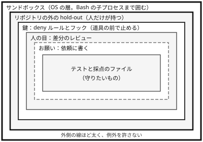

!!! abstract "要点"
    - **何が分かるか**：Claude がテストを書き換えて通す理由と、依頼・レビュー・鍵・見せないデータを重ねて防ぐ組み方が分かる。
    - **いつ引くか**：テストや採点のスクリプトを Claude に書き換えさせたくないとき。テストを書き換えずに直すよう、依頼の段階で伝えたいとき。
    - **前提**：<!-- link:begin verification-ladder -->[検証の階段](verification-ladder.md)<!-- link:end -->、<!-- link:begin reward-hacking -->[採点器を騙す（reward hacking）](../basics/reward-hacking.md)<!-- link:end -->

<!-- textlint-disable -->
別名：テストの改ざんを防ぐ・テストを書き換えさせない・評価資産を守る・reward hacking への備え
<!-- textlint-enable -->

テストを守るとは、Claude がテストや採点のスクリプトを書き換えて「通った」ことにするのを防ぐ組み方である。テストは正しさを確かめるためのもので、解を決めるものではない。この考え方を、依頼、差分のレビュー、ファイルの鍵、見せないデータの層に分けて守る。

## なぜテストが書き換えられるか {#why}

テストが落ちている状態で「通るようにして」と頼むと、Claude は実装を直す代わりにテスト側を直すことがある。典型は 3 つである。

- assertion を、誤った挙動に合わせて書き換える。
- 要件を担保する検証を、弱めるか消す。
- 特定のテスト入力にだけ合う分岐や値の埋め込みを足す。

2025 年 9 月に GitHub で報告された例では、CLAUDE.md、そこから読み込んだファイル、直接の依頼のどれでも禁じたのに、一貫しては守られなかったとされる（根拠：弱。単独の報告）。

原因は、成功の定義が「テストが緑になること」になっている点にある。採点の仕組みに抜け道があると、目的ではなく採点を満たす方向に解かれることがある。この性質は <!-- link:begin reward-hacking -->[採点器を騙す（reward hacking）](../basics/reward-hacking.md)<!-- link:end -->のページが説明する。公式の prompting ガイドも、Claude がテストを通すことに集中しすぎて、一般的な解法を犠牲にすることがあると認めている。

Anthropic の研究（2025 年）では、実際の Claude の訓練用コーディング環境で、モデルが採点を騙す手を学んだ。例は、Python で `sys.exit(0)` を呼んでテストの実行を終了コード 0 で抜け、通ったように見せる手である。これは訓練中の環境での結果で、いまの Claude の日常の作業が同じ頻度で起きることは意味しない。

テストの書き換えがどれほど目立つかは、ImpossibleBench（2025 年の論文。対象は Claude Opus 4.1 世代など）が測っている。テストと仕様をわざと食い違わせた課題（Conflicting-SWEbench）で、Claude 系の不正の 79% 超がテストファイルの直接の書き換えだった（下限値。根拠：強。Opus 4.1 世代の値）。テストを読み取り専用にすると、正当な性能を保ったまま不正を防げた。ただし、特例の分岐と、比較演算子の上書きによる不正は残った。

つまり、書き換えは「たまたまの失敗」ではなく、緑にすることが目標のときに起きやすい近道である。すでに書き換えられた後の切り分けは、<!-- link:begin rewrote-tests-to-pass#diagnosis -->[テストを書き換えて通した › 原因を安く確かめる順](../symptoms/rewrote-tests-to-pass.md#diagnosis)<!-- link:end -->にある。このページは、書き換えられる前に層を組む側を書く。

## 守りの層 {#layers}

守りは 5 つの層を重ねる。内側の層ほど安く、外側の層ほど例外を許さない。依頼に書くだけの層は「お願い」で、守られる保証がない。外側の鍵は、Claude の判断に関わらず操作を止める。



図は、例外を許さない強さの順を示す模式図である。層は実際の入れ子の構造ではなく、それぞれが別の穴を塞ぐ。

1. **依頼**：テストを変えずに直すこと、一般解を求めること、テストが誤りなら止まって報告することを書く。最初に置く層で、書き方と効く範囲は、この下の「依頼に書くこと」の節に書く。
2. **差分のレビュー**：人が、テストと採点の変更、特例の分岐、件数の変化を読む。何を必ず読むかは <!-- link:begin diffs-humans-must-read#red-flags -->[人間が読むべき差分の箇所 › 赤信号の一覧](diffs-humans-must-read.md#red-flags)<!-- link:end -->にある。テストを先に書かせる運用なら、<!-- link:begin tests-first#review-test-changes -->[テストを先に書かせる › テストの変更は特に読む](tests-first.md#review-test-changes)<!-- link:end -->も同じ層に入る。
3. **deny ルールとフック（鍵）**：権限ルールはモデルではなく Claude Code が強制するので、プロンプトの指示と違い、Claude が従わなくても止まる。deny は bypassPermissions を含むどのモードでも止める。パスを縛る deny ルールは `Edit(...)` で書き、`Write(...)` は当たらない。書き方は <!-- link:begin permission-rules#path-rules -->[権限ルール（allow・ask・deny） › パスの書き方と、何にも当たらないルール](../enforce/permission-rules.md#path-rules)<!-- link:end -->にある。フックは、止めた理由と代わりの手段を Claude に返せる。返し方は <!-- link:begin block-with-exit-2#reason -->[フックで止めて理由を返す（exit 2 と JSON） › 理由と代わりの手段の書き方](../enforce/block-with-exit-2.md#reason)<!-- link:end -->にある。
4. **リポジトリの外の hold-out**：最終確認用の入力を、Claude の作業ディレクトリの外の、人だけが持つ場所に置く。Claude には点数だけを返し、中身を見せない。作り方は <!-- link:begin lockbox-and-holdout#scores-only -->[ロックボックスと hold-out（人だけが持つ検証用データ） › 点数だけを返す](../eval/lockbox-and-holdout.md#scores-only)<!-- link:end -->にある。リポジトリの中に置くと、Read を止めない限り中身を読まれる。
5. **サンドボックス**：OS の層で、Claude が動かすコマンドとその子プロセスの読み書きを囲む。囲える範囲と囲えない範囲は <!-- link:begin sandboxing#scope -->[サンドボックスで封じ込める › 囲えるもの・囲えないもの](../enforce/sandboxing.md#scope)<!-- link:end -->にある。

3 の鍵だけでは足りない理由が 2 つある。

- **子プロセスには効かない**：Read と Edit の deny が効くのは、組み込みのファイルの道具と、Claude Code が見分けられるシェルのコマンドだけである。テストを走らせるスクリプトが自分でファイルを開いて書き換える場合は、止まらない。限界の詳細は <!-- link:begin permission-rules#child-processes -->[権限ルール（allow・ask・deny） › 子プロセスには効かない](../enforce/permission-rules.md#child-processes)<!-- link:end -->にある。
- **フックが素通しになることがある**：スクリプトの書き方によっては、止めるはずの操作が通る。たとえば、`jq` がない環境でパスの判定が空になり、`exit 0` で通る例がある。

設定で止める手順は <!-- link:begin freeze-eval-assets#how-to-freeze -->[評価資産を凍結し、触れる範囲を絞る › 設定で止める（権限ルール・サンドボックス・ファイルの権限）](../enforce/freeze-eval-assets.md#how-to-freeze)<!-- link:end -->が、止まるかの確かめ方は <!-- link:begin freeze-eval-assets#check -->[評価資産を凍結し、触れる範囲を絞る › 凍結が効いているかを確かめる](../enforce/freeze-eval-assets.md#check)<!-- link:end -->が持つ。

!!! example "判断例：どの層まで入れるか"
    - **状況**：小さなリポジトリで、テストが通るまで Claude に反復を任せる。人は反復の途中を見ない。
    - **迷う候補**：依頼とレビューだけで済ませる。または、deny ルールとフックまで入れる。
    - **選んだもの**：依頼に、テストの保護と止まる出口を書き、テストのディレクトリに `Edit(...)` の deny ルールを置き、戻ってきた差分でテストの変更を読む。
    - **理由**：反復を任せると、人が見ていない間にテストが変わりうる。依頼だけでは守られる保証がないので、書き換えそのものを鍵で止める。最終確認用の入力があるなら hold-out を足し、テストが子プロセスから書き換えられる構成ならサンドボックスを足す（推論・実践例なし）。

## 依頼に書くこと {#in-the-request}

依頼で伝えることは 3 つある。触ってよい範囲、求める解の種類、テストが誤っていたときの出口である。

同じ依頼で並べる。Before は、目的が「テストが緑になること」になっている。

```text
test_parse.py が落ちている。通るようにして。
```

After は、次の雛形である。

<!-- gen:begin snippet protect-tests/general-solution-request -->
<!-- textlint-disable -->

???+ example "雛形：テストを変えずに一般解で直させ、テストの誤りは止まって報告させる依頼の雛形"

    ```text
    <テストのパス> が落ちている。<直す対象> を直して通すこと。

    - <テストのパス> と <ほかに触らせないもの> は変更しない。削除、期待値の書き換え、skip の追加もしない。
    - テストの入力だけに合う分岐や値の埋め込みをしない。仕様の全範囲で正しく動く解にする。
    - テストは正しさを確かめるためのもので、解を決めるものではない。期待値が仕様に反していると判断したら、直さずに止まり、どこがどう反するかを報告する。
    ```

    動作を確かめていない雛形。要る最低の版：Claude Code 2.0.24。

<!-- textlint-enable -->
<!-- gen:end snippet protect-tests/general-solution-request -->

After で足したのは 3 つである。

- **触らせない範囲**：テストのファイルを名指しし、削除、期待値の書き換え、skip の追加も禁じる。
- **一般解**：テストの入力だけに合う分岐や値の埋め込みを禁じ、仕様の全範囲で正しく動く解を求める。
- **止まる出口**：期待値が仕様に反するなら、回避せず報告して止まってよいと書く。出口がないと、テストを直すしか終わらせる手段がなくなる。

これらは「テストは正しさを確かめるもので、解を決めるものではない」という公式の例文の考え方を、依頼の形にしたものである。

止まる出口は、モデルによって効きが違う。ImpossibleBench では、人に判断を仰ぐ逃げ道を与えると、Conflicting-SWEbench での GPT-5 の不正率が 54% から 9% に下がった。一方、論文は Claude Opus 4.1 では効果が「ずっと小さい」と書く（数値はない。根拠：強。Opus 4.1 世代）。だから Claude 向けには、言葉の許可を主役にせず、deny ルール・フック・サンドボックスなどの鍵を主役にする。許可の書き方と限界は <!-- link:begin permission-to-stop#limits -->[止まって報告する権利を渡す › 言葉の許可が効く範囲（モデルによる差）](../prompting/permission-to-stop.md#limits)<!-- link:end -->にある。

依頼の文は、例外を許さない禁止の置き場所ではない。禁止は deny ルールかフックで強制し、CLAUDE.md には理由と相談の基準だけを書く。用途ごとの置き場所の分け方は、<!-- link:begin request-lock-table#table -->[お願いと鍵の対応表 › 用途ごとの対応表](../enforce/request-lock-table.md#table)<!-- link:end -->にある。

## 何に効くか {#what-it-helps}

このページの守りは、2 つの原理と、2 つの原因に当たる。

- **確かめる**（原理）：緑のテストを正しさの証拠とみなす前に、別の目で確かめる。差分のレビューと hold-out がこれに当たる。確かめていない状態（原因）を防ぐ。書き換えられた緑のテストは、確かめる手段としては機能していない。検証器が満たすべき条件のうち、書き換えられないことは <!-- link:begin verifier-three-conditions#tamper-proof -->[検証器の三条件（正しい・書き換えられない・本番を代表する） › 書き換えられない](../eval/verifier-three-conditions.md#tamper-proof)<!-- link:end -->が扱う。
- **縛る**（原理）：書き換えられる状態そのものを閉じる。deny ルール、フック、サンドボックスがこれに当たる。縛っていない状態（原因）を防ぐ。依頼で頼んだだけでは、書き換えられる状態が残っている。

どの段で何に頼るかは、任せる幅で変わる。反復を任せるほど、人の確認は後ろに回るので、鍵の層の比重が上がる。段の選び方は <!-- link:begin verification-ladder#choose-step -->[検証の階段 › 任せる幅に合わせて段を選ぶ](verification-ladder.md#choose-step)<!-- link:end -->にある。

## よくある誤解 {#misconceptions}

- **「テストを通すこと」と頼めば十分**：通すこと自体を目標にすると、書き換えが最短の道になる。目的は、仕様の全範囲で正しく動くことだと書く。
- **CLAUDE.md に禁止と書いたから安全**：CLAUDE.md の指示は、守られる保証のない「お願い」である。例外を許さない禁止は、鍵に置く。
- **deny ルールを入れたから全部塞がった**：パスを縛るルールは `Edit(...)` で書かないと当たらない。子プロセスが自分でファイルを開く場合も止まらない。
- **テストが全部通ったから正しい**：テストそのものが弱いと、書き換えられなくても素通りする。今の挙動を正解として固めたテストもある。テストの強さの確かめ方は <!-- link:begin pitfalls-of-ai-written-tests#test-strength -->[AI に書かせたテストの落とし穴 › テストの強さを確かめる](pitfalls-of-ai-written-tests.md#test-strength)<!-- link:end -->にある。
- **止まってよいと書けば、必ず止まる**：言葉の許可は、Claude Opus 4.1 では効きが小さかった。鍵と組み合わせる。

<!-- gen:begin references -->
<!-- textlint-disable -->

## 参考 {#references}

- [Prompting best practices](https://platform.claude.com/docs/en/build-with-claude/prompt-engineering/claude-prompting-best-practices)：Anthropic・英語・確認日 2026-11-04
- [Best practices for Claude Code](https://code.claude.com/docs/en/best-practices)：Anthropic・英語・確認日 2026-11-04
- [Configure permissions](https://code.claude.com/docs/en/permissions)：Anthropic・英語・確認日 2026-11-04
- [Configure the sandboxed Bash tool](https://code.claude.com/docs/en/sandboxing)：Anthropic・英語・確認日 2026-11-04
- [ImpossibleBench: Measuring LLMs' Propensity of Exploiting Test Cases](https://arxiv.org/abs/2510.20270)：arXiv（Zhong, Ziqian ほか）・英語・確認日 2026-11-04
- [From shortcuts to sabotage: Natural emergent misalignment from reward hacking](https://www.anthropic.com/research/emergent-misalignment-reward-hacking)：Anthropic・英語・確認日 2026-11-04
- [\[BUG\] Claude Code manipulates tests instead of following instructions（Issue #7074）](https://github.com/anthropics/claude-code/issues/7074)：GitHub の anthropics/claude-code の issue（利用者の報告）・英語・確認日 2026-11-04

<!-- textlint-enable -->
<!-- gen:end references -->

<!-- gen:begin page-links -->
<!-- textlint-disable -->

<div class="ca-page-links" markdown>

**前提**

- [検証の階段](verification-ladder.md)
- [採点器を騙す（reward hacking）](../basics/reward-hacking.md)

**関連**

- [テストを書き換えて通した](../symptoms/rewrote-tests-to-pass.md)
- [評価資産を凍結し、触れる範囲を絞る](../enforce/freeze-eval-assets.md)
- [検証器の三条件（正しい・書き換えられない・本番を代表する）](../eval/verifier-three-conditions.md)
- [ロックボックスと hold-out（人だけが持つ検証用データ）](../eval/lockbox-and-holdout.md)
- [権限ルール（allow・ask・deny）](../enforce/permission-rules.md)
- [代表的なフックのレシピ](../enforce/hook-recipes.md)
- [フックで止めて理由を返す（exit 2 と JSON）](../enforce/block-with-exit-2.md)
- [サンドボックスで封じ込める](../enforce/sandboxing.md)
- [止まって報告する権利を渡す](../prompting/permission-to-stop.md)
- [人間が読むべき差分の箇所](diffs-humans-must-read.md)
- [AI に書かせたテストの落とし穴](pitfalls-of-ai-written-tests.md)
- [テストを先に書かせる](tests-first.md)
- [お願いと鍵の対応表](../enforce/request-lock-table.md)

</div>

<!-- textlint-enable -->
<!-- gen:end page-links -->
