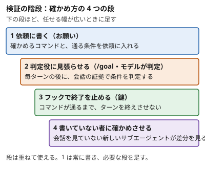

!!! abstract "要点"
    - **何が分かるか**：完了の確かめには 4 つの段があり、任せる幅に応じて選べる。「確かめて」と書き足すより、確かめる手段を渡すほうが効く。
    - **いつ引くか**：「確かめて」と書いても確かめずに終わるとき、長い作業を途中は見ずに任せるとき、確かめ方の強さを選びたいとき。
    - **前提**：<!-- link:begin evidence-not-reports -->[報告ではなく証拠を求める](evidence-not-reports.md)<!-- link:end -->・<!-- link:begin request-vs-lock -->[お願いと鍵（決定論的か、非決定論的か）](../basics/request-vs-lock.md)<!-- link:end -->

<!-- textlint-disable -->
別名：確かめ方の段階・検証の強さ・Give Claude a check to run・「念のため確認して」は効くか・double-check して
<!-- textlint-enable -->

検証の階段は、Claude に完了を確かめさせる強さを 4 つの段で整理し、任せる幅に合わせて選ぶ考え方である。公式の Best practices は、Claude は作業が終わったように見えると止まると書く。終わったかを判定するものを実行できなければ、判断材料は「終わったように見える」ことだけになる。

## 四つの段 {#four-steps}

検証の階段は、確かめる主体が依頼を読む Claude 自身から、別モデルの判定役、コマンドを走らせるフック、書いていない者へと移る 4 つの段である。現行の Best practices（2026-11-03 に確かめた版）が、確かめ方をこの 4 段階で示している。



1. **依頼に書く**：確かめるコマンドと、通る条件を依頼に入れる。Claude が読んで従うお願いであり、鍵ではない。書き方は <!-- link:begin protect-tests#in-the-request -->[テストを守る（改ざんを防ぐ） › 依頼に書くこと](protect-tests.md#in-the-request)<!-- link:end --> も参照する。
2. **判定役に見張らせる**：`/goal` で完了の条件を決めると、各ターンの後にモデルが条件を満たしたかを判定し、満たすまで次のターンを続ける。判定役は会話に出た証拠しか読まないので、証拠を会話に出させる条件を書く。判定はモデルなので、鍵ではない。条件の書き方は <!-- link:begin goal-until-done#writing-conditions -->[/goal（完了するまで続けさせる） › 条件の書き方（終わりの状態・証明・変えないもの・上限）](../delegate/goal-until-done.md#writing-conditions)<!-- link:end --> にある。
3. **フックで終了を止める**：Stop フックで確かめるコマンドを走らせ、通るまでターンを終えさせない。コマンドで決まる判定は、毎回必ず効く鍵になる。続けて止められる回数には上限があり、<!-- fact:begin stop-hook-block-cap -->続けて止められるのは 8 回まで（2026-11-04 時点）<!-- fact:end -->。止め続けるループの避け方は <!-- link:begin stop-hooks#avoid-loops -->[Stop フックで「終わらせない」 › 止め続けるループを避ける](../enforce/stop-hooks.md#avoid-loops)<!-- link:end --> にある。
4. **書いていない者に確かめさせる**：`/code-review` の新しいサブエージェントのように、変更を生んだ会話を見ていない者に差分をレビューさせる。誰に頼み、何を見せないかは <!-- link:begin independent-review#who -->[書いた本人ではない者にレビューさせる › 誰にレビューさせるか](independent-review.md#who)<!-- link:end --> にある。

段 1 は常に書く。段 2 から 4 は、任せる幅や失敗の重さに応じて足す。段を足すほど、用意するものが増える。

## 「念のため確認して」と書き足すより、確かめる手段を渡す {#verbal-checks}

言葉で確認を命じることと、確かめる手段を渡すことは別である。「念のため確認して」「double-check して」と書き足す文は、何で確かめるかを決めない。手段とは、Claude が実行して合否が返るもの（テスト・型の検査・linter・スクリーンショットの比較など）や、結果を照らす基準である。

Before は、手段を決めず、確認を言葉で命じる依頼である。

```text
ログインの処理のバグを直して。最後に念のため確認して、double-check もしてね。
```

After は、同じ依頼に手段と終わりの条件を足したものである。

<!-- gen:begin snippet verification-ladder/give-a-check -->
<!-- textlint-disable -->

??? example "雛形：確かめる手段と終わりの条件を渡す依頼"

    ```markdown
    `src/auth/login.ts` の `login` が、パスワードに `:` を含むと失敗する。直してほしい。

    - 確かめる手段：`npm test -- auth` を実行する。直す前に、この失敗を再現するテストを 1 件足し、失敗することを確かめる。
    - 終わりの条件：`npm test -- auth` と `npx tsc --noEmit` がどちらも通ること。
    - 変えないもの：既存のテストの中身。消したり緩めたりして通さない。
    - 最後の報告：実行したコマンドと、出力の最後の部分を貼る。
    ```

    動作を確かめていない雛形。要る最低の版：Claude Code 2.1.139。

<!-- textlint-enable -->
<!-- gen:end snippet verification-ladder/give-a-check -->

After で足したのは 4 点である。確かめるコマンド、直す前に失敗するテスト、変えないもの（テストの中身）、報告に貼るもの（実行したコマンドと出力）を決めた。これで「確認した」という言葉でなく、通ったという出力が残る。出力を証拠として読む手順は <!-- link:begin evidence-not-reports#what-counts -->[報告ではなく証拠を求める › 証拠の形（コマンド・生の出力・分母）](evidence-not-reports.md#what-counts)<!-- link:end --> にある。

言葉の念押しの価値は、モデルによって変わった。自分の作業を言われなくても確かめるモデルに、「見直して」「double-check して」を重ねると、確かめすぎでトークンと時間が増える。モデル向けの公式の手引きは、そうしたモデルでは文言での確認の指示を外すよう勧める。ほかのモデルでは、終わる前に基準と照らして確かめるよう頼むのは今も効く。どのモデルがどちらに当たるかは台帳 <!-- link:begin outdated-advice-ledger#add-double-check -->[古くなった助言の台帳](../changes/outdated-advice-ledger.md#add-double-check)<!-- link:end --> にある。確かめる手段を整える価値は、どのモデルでも残る。モデルごとの傾向の見方は <!-- link:begin model-quirks#official-guidance -->[モデル別の癖と、プロンプトの合わせ方 › 公式の指針に出てくる傾向](../models/model-quirks.md#official-guidance)<!-- link:end --> にある。

## 任せる幅に合わせて段を選ぶ {#choose-step}

任せる幅を広げるほど、確かめる仕組みを強める。これが 4 つの原理の比例則で、段の選び方もこれに従う（<!-- link:begin four-principles#proportional-rule -->[四つの原理と比例則（見せる・確かめる・縛る・握る） › 比例則](../start/four-principles.md#proportional-rule)<!-- link:end -->）。

| 任せ方 | 足す段 | 弱いところ |
| --- | --- | --- |
| 席にいて、短い作業を見ながら進める | 段 1 | 確かめを Claude に任せるので、守られなくても止まらない |
| 長い作業を任せ、条件が会話の証拠で決まる | 段 1 と 2 | 判定役はモデルで、会話に出ない証拠は読めない |
| 長い作業を任せ、コマンドの結果で決まる | 段 1 と 3 | 判断を含む良し悪しは、コマンドで決められない |
| 差分を人に出す前、または無人で走らせた後 | 段 1 から 4 | 手間が増える。AI の承認は人の承認に数えない |

段 2 と段 3 の使い分けは、条件の決まり方で見る。終了コードで決まる条件（テストと型の検査）は段 3 に向く。会話に出た証拠から読む条件は段 2 に向く。2 つの比べ方は <!-- link:begin stop-hooks#vs-goal -->[Stop フックで「終わらせない」 › /goal との使い分け](../enforce/stop-hooks.md#vs-goal)<!-- link:end --> にある。

!!! example "判断例：夜間に任せる移行作業"
    - **状況**：テストのある API を新しい版へ移す作業を、数時間かかる前提で任せる。途中は見ない。
    - **迷う候補**：`/goal` の条件に「テストが全部通る」と書く案と、Stop フックでテストを走らせる案。
    - **選んだもの**：依頼に手段と変えないものを書き、Stop フックでテストを走らせる。差分は翌朝に新しいサブエージェントでレビューさせる。
    - **理由**：条件がテストの終了コードで決まるので、モデルの判定に任せず、毎回必ず効くフックに置ける。レビューは書いた会話を見ていない者にさせ、最後の判断は人が持つ。

席を外す時間が長くなるほど、確かめる側を強める。無人で走らせる前に答える問いは <!-- link:begin five-questions-before-delegating#five-questions -->[任せ方の段階と、無人で走らせる前の五つの問い › 無人で走らせる前の五つの問い](../delegate/five-questions-before-delegating.md#five-questions)<!-- link:end -->、走らせた後の見方は <!-- link:begin checking-unattended-runs#beyond-exit-codes -->[無人実行の結果を確かめる › 終了コードと要約だけで決めない](checking-unattended-runs.md#beyond-exit-codes)<!-- link:end --> にある。

## 何に効くか、どこまで効くか {#what-it-prevents}

検証の階段は、原理の「確かめる」と「縛る」に関わり、原因の「確かめていない」と「縛っていない」を防ぐ。

- **確かめていない**：Claude が終わったように見えた時点で止まり、本当に終わったかを確かめるものがない状態である。依頼に手段を書く段 1 と、判定役に条件を見張らせる段 2 は、確かめる手段と条件を渡して防ぐ。書いていない者に確かめさせる段 4 は、書いた本人が見落とす誤りに、別の目を足す。
- **縛っていない**：確かめるよう頼んだだけで、終了を止める仕組みがない状態である。頼みはお願いで、守られるかは Claude の判断に残る。Stop フックで終了を止める段 3 は、条件と範囲の中で毎回必ず効く鍵に移す手段である（<!-- link:begin request-vs-lock#why -->[お願いと鍵（決定論的か、非決定論的か） › なぜそうなるか](../basics/request-vs-lock.md#why)<!-- link:end -->）。

効かない場面もある。

- 確かめる手段そのものが甘い、または誤っているときは、誤りも同じ速さで増える。<!-- link:begin verifier-defines-problem#loops-amplify -->[検証器が問題を定義する（Claude は置かれたループを何でも加速する） › ループは何でも速める](../eval/verifier-defines-problem.md#loops-amplify)<!-- link:end --> を読む。
- Claude がテストを書き換えて通すときは、判定役の段 2 もフックの段 3 も通ってしまう。守りの層は <!-- link:begin protect-tests#layers -->[テストを守る（改ざんを防ぐ） › 守りの層](protect-tests.md#layers)<!-- link:end --> にある。
- 完了の報告が事実と違う症状から入るなら、<!-- link:begin claims-done-but-isnt -->[「完了」と言うが終わっていない](../symptoms/claims-done-but-isnt.md)<!-- link:end --> で原因を切り分ける。
- 画面を持つ成果物は、コマンドの合否だけでは足りない。<!-- link:begin visual-checks#as-a-user -->[画面で確かめる（ブラウザ・スクリーンショット・/verify） › 人のユーザーとして確かめさせる](visual-checks.md#as-a-user)<!-- link:end --> で、人が使うのと同じ形で確かめさせる。

## 誤解しやすいこと {#misconceptions}

- **上の段ほど常に良い**：段を足すほど、用意するものと実行の手間が増える。小さな作業に Stop フックは過剰になりうる。任せる幅と失敗の重さに合わせる。
- **`/goal` はフックと同じ鍵だ**：`/goal` の強制力は「<!-- gen:begin feature goal/enforcement -->モデルの判定<!-- gen:end feature goal/enforcement -->」で、鍵ではない。判定はモデルが行うので、フックのコマンドと違い、止まることは保証されない。
- **段 4 の AI のレビューが通れば人の承認は要らない**：AI の承認は、人の承認に数えない（<!-- link:begin independent-review#ai-approval -->[書いた本人ではない者にレビューさせる › AI の承認を人の承認に数えない](independent-review.md#ai-approval)<!-- link:end -->）。
- **言葉の念押しは、どのモデルでも無駄だ**：言葉での念押しが過剰になるのは、自分で確かめるモデルである。ほかのモデルでは今も効く。ただし、手段を渡す依頼のほうが、確かめた結果が出力に残る。
- **鍵に移せば、鍵が決める範囲は全部守れる**：鍵が効くのは、条件と範囲の中だけである。判断を含む規則は、鍵にしない（<!-- link:begin when-to-lock#what-not-to-lock -->[お願いを鍵に移す判断 › 鍵にしない規則（判断を含むもの）](../enforce/when-to-lock.md#what-not-to-lock)<!-- link:end -->）。

<!-- gen:begin page-links -->
<!-- textlint-disable -->

<div class="ca-page-links" markdown>

**前提**

- [報告ではなく証拠を求める](evidence-not-reports.md)
- [お願いと鍵（決定論的か、非決定論的か）](../basics/request-vs-lock.md)

**次に読む**

- [無人実行の結果を確かめる](checking-unattended-runs.md)
- [テストを守る（改ざんを防ぐ）](protect-tests.md)
- [書いた本人ではない者にレビューさせる](independent-review.md)
- [検証器が問題を定義する（Claude は置かれたループを何でも加速する）](../eval/verifier-defines-problem.md)
- [Stop フックで「終わらせない」](../enforce/stop-hooks.md)
- [任せ方の段階と、無人で走らせる前の五つの問い](../delegate/five-questions-before-delegating.md)

**関連**

- [/goal（完了するまで続けさせる）](../delegate/goal-until-done.md)
- [モデル別の癖と、プロンプトの合わせ方](../models/model-quirks.md)
- [お願いを鍵に移す判断](../enforce/when-to-lock.md)
- [「完了」と言うが終わっていない](../symptoms/claims-done-but-isnt.md)
- [画面で確かめる（ブラウザ・スクリーンショット・/verify）](visual-checks.md)
- [四つの原理と比例則（見せる・確かめる・縛る・握る）](../start/four-principles.md)

</div>

<!-- textlint-enable -->
<!-- gen:end page-links -->

<!-- gen:begin references -->
<!-- textlint-disable -->

## 参考 {#references}

- [Best practices for Claude Code](https://code.claude.com/docs/en/best-practices)：Anthropic・英語・確認日 2026-11-04
- [Keep Claude working toward a goal](https://code.claude.com/docs/en/goal)：Anthropic・英語・確認日 2026-11-04
- [Hooks reference](https://code.claude.com/docs/en/hooks)：Anthropic・英語・確認日 2026-11-04
- [Review locally with /code-review](https://code.claude.com/docs/en/code-review-local)：Anthropic・英語・確認日 2026-11-04
- [Prompting Claude Opus 5](https://platform.claude.com/docs/en/build-with-claude/prompt-engineering/prompting-claude-opus-5)：Anthropic・英語・確認日 2026-11-04

<!-- textlint-enable -->
<!-- gen:end references -->
